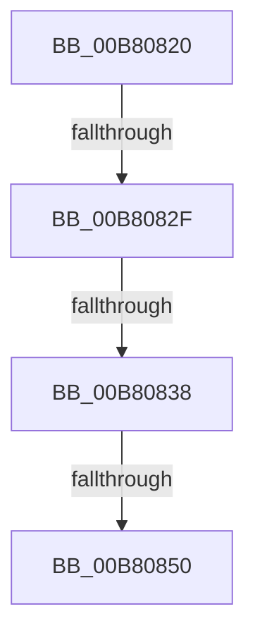

# sub_00B80820

- RVA: `0x00B80820`–`0x00B80867` (길이 `71` bytes)
- VA: `0x0000000140B80820`
- 실행 섹션: `PAGELK`
- PDB 이름 있음: `아니요`; PDB Function 태그: `아니요`
- unwind 정보 RVA: `0x000B6920`
- 디코드: `14`개 명령, `71/71` bytes 표시
- 미해석 바이트: `0` (있으면 어셈블리에 `.byte`로 보존)

> 이 문서는 커널 이미지의 기계어와 PDB 기호를 분석해 생성했습니다. 4번과 5번은 함수 원형과 자료형을 바이너리 사용 방식에서 추정한 C 해석이며 원본 소스 복구 결과는 아닙니다.

## 1. Dependencies

- 직접 호출 지점: **2**; 고유 호출 대상: **2**
- 직접 호출자로 확인된 함수: **0**
- RIP 상대 이미지 참조: **1**

### Outgoing calls
- `0x00B80842` → [MiGetPteAddress](../../text/43/MiGetPteAddress_function_0043E130.md) (function, `0x0043E130`)
- `0x00B8085C` → [MiCheckLinearProtectedPteAccessedBit](../../text/29/MiCheckLinearProtectedPteAccessedBit_function_00292D80.md) (function, `0x00292D80`)

### Direct callers
- 이 함수 시작 RVA로 연결되는 직접 call은 확인되지 않았습니다. 간접 호출은 완전히 역산할 수 없습니다.

### Static image references
- `0x00B80820` → RVA `0x00FC6A88` (`ALMOSTRO`; read)

## 2. Other-region calls and transfers

- 다른 실행 섹션으로 향하는 call: **2**
  - `0x00B80842` → [MiGetPteAddress](../../text/43/MiGetPteAddress_function_0043E130.md) (`PAGELK` → `.text`)
  - `0x00B8085C` → [MiCheckLinearProtectedPteAccessedBit](../../text/29/MiCheckLinearProtectedPteAccessedBit_function_00292D80.md) (`PAGELK` → `.text`)
- call이 아닌 외부 분기/꼬리 이동: **4**
  - `0x00B80829` → [MiUpdateUserMappings + 0x6E](../B7/MiUpdateUserMappings_function_00B7966C.md) (`tail-transfer`)
  - `0x00B80832` → [MiUpdateUserMappings + 0x6E](../B7/MiUpdateUserMappings_function_00B7966C.md) (`tail-transfer`)
  - `0x00B8084A` → [MiUpdateUserMappings + 0x6E](../B7/MiUpdateUserMappings_function_00B7966C.md) (`tail-transfer`)
  - `0x00B80862` → [MiUpdateUserMappings + 0x6E](../B7/MiUpdateUserMappings_function_00B7966C.md) (`tail-transfer`)

## 3. Assembly (complete function range)

```asm
00B80820  48 0F BA 25 5F 62 44 00 24      bt qword ptr [rip + 0x44625f], 0x24
00B80829  0F 83 AB 8E FF FF               jae 0x140b796da
00B8082F  F6 C3 20                        test bl, 0x20
00B80832  0F 85 A2 8E FF FF               jne 0x140b796da
00B80838  48 B9 00 00 00 00 00 80 FF FF   movabs rcx, 0xffff800000000000
00B80842  E8 E9 D8 8B FF                  call 0x14043e130
00B80847  48 3B F8                        cmp rdi, rax
00B8084A  0F 82 8A 8E FF FF               jb 0x140b796da
00B80850  41 B8 80 00 00 00               mov r8d, 0x80
00B80856  48 8B D3                        mov rdx, rbx
00B80859  48 8B CF                        mov rcx, rdi
00B8085C  E8 1F 25 71 FF                  call 0x140292d80
00B80861  90                              nop
00B80862  E9 73 8E FF FF                  jmp 0x140b796da
```

## 4. C-style interpretation (structured pseudocode)

```c
__int64 __fastcall sub_00B80820(void)
{
    __int64 result;

    result = MiGetPteAddress(a1, a2, a3, a4);
    result = MiCheckLinearProtectedPteAccessedBit(v_rdi, v_rbx, 128, a4);
}
```

## 5. (Beta) C Style

```c
void sub_00B80820(void)
{
    int64_t result;

    result = MiGetPteAddress(a1, a2, a3, a4);
    result = MiCheckLinearProtectedPteAccessedBit(local_rdi, local_rbx, 128, a4);
}
```

## 6. Execution-region graph

[열기: 2D/3D 그래프와 함수 탐색 컨트롤 패널](../../../control-panel.html?section=pagelk&rva=0x00B80820&view=graph)

- 2D 그래프는 위에서 아래로 흐르고, 3D 그래프는 빈 공간을 드래그해 회전합니다. Shift+드래그는 이동, 휠은 확대·축소, 함수 노드 선택은 대상 보고서 이동입니다.

### Static fallback


