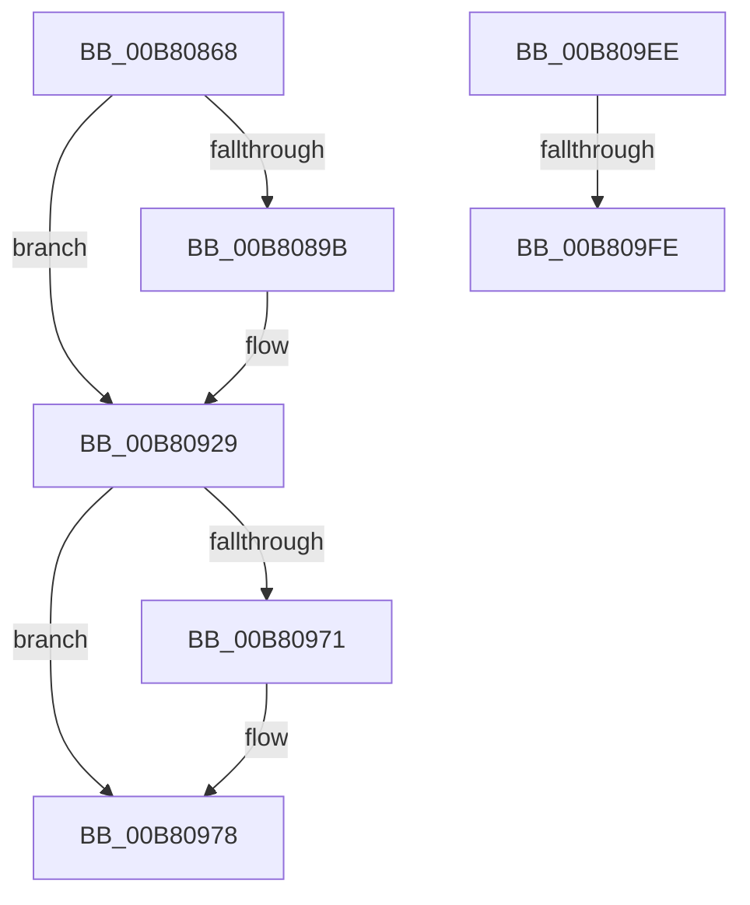

# sub_00B80868

- RVA: `0x00B80868`–`0x00B80A41` (길이 `473` bytes)
- VA: `0x0000000140B80868`
- 실행 섹션: `PAGELK`
- PDB 이름 있음: `아니요`; PDB Function 태그: `아니요`
- unwind 정보 RVA: `0x000B8CCC`
- 디코드: `105`개 명령, `473/473` bytes 표시
- 미해석 바이트: `0` (있으면 어셈블리에 `.byte`로 보존)

> 이 문서는 커널 이미지의 기계어와 PDB 기호를 분석해 생성했습니다. 4번과 5번은 함수 원형과 자료형을 바이너리 사용 방식에서 추정한 C 해석이며 원본 소스 복구 결과는 아닙니다.

## 1. Dependencies

- 직접 호출 지점: **6**; 고유 호출 대상: **5**
- 직접 호출자로 확인된 함수: **0**
- RIP 상대 이미지 참조: **5**

### Outgoing calls
- `0x00B80868` → [KeDisableInterrupts](../../text/21/KeDisableInterrupts_function_00217BE0.md) (function, `0x00217BE0`)
- `0x00B8088A` → [KeQueryPerformanceCounter](../../text/37/KeQueryPerformanceCounter_function_0037E7E0.md) (function, `0x0037E7E0`)
- `0x00B80980` → [RtlWriteAcquireTickLock](../../text/39/RtlWriteAcquireTickLock_function_0039D3B4.md) (function, `0x0039D3B4`)
- `0x00B809E0` → [RtlWriteReleaseTickLock](../../text/45/RtlWriteReleaseTickLock_function_0045C50C.md) (function, `0x0045C50C`)
- `0x00B80A00` → [KeQueryPerformanceCounter](../../text/37/KeQueryPerformanceCounter_function_0037E7E0.md) (function, `0x0037E7E0`)
- `0x00B80A36` → [EtwTraceKernelEvent](../../text/23/EtwTraceKernelEvent_function_00235350.md) (function, `0x00235350`)

### Direct callers
- 이 함수 시작 RVA로 연결되는 직접 call은 확인되지 않았습니다. 간접 호출은 완전히 역산할 수 없습니다.

### Static image references
- `0x00B80929` → RVA `0x00FC6AA0` (`ALMOSTRO`; read)
- `0x00B80932` → RVA `0x00FC5008` (`ALMOSTRO`; read)
- `0x00B80951` → RVA `0x00E66898` (`.data`; write)
- `0x00B809D9` → RVA `0x00E668A0` (`.data`; write)
- `0x00B809EE` → RVA `0x00FC6B10` (`ALMOSTRO`; read)

## 2. Other-region calls and transfers

- 다른 실행 섹션으로 향하는 call: **6**
  - `0x00B80868` → [KeDisableInterrupts](../../text/21/KeDisableInterrupts_function_00217BE0.md) (`PAGELK` → `.text`)
  - `0x00B8088A` → [KeQueryPerformanceCounter](../../text/37/KeQueryPerformanceCounter_function_0037E7E0.md) (`PAGELK` → `.text`)
  - `0x00B80980` → [RtlWriteAcquireTickLock](../../text/39/RtlWriteAcquireTickLock_function_0039D3B4.md) (`PAGELK` → `.text`)
  - `0x00B809E0` → [RtlWriteReleaseTickLock](../../text/45/RtlWriteReleaseTickLock_function_0045C50C.md) (`PAGELK` → `.text`)
  - `0x00B80A00` → [KeQueryPerformanceCounter](../../text/37/KeQueryPerformanceCounter_function_0037E7E0.md) (`PAGELK` → `.text`)
  - `0x00B80A36` → [EtwTraceKernelEvent](../../text/23/EtwTraceKernelEvent_function_00235350.md) (`PAGELK` → `.text`)
- call이 아닌 외부 분기/꼬리 이동: **3**
  - `0x00B809E9` → [KiCalibrateTimeAdjustment + 0x70](../B7/KiCalibrateTimeAdjustment_function_00B797E0.md) (`tail-transfer`)
  - `0x00B809F8` → [KiCalibrateTimeAdjustment + 0xB6](../B7/KiCalibrateTimeAdjustment_function_00B797E0.md) (`tail-transfer`)
  - `0x00B80A3C` → [KiCalibrateTimeAdjustment + 0xB6](../B7/KiCalibrateTimeAdjustment_function_00B797E0.md) (`tail-transfer`)

## 3. Assembly (complete function range)

```asm
00B80868  E8 73 73 69 FF                  call 0x140217be0
00B8086D  48 8B 7E 08                     mov rdi, qword ptr [rsi + 8]
00B80871  48 8D 4D C8                     lea rcx, [rbp - 0x38]
00B80875  44 8A F8                        mov r15b, al
00B80878  48 89 7D D8                     mov qword ptr [rbp - 0x28], rdi
00B8087C  48 A1 08 00 00 00 80 F7 FF FF   movabs rax, qword ptr [0xfffff78000000008]
00B80886  48 8D 1C 07                     lea rbx, [rdi + rax]
00B8088A  E8 51 DF 7F FF                  call 0x14037e7e0
00B8088F  4C 8B C8                        mov r9, rax
00B80892  44 38 2E                        cmp byte ptr [rsi], r13b
00B80895  0F 84 8E 00 00 00               je 0x140b80929
00B8089B  8B 55 C8                        mov edx, dword ptr [rbp - 0x38]
00B8089E  44 8B 45 DC                     mov r8d, dword ptr [rbp - 0x24]
00B808A2  44 8B D2                        mov r10d, edx
00B808A5  8B 4D CC                        mov ecx, dword ptr [rbp - 0x34]
00B808A8  8B C7                           mov eax, edi
00B808AA  48 BF BD 42 7A E5 D5 94 BF D6   movabs rdi, 0xd6bf94d5e57a42bd
00B808B4  4C 0F AF D0                     imul r10, rax
00B808B8  48 0F AF C8                     imul rcx, rax
00B808BC  4C 89 55 C0                     mov qword ptr [rbp - 0x40], r10
00B808C0  41 8B C0                        mov eax, r8d
00B808C3  44 0F AF 45 CC                  imul r8d, dword ptr [rbp - 0x34]
00B808C8  45 8B DA                        mov r11d, r10d
00B808CB  48 0F AF C2                     imul rax, rdx
00B808CF  49 C1 EA 20                     shr r10, 0x20
00B808D3  49 03 C2                        add rax, r10
00B808D6  48 03 C1                        add rax, rcx
00B808D9  48 89 45 C0                     mov qword ptr [rbp - 0x40], rax
00B808DD  48 C1 E8 20                     shr rax, 0x20
00B808E1  41 03 C0                        add eax, r8d
00B808E4  89 45 C4                        mov dword ptr [rbp - 0x3c], eax
00B808E7  48 8B C7                        mov rax, rdi
00B808EA  48 8B 4D C0                     mov rcx, qword ptr [rbp - 0x40]
00B808EE  48 F7 E1                        mul rcx
00B808F1  48 8B C7                        mov rax, rdi
00B808F4  44 89 5D C0                     mov dword ptr [rbp - 0x40], r11d
00B808F8  4C 8B D2                        mov r10, rdx
00B808FB  48 F7 E1                        mul rcx
00B808FE  49 C1 EA 17                     shr r10, 0x17
00B80902  48 8B C7                        mov rax, rdi
00B80905  48 C1 EA 17                     shr rdx, 0x17
00B80909  4C 69 C2 80 96 98 00            imul r8, rdx, 0x989680
00B80910  44 89 56 14                     mov dword ptr [rsi + 0x14], r10d
00B80914  49 2B C8                        sub rcx, r8
00B80917  89 4D C4                        mov dword ptr [rbp - 0x3c], ecx
00B8091A  48 F7 65 C0                     mul qword ptr [rbp - 0x40]
00B8091E  48 C1 EA 17                     shr rdx, 0x17
00B80922  89 56 10                        mov dword ptr [rsi + 0x10], edx
00B80925  4C 01 4E 10                     add qword ptr [rsi + 0x10], r9
00B80929  44 8B 15 70 61 44 00            mov r10d, dword ptr [rip + 0x446170]
00B80930  33 D2                           xor edx, edx
00B80932  48 8B 0D CF 46 44 00            mov rcx, qword ptr [rip + 0x4446cf]
00B80939  48 8B C3                        mov rax, rbx
00B8093C  49 F7 F2                        div r10
00B8093F  33 D2                           xor edx, edx
00B80941  4C 8B C0                        mov r8, rax
00B80944  48 8B C3                        mov rax, rbx
00B80947  49 F7 F2                        div r10
00B8094A  48 8B 46 08                     mov rax, qword ptr [rsi + 8]
00B8094E  44 2B D2                        sub r10d, edx
00B80951  44 89 15 40 5F 2E 00            mov dword ptr [rip + 0x2e5f40], r10d
00B80958  48 01 81 B0 03 00 00            add qword ptr [rcx + 0x3b0], rax
00B8095F  48 B8 B0 03 00 00 80 F7 FF FF   movabs rax, 0xfffff780000003b0
00B80969  48 8B 00                        mov rax, qword ptr [rax]
00B8096C  48 85 C0                        test rax, rax
00B8096F  79 07                           jns 0x140b80978
00B80971  B9 05 00 00 00                  mov ecx, 5
00B80976  CD 29                           int 0x29
00B80978  49 8D 8C 24 40 03 00 00         lea rcx, [r12 + 0x340]
00B80980  E8 2F CA 81 FF                  call 0x14039d3b4
00B80985  48 8B 0D 7C 46 44 00            mov rcx, qword ptr [rip + 0x44467c]
00B8098C  48 8B C3                        mov rax, rbx
00B8098F  48 C1 E8 20                     shr rax, 0x20
00B80993  89 41 10                        mov dword ptr [rcx + 0x10], eax
00B80996  49 8D 8C 24 40 03 00 00         lea rcx, [r12 + 0x340]
00B8099E  48 8B 05 63 46 44 00            mov rax, qword ptr [rip + 0x444663]
00B809A5  48 89 58 08                     mov qword ptr [rax + 8], rbx
00B809A9  49 8B C0                        mov rax, r8
00B809AC  48 8B 15 55 46 44 00            mov rdx, qword ptr [rip + 0x444655]
00B809B3  48 C1 E8 20                     shr rax, 0x20
00B809B7  89 82 28 03 00 00               mov dword ptr [rdx + 0x328], eax
00B809BD  48 8B 05 44 46 44 00            mov rax, qword ptr [rip + 0x444644]
00B809C4  4C 89 80 20 03 00 00            mov qword ptr [rax + 0x320], r8
00B809CB  48 8B 05 36 46 44 00            mov rax, qword ptr [rip + 0x444636]
00B809D2  4C 89 88 50 03 00 00            mov qword ptr [rax + 0x350], r9
00B809D9  4C 89 2D C0 5E 2E 00            mov qword ptr [rip + 0x2e5ec0], r13
00B809E0  E8 27 BB 8D FF                  call 0x14045c50c
00B809E5  44 89 6E 1C                     mov dword ptr [rsi + 0x1c], r13d
00B809E9  E9 62 8E FF FF                  jmp 0x140b79850
00B809EE  F7 05 18 61 44 00 00 80 00 00   test dword ptr [rip + 0x446118], 0x8000
00B809F8  0F 84 98 8E FF FF               je 0x140b79896
00B809FE  33 C9                           xor ecx, ecx
00B80A00  E8 DB DD 7F FF                  call 0x14037e7e0
00B80A05  48 89 45 D0                     mov qword ptr [rbp - 0x30], rax
00B80A09  48 8D 4D E0                     lea rcx, [rbp - 0x20]
00B80A0D  48 8D 45 D0                     lea rax, [rbp - 0x30]
00B80A11  48 C7 45 E8 08 00 00 00         mov qword ptr [rbp - 0x18], 8
00B80A19  41 B9 32 12 00 00               mov r9d, 0x1232
00B80A1F  48 89 45 E0                     mov qword ptr [rbp - 0x20], rax
00B80A23  BA 01 00 00 00                  mov edx, 1
00B80A28  C7 44 24 20 02 18 50 00         mov dword ptr [rsp + 0x20], 0x501802
00B80A30  41 B8 00 80 00 80               mov r8d, 0x80008000
00B80A36  E8 15 49 6B FF                  call 0x140235350
00B80A3B  90                              nop
00B80A3C  E9 55 8E FF FF                  jmp 0x140b79896
```

## 4. C-style interpretation (structured pseudocode)

```c
__int64 __fastcall sub_00B80868(void)
{
    __int64 result;
    __int64 v_r10;
    __int64 v_r11;
    unsigned int v_stack_p20;

    result = KeDisableInterrupts(a1, a2, a3, a4);
    *(unsigned __int64 *)(v_rbp - 40) = *(unsigned __int64 *)(v_rsi + 8);
    result = KeQueryPerformanceCounter(v_rbp - 56, a2, a3, a4);
    if ((*(unsigned __int8 *)(v_rsi)) != ((unsigned __int8)(v_r13))) {
        a2 = *(unsigned int *)(v_rbp - 56);
        a3 = *(unsigned int *)(v_rbp - 36);
        v_r10 = (unsigned int)(a2);
        a1 = *(unsigned int *)(v_rbp - 52);
        result = (unsigned int)(*(unsigned __int64 *)(v_rsi + 8));
        v_r10 = (v_r10) * (result);
        a1 = (a1) * (result);
        *(unsigned __int64 *)(v_rbp - 64) = v_r10;
        result = (unsigned int)(a3);
        a3 = (unsigned int)((a3) * (*(unsigned int *)(v_rbp - 52)));
        v_r11 = (unsigned int)(v_r10);
        result = (result) * (a2);
        v_r10 = (v_r10) >> (32);
        result = (result) + (v_r10);
        result = (result) + (a1);
        *(unsigned __int64 *)(v_rbp - 64) = result;
        result = (result) >> (32);
        result = (unsigned int)((result) + ((unsigned int)(a3)));
        *(unsigned int *)(v_rbp - 60) = (unsigned int)(result);
        result = *(unsigned __int64 *)(v_rsi + 8);
        a1 = *(unsigned __int64 *)(v_rbp - 64);
        result = *(unsigned __int64 *)(v_rsi + 8);
        *(unsigned int *)(v_rbp - 64) = (unsigned int)(v_r11);
        v_r10 = a2;
        v_r10 = (v_r10) >> (23);
        result = *(unsigned __int64 *)(v_rsi + 8);
        a2 = (a2) >> (23);
        a3 = (a3) * (a2);
        *(unsigned int *)(v_rsi + 20) = (unsigned int)(v_r10);
        a1 = (a1) - (a3);
        *(unsigned int *)(v_rbp - 60) = (unsigned int)(a1);
        a2 = (a2) >> (23);
        *(unsigned int *)(v_rsi + 16) = (unsigned int)(a2);
    }
    a2 = 0;
    a2 = 0;
    v_r10 = (unsigned int)(((unsigned int)(*(unsigned int *)(v_rip + 4481392))) - (0));
    *(unsigned int *)(v_rip + 3039040) = (unsigned int)(v_r10);
    if (sign_flag) {
        a1 = 5;
    }
    result = RtlWriteAcquireTickLock(v_r12 + 832, a2, *(unsigned __int64 *)(v_rsi + 8) + result * 1, result);
    result = (*(unsigned __int64 *)(v_rsi + 8) + result * 1) >> (32);
    *(unsigned int *)(*(unsigned __int64 *)(v_rip + 4474492) + 16) = (unsigned int)(result);
    *(unsigned __int64 *)(*(unsigned __int64 *)(v_rip + 4474467) + 8) = *(unsigned __int64 *)(v_rsi + 8) + result * 1;
    result = (*(unsigned __int64 *)(v_rsi + 8) + result * 1) >> (32);
    *(unsigned int *)(*(unsigned __int64 *)(v_rip + 4474453) + 808) = (unsigned int)(result);
    *(unsigned __int64 *)(*(unsigned __int64 *)(v_rip + 4474436) + 800) = *(unsigned __int64 *)(v_rsi + 8) + result * 1;
    *(unsigned __int64 *)(*(unsigned __int64 *)(v_rip + 4474422) + 848) = result;
    *(unsigned __int64 *)(v_rip + 3038912) = v_r13;
    result = RtlWriteReleaseTickLock(v_r12 + 832, *(unsigned __int64 *)(v_rip + 4474453), *(unsigned __int64 *)(v_rsi + 8) + result * 1, result);
    *(unsigned int *)(v_rsi + 28) = (unsigned int)(v_r13);
}
```

## 5. (Beta) C Style

```c
void sub_00B80868(void)
{
    int64_t result;
    int64_t local_r10;
    int64_t local_r11;
    uint32_t v_stack_p20;

    result = KeDisableInterrupts(a1, a2, a3, a4);
    *(uint64_t *)(local_rbp - 0x28) = *(uint64_t *)(local_rsi + 0x8);
    result = KeQueryPerformanceCounter(local_rbp - 56, a2, a3, a4);
    if ((*(uint8_t *)(local_rsi)) != ((uint8_t)(local_r13))) {
        a2 = *(uint32_t *)(local_rbp - 0x38);
        a3 = *(uint32_t *)(local_rbp - 0x24);
        local_r10 = (uint32_t)(a2);
        a1 = *(uint32_t *)(local_rbp - 0x34);
        result = (uint32_t)(*(uint64_t *)(local_rsi + 0x8));
        local_r10 = (local_r10) * (result);
        a1 = (a1) * (result);
        *(uint64_t *)(local_rbp - 0x40) = local_r10;
        result = (uint32_t)(a3);
        a3 = (uint32_t)((a3) * (*(uint32_t *)(local_rbp - 0x34)));
        local_r11 = (uint32_t)(local_r10);
        result = (result) * (a2);
        local_r10 = (local_r10) >> (32);
        result = (result) + (local_r10);
        result = (result) + (a1);
        *(uint64_t *)(local_rbp - 0x40) = result;
        result = (result) >> (32);
        result = (uint32_t)((result) + ((uint32_t)(a3)));
        *(uint32_t *)(local_rbp - 0x3C) = (uint32_t)(result);
        result = *(uint64_t *)(local_rsi + 0x8);
        a1 = *(uint64_t *)(local_rbp - 0x40);
        result = *(uint64_t *)(local_rsi + 0x8);
        *(uint32_t *)(local_rbp - 0x40) = (uint32_t)(local_r11);
        local_r10 = a2;
        local_r10 = (local_r10) >> (23);
        result = *(uint64_t *)(local_rsi + 0x8);
        a2 = (a2) >> (23);
        a3 = (a3) * (a2);
        *(uint32_t *)(local_rsi + 0x14) = (uint32_t)(local_r10);
        a1 = (a1) - (a3);
        *(uint32_t *)(local_rbp - 0x3C) = (uint32_t)(a1);
        a2 = (a2) >> (23);
        *(uint32_t *)(local_rsi + 0x10) = (uint32_t)(a2);
    }
    a2 = 0;
    a2 = 0;
    local_r10 = (uint32_t)(((uint32_t)(*(uint32_t *)(v_rip + 0x446170))) - (0));
    *(uint32_t *)(v_rip + 0x2E5F40) = (uint32_t)(local_r10);
    if (sign_flag) {
        a1 = 5;
    }
    result = RtlWriteAcquireTickLock(local_r12 + 832, a2, *(uint64_t *)(local_rsi + 0x8) + result * 1, result);
    result = (*(uint64_t *)(local_rsi + 0x8) + result * 1) >> (32);
    *(uint32_t *)(*(uint64_t *)(v_rip + 0x44467C) + 0x10) = (uint32_t)(result);
    *(uint64_t *)(*(uint64_t *)(v_rip + 0x444663) + 0x8) = *(uint64_t *)(local_rsi + 0x8) + result * 1;
    result = (*(uint64_t *)(local_rsi + 0x8) + result * 1) >> (32);
    *(uint32_t *)(*(uint64_t *)(v_rip + 0x444655) + 0x328) = (uint32_t)(result);
    *(uint64_t *)(*(uint64_t *)(v_rip + 0x444644) + 0x320) = *(uint64_t *)(local_rsi + 0x8) + result * 1;
    *(uint64_t *)(*(uint64_t *)(v_rip + 0x444636) + 0x350) = result;
    *(uint64_t *)(v_rip + 0x2E5EC0) = local_r13;
    result = RtlWriteReleaseTickLock(local_r12 + 832, *(uint64_t *)(v_rip + 0x444655), *(uint64_t *)(local_rsi + 0x8) + result * 1, result);
    *(uint32_t *)(local_rsi + 0x1C) = (uint32_t)(local_r13);
}
```

## 6. Execution-region graph

[열기: 2D/3D 그래프와 함수 탐색 컨트롤 패널](../../../control-panel.html?section=pagelk&rva=0x00B80868&view=graph)

- 2D 그래프는 위에서 아래로 흐르고, 3D 그래프는 빈 공간을 드래그해 회전합니다. Shift+드래그는 이동, 휠은 확대·축소, 함수 노드 선택은 대상 보고서 이동입니다.

### Static fallback


