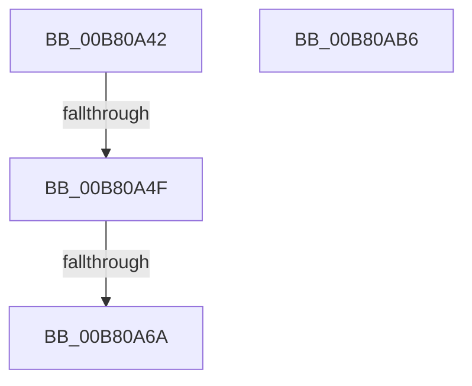

# sub_00B80A42

- RVA: `0x00B80A42`–`0x00B80AC1` (길이 `127` bytes)
- VA: `0x0000000140B80A42`
- 실행 섹션: `PAGELK`
- PDB 이름 있음: `아니요`; PDB Function 태그: `아니요`
- unwind 정보 RVA: `0x000B8D24`
- 디코드: `28`개 명령, `127/127` bytes 표시
- 미해석 바이트: `0` (있으면 어셈블리에 `.byte`로 보존)

> 이 문서는 커널 이미지의 기계어와 PDB 기호를 분석해 생성했습니다. 4번과 5번은 함수 원형과 자료형을 바이너리 사용 방식에서 추정한 C 해석이며 원본 소스 복구 결과는 아닙니다.

## 1. Dependencies

- 직접 호출 지점: **3**; 고유 호출 대상: **3**
- 직접 호출자로 확인된 함수: **0**
- RIP 상대 이미지 참조: **3**

### Outgoing calls
- `0x00B80A5D` → [EtwEventEnabled](../../text/39/EtwEventEnabled_function_00392450.md) (function, `0x00392450`)
- `0x00B80AAB` → [EtwWrite](../../text/41/EtwWrite_function_0041C720.md) (function, `0x0041C720`)
- `0x00B80AB6` → [HalpRestoreDmaControllerState](../B5/HalpRestoreDmaControllerState_function_00B5C0D0.md) (function, `0x00B5C0D0`)

### Direct callers
- 이 함수 시작 RVA로 연결되는 직접 call은 확인되지 않았습니다. 간접 호출은 완전히 역산할 수 없습니다.

### Static image references
- `0x00B80A42` → RVA `0x00FC22C0` (`.data`; read)
- `0x00B80A4F` → RVA `0x00FC22B8` (`.data`; read)
- `0x00B80A56` → RVA `0x00023410` (`.rdata`; read)

## 2. Other-region calls and transfers

- 다른 실행 섹션으로 향하는 call: **2**
  - `0x00B80A5D` → [EtwEventEnabled](../../text/39/EtwEventEnabled_function_00392450.md) (`PAGELK` → `.text`)
  - `0x00B80AAB` → [EtwWrite](../../text/41/EtwWrite_function_0041C720.md) (`PAGELK` → `.text`)
- call이 아닌 외부 분기/꼬리 이동: **4**
  - `0x00B80A49` → [HalpAcpiPostSleep + 0x16D](../B7/HalpAcpiPostSleep_function_00B79990.md) (`tail-transfer`)
  - `0x00B80A64` → [HalpAcpiPostSleep + 0x16D](../B7/HalpAcpiPostSleep_function_00B79990.md) (`tail-transfer`)
  - `0x00B80AB1` → [HalpAcpiPostSleep + 0x16D](../B7/HalpAcpiPostSleep_function_00B79990.md) (`tail-transfer`)
  - `0x00B80ABC` → [HalpAcpiPostSleep + 0x17D](../B7/HalpAcpiPostSleep_function_00B79990.md) (`tail-transfer`)

## 3. Assembly (complete function range)

```asm
00B80A42  40 38 35 77 18 44 00            cmp byte ptr [rip + 0x441877], sil
00B80A49  0F 84 AE 90 FF FF               je 0x140b79afd
00B80A4F  48 8B 0D 62 18 44 00            mov rcx, qword ptr [rip + 0x441862]
00B80A56  48 8D 15 B3 29 4A FF            lea rdx, [rip - 0xb5d64d]
00B80A5D  E8 EE 19 81 FF                  call 0x140392450
00B80A62  84 C0                           test al, al
00B80A64  0F 84 93 90 FF FF               je 0x140b79afd
00B80A6A  48 8B 0D 47 18 44 00            mov rcx, qword ptr [rip + 0x441847]
00B80A71  48 8D 45 B8                     lea rax, [rbp - 0x48]
00B80A75  48 89 45 C8                     mov qword ptr [rbp - 0x38], rax
00B80A79  48 8D 15 90 29 4A FF            lea rdx, [rip - 0xb5d670]
00B80A80  48 8D 45 BC                     lea rax, [rbp - 0x44]
00B80A84  48 89 7D D0                     mov qword ptr [rbp - 0x30], rdi
00B80A88  48 89 45 D8                     mov qword ptr [rbp - 0x28], rax
00B80A8C  45 8B CE                        mov r9d, r14d
00B80A8F  48 8D 45 C0                     lea rax, [rbp - 0x40]
00B80A93  48 89 7D E0                     mov qword ptr [rbp - 0x20], rdi
00B80A97  48 89 45 E8                     mov qword ptr [rbp - 0x18], rax
00B80A9B  45 33 C0                        xor r8d, r8d
00B80A9E  48 8D 45 C8                     lea rax, [rbp - 0x38]
00B80AA2  48 89 7D F0                     mov qword ptr [rbp - 0x10], rdi
00B80AA6  48 89 44 24 20                  mov qword ptr [rsp + 0x20], rax
00B80AAB  E8 70 BC 89 FF                  call 0x14041c720
00B80AB0  90                              nop
00B80AB1  E9 47 90 FF FF                  jmp 0x140b79afd
00B80AB6  E8 15 B6 FD FF                  call 0x140b5c0d0
00B80ABB  90                              nop
00B80ABC  E9 4C 90 FF FF                  jmp 0x140b79b0d
```

## 4. C-style interpretation (structured pseudocode)

```c
__int64 __fastcall sub_00B80A42(__int64 a1, __int64 a2, int a3)
{
    __int64 result;
    unsigned __int64 v_stack_p20;

    result = EtwEventEnabled(*(unsigned __int64 *)(v_rip + 4462690), v_rip - 11916877, a3, a4);
    *(unsigned __int64 *)(v_rbp - 56) = v_rbp - 72;
    *(unsigned __int64 *)(v_rbp - 48) = v_rdi;
    *(unsigned __int64 *)(v_rbp - 40) = v_rbp - 68;
    *(unsigned __int64 *)(v_rbp - 32) = v_rdi;
    *(unsigned __int64 *)(v_rbp - 24) = v_rbp - 64;
    a3 = 0;
    *(unsigned __int64 *)(v_rbp - 16) = v_rdi;
    v_stack_p20 = v_rbp - 56;
    result = EtwWrite(*(unsigned __int64 *)(v_rip + 4462663), v_rip - 11916912, a3, (unsigned int)((unsigned int)(v_r14)));
}
```

## 5. (Beta) C Style

```c
int64_t sub_00B80A42(int64_t Arg1, int64_t Arg2, int32_t Arg3)
{
    int64_t result;
    uint64_t v_stack_p20;

    result = EtwEventEnabled(*(uint64_t *)(v_rip + 0x441862), v_rip - 11916877, Arg3, a4);
    *(uint64_t *)(local_rbp - 0x38) = local_rbp - 72;
    *(uint64_t *)(local_rbp - 0x30) = local_rdi;
    *(uint64_t *)(local_rbp - 0x28) = local_rbp - 68;
    *(uint64_t *)(local_rbp - 0x20) = local_rdi;
    *(uint64_t *)(local_rbp - 0x18) = local_rbp - 64;
    Arg3 = 0;
    *(uint64_t *)(local_rbp - 0x10) = local_rdi;
    v_stack_p20 = local_rbp - 56;
    result = EtwWrite(*(uint64_t *)(v_rip + 0x441847), v_rip - 11916912, Arg3, (uint32_t)((uint32_t)(local_r14)));
}
```

## 6. Execution-region graph

[열기: 2D/3D 그래프와 함수 탐색 컨트롤 패널](../../../control-panel.html?section=pagelk&rva=0x00B80A42&view=graph)

- 2D 그래프는 위에서 아래로 흐르고, 3D 그래프는 빈 공간을 드래그해 회전합니다. Shift+드래그는 이동, 휠은 확대·축소, 함수 노드 선택은 대상 보고서 이동입니다.

### Static fallback


