# sub_00B80AC2

- RVA: `0x00B80AC2`–`0x00B80CFD` (길이 `571` bytes)
- VA: `0x0000000140B80AC2`
- 실행 섹션: `PAGELK`
- PDB 이름 있음: `아니요`; PDB Function 태그: `아니요`
- unwind 정보 RVA: `0x000B8E18`
- 디코드: `142`개 명령, `571/571` bytes 표시
- 미해석 바이트: `0` (있으면 어셈블리에 `.byte`로 보존)

> 이 문서는 커널 이미지의 기계어와 PDB 기호를 분석해 생성했습니다. 4번과 5번은 함수 원형과 자료형을 바이너리 사용 방식에서 추정한 C 해석이며 원본 소스 복구 결과는 아닙니다.

## 1. Dependencies

- 직접 호출 지점: **14**; 고유 호출 대상: **14**
- 직접 호출자로 확인된 함수: **0**
- RIP 상대 이미지 참조: **8**

### Outgoing calls
- `0x00B80AED` → [ArbAddReserved](../../page/A8/ArbAddReserved_function_00A84330.md) (function, `0x00A84330`)
- `0x00B80B17` → [HalpGetAcpiStaticNumaTopology](../../page/70/HalpGetAcpiStaticNumaTopology_function_0070B038.md) (function, `0x0070B038`)
- `0x00B80B38` → [HalpGetDisplayBiosInformation](../../text/53/HalpGetDisplayBiosInformation_function_0053DD10.md) (function, `0x0053DD10`)
- `0x00B80B4E` → [HalpQueryNumaRangeTableInformation](../../text/55/HalpQueryNumaRangeTableInformation_function_0055A0A0.md) (function, `0x0055A0A0`)
- `0x00B80B62` → [BvgaSetVirtualFrameBuffer](../../text/4F/BvgaSetVirtualFrameBuffer_function_004FC600.md) (function, `0x004FC600`)
- `0x00B80B6C` → [HalpQueryHeterogeneousMemoryAttributesInterface](../../page/70/HalpQueryHeterogeneousMemoryAttributesInterface_function_0070B1C8.md) (function, `0x0070B1C8`)
- `0x00B80B9E` → [HalpQuerySecondaryInterruptInformation](../../page/70/HalpQuerySecondaryInterruptInformation_function_0070A48C.md) (function, `0x0070A48C`)
- `0x00B80BC0` → [HalpInterruptGetIrtInfo](../../page/70/HalpInterruptGetIrtInfo_function_00707784.md) (function, `0x00707784`)
- `0x00B80BE2` → [HalpAuditQueryResults](../../page/70/HalpAuditQueryResults_function_0070C364.md) (function, `0x0070C364`)
- `0x00B80C12` → [HalpQueryAcpiWakeAlarmSystemPowerState](../../page/70/HalpQueryAcpiWakeAlarmSystemPowerState_function_0070B634.md) (function, `0x0070B634`)
- `0x00B80C1C` → [HalpTimerQueryWatchdogType](../../text/53/HalpTimerQueryWatchdogType_function_0053D2A0.md) (function, `0x0053D2A0`)
- `0x00B80C3E` → [HalpQueryIommuReservedRegionInformation](../../page/70/HalpQueryIommuReservedRegionInformation_function_00708904.md) (function, `0x00708904`)
- `0x00B80C61` → [HalpInterruptQueryControllerInfo](../../page/70/HalpInterruptQueryControllerInfo_function_00707310.md) (function, `0x00707310`)
- `0x00B80C9A` → [HalpChannelPowerRequest](../../page/70/HalpChannelPowerRequest_function_0070D62C.md) (function, `0x0070D62C`)

### Direct callers
- 이 함수 시작 RVA로 연결되는 직접 call은 확인되지 않았습니다. 간접 호출은 완전히 역산할 수 없습니다.

### Static image references
- `0x00B80ACF` → RVA `0x00E00440` (`.data`; read)
- `0x00B80B02` → RVA `0x00F90658` (`.data`; read)
- `0x00B80BED` → RVA `0x00E0A808` (`.data`; read)
- `0x00B80C6F` → RVA `0x00009DE8` (`.rdata`; read)
- `0x00B80CA5` → RVA `0x00FC2C80` (`.data`; read)
- `0x00B80CB5` → RVA `0x00FC2C78` (`.data`; read)
- `0x00B80CCB` → RVA `0x00FC2C88` (`.data`; read)
- `0x00B80CE3` → RVA `0x00FC2C90` (`.data`; read)

## 2. Other-region calls and transfers

- 다른 실행 섹션으로 향하는 call: **14**
  - `0x00B80AED` → [ArbAddReserved](../../page/A8/ArbAddReserved_function_00A84330.md) (`PAGELK` → `PAGE`)
  - `0x00B80B17` → [HalpGetAcpiStaticNumaTopology](../../page/70/HalpGetAcpiStaticNumaTopology_function_0070B038.md) (`PAGELK` → `PAGE`)
  - `0x00B80B38` → [HalpGetDisplayBiosInformation](../../text/53/HalpGetDisplayBiosInformation_function_0053DD10.md) (`PAGELK` → `.text`)
  - `0x00B80B4E` → [HalpQueryNumaRangeTableInformation](../../text/55/HalpQueryNumaRangeTableInformation_function_0055A0A0.md) (`PAGELK` → `.text`)
  - `0x00B80B62` → [BvgaSetVirtualFrameBuffer](../../text/4F/BvgaSetVirtualFrameBuffer_function_004FC600.md) (`PAGELK` → `.text`)
  - `0x00B80B6C` → [HalpQueryHeterogeneousMemoryAttributesInterface](../../page/70/HalpQueryHeterogeneousMemoryAttributesInterface_function_0070B1C8.md) (`PAGELK` → `PAGE`)
  - `0x00B80B9E` → [HalpQuerySecondaryInterruptInformation](../../page/70/HalpQuerySecondaryInterruptInformation_function_0070A48C.md) (`PAGELK` → `PAGE`)
  - `0x00B80BC0` → [HalpInterruptGetIrtInfo](../../page/70/HalpInterruptGetIrtInfo_function_00707784.md) (`PAGELK` → `PAGE`)
  - `0x00B80BE2` → [HalpAuditQueryResults](../../page/70/HalpAuditQueryResults_function_0070C364.md) (`PAGELK` → `PAGE`)
  - `0x00B80C12` → [HalpQueryAcpiWakeAlarmSystemPowerState](../../page/70/HalpQueryAcpiWakeAlarmSystemPowerState_function_0070B634.md) (`PAGELK` → `PAGE`)
  - `0x00B80C1C` → [HalpTimerQueryWatchdogType](../../text/53/HalpTimerQueryWatchdogType_function_0053D2A0.md) (`PAGELK` → `.text`)
  - `0x00B80C3E` → [HalpQueryIommuReservedRegionInformation](../../page/70/HalpQueryIommuReservedRegionInformation_function_00708904.md) (`PAGELK` → `PAGE`)
  - `0x00B80C61` → [HalpInterruptQueryControllerInfo](../../page/70/HalpInterruptQueryControllerInfo_function_00707310.md) (`PAGELK` → `PAGE`)
  - `0x00B80C9A` → [HalpChannelPowerRequest](../../page/70/HalpChannelPowerRequest_function_0070D62C.md) (`PAGELK` → `PAGE`)
- call이 아닌 외부 분기/꼬리 이동: **30**
  - `0x00B80AD6` → [HaliQuerySystemInformation + 0x95](../B7/HaliQuerySystemInformation_function_00B7A990.md) (`tail-transfer`)
  - `0x00B80AF4` → [HaliQuerySystemInformation + 0x151](../B7/HaliQuerySystemInformation_function_00B7A990.md) (`tail-transfer`)
  - `0x00B80AFC` → [HaliQuerySystemInformation + 0x122](../B7/HaliQuerySystemInformation_function_00B7A990.md) (`tail-transfer`)
  - `0x00B80B0E` → [HaliQuerySystemInformation + 0xA6](../B7/HaliQuerySystemInformation_function_00B7A990.md) (`tail-transfer`)
  - `0x00B80B20` → [HaliQuerySystemInformation + 0xA6](../B7/HaliQuerySystemInformation_function_00B7A990.md) (`tail-transfer`)
  - `0x00B80B29` → [HaliQuerySystemInformation + 0xA6](../B7/HaliQuerySystemInformation_function_00B7A990.md) (`tail-transfer`)
  - `0x00B80B41` → [HaliQuerySystemInformation + 0x151](../B7/HaliQuerySystemInformation_function_00B7A990.md) (`tail-transfer`)
  - `0x00B80B54` → [HaliQuerySystemInformation + 0x11E](../B7/HaliQuerySystemInformation_function_00B7A990.md) (`tail-transfer`)
  - `0x00B80B5C` → [HaliQuerySystemInformation + 0x122](../B7/HaliQuerySystemInformation_function_00B7A990.md) (`tail-transfer`)
  - `0x00B80B75` → [HaliQuerySystemInformation + 0xA6](../B7/HaliQuerySystemInformation_function_00B7A990.md) (`tail-transfer`)
  - `0x00B80B82` → [HaliQuerySystemInformation + 0xA6](../B7/HaliQuerySystemInformation_function_00B7A990.md) (`tail-transfer`)
  - `0x00B80B8E` → [HaliQuerySystemInformation + 0x122](../B7/HaliQuerySystemInformation_function_00B7A990.md) (`tail-transfer`)
  - `0x00B80BA4` → [HaliQuerySystemInformation + 0x93](../B7/HaliQuerySystemInformation_function_00B7A990.md) (`tail-transfer`)
  - `0x00B80BB0` → [HaliQuerySystemInformation + 0x122](../B7/HaliQuerySystemInformation_function_00B7A990.md) (`tail-transfer`)
  - `0x00B80BC6` → [HaliQuerySystemInformation + 0x93](../B7/HaliQuerySystemInformation_function_00B7A990.md) (`tail-transfer`)
  - `0x00B80BD2` → [HaliQuerySystemInformation + 0x122](../B7/HaliQuerySystemInformation_function_00B7A990.md) (`tail-transfer`)
  - `0x00B80BE8` → [HaliQuerySystemInformation + 0x93](../B7/HaliQuerySystemInformation_function_00B7A990.md) (`tail-transfer`)
  - `0x00B80C02` → [HaliQuerySystemInformation + 0xA6](../B7/HaliQuerySystemInformation_function_00B7A990.md) (`tail-transfer`)
  - `0x00B80C09` → [HaliQuerySystemInformation + 0x122](../B7/HaliQuerySystemInformation_function_00B7A990.md) (`tail-transfer`)
  - `0x00B80C25` → [HaliQuerySystemInformation + 0xA6](../B7/HaliQuerySystemInformation_function_00B7A990.md) (`tail-transfer`)
  - `0x00B80C33` → [HaliQuerySystemInformation + 0x122](../B7/HaliQuerySystemInformation_function_00B7A990.md) (`tail-transfer`)
  - `0x00B80C47` → [HaliQuerySystemInformation + 0xA6](../B7/HaliQuerySystemInformation_function_00B7A990.md) (`tail-transfer`)
  - `0x00B80C54` → [HaliQuerySystemInformation + 0xA6](../B7/HaliQuerySystemInformation_function_00B7A990.md) (`tail-transfer`)
  - `0x00B80C67` → [HaliQuerySystemInformation + 0x11E](../B7/HaliQuerySystemInformation_function_00B7A990.md) (`tail-transfer`)
  - `0x00B80C8D` → [HaliQuerySystemInformation + 0x149](../B7/HaliQuerySystemInformation_function_00B7A990.md) (`tail-transfer`)
  - `0x00B80CA0` → [HaliQuerySystemInformation + 0x11E](../B7/HaliQuerySystemInformation_function_00B7A990.md) (`tail-transfer`)
  - `0x00B80CC2` → [HaliQuerySystemInformation + 0xA6](../B7/HaliQuerySystemInformation_function_00B7A990.md) (`tail-transfer`)
  - `0x00B80CD5` → [HaliQuerySystemInformation + 0x149](../B7/HaliQuerySystemInformation_function_00B7A990.md) (`tail-transfer`)
  - `0x00B80CDE` → [HaliQuerySystemInformation + 0x122](../B7/HaliQuerySystemInformation_function_00B7A990.md) (`tail-transfer`)
  - `0x00B80CF8` → [HaliQuerySystemInformation + 0xA6](../B7/HaliQuerySystemInformation_function_00B7A990.md) (`tail-transfer`)

## 3. Assembly (complete function range)

```asm
00B80AC2  BF C8 01 00 00                  mov edi, 0x1c8
00B80AC7  3B F7                           cmp esi, edi
00B80AC9  0F 82 0C 02 00 00               jb 0x140b80cdb
00B80ACF  4C 8D 3D 6A F9 27 00            lea r15, [rip + 0x27f96a]
00B80AD6  E9 4A 9F FF FF                  jmp 0x140b7aa25
00B80ADB  41 8B 04 24                     mov eax, dword ptr [r12]
00B80ADF  4C 8D 7C 24 20                  lea r15, [rsp + 0x20]
00B80AE4  89 44 24 20                     mov dword ptr [rsp + 0x20], eax
00B80AE8  BF 90 00 00 00                  mov edi, 0x90
00B80AED  E8 3E 38 F0 FF                  call 0x140a84330
00B80AF2  8B D8                           mov ebx, eax
00B80AF4  E9 E8 9F FF FF                  jmp 0x140b7aae1
00B80AF9  83 FE 40                        cmp esi, 0x40
00B80AFC  0F 85 B0 9F FF FF               jne 0x140b7aab2
00B80B02  4C 39 2D 4F FB 40 00            cmp qword ptr [rip + 0x40fb4f], r13
00B80B09  BB 48 01 00 C0                  mov ebx, 0xc0000148
00B80B0E  0F 84 22 9F FF FF               je 0x140b7aa36
00B80B14  49 8B CC                        mov rcx, r12
00B80B17  E8 1C A5 B8 FF                  call 0x14070b038
00B80B1C  8B D8                           mov ebx, eax
00B80B1E  85 C0                           test eax, eax
00B80B20  0F 88 10 9F FF FF               js 0x140b7aa36
00B80B26  41 89 36                        mov dword ptr [r14], esi
00B80B29  E9 08 9F FF FF                  jmp 0x140b7aa36
00B80B2E  4C 8D 7C 24 20                  lea r15, [rsp + 0x20]
00B80B33  BF 04 00 00 00                  mov edi, 4
00B80B38  E8 D3 D1 9B FF                  call 0x14053dd10
00B80B3D  89 44 24 20                     mov dword ptr [rsp + 0x20], eax
00B80B41  E9 9B 9F FF FF                  jmp 0x140b7aae1
00B80B46  4D 8B C6                        mov r8, r14
00B80B49  8B D6                           mov edx, esi
00B80B4B  49 8B CC                        mov rcx, r12
00B80B4E  E8 4D 95 9D FF                  call 0x14055a0a0
00B80B53  90                              nop
00B80B54  E9 55 9F FF FF                  jmp 0x140b7aaae
00B80B59  83 FE 18                        cmp esi, 0x18
00B80B5C  0F 82 50 9F FF FF               jb 0x140b7aab2
00B80B62  E8 99 BA 97 FF                  call 0x1404fc600
00B80B67  EB 08                           jmp 0x140b80b71
00B80B69  49 8B CC                        mov rcx, r12
00B80B6C  E8 57 A6 B8 FF                  call 0x14070b1c8
00B80B71  8B D8                           mov ebx, eax
00B80B73  85 C0                           test eax, eax
00B80B75  0F 88 BB 9E FF FF               js 0x140b7aa36
00B80B7B  41 C7 06 18 00 00 00            mov dword ptr [r14], 0x18
00B80B82  E9 AF 9E FF FF                  jmp 0x140b7aa36
00B80B87  BF 38 00 00 00                  mov edi, 0x38
00B80B8C  3B F7                           cmp esi, edi
00B80B8E  0F 82 1E 9F FF FF               jb 0x140b7aab2
00B80B94  48 8D 4C 24 20                  lea rcx, [rsp + 0x20]
00B80B99  4C 8D 7C 24 20                  lea r15, [rsp + 0x20]
00B80B9E  E8 E9 98 B8 FF                  call 0x14070a48c
00B80BA3  90                              nop
00B80BA4  E9 7A 9E FF FF                  jmp 0x140b7aa23
00B80BA9  BF 0C 00 00 00                  mov edi, 0xc
00B80BAE  3B F7                           cmp esi, edi
00B80BB0  0F 82 FC 9E FF FF               jb 0x140b7aab2
00B80BB6  48 8D 4C 24 20                  lea rcx, [rsp + 0x20]
00B80BBB  4C 8D 7C 24 20                  lea r15, [rsp + 0x20]
00B80BC0  E8 BF 6B B8 FF                  call 0x140707784
00B80BC5  90                              nop
00B80BC6  E9 58 9E FF FF                  jmp 0x140b7aa23
00B80BCB  BF 08 00 00 00                  mov edi, 8
00B80BD0  3B F7                           cmp esi, edi
00B80BD2  0F 82 DA 9E FF FF               jb 0x140b7aab2
00B80BD8  48 8D 4C 24 20                  lea rcx, [rsp + 0x20]
00B80BDD  4C 8D 7C 24 20                  lea r15, [rsp + 0x20]
00B80BE2  E8 7D B7 B8 FF                  call 0x14070c364
00B80BE7  90                              nop
00B80BE8  E9 36 9E FF FF                  jmp 0x140b7aa23
00B80BED  8B 05 15 9C 28 00               mov eax, dword ptr [rip + 0x289c15]
00B80BF3  BF 04 00 00 00                  mov edi, 4
00B80BF8  40 84 C7                        test dil, al
00B80BFB  74 0A                           je 0x140b80c07
00B80BFD  BB BB 00 00 C0                  mov ebx, 0xc00000bb
00B80C02  E9 2F 9E FF FF                  jmp 0x140b7aa36
00B80C07  3B F7                           cmp esi, edi
00B80C09  0F 82 A3 9E FF FF               jb 0x140b7aab2
00B80C0F  49 8B CC                        mov rcx, r12
00B80C12  E8 1D AA B8 FF                  call 0x14070b634
00B80C17  EB 08                           jmp 0x140b80c21
00B80C19  49 8B CC                        mov rcx, r12
00B80C1C  E8 7F C6 9B FF                  call 0x14053d2a0
00B80C21  8B D8                           mov ebx, eax
00B80C23  85 C0                           test eax, eax
00B80C25  0F 88 0B 9E FF FF               js 0x140b7aa36
00B80C2B  E9 C5 00 00 00                  jmp 0x140b80cf5
00B80C30  83 FE 10                        cmp esi, 0x10
00B80C33  0F 82 79 9E FF FF               jb 0x140b7aab2
00B80C39  8B D6                           mov edx, esi
00B80C3B  49 8B CC                        mov rcx, r12
00B80C3E  E8 C1 7C B8 FF                  call 0x140708904
00B80C43  8B D8                           mov ebx, eax
00B80C45  85 C0                           test eax, eax
00B80C47  0F 88 E9 9D FF FF               js 0x140b7aa36
00B80C4D  41 C7 06 10 00 00 00            mov dword ptr [r14], 0x10
00B80C54  E9 DD 9D FF FF                  jmp 0x140b7aa36
00B80C59  4D 8B C6                        mov r8, r14
00B80C5C  49 8B D4                        mov rdx, r12
00B80C5F  8B CE                           mov ecx, esi
00B80C61  E8 AA 66 B8 FF                  call 0x140707310
00B80C66  90                              nop
00B80C67  E9 42 9E FF FF                  jmp 0x140b7aaae
00B80C6C  83 FE 10                        cmp esi, 0x10
00B80C6F  4C 8D 3D 72 91 48 FF            lea r15, [rip - 0xb76e8e]
00B80C76  BB 04 00 00 C0                  mov ebx, 0xc0000004
00B80C7B  4D 0F 42 FD                     cmovb r15, r13
00B80C7F  1B FF                           sbb edi, edi
00B80C81  F7 D7                           not edi
00B80C83  83 E7 10                        and edi, 0x10
00B80C86  83 FE 10                        cmp esi, 0x10
00B80C89  1B C0                           sbb eax, eax
00B80C8B  23 D8                           and ebx, eax
00B80C8D  E9 47 9E FF FF                  jmp 0x140b7aad9
00B80C92  4D 8B C6                        mov r8, r14
00B80C95  8B D6                           mov edx, esi
00B80C97  49 8B CC                        mov rcx, r12
00B80C9A  E8 8D C9 B8 FF                  call 0x14070d62c
00B80C9F  90                              nop
00B80CA0  E9 09 9E FF FF                  jmp 0x140b7aaae
00B80CA5  4C 8B 3D D4 1F 44 00            mov r15, qword ptr [rip + 0x441fd4]
00B80CAC  4D 85 FF                        test r15, r15
00B80CAF  74 0C                           je 0x140b80cbd
00B80CB1  41 8B 7F 04                     mov edi, dword ptr [r15 + 4]
00B80CB5  3B 3D BD 1F 44 00               cmp edi, dword ptr [rip + 0x441fbd]
00B80CBB  EB 14                           jmp 0x140b80cd1
00B80CBD  BB 02 00 00 C0                  mov ebx, 0xc0000002
00B80CC2  E9 6F 9D FF FF                  jmp 0x140b7aa36
00B80CC7  41 8B 7F 04                     mov edi, dword ptr [r15 + 4]
00B80CCB  3B 3D B7 1F 44 00               cmp edi, dword ptr [rip + 0x441fb7]
00B80CD1  77 EA                           ja 0x140b80cbd
00B80CD3  3B F7                           cmp esi, edi
00B80CD5  0F 83 FE 9D FF FF               jae 0x140b7aad9
00B80CDB  41 89 3E                        mov dword ptr [r14], edi
00B80CDE  E9 CF 9D FF FF                  jmp 0x140b7aab2
00B80CE3  4C 8B 3D A6 1F 44 00            mov r15, qword ptr [rip + 0x441fa6]
00B80CEA  4D 85 FF                        test r15, r15
00B80CED  74 CE                           je 0x140b80cbd
00B80CEF  EB D6                           jmp 0x140b80cc7
00B80CF1  49 89 04 24                     mov qword ptr [r12], rax
00B80CF5  41 89 3E                        mov dword ptr [r14], edi
00B80CF8  E9 39 9D FF FF                  jmp 0x140b7aa36
```

## 4. C-style interpretation (structured pseudocode)

```c
__int64 __fastcall sub_00B80AC2(void)
{
    unsigned __int64 v_stack_p20;

    if (((unsigned int)(v_rsi)) < 456) goto loc_00B80CDB;
loc_00B80CDB:
    *(unsigned int *)(v_r14) = 456;
}
```

## 5. (Beta) C Style

```c
void sub_00B80AC2(void)
{
    uint64_t v_stack_p20;

    if (((uint32_t)(local_rsi)) < 456) goto loc_00B80CDB;
loc_00B80CDB:
    *(uint32_t *)(local_r14) = 456;
}
```

## 6. Execution-region graph

[열기: 2D/3D 그래프와 함수 탐색 컨트롤 패널](../../../control-panel.html?section=pagelk&rva=0x00B80AC2&view=graph)

- 2D 그래프는 위에서 아래로 흐르고, 3D 그래프는 빈 공간을 드래그해 회전합니다. Shift+드래그는 이동, 휠은 확대·축소, 함수 노드 선택은 대상 보고서 이동입니다.

### Static fallback

```mermaid
flowchart TD
  bb_00B80AC2[BB_00B80AC2]
  bb_00B80ACF[BB_00B80ACF]
  bb_00B80ADB[BB_00B80ADB]
  bb_00B80AF9[BB_00B80AF9]
  bb_00B80B02[BB_00B80B02]
  bb_00B80B14[BB_00B80B14]
  bb_00B80B26[BB_00B80B26]
  bb_00B80B2E[BB_00B80B2E]
  bb_00B80B46[BB_00B80B46]
  bb_00B80B59[BB_00B80B59]
  bb_00B80B62[BB_00B80B62]
  bb_00B80B69[BB_00B80B69]
  bb_00B80B71[BB_00B80B71]
  bb_00B80B7B[BB_00B80B7B]
  bb_00B80B87[BB_00B80B87]
  bb_00B80B94[BB_00B80B94]
  bb_00B80BA9[BB_00B80BA9]
  bb_00B80BB6[BB_00B80BB6]
  bb_00B80BCB[BB_00B80BCB]
  bb_00B80BD8[BB_00B80BD8]
  bb_00B80BED[BB_00B80BED]
  bb_00B80BFD[BB_00B80BFD]
  bb_00B80C07[BB_00B80C07]
  bb_00B80C0F[BB_00B80C0F]
  bb_00B80C19[BB_00B80C19]
  bb_00B80C21[BB_00B80C21]
  bb_00B80C2B[BB_00B80C2B]
  bb_00B80C30[BB_00B80C30]
  bb_00B80C39[BB_00B80C39]
  bb_00B80C4D[BB_00B80C4D]
  bb_00B80C59[BB_00B80C59]
  bb_00B80C6C[BB_00B80C6C]
  bb_00B80C92[BB_00B80C92]
  bb_00B80CA5[BB_00B80CA5]
  bb_00B80CB1[BB_00B80CB1]
  bb_00B80CBD[BB_00B80CBD]
  bb_00B80CC7[BB_00B80CC7]
  bb_00B80CD1[BB_00B80CD1]
  bb_00B80CD3[BB_00B80CD3]
  bb_00B80CDB[BB_00B80CDB]
  bb_00B80CE3[BB_00B80CE3]
  bb_00B80CEF[BB_00B80CEF]
  bb_00B80CF1[BB_00B80CF1]
  bb_00B80CF5[BB_00B80CF5]
  bb_00B80AC2 -->|branch| bb_00B80CDB
  bb_00B80AC2 -->|fallthrough| bb_00B80ACF
  bb_00B80AF9 -->|fallthrough| bb_00B80B02
  bb_00B80B02 -->|fallthrough| bb_00B80B14
  bb_00B80B14 -->|fallthrough| bb_00B80B26
  bb_00B80B59 -->|fallthrough| bb_00B80B62
  bb_00B80B62 -->|branch| bb_00B80B71
  bb_00B80B69 -->|flow| bb_00B80B71
  bb_00B80B71 -->|fallthrough| bb_00B80B7B
  bb_00B80B87 -->|fallthrough| bb_00B80B94
  bb_00B80BA9 -->|fallthrough| bb_00B80BB6
  bb_00B80BCB -->|fallthrough| bb_00B80BD8
  bb_00B80BED -->|branch| bb_00B80C07
  bb_00B80BED -->|fallthrough| bb_00B80BFD
  bb_00B80C07 -->|fallthrough| bb_00B80C0F
  bb_00B80C0F -->|branch| bb_00B80C21
  bb_00B80C19 -->|flow| bb_00B80C21
  bb_00B80C21 -->|fallthrough| bb_00B80C2B
  bb_00B80C2B -->|branch| bb_00B80CF5
  bb_00B80C30 -->|fallthrough| bb_00B80C39
  bb_00B80C39 -->|fallthrough| bb_00B80C4D
  bb_00B80CA5 -->|branch| bb_00B80CBD
  bb_00B80CA5 -->|fallthrough| bb_00B80CB1
  bb_00B80CB1 -->|branch| bb_00B80CD1
  bb_00B80CC7 -->|flow| bb_00B80CD1
  bb_00B80CD1 -->|branch| bb_00B80CBD
  bb_00B80CD1 -->|fallthrough| bb_00B80CD3
  bb_00B80CD3 -->|fallthrough| bb_00B80CDB
  bb_00B80CE3 -->|branch| bb_00B80CBD
  bb_00B80CE3 -->|fallthrough| bb_00B80CEF
  bb_00B80CEF -->|branch| bb_00B80CC7
  bb_00B80CF1 -->|flow| bb_00B80CF5
```


