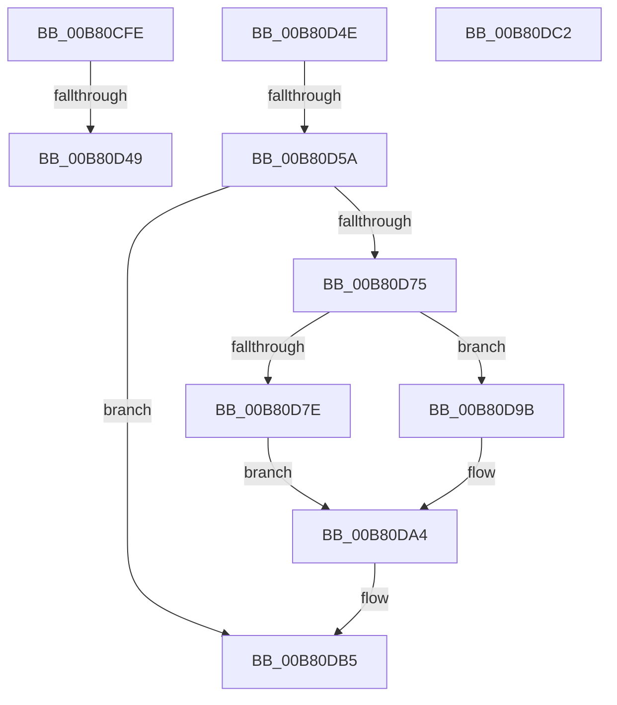

# sub_00B80CFE

- RVA: `0x00B80CFE`–`0x00B80DDC` (길이 `222` bytes)
- VA: `0x0000000140B80CFE`
- 실행 섹션: `PAGELK`
- PDB 이름 있음: `아니요`; PDB Function 태그: `아니요`
- unwind 정보 RVA: `0x000B93E8`
- 디코드: `54`개 명령, `222/222` bytes 표시
- 미해석 바이트: `0` (있으면 어셈블리에 `.byte`로 보존)

> 이 문서는 커널 이미지의 기계어와 PDB 기호를 분석해 생성했습니다. 4번과 5번은 함수 원형과 자료형을 바이너리 사용 방식에서 추정한 C 해석이며 원본 소스 복구 결과는 아닙니다.

## 1. Dependencies

- 직접 호출 지점: **8**; 고유 호출 대상: **5**
- 직접 호출자로 확인된 함수: **0**
- RIP 상대 이미지 참조: **6**

### Outgoing calls
- `0x00B80D0D` → [PfpScenCtxScenarioSet](../B7/PfpScenCtxScenarioSet_function_00B7CFF0.md) (function, `0x00B7CFF0`)
- `0x00B80D23` → [PfpScenCtxScenarioSet](../B7/PfpScenCtxScenarioSet_function_00B7CFF0.md) (function, `0x00B7CFF0`)
- `0x00B80D37` → [PfpScenCtxScenarioSet](../B7/PfpScenCtxScenarioSet_function_00B7CFF0.md) (function, `0x00B7CFF0`)
- `0x00B80D3C` → [PfpStartLoggingHardFaultEvents](../B7/PfpStartLoggingHardFaultEvents_function_00B7D9EC.md) (function, `0x00B7D9EC`)
- `0x00B80D6A` → [PfpPartitionIterate](../../text/34/PfpPartitionIterate_function_00341D00.md) (function, `0x00341D00`)
- `0x00B80DAD` → [PfpScenCtxPrefetchWait](../B6/PfpScenCtxPrefetchWait_function_00B6B5B0.md) (function, `0x00B6B5B0`)
- `0x00B80DB7` → [PfpServiceMainThreadUnboost](../../text/5C/PfpServiceMainThreadUnboost_function_005CDCB0.md) (function, `0x005CDCB0`)
- `0x00B80DD1` → [PfpScenCtxScenarioSet](../B7/PfpScenCtxScenarioSet_function_00B7CFF0.md) (function, `0x00B7CFF0`)

### Direct callers
- 이 함수 시작 RVA로 연결되는 직접 call은 확인되지 않았습니다. 간접 호출은 완전히 역산할 수 없습니다.

### Static image references
- `0x00B80D01` → RVA `0x00E670D0` (`.data`; read)
- `0x00B80D63` → RVA `0x00B6B270` (`PfpPowerActionSleepSystemPhaseCallback`; read)
- `0x00B80D7E` → RVA `0x00E67100` (`.data`; read)
- `0x00B80D87` → RVA `0x00E66F08` (`.data`; read)
- `0x00B80D8E` → RVA `0x00E66F0C` (`.data`; read)
- `0x00B80D9B` → RVA `0x00E66F04` (`.data`; read)

## 2. Other-region calls and transfers

- 다른 실행 섹션으로 향하는 call: **2**
  - `0x00B80D6A` → [PfpPartitionIterate](../../text/34/PfpPartitionIterate_function_00341D00.md) (`PAGELK` → `.text`)
  - `0x00B80DB7` → [PfpServiceMainThreadUnboost](../../text/5C/PfpServiceMainThreadUnboost_function_005CDCB0.md) (`PAGELK` → `.text`)
- call이 아닌 외부 분기/꼬리 이동: **5**
  - `0x00B80D43` → [PfPowerActionNotify + 0x113](../B7/PfPowerActionNotify_function_00B7AC98.md) (`tail-transfer`)
  - `0x00B80D49` → [PfPowerActionNotify + 0x88](../B7/PfPowerActionNotify_function_00B7AC98.md) (`tail-transfer`)
  - `0x00B80D54` → [PfPowerActionNotify + 0x113](../B7/PfPowerActionNotify_function_00B7AC98.md) (`tail-transfer`)
  - `0x00B80DBD` → [PfPowerActionNotify + 0xB2](../B7/PfPowerActionNotify_function_00B7AC98.md) (`tail-transfer`)
  - `0x00B80DD7` → [PfPowerActionNotify + 0x113](../B7/PfPowerActionNotify_function_00B7AC98.md) (`tail-transfer`)

## 3. Assembly (complete function range)

```asm
00B80CFE  45 33 C9                        xor r9d, r9d
00B80D01  48 8D 0D C8 63 2E 00            lea rcx, [rip + 0x2e63c8]
00B80D08  45 33 C0                        xor r8d, r8d
00B80D0B  8B D7                           mov edx, edi
00B80D0D  E8 DE C2 FF FF                  call 0x140b7cff0
00B80D12  45 33 C9                        xor r9d, r9d
00B80D15  48 8D 0D B4 63 2E 00            lea rcx, [rip + 0x2e63b4]
00B80D1C  45 33 C0                        xor r8d, r8d
00B80D1F  41 8D 51 02                     lea edx, [r9 + 2]
00B80D23  E8 C8 C2 FF FF                  call 0x140b7cff0
00B80D28  45 33 C9                        xor r9d, r9d
00B80D2B  48 8D 0D 9E 63 2E 00            lea rcx, [rip + 0x2e639e]
00B80D32  45 33 C0                        xor r8d, r8d
00B80D35  8B D3                           mov edx, ebx
00B80D37  E8 B4 C2 FF FF                  call 0x140b7cff0
00B80D3C  E8 AB CC FF FF                  call 0x140b7d9ec
00B80D41  85 C0                           test eax, eax
00B80D43  0F 88 62 A0 FF FF               js 0x140b7adab
00B80D49  E9 D2 9F FF FF                  jmp 0x140b7ad20
00B80D4E  8D 46 FE                        lea eax, [rsi - 2]
00B80D51  83 F8 03                        cmp eax, 3
00B80D54  0F 87 51 A0 FF FF               ja 0x140b7adab
00B80D5A  4C 8D 45 B0                     lea r8, [rbp - 0x50]
00B80D5E  BA 04 00 00 00                  mov edx, 4
00B80D63  48 8D 0D 06 A5 FE FF            lea rcx, [rip - 0x15afa]
00B80D6A  E8 91 0F 7C FF                  call 0x140341d00
00B80D6F  83 7D B0 00                     cmp dword ptr [rbp - 0x50], 0
00B80D73  74 40                           je 0x140b80db5
00B80D75  BB 05 00 00 00                  mov ebx, 5
00B80D7A  3B F3                           cmp esi, ebx
00B80D7C  75 1D                           jne 0x140b80d9b
00B80D7E  39 1D 7C 63 2E 00               cmp dword ptr [rip + 0x2e637c], ebx
00B80D84  8D 53 FD                        lea edx, [rbx - 3]
00B80D87  44 8B 05 7A 61 2E 00            mov r8d, dword ptr [rip + 0x2e617a]
00B80D8E  44 0F 44 05 76 61 2E 00         cmove r8d, dword ptr [rip + 0x2e6176]
00B80D96  0F 45 DA                        cmovne ebx, edx
00B80D99  EB 09                           jmp 0x140b80da4
00B80D9B  44 8B 05 62 61 2E 00            mov r8d, dword ptr [rip + 0x2e6162]
00B80DA2  8B DF                           mov ebx, edi
00B80DA4  8B D3                           mov edx, ebx
00B80DA6  48 8D 0D 23 63 2E 00            lea rcx, [rip + 0x2e6323]
00B80DAD  E8 FE A7 FE FF                  call 0x140b6b5b0
00B80DB2  89 45 BC                        mov dword ptr [rbp - 0x44], eax
00B80DB5  33 C9                           xor ecx, ecx
00B80DB7  E8 F4 CE A4 FF                  call 0x1405cdcb0
00B80DBC  90                              nop
00B80DBD  E9 88 9F FF FF                  jmp 0x140b7ad4a
00B80DC2  45 33 C9                        xor r9d, r9d
00B80DC5  48 8D 0D 04 63 2E 00            lea rcx, [rip + 0x2e6304]
00B80DCC  44 8B C7                        mov r8d, edi
00B80DCF  33 D2                           xor edx, edx
00B80DD1  E8 1A C2 FF FF                  call 0x140b7cff0
00B80DD6  90                              nop
00B80DD7  E9 CF 9F FF FF                  jmp 0x140b7adab
```

## 4. C-style interpretation (structured pseudocode)

```c
__int64 __fastcall sub_00B80CFE(__int64 a1, __int64 a2, int a3, int a4)
{
    __int64 result;

    a4 = 0;
    a3 = 0;
    result = PfpScenCtxScenarioSet(v_rip + 3040200, (unsigned int)((unsigned int)(v_rdi)), a3, a4);
    a4 = 0;
    a3 = 0;
    result = PfpScenCtxScenarioSet(v_rip + 3040180, a4 + 2, a3, a4);
    a4 = 0;
    a3 = 0;
    result = PfpScenCtxScenarioSet(v_rip + 3040158, (unsigned int)((unsigned int)(v_rbx)), a3, a4);
    result = PfpStartLoggingHardFaultEvents(v_rip + 3040158, (unsigned int)((unsigned int)(v_rbx)), a3, a4);
}
```

## 5. (Beta) C Style

```c
int64_t sub_00B80CFE(int64_t Arg1, int64_t Arg2, int32_t Arg3, int32_t Arg4)
{
    int64_t result;

    Arg4 = 0;
    Arg3 = 0;
    result = PfpScenCtxScenarioSet(v_rip + 3040200, (uint32_t)((uint32_t)(local_rdi)), Arg3, Arg4);
    Arg4 = 0;
    Arg3 = 0;
    result = PfpScenCtxScenarioSet(v_rip + 3040180, Arg4 + 2, Arg3, Arg4);
    Arg4 = 0;
    Arg3 = 0;
    result = PfpScenCtxScenarioSet(v_rip + 3040158, (uint32_t)((uint32_t)(local_rbx)), Arg3, Arg4);
    result = PfpStartLoggingHardFaultEvents(v_rip + 3040158, (uint32_t)((uint32_t)(local_rbx)), Arg3, Arg4);
}
```

## 6. Execution-region graph

[열기: 2D/3D 그래프와 함수 탐색 컨트롤 패널](../../../control-panel.html?section=pagelk&rva=0x00B80CFE&view=graph)

- 2D 그래프는 위에서 아래로 흐르고, 3D 그래프는 빈 공간을 드래그해 회전합니다. Shift+드래그는 이동, 휠은 확대·축소, 함수 노드 선택은 대상 보고서 이동입니다.

### Static fallback


