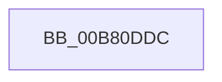

# sub_00B80DDC

- RVA: `0x00B80DDC`–`0x00B80E6E` (길이 `146` bytes)
- VA: `0x0000000140B80DDC`
- 실행 섹션: `PAGELK`
- PDB 이름 있음: `아니요`; PDB Function 태그: `아니요`
- unwind 정보 RVA: `0x000B9EE8`
- 디코드: `34`개 명령, `146/146` bytes 표시
- 미해석 바이트: `0` (있으면 어셈블리에 `.byte`로 보존)

> 이 문서는 커널 이미지의 기계어와 PDB 기호를 분석해 생성했습니다. 4번과 5번은 함수 원형과 자료형을 바이너리 사용 방식에서 추정한 C 해석이며 원본 소스 복구 결과는 아닙니다.

## 1. Dependencies

- 직접 호출 지점: **6**; 고유 호출 대상: **2**
- 직접 호출자로 확인된 함수: **0**
- RIP 상대 이미지 참조: **3**

### Outgoing calls
- `0x00B80DE7` → [RtlInitUnicodeString](../../text/42/RtlInitUnicodeString_function_0042A780.md) (function, `0x0042A780`)
- `0x00B80E0B` → [ZwSetValueKey](../../text/6A/ZwSetValueKey_function_006ADCD0.md) (function, `0x006ADCD0`)
- `0x00B80E1B` → [RtlInitUnicodeString](../../text/42/RtlInitUnicodeString_function_0042A780.md) (function, `0x0042A780`)
- `0x00B80E37` → [ZwSetValueKey](../../text/6A/ZwSetValueKey_function_006ADCD0.md) (function, `0x006ADCD0`)
- `0x00B80E47` → [RtlInitUnicodeString](../../text/42/RtlInitUnicodeString_function_0042A780.md) (function, `0x0042A780`)
- `0x00B80E63` → [ZwSetValueKey](../../text/6A/ZwSetValueKey_function_006ADCD0.md) (function, `0x006ADCD0`)

### Direct callers
- 이 함수 시작 RVA로 연결되는 직접 call은 확인되지 않았습니다. 간접 호출은 완전히 역산할 수 없습니다.

### Static image references
- `0x00B80DDC` → RVA `0x00B801B0` (` ?? ::OKHAJAOM::`string'`; read)
- `0x00B80E10` → RVA `0x00B80180` (` ?? ::OKHAJAOM::`string'`; read)
- `0x00B80E3C` → RVA `0x00B801E0` (` ?? ::OKHAJAOM::`string'`; read)

## 2. Other-region calls and transfers

- 다른 실행 섹션으로 향하는 call: **6**
  - `0x00B80DE7` → [RtlInitUnicodeString](../../text/42/RtlInitUnicodeString_function_0042A780.md) (`PAGELK` → `.text`)
  - `0x00B80E0B` → [ZwSetValueKey](../../text/6A/ZwSetValueKey_function_006ADCD0.md) (`PAGELK` → `.text`)
  - `0x00B80E1B` → [RtlInitUnicodeString](../../text/42/RtlInitUnicodeString_function_0042A780.md) (`PAGELK` → `.text`)
  - `0x00B80E37` → [ZwSetValueKey](../../text/6A/ZwSetValueKey_function_006ADCD0.md) (`PAGELK` → `.text`)
  - `0x00B80E47` → [RtlInitUnicodeString](../../text/42/RtlInitUnicodeString_function_0042A780.md) (`PAGELK` → `.text`)
  - `0x00B80E63` → [ZwSetValueKey](../../text/6A/ZwSetValueKey_function_006ADCD0.md) (`PAGELK` → `.text`)
- call이 아닌 외부 분기/꼬리 이동: **1**
  - `0x00B80E69` → [BapdRegisterSiData + 0x14F](../B7/BapdRegisterSiData_function_00B7B5B8.md) (`tail-transfer`)

## 3. Assembly (complete function range)

```asm
00B80DDC  48 8D 15 CD F3 FF FF            lea rdx, [rip - 0xc33]
00B80DE3  48 8D 4D F0                     lea rcx, [rbp - 0x10]
00B80DE7  E8 94 99 8A FF                  call 0x14042a780
00B80DEC  48 8B 4D 30                     mov rcx, qword ptr [rbp + 0x30]
00B80DF0  48 8D 55 F0                     lea rdx, [rbp - 0x10]
00B80DF4  BB 08 00 00 00                  mov ebx, 8
00B80DF9  45 33 C0                        xor r8d, r8d
00B80DFC  89 5C 24 28                     mov dword ptr [rsp + 0x28], ebx
00B80E00  4C 89 74 24 20                  mov qword ptr [rsp + 0x20], r14
00B80E05  8D 7B 03                        lea edi, [rbx + 3]
00B80E08  44 8B CF                        mov r9d, edi
00B80E0B  E8 C0 CE B2 FF                  call 0x1406adcd0
00B80E10  48 8D 15 69 F3 FF FF            lea rdx, [rip - 0xc97]
00B80E17  48 8D 4D F0                     lea rcx, [rbp - 0x10]
00B80E1B  E8 60 99 8A FF                  call 0x14042a780
00B80E20  48 8B 4D 30                     mov rcx, qword ptr [rbp + 0x30]
00B80E24  48 8D 55 F0                     lea rdx, [rbp - 0x10]
00B80E28  44 8B CF                        mov r9d, edi
00B80E2B  89 5C 24 28                     mov dword ptr [rsp + 0x28], ebx
00B80E2F  45 33 C0                        xor r8d, r8d
00B80E32  4C 89 7C 24 20                  mov qword ptr [rsp + 0x20], r15
00B80E37  E8 94 CE B2 FF                  call 0x1406adcd0
00B80E3C  48 8D 15 9D F3 FF FF            lea rdx, [rip - 0xc63]
00B80E43  48 8D 4D F0                     lea rcx, [rbp - 0x10]
00B80E47  E8 34 99 8A FF                  call 0x14042a780
00B80E4C  48 8B 4D 30                     mov rcx, qword ptr [rbp + 0x30]
00B80E50  48 8D 55 F0                     lea rdx, [rbp - 0x10]
00B80E54  44 8B CF                        mov r9d, edi
00B80E57  89 5C 24 28                     mov dword ptr [rsp + 0x28], ebx
00B80E5B  45 33 C0                        xor r8d, r8d
00B80E5E  4C 89 64 24 20                  mov qword ptr [rsp + 0x20], r12
00B80E63  E8 68 CE B2 FF                  call 0x1406adcd0
00B80E68  90                              nop
00B80E69  E9 99 A8 FF FF                  jmp 0x140b7b707
```

## 4. C-style interpretation (structured pseudocode)

```c
__int64 __fastcall sub_00B80DDC(__int64 a1, __int64 a2, int a3)
{
    __int64 result;
    unsigned __int64 v_stack_p20;
    unsigned int v_stack_p28;

    result = RtlInitUnicodeString(v_rbp - 16, v_rip - 3123, a3, a4);
    a3 = 0;
    v_stack_p28 = 8;
    v_stack_p20 = v_r14;
    result = ZwSetValueKey(*(unsigned __int64 *)(v_rbp + 48), v_rbp - 16, a3, (unsigned int)((unsigned int)(8 + 3)));
    result = RtlInitUnicodeString(v_rbp - 16, v_rip - 3223, a3, (unsigned int)((unsigned int)(8 + 3)));
    v_stack_p28 = 8;
    a3 = 0;
    v_stack_p20 = v_r15;
    result = ZwSetValueKey(*(unsigned __int64 *)(v_rbp + 48), v_rbp - 16, a3, (unsigned int)((unsigned int)(8 + 3)));
    result = RtlInitUnicodeString(v_rbp - 16, v_rip - 3171, a3, (unsigned int)((unsigned int)(8 + 3)));
    v_stack_p28 = 8;
    a3 = 0;
    v_stack_p20 = v_r12;
    result = ZwSetValueKey(*(unsigned __int64 *)(v_rbp + 48), v_rbp - 16, a3, (unsigned int)((unsigned int)(8 + 3)));
}
```

## 5. (Beta) C Style

```c
int64_t sub_00B80DDC(int64_t Arg1, int64_t Arg2, int32_t Arg3)
{
    int64_t result;
    uint64_t v_stack_p20;
    uint32_t v_stack_p28;

    result = RtlInitUnicodeString(local_rbp - 16, v_rip - 3123, Arg3, a4);
    Arg3 = 0;
    v_stack_p28 = 8;
    v_stack_p20 = local_r14;
    result = ZwSetValueKey(*(uint64_t *)(local_rbp + 0x30), local_rbp - 16, Arg3, (uint32_t)((uint32_t)(8 + 3)));
    result = RtlInitUnicodeString(local_rbp - 16, v_rip - 3223, Arg3, (uint32_t)((uint32_t)(8 + 3)));
    v_stack_p28 = 8;
    Arg3 = 0;
    v_stack_p20 = local_r15;
    result = ZwSetValueKey(*(uint64_t *)(local_rbp + 0x30), local_rbp - 16, Arg3, (uint32_t)((uint32_t)(8 + 3)));
    result = RtlInitUnicodeString(local_rbp - 16, v_rip - 3171, Arg3, (uint32_t)((uint32_t)(8 + 3)));
    v_stack_p28 = 8;
    Arg3 = 0;
    v_stack_p20 = local_r12;
    result = ZwSetValueKey(*(uint64_t *)(local_rbp + 0x30), local_rbp - 16, Arg3, (uint32_t)((uint32_t)(8 + 3)));
}
```

## 6. Execution-region graph

[열기: 2D/3D 그래프와 함수 탐색 컨트롤 패널](../../../control-panel.html?section=pagelk&rva=0x00B80DDC&view=graph)

- 2D 그래프는 위에서 아래로 흐르고, 3D 그래프는 빈 공간을 드래그해 회전합니다. Shift+드래그는 이동, 휠은 확대·축소, 함수 노드 선택은 대상 보고서 이동입니다.

### Static fallback


