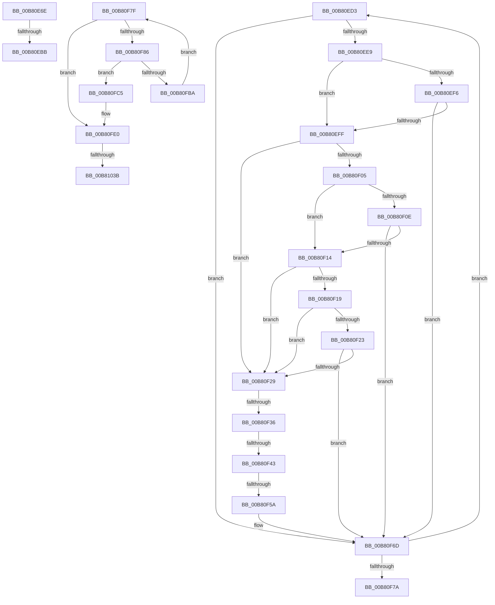

# sub_00B80E6E

- RVA: `0x00B80E6E`–`0x00B81046` (길이 `472` bytes)
- VA: `0x0000000140B80E6E`
- 실행 섹션: `PAGELK`
- PDB 이름 있음: `아니요`; PDB Function 태그: `아니요`
- unwind 정보 RVA: `0x000BA1E8`
- 디코드: `114`개 명령, `472/472` bytes 표시
- 미해석 바이트: `0` (있으면 어셈블리에 `.byte`로 보존)

> 이 문서는 커널 이미지의 기계어와 PDB 기호를 분석해 생성했습니다. 4번과 5번은 함수 원형과 자료형을 바이너리 사용 방식에서 추정한 C 해석이며 원본 소스 복구 결과는 아닙니다.

## 1. Dependencies

- 직접 호출 지점: **12**; 고유 호출 대상: **11**
- 직접 호출자로 확인된 함수: **0**
- RIP 상대 이미지 참조: **6**

### Outgoing calls
- `0x00B80E79` → [RtlInitUnicodeString](../../text/42/RtlInitUnicodeString_function_0042A780.md) (function, `0x0042A780`)
- `0x00B80EAE` → [ZwOpenKey](../../text/6A/ZwOpenKey_function_006AD310.md) (function, `0x006AD310`)
- `0x00B80EBF` → [ZwFlushKey](../../text/6A/ZwFlushKey_function_006AEF10.md) (function, `0x006AEF10`)
- `0x00B80EC8` → [ZwClose](../../text/6A/ZwClose_function_006AD2B0.md) (function, `0x006AD2B0`)
- `0x00B80FB1` → [PsCreateSystemThread](../../page/9E/PsCreateSystemThread_function_009ED0D0.md) (function, `0x009ED0D0`)
- `0x00B80FBE` → [ZwClose](../../text/6A/ZwClose_function_006AD2B0.md) (function, `0x006AD2B0`)
- `0x00B80FCC` → [ExAcquireFastMutex](../../text/20/ExAcquireFastMutex_function_0020E5A0.md) (function, `0x0020E5A0`)
- `0x00B80FDB` → [ExReleaseFastMutex](../../text/25/ExReleaseFastMutex_function_002519C0.md) (function, `0x002519C0`)
- `0x00B8100C` → [PopPushPowerStateTransitionRecordWithCallback](../../text/43/PopPushPowerStateTransitionRecordWithCallback_function_00430A04.md) (function, `0x00430A04`)
- `0x00B81017` → [PopFlushVolumeWorker](../B7/PopFlushVolumeWorker_function_00B7AEB0.md) (function, `0x00B7AEB0`)
- `0x00B8102E` → [KeWaitForSingleObject](../../text/20/KeWaitForSingleObject_function_0020E6B0.md) (function, `0x0020E6B0`)
- `0x00B8103B` → [PoDelistPowerStateTransitionBlocker](../B7/PoDelistPowerStateTransitionBlocker_function_00B795D4.md) (function, `0x00B795D4`)

### Direct callers
- 이 함수 시작 RVA로 연결되는 직접 call은 확인되지 않았습니다. 간접 호출은 완전히 역산할 수 없습니다.

### Static image references
- `0x00B80E6E` → RVA `0x00B7FEF0` (` ?? ::OKHAJAOM::`string'`; read)
- `0x00B80F4A` → RVA `0x00F0CEB8` (`.data`; read)
- `0x00B80F66` → RVA `0x00F0CEB8` (`.data`; write)
- `0x00B80F96` → RVA `0x00B7AEB0` (`PopFlushVolumeWorker`; read)
- `0x00B80FC5` → RVA `0x00F0CAA0` (`.data`; read)
- `0x00B81000` → RVA `0x00B70830` (`PopFlushVolumeBlameResolverCallback`; read)

## 2. Other-region calls and transfers

- 다른 실행 섹션으로 향하는 call: **10**
  - `0x00B80E79` → [RtlInitUnicodeString](../../text/42/RtlInitUnicodeString_function_0042A780.md) (`PAGELK` → `.text`)
  - `0x00B80EAE` → [ZwOpenKey](../../text/6A/ZwOpenKey_function_006AD310.md) (`PAGELK` → `.text`)
  - `0x00B80EBF` → [ZwFlushKey](../../text/6A/ZwFlushKey_function_006AEF10.md) (`PAGELK` → `.text`)
  - `0x00B80EC8` → [ZwClose](../../text/6A/ZwClose_function_006AD2B0.md) (`PAGELK` → `.text`)
  - `0x00B80FB1` → [PsCreateSystemThread](../../page/9E/PsCreateSystemThread_function_009ED0D0.md) (`PAGELK` → `PAGE`)
  - `0x00B80FBE` → [ZwClose](../../text/6A/ZwClose_function_006AD2B0.md) (`PAGELK` → `.text`)
  - `0x00B80FCC` → [ExAcquireFastMutex](../../text/20/ExAcquireFastMutex_function_0020E5A0.md) (`PAGELK` → `.text`)
  - `0x00B80FDB` → [ExReleaseFastMutex](../../text/25/ExReleaseFastMutex_function_002519C0.md) (`PAGELK` → `.text`)
  - `0x00B8100C` → [PopPushPowerStateTransitionRecordWithCallback](../../text/43/PopPushPowerStateTransitionRecordWithCallback_function_00430A04.md) (`PAGELK` → `.text`)
  - `0x00B8102E` → [KeWaitForSingleObject](../../text/20/KeWaitForSingleObject_function_0020E6B0.md) (`PAGELK` → `.text`)
- call이 아닌 외부 분기/꼬리 이동: **8**
  - `0x00B80EB5` → [PopFlushVolumes + 0xD1](../B7/PopFlushVolumes_function_00B7B938.md) (`tail-transfer`)
  - `0x00B80ECE` → [PopFlushVolumes + 0xD1](../B7/PopFlushVolumes_function_00B7B938.md) (`tail-transfer`)
  - `0x00B80F30` → [PopFlushVolumes + 0x17F](../B7/PopFlushVolumes_function_00B7B938.md) (`tail-transfer`)
  - `0x00B80F3D` → [PopFlushVolumes + 0x17F](../B7/PopFlushVolumes_function_00B7B938.md) (`tail-transfer`)
  - `0x00B80F54` → [PopFlushVolumes + 0x17F](../B7/PopFlushVolumes_function_00B7B938.md) (`tail-transfer`)
  - `0x00B80F7A` → [PopFlushVolumes + 0xFC](../B7/PopFlushVolumes_function_00B7B938.md) (`tail-transfer`)
  - `0x00B81035` → [PopFlushVolumes + 0x110](../B7/PopFlushVolumes_function_00B7B938.md) (`tail-transfer`)
  - `0x00B81041` → [PopFlushVolumes + 0x110](../B7/PopFlushVolumes_function_00B7B938.md) (`tail-transfer`)

## 3. Assembly (complete function range)

```asm
00B80E6E  48 8D 15 7B F0 FF FF            lea rdx, [rip - 0xf85]
00B80E75  48 8D 4D 27                     lea rcx, [rbp + 0x27]
00B80E79  E8 02 99 8A FF                  call 0x14042a780
00B80E7E  48 83 65 FF 00                  and qword ptr [rbp - 1], 0
00B80E83  48 8D 45 27                     lea rax, [rbp + 0x27]
00B80E87  0F 57 C0                        xorps xmm0, xmm0
00B80E8A  48 89 45 07                     mov qword ptr [rbp + 7], rax
00B80E8E  4C 8D 45 F7                     lea r8, [rbp - 9]
00B80E92  C7 45 F7 30 00 00 00            mov dword ptr [rbp - 9], 0x30
00B80E99  BA 19 00 02 00                  mov edx, 0x20019
00B80E9E  C7 45 0F 40 02 00 00            mov dword ptr [rbp + 0xf], 0x240
00B80EA5  48 8D 4D 6F                     lea rcx, [rbp + 0x6f]
00B80EA9  F3 0F 7F 45 17                  movdqu xmmword ptr [rbp + 0x17], xmm0
00B80EAE  E8 5D C4 B2 FF                  call 0x1406ad310
00B80EB3  85 C0                           test eax, eax
00B80EB5  0F 88 4E AB FF FF               js 0x140b7ba09
00B80EBB  48 8B 4D 6F                     mov rcx, qword ptr [rbp + 0x6f]
00B80EBF  E8 4C E0 B2 FF                  call 0x1406aef10
00B80EC4  48 8B 4D 6F                     mov rcx, qword ptr [rbp + 0x6f]
00B80EC8  E8 E3 C3 B2 FF                  call 0x1406ad2b0
00B80ECD  90                              nop
00B80ECE  E9 36 AB FF FF                  jmp 0x140b7ba09
00B80ED3  49 8B 50 C8                     mov rdx, qword ptr [r8 - 0x38]
00B80ED7  49 8B C8                        mov rcx, r8
00B80EDA  4D 8B 00                        mov r8, qword ptr [r8]
00B80EDD  8B 42 34                        mov eax, dword ptr [rdx + 0x34]
00B80EE0  41 84 C6                        test r14b, al
00B80EE3  0F 85 84 00 00 00               jne 0x140b80f6d
00B80EE9  48 8B 42 38                     mov rax, qword ptr [rdx + 0x38]
00B80EED  4C 8B 48 10                     mov r9, qword ptr [rax + 0x10]
00B80EF1  4D 85 C9                        test r9, r9
00B80EF4  74 09                           je 0x140b80eff
00B80EF6  41 8B 41 34                     mov eax, dword ptr [r9 + 0x34]
00B80EFA  41 84 C6                        test r14b, al
00B80EFD  75 6E                           jne 0x140b80f6d
00B80EFF  40 F6 C7 10                     test dil, 0x10
00B80F03  74 24                           je 0x140b80f29
00B80F05  8B 42 30                        mov eax, dword ptr [rdx + 0x30]
00B80F08  0F BA E0 15                     bt eax, 0x15
00B80F0C  73 06                           jae 0x140b80f14
00B80F0E  0F BA E0 08                     bt eax, 8
00B80F12  73 59                           jae 0x140b80f6d
00B80F14  4D 85 C9                        test r9, r9
00B80F17  74 10                           je 0x140b80f29
00B80F19  41 8B 41 30                     mov eax, dword ptr [r9 + 0x30]
00B80F1D  0F BA E0 15                     bt eax, 0x15
00B80F21  73 06                           jae 0x140b80f29
00B80F23  0F BA E0 08                     bt eax, 8
00B80F27  73 44                           jae 0x140b80f6d
00B80F29  48 8B 01                        mov rax, qword ptr [rcx]
00B80F2C  48 39 48 08                     cmp qword ptr [rax + 8], rcx
00B80F30  0F 85 81 AB FF FF               jne 0x140b7bab7
00B80F36  48 8B 51 08                     mov rdx, qword ptr [rcx + 8]
00B80F3A  48 39 0A                        cmp qword ptr [rdx], rcx
00B80F3D  0F 85 74 AB FF FF               jne 0x140b7bab7
00B80F43  48 89 02                        mov qword ptr [rdx], rax
00B80F46  48 89 50 08                     mov qword ptr [rax + 8], rdx
00B80F4A  48 8B 05 67 BF 38 00            mov rax, qword ptr [rip + 0x38bf67]
00B80F51  4C 39 20                        cmp qword ptr [rax], r12
00B80F54  0F 85 5D AB FF FF               jne 0x140b7bab7
00B80F5A  4C 89 21                        mov qword ptr [rcx], r12
00B80F5D  FF CB                           dec ebx
00B80F5F  48 89 41 08                     mov qword ptr [rcx + 8], rax
00B80F63  48 89 08                        mov qword ptr [rax], rcx
00B80F66  48 89 0D 4B BF 38 00            mov qword ptr [rip + 0x38bf4b], rcx
00B80F6D  48 8D 45 A7                     lea rax, [rbp - 0x59]
00B80F71  4C 3B C0                        cmp r8, rax
00B80F74  0F 85 59 FF FF FF               jne 0x140b80ed3
00B80F7A  E9 B5 AA FF FF                  jmp 0x140b7ba34
00B80F7F  41 2B DE                        sub ebx, r14d
00B80F82  85 DB                           test ebx, ebx
00B80F84  7E 5A                           jle 0x140b80fe0
00B80F86  48 8D 45 A7                     lea rax, [rbp - 0x59]
00B80F8A  45 33 C9                        xor r9d, r9d
00B80F8D  48 89 44 24 30                  mov qword ptr [rsp + 0x30], rax
00B80F92  4C 8D 45 F7                     lea r8, [rbp - 9]
00B80F96  48 8D 05 13 9F FF FF            lea rax, [rip - 0x60ed]
00B80F9D  BA FF FF 1F 00                  mov edx, 0x1fffff
00B80FA2  48 89 44 24 28                  mov qword ptr [rsp + 0x28], rax
00B80FA7  48 8D 4D 77                     lea rcx, [rbp + 0x77]
00B80FAB  48 83 64 24 20 00               and qword ptr [rsp + 0x20], 0
00B80FB1  E8 1A C1 E6 FF                  call 0x1409ed0d0
00B80FB6  85 C0                           test eax, eax
00B80FB8  78 0B                           js 0x140b80fc5
00B80FBA  48 8B 4D 77                     mov rcx, qword ptr [rbp + 0x77]
00B80FBE  E8 ED C2 B2 FF                  call 0x1406ad2b0
00B80FC3  EB BA                           jmp 0x140b80f7f
00B80FC5  48 8D 0D D4 BA 38 00            lea rcx, [rip + 0x38bad4]
00B80FCC  E8 CF D5 68 FF                  call 0x14020e5a0
00B80FD1  29 5D B7                        sub dword ptr [rbp - 0x49], ebx
00B80FD4  48 8D 0D C5 BA 38 00            lea rcx, [rip + 0x38bac5]
00B80FDB  E8 E0 09 6D FF                  call 0x1402519c0
00B80FE0  65 48 8B 14 25 88 01 00 00      mov rdx, qword ptr gs:[0x188]
00B80FE9  4C 8D 45 A7                     lea r8, [rbp - 0x59]
00B80FED  65 48 8B 04 25 88 01 00 00      mov rax, qword ptr gs:[0x188]
00B80FF6  45 8B CE                        mov r9d, r14d
00B80FF9  48 8B 88 B8 00 00 00            mov rcx, qword ptr [rax + 0xb8]
00B81000  48 8D 05 29 F8 FE FF            lea rax, [rip - 0x107d7]
00B81007  48 89 44 24 20                  mov qword ptr [rsp + 0x20], rax
00B8100C  E8 F3 F9 8A FF                  call 0x140430a04
00B81011  48 8D 4D A7                     lea rcx, [rbp - 0x59]
00B81015  8B D8                           mov ebx, eax
00B81017  E8 94 9E FF FF                  call 0x140b7aeb0
00B8101C  48 83 64 24 20 00               and qword ptr [rsp + 0x20], 0
00B81022  48 8D 4D BF                     lea rcx, [rbp - 0x41]
00B81026  45 33 C9                        xor r9d, r9d
00B81029  45 33 C0                        xor r8d, r8d
00B8102C  33 D2                           xor edx, edx
00B8102E  E8 7D D6 68 FF                  call 0x14020e6b0
00B81033  85 DB                           test ebx, ebx
00B81035  0F 88 0D AA FF FF               js 0x140b7ba48
00B8103B  E8 94 85 FF FF                  call 0x140b795d4
00B81040  90                              nop
00B81041  E9 02 AA FF FF                  jmp 0x140b7ba48
```

## 4. C-style interpretation (structured pseudocode)

```c
__int64 __fastcall sub_00B80E6E(void)
{
    __int64 result;
    unsigned __int64 v_stack_p20;
    unsigned __int64 v_stack_p28;
    unsigned __int64 v_stack_p30;

    result = RtlInitUnicodeString(v_rbp + 39, v_rip - 3973, a3, a4);
    *(unsigned __int64 *)(v_rbp + 7) = v_rbp + 39;
    *(unsigned int *)(v_rbp - 9) = 48;
    *(unsigned int *)(v_rbp + 15) = 576;
    *(unsigned __int64 *)(v_rbp + 23) = v_xmm0;
    result = ZwOpenKey(v_rbp + 111, (unsigned int)(0x20019ULL), v_rbp - 9, a4);
    result = ZwFlushKey(*(unsigned __int64 *)(v_rbp + 111), (unsigned int)(0x20019ULL), v_rbp - 9, a4);
    result = ZwClose(*(unsigned __int64 *)(v_rbp + 111), (unsigned int)(0x20019ULL), v_rbp - 9, a4);
}
```

## 5. (Beta) C Style

```c
void sub_00B80E6E(void)
{
    int64_t result;
    uint64_t v_stack_p20;
    uint64_t v_stack_p28;
    uint64_t v_stack_p30;

    result = RtlInitUnicodeString(local_rbp + 39, v_rip - 3973, a3, a4);
    *(uint64_t *)(local_rbp + 0x7) = local_rbp + 39;
    *(uint32_t *)(local_rbp - 0x9) = 48;
    *(uint32_t *)(local_rbp + 0xF) = 576;
    *(uint64_t *)(local_rbp + 0x17) = v_xmm0;
    result = ZwOpenKey(local_rbp + 111, (uint32_t)(0x20019ULL), local_rbp - 9, a4);
    result = ZwFlushKey(*(uint64_t *)(local_rbp + 0x6F), (uint32_t)(0x20019ULL), local_rbp - 9, a4);
    result = ZwClose(*(uint64_t *)(local_rbp + 0x6F), (uint32_t)(0x20019ULL), local_rbp - 9, a4);
}
```

## 6. Execution-region graph

[열기: 2D/3D 그래프와 함수 탐색 컨트롤 패널](../../../control-panel.html?section=pagelk&rva=0x00B80E6E&view=graph)

- 2D 그래프는 위에서 아래로 흐르고, 3D 그래프는 빈 공간을 드래그해 회전합니다. Shift+드래그는 이동, 휠은 확대·축소, 함수 노드 선택은 대상 보고서 이동입니다.

### Static fallback


