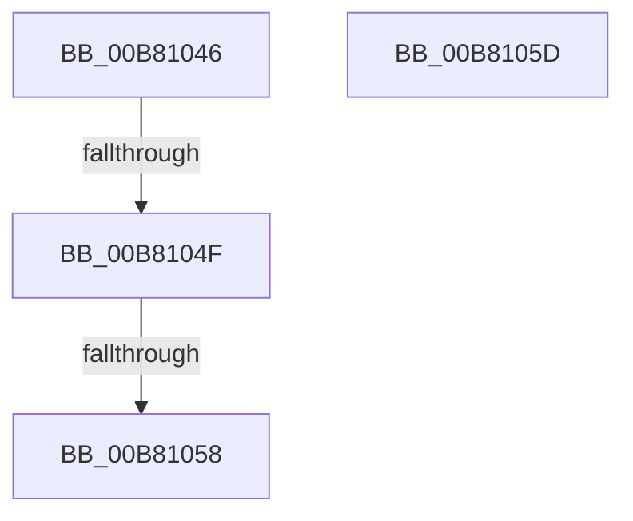

# sub_00B81046

- RVA: `0x00B81046`–`0x00B8106D` (길이 `39` bytes)
- VA: `0x0000000140B81046`
- 실행 섹션: `PAGELK`
- PDB 이름 있음: `아니요`; PDB Function 태그: `아니요`
- unwind 정보 RVA: `0x000BB014`
- 디코드: `9`개 명령, `39/39` bytes 표시
- 미해석 바이트: `0` (있으면 어셈블리에 `.byte`로 보존)

> 이 문서는 커널 이미지의 기계어와 PDB 기호를 분석해 생성했습니다. 4번과 5번은 함수 원형과 자료형을 바이너리 사용 방식에서 추정한 C 해석이며 원본 소스 복구 결과는 아닙니다.

## 1. Dependencies

- 직접 호출 지점: **1**; 고유 호출 대상: **1**
- 직접 호출자로 확인된 함수: **0**
- RIP 상대 이미지 참조: **0**

### Outgoing calls
- `0x00B81062` → [ExFreePoolWithTag](../../poolcode/B8/ExFreePoolWithTag_function_00B82870.md) (function, `0x00B82870`)

### Direct callers
- 이 함수 시작 RVA로 연결되는 직접 call은 확인되지 않았습니다. 간접 호출은 완전히 역산할 수 없습니다.

### Static image references
- 디코드된 RIP-relative 메모리 참조가 없습니다.

## 2. Other-region calls and transfers

- 다른 실행 섹션으로 향하는 call: **1**
  - `0x00B81062` → [ExFreePoolWithTag](../../poolcode/B8/ExFreePoolWithTag_function_00B82870.md) (`PAGELK` → `POOLCODE`)
- call이 아닌 외부 분기/꼬리 이동: **4**
  - `0x00B81049` → [PopCloneRange + 0x4D](../B7/PopCloneRange_function_00B7BBB8.md) (`tail-transfer`)
  - `0x00B81052` → [PopCloneRange + 0x146](../B7/PopCloneRange_function_00B7BBB8.md) (`tail-transfer`)
  - `0x00B81058` → [PopCloneRange + 0xD2](../B7/PopCloneRange_function_00B7BBB8.md) (`tail-transfer`)
  - `0x00B81068` → [PopCloneRange + 0x4D](../B7/PopCloneRange_function_00B7BBB8.md) (`tail-transfer`)

## 3. Assembly (complete function range)

```asm
00B81046  48 3B F0                        cmp rsi, rax
00B81049  0F 87 B6 AB FF FF               ja 0x140b7bc05
00B8104F  49 3B C6                        cmp rax, r14
00B81052  0F 87 A6 AC FF FF               ja 0x140b7bcfe
00B81058  E9 2D AC FF FF                  jmp 0x140b7bc8a
00B8105D  BA 48 6D 61 70                  mov edx, 0x70616d48
00B81062  E8 09 18 00 00                  call 0x140b82870
00B81067  90                              nop
00B81068  E9 98 AB FF FF                  jmp 0x140b7bc05
```

## 4. C-style interpretation (structured pseudocode)

```c
__int64 __fastcall sub_00B81046(void)
{
}
```

## 5. (Beta) C Style

```c
void sub_00B81046(void)
{
}
```

## 6. Execution-region graph

[열기: 2D/3D 그래프와 함수 탐색 컨트롤 패널](../../../control-panel.html?section=pagelk&rva=0x00B81046&view=graph)

- 2D 그래프는 위에서 아래로 흐르고, 3D 그래프는 빈 공간을 드래그해 회전합니다. Shift+드래그는 이동, 휠은 확대·축소, 함수 노드 선택은 대상 보고서 이동입니다.

### Static fallback


