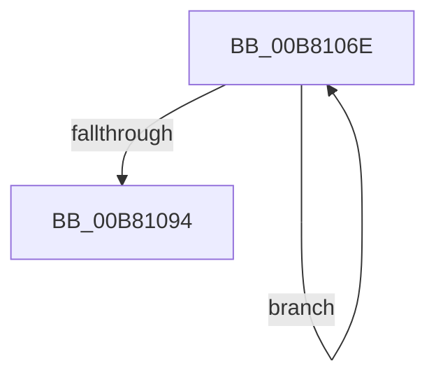

# sub_00B8106E

- RVA: `0x00B8106E`–`0x00B8109C` (길이 `46` bytes)
- VA: `0x0000000140B8106E`
- 실행 섹션: `PAGELK`
- PDB 이름 있음: `아니요`; PDB Function 태그: `아니요`
- unwind 정보 RVA: `0x000BB3F4`
- 디코드: `11`개 명령, `46/46` bytes 표시
- 미해석 바이트: `0` (있으면 어셈블리에 `.byte`로 보존)

> 이 문서는 커널 이미지의 기계어와 PDB 기호를 분석해 생성했습니다. 4번과 5번은 함수 원형과 자료형을 바이너리 사용 방식에서 추정한 C 해석이며 원본 소스 복구 결과는 아닙니다.

## 1. Dependencies

- 직접 호출 지점: **1**; 고유 호출 대상: **1**
- 직접 호출자로 확인된 함수: **0**
- RIP 상대 이미지 참조: **0**

### Outgoing calls
- `0x00B81087` → [PoSetHiberRange](../../text/47/PoSetHiberRange_function_0047C580.md) (function, `0x0047C580`)

### Direct callers
- 이 함수 시작 RVA로 연결되는 직접 call은 확인되지 않았습니다. 간접 호출은 완전히 역산할 수 없습니다.

### Static image references
- 디코드된 RIP-relative 메모리 참조가 없습니다.

## 2. Other-region calls and transfers

- 다른 실행 섹션으로 향하는 call: **1**
  - `0x00B81087` → [PoSetHiberRange](../../text/47/PoSetHiberRange_function_0047C580.md) (`PAGELK` → `.text`)
- call이 아닌 외부 분기/꼬리 이동: **1**
  - `0x00B81097` → [HalpIommuMarkHiberPhase + 0x74](../B7/HalpIommuMarkHiberPhase_function_00B7BE8C.md) (`tail-transfer`)

## 3. Assembly (complete function range)

```asm
00B8106E  41 B9 58 10 00 00               mov r9d, 0x1058
00B81074  C7 44 24 20 48 61 6C 49         mov dword ptr [rsp + 0x20], 0x496c6148
00B8107C  4C 8B C6                        mov r8, rsi
00B8107F  BA 02 00 00 00                  mov edx, 2
00B81084  48 8B CF                        mov rcx, rdi
00B81087  E8 F4 B4 8F FF                  call 0x14047c580
00B8108C  48 8B 36                        mov rsi, qword ptr [rsi]
00B8108F  49 3B F6                        cmp rsi, r14
00B81092  75 DA                           jne 0x140b8106e
00B81094  48 8B 1B                        mov rbx, qword ptr [rbx]
00B81097  E9 64 AE FF FF                  jmp 0x140b7bf00
```

## 4. C-style interpretation (structured pseudocode)

```c
__int64 __fastcall sub_00B8106E(void)
{
    __int64 result;
    unsigned int v_stack_p20;

    v_stack_p20 = 0x496C6148ULL;
    result = PoSetHiberRange(v_rdi, 2, v_rsi, (unsigned int)(0x1058ULL));
    if ((*(unsigned __int64 *)(v_rsi)) != v_r14) goto loc_00B8106E;
}
```

## 5. (Beta) C Style

```c
void sub_00B8106E(void)
{
    int64_t result;
    uint32_t v_stack_p20;

    v_stack_p20 = 0x496C6148ULL;
    result = PoSetHiberRange(local_rdi, 2, local_rsi, (uint32_t)(0x1058ULL));
    if ((*(uint64_t *)(local_rsi)) != local_r14) goto loc_00B8106E;
}
```

## 6. Execution-region graph

[열기: 2D/3D 그래프와 함수 탐색 컨트롤 패널](../../../control-panel.html?section=pagelk&rva=0x00B8106E&view=graph)

- 2D 그래프는 위에서 아래로 흐르고, 3D 그래프는 빈 공간을 드래그해 회전합니다. Shift+드래그는 이동, 휠은 확대·축소, 함수 노드 선택은 대상 보고서 이동입니다.

### Static fallback


