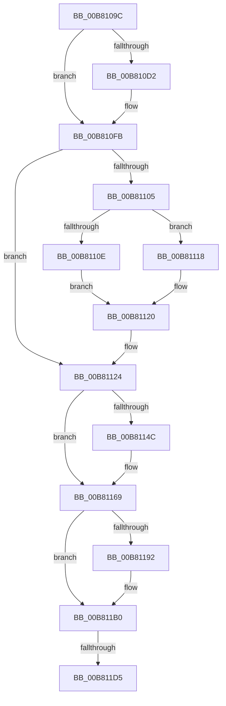

# sub_00B8109C

- RVA: `0x00B8109C`–`0x00B811F1` (길이 `341` bytes)
- VA: `0x0000000140B8109C`
- 실행 섹션: `PAGELK`
- PDB 이름 있음: `아니요`; PDB Function 태그: `아니요`
- unwind 정보 RVA: `0x000BB7D0`
- 디코드: `91`개 명령, `341/341` bytes 표시
- 미해석 바이트: `0` (있으면 어셈블리에 `.byte`로 보존)

> 이 문서는 커널 이미지의 기계어와 PDB 기호를 분석해 생성했습니다. 4번과 5번은 함수 원형과 자료형을 바이너리 사용 방식에서 추정한 C 해석이며 원본 소스 복구 결과는 아닙니다.

## 1. Dependencies

- 직접 호출 지점: **12**; 고유 호출 대상: **3**
- 직접 호출자로 확인된 함수: **0**
- RIP 상대 이미지 참조: **3**

### Outgoing calls
- `0x00B810B3` → [HalpAcpiPmRegisterRead](../../text/41/HalpAcpiPmRegisterRead_function_0041DB30.md) (function, `0x0041DB30`)
- `0x00B810C9` → [HalpAcpiPmRegisterAvailable](../../text/43/HalpAcpiPmRegisterAvailable_function_0043F330.md) (function, `0x0043F330`)
- `0x00B810EA` → [HalpAcpiPmRegisterRead](../../text/41/HalpAcpiPmRegisterRead_function_0041DB30.md) (function, `0x0041DB30`)
- `0x00B8113B` → [HalpAcpiPmRegisterWrite](../../text/41/HalpAcpiPmRegisterWrite_function_0041C760.md) (function, `0x0041C760`)
- `0x00B81143` → [HalpAcpiPmRegisterAvailable](../../text/43/HalpAcpiPmRegisterAvailable_function_0043F330.md) (function, `0x0043F330`)
- `0x00B81164` → [HalpAcpiPmRegisterWrite](../../text/41/HalpAcpiPmRegisterWrite_function_0041C760.md) (function, `0x0041C760`)
- `0x00B81179` → [HalpAcpiPmRegisterRead](../../text/41/HalpAcpiPmRegisterRead_function_0041DB30.md) (function, `0x0041DB30`)
- `0x00B81189` → [HalpAcpiPmRegisterAvailable](../../text/43/HalpAcpiPmRegisterAvailable_function_0043F330.md) (function, `0x0043F330`)
- `0x00B811A3` → [HalpAcpiPmRegisterRead](../../text/41/HalpAcpiPmRegisterRead_function_0041DB30.md) (function, `0x0041DB30`)
- `0x00B811C0` → [HalpAcpiPmRegisterWrite](../../text/41/HalpAcpiPmRegisterWrite_function_0041C760.md) (function, `0x0041C760`)
- `0x00B811C8` → [HalpAcpiPmRegisterAvailable](../../text/43/HalpAcpiPmRegisterAvailable_function_0043F330.md) (function, `0x0043F330`)
- `0x00B811E6` → [HalpAcpiPmRegisterWrite](../../text/41/HalpAcpiPmRegisterWrite_function_0041C760.md) (function, `0x0041C760`)

### Direct callers
- 이 함수 시작 RVA로 연결되는 직접 call은 확인되지 않았습니다. 간접 호출은 완전히 역산할 수 없습니다.

### Static image references
- `0x00B8109C` → RVA `0x00FC1B38` (`.data`; read)
- `0x00B810FB` → RVA `0x00FC1B50` (`.data`; read)
- `0x00B81105` → RVA `0x00F90141` (`.data`; read)

## 2. Other-region calls and transfers

- 다른 실행 섹션으로 향하는 call: **12**
  - `0x00B810B3` → [HalpAcpiPmRegisterRead](../../text/41/HalpAcpiPmRegisterRead_function_0041DB30.md) (`PAGELK` → `.text`)
  - `0x00B810C9` → [HalpAcpiPmRegisterAvailable](../../text/43/HalpAcpiPmRegisterAvailable_function_0043F330.md) (`PAGELK` → `.text`)
  - `0x00B810EA` → [HalpAcpiPmRegisterRead](../../text/41/HalpAcpiPmRegisterRead_function_0041DB30.md) (`PAGELK` → `.text`)
  - `0x00B8113B` → [HalpAcpiPmRegisterWrite](../../text/41/HalpAcpiPmRegisterWrite_function_0041C760.md) (`PAGELK` → `.text`)
  - `0x00B81143` → [HalpAcpiPmRegisterAvailable](../../text/43/HalpAcpiPmRegisterAvailable_function_0043F330.md) (`PAGELK` → `.text`)
  - `0x00B81164` → [HalpAcpiPmRegisterWrite](../../text/41/HalpAcpiPmRegisterWrite_function_0041C760.md) (`PAGELK` → `.text`)
  - `0x00B81179` → [HalpAcpiPmRegisterRead](../../text/41/HalpAcpiPmRegisterRead_function_0041DB30.md) (`PAGELK` → `.text`)
  - `0x00B81189` → [HalpAcpiPmRegisterAvailable](../../text/43/HalpAcpiPmRegisterAvailable_function_0043F330.md) (`PAGELK` → `.text`)
  - `0x00B811A3` → [HalpAcpiPmRegisterRead](../../text/41/HalpAcpiPmRegisterRead_function_0041DB30.md) (`PAGELK` → `.text`)
  - `0x00B811C0` → [HalpAcpiPmRegisterWrite](../../text/41/HalpAcpiPmRegisterWrite_function_0041C760.md) (`PAGELK` → `.text`)
  - `0x00B811C8` → [HalpAcpiPmRegisterAvailable](../../text/43/HalpAcpiPmRegisterAvailable_function_0043F330.md) (`PAGELK` → `.text`)
  - `0x00B811E6` → [HalpAcpiPmRegisterWrite](../../text/41/HalpAcpiPmRegisterWrite_function_0041C760.md) (`PAGELK` → `.text`)
- call이 아닌 외부 분기/꼬리 이동: **2**
  - `0x00B811CF` → [HalpAcpiPreSleep + 0x6B](../B7/HalpAcpiPreSleep_function_00B7BFD4.md) (`tail-transfer`)
  - `0x00B811EC` → [HalpAcpiPreSleep + 0x6B](../B7/HalpAcpiPreSleep_function_00B7BFD4.md) (`tail-transfer`)

## 3. Assembly (complete function range)

```asm
00B8109C  0F B6 15 95 0A 44 00            movzx edx, byte ptr [rip + 0x440a95]
00B810A3  4C 8D 45 28                     lea r8, [rbp + 0x28]
00B810A7  D1 EA                           shr edx, 1
00B810A9  44 8B CE                        mov r9d, esi
00B810AC  33 C9                           xor ecx, ecx
00B810AE  48 89 7C 24 20                  mov qword ptr [rsp + 0x20], rdi
00B810B3  E8 78 CA 89 FF                  call 0x14041db30
00B810B8  0F B7 5D 28                     movzx ebx, word ptr [rbp + 0x28]
00B810BC  41 BE 03 00 00 00               mov r14d, 3
00B810C2  41 8B CE                        mov ecx, r14d
00B810C5  66 89 5D 20                     mov word ptr [rbp + 0x20], bx
00B810C9  E8 62 E2 8B FF                  call 0x14043f330
00B810CE  85 C0                           test eax, eax
00B810D0  78 29                           js 0x140b810fb
00B810D2  0F B6 15 5F 0A 44 00            movzx edx, byte ptr [rip + 0x440a5f]
00B810D9  4C 8D 45 28                     lea r8, [rbp + 0x28]
00B810DD  D1 EA                           shr edx, 1
00B810DF  44 8B CE                        mov r9d, esi
00B810E2  41 8B CE                        mov ecx, r14d
00B810E5  48 89 7C 24 20                  mov qword ptr [rsp + 0x20], rdi
00B810EA  E8 41 CA 89 FF                  call 0x14041db30
00B810EF  0F B7 5D 20                     movzx ebx, word ptr [rbp + 0x20]
00B810F3  66 0B 5D 28                     or bx, word ptr [rbp + 0x28]
00B810F7  66 89 5D 20                     mov word ptr [rbp + 0x20], bx
00B810FB  8B 05 4F 0A 44 00               mov eax, dword ptr [rip + 0x440a4f]
00B81101  A8 40                           test al, 0x40
00B81103  75 1F                           jne 0x140b81124
00B81105  40 38 3D 35 F0 40 00            cmp byte ptr [rip + 0x40f035], dil
00B8110C  75 0A                           jne 0x140b81118
00B8110E  B8 FF FB 00 00                  mov eax, 0xfbff
00B81113  66 23 D8                        and bx, ax
00B81116  EB 08                           jmp 0x140b81120
00B81118  B8 00 04 00 00                  mov eax, 0x400
00B8111D  66 0B D8                        or bx, ax
00B81120  66 89 5D 20                     mov word ptr [rbp + 0x20], bx
00B81124  0F B6 15 0D 0A 44 00            movzx edx, byte ptr [rip + 0x440a0d]
00B8112B  4C 8D 45 20                     lea r8, [rbp + 0x20]
00B8112F  D1 EA                           shr edx, 1
00B81131  44 8B CE                        mov r9d, esi
00B81134  33 C9                           xor ecx, ecx
00B81136  48 89 7C 24 20                  mov qword ptr [rsp + 0x20], rdi
00B8113B  E8 20 B6 89 FF                  call 0x14041c760
00B81140  41 8B CE                        mov ecx, r14d
00B81143  E8 E8 E1 8B FF                  call 0x14043f330
00B81148  85 C0                           test eax, eax
00B8114A  78 1D                           js 0x140b81169
00B8114C  0F B6 15 E5 09 44 00            movzx edx, byte ptr [rip + 0x4409e5]
00B81153  4C 8D 45 20                     lea r8, [rbp + 0x20]
00B81157  D1 EA                           shr edx, 1
00B81159  44 8B CE                        mov r9d, esi
00B8115C  41 8B CE                        mov ecx, r14d
00B8115F  48 89 7C 24 20                  mov qword ptr [rsp + 0x20], rdi
00B81164  E8 F7 B5 89 FF                  call 0x14041c760
00B81169  44 8B CE                        mov r9d, esi
00B8116C  48 89 7C 24 20                  mov qword ptr [rsp + 0x20], rdi
00B81171  4C 8D 45 28                     lea r8, [rbp + 0x28]
00B81175  33 D2                           xor edx, edx
00B81177  33 C9                           xor ecx, ecx
00B81179  E8 B2 C9 89 FF                  call 0x14041db30
00B8117E  0F B7 45 28                     movzx eax, word ptr [rbp + 0x28]
00B81182  41 8B CE                        mov ecx, r14d
00B81185  66 89 45 20                     mov word ptr [rbp + 0x20], ax
00B81189  E8 A2 E1 8B FF                  call 0x14043f330
00B8118E  85 C0                           test eax, eax
00B81190  78 1E                           js 0x140b811b0
00B81192  44 8B CE                        mov r9d, esi
00B81195  48 89 7C 24 20                  mov qword ptr [rsp + 0x20], rdi
00B8119A  4C 8D 45 28                     lea r8, [rbp + 0x28]
00B8119E  33 D2                           xor edx, edx
00B811A0  41 8B CE                        mov ecx, r14d
00B811A3  E8 88 C9 89 FF                  call 0x14041db30
00B811A8  0F B7 45 28                     movzx eax, word ptr [rbp + 0x28]
00B811AC  66 09 45 20                     or word ptr [rbp + 0x20], ax
00B811B0  44 8B CE                        mov r9d, esi
00B811B3  48 89 7C 24 20                  mov qword ptr [rsp + 0x20], rdi
00B811B8  4C 8D 45 20                     lea r8, [rbp + 0x20]
00B811BC  33 D2                           xor edx, edx
00B811BE  33 C9                           xor ecx, ecx
00B811C0  E8 9B B5 89 FF                  call 0x14041c760
00B811C5  41 8B CE                        mov ecx, r14d
00B811C8  E8 63 E1 8B FF                  call 0x14043f330
00B811CD  85 C0                           test eax, eax
00B811CF  0F 88 6A AE FF FF               js 0x140b7c03f
00B811D5  44 8B CE                        mov r9d, esi
00B811D8  48 89 7C 24 20                  mov qword ptr [rsp + 0x20], rdi
00B811DD  4C 8D 45 20                     lea r8, [rbp + 0x20]
00B811E1  33 D2                           xor edx, edx
00B811E3  41 8B CE                        mov ecx, r14d
00B811E6  E8 75 B5 89 FF                  call 0x14041c760
00B811EB  90                              nop
00B811EC  E9 4E AE FF FF                  jmp 0x140b7c03f
```

## 4. C-style interpretation (structured pseudocode)

```c
__int64 __fastcall sub_00B8109C(int a1)
{
    __int64 result;
    __int64 v_rbx;
    unsigned __int64 v_stack_p20;

    a2 = (unsigned int)((*(unsigned __int8 *)(v_rip + 4459157)) >> (1));
    a1 = 0;
    v_stack_p20 = v_rdi;
    result = HalpAcpiPmRegisterRead(a1, a2, v_rbp + 40, (unsigned int)((unsigned int)(v_rsi)));
    *(unsigned __int16 *)(v_rbp + 32) = (unsigned __int16)(*(unsigned __int16 *)(v_rbp + 40));
    result = HalpAcpiPmRegisterAvailable(3, a2, v_rbp + 40, (unsigned int)((unsigned int)(v_rsi)));
    v_rbx = *(unsigned __int16 *)(v_rbp + 40);
    if (!(sign_flag)) {
        a2 = *(unsigned __int8 *)(v_rip + 4459103);
        a3 = v_rbp + 40;
        a2 = (unsigned int)((a2) >> (1));
        a4 = (unsigned int)(v_rsi);
        a1 = 3;
        v_stack_p20 = v_rdi;
        result = HalpAcpiPmRegisterRead(a1, a2, a3, a4);
        v_rbx = *(unsigned __int16 *)(v_rbp + 32);
        v_rbx = (unsigned __int16)((v_rbx) | (*(unsigned __int16 *)(v_rbp + 40)));
        *(unsigned __int16 *)(v_rbp + 32) = (unsigned __int16)(v_rbx);
    }
    if ((((unsigned __int8)((unsigned int)(*(unsigned int *)(v_rip + 4459087)))) & (64)) != 0) goto loc_00B81124;
    if ((*(unsigned __int8 *)(v_rip + 4255797)) != ((unsigned __int8)(v_rdi))) goto loc_00B81118;
    v_rbx = (unsigned __int16)((v_rbx) & ((unsigned __int16)((unsigned int)(0xFBFFULL))));
    goto loc_00B81120;
loc_00B81118:
    v_rbx = (unsigned __int16)((v_rbx) | ((unsigned __int16)((unsigned int)(0x400ULL))));
loc_00B81120:
    *(unsigned __int16 *)(v_rbp + 32) = (unsigned __int16)(v_rbx);
loc_00B81124:
    a2 = (unsigned int)((*(unsigned __int8 *)(v_rip + 4459021)) >> (1));
    a1 = 0;
    v_stack_p20 = v_rdi;
    result = HalpAcpiPmRegisterWrite(a1, a2, v_rbp + 32, (unsigned int)((unsigned int)(v_rsi)));
    result = HalpAcpiPmRegisterAvailable(3, a2, v_rbp + 32, (unsigned int)((unsigned int)(v_rsi)));
    if (!(sign_flag)) {
        a2 = *(unsigned __int8 *)(v_rip + 4458981);
        a3 = v_rbp + 32;
        a2 = (unsigned int)((a2) >> (1));
        a4 = (unsigned int)(v_rsi);
        a1 = 3;
        v_stack_p20 = v_rdi;
        result = HalpAcpiPmRegisterWrite(a1, a2, a3, a4);
    }
    v_stack_p20 = v_rdi;
    a2 = 0;
    a1 = 0;
    result = HalpAcpiPmRegisterRead(a1, a2, v_rbp + 40, (unsigned int)((unsigned int)(v_rsi)));
    *(unsigned __int16 *)(v_rbp + 32) = (unsigned __int16)(*(unsigned __int16 *)(v_rbp + 40));
    result = HalpAcpiPmRegisterAvailable(3, a2, v_rbp + 40, (unsigned int)((unsigned int)(v_rsi)));
    if (!(sign_flag)) {
        a4 = (unsigned int)(v_rsi);
        v_stack_p20 = v_rdi;
        a3 = v_rbp + 40;
        a2 = 0;
        a1 = 3;
        result = HalpAcpiPmRegisterRead(a1, a2, a3, a4);
        result = *(unsigned __int16 *)(v_rbp + 40);
    }
    v_stack_p20 = v_rdi;
    a2 = 0;
    a1 = 0;
    result = HalpAcpiPmRegisterWrite(a1, a2, v_rbp + 32, (unsigned int)((unsigned int)(v_rsi)));
    result = HalpAcpiPmRegisterAvailable(3, a2, v_rbp + 32, (unsigned int)((unsigned int)(v_rsi)));
    v_stack_p20 = v_rdi;
    a2 = 0;
    result = HalpAcpiPmRegisterWrite(3, a2, v_rbp + 32, (unsigned int)((unsigned int)(v_rsi)));
}
```

## 5. (Beta) C Style

```c
int64_t sub_00B8109C(int32_t Arg1)
{
    int64_t result;
    int64_t local_rbx;
    uint64_t v_stack_p20;

    a2 = (uint32_t)((*(uint8_t *)(v_rip + 0x440A95)) >> (1));
    Arg1 = 0;
    v_stack_p20 = local_rdi;
    result = HalpAcpiPmRegisterRead(Arg1, a2, local_rbp + 40, (uint32_t)((uint32_t)(local_rsi)));
    *(uint16_t *)(local_rbp + 0x20) = (uint16_t)(*(uint16_t *)(local_rbp + 0x28));
    result = HalpAcpiPmRegisterAvailable(3, a2, local_rbp + 40, (uint32_t)((uint32_t)(local_rsi)));
    local_rbx = *(uint16_t *)(local_rbp + 0x28);
    if (!(sign_flag)) {
        a2 = *(uint8_t *)(v_rip + 0x440A5F);
        a3 = local_rbp + 40;
        a2 = (uint32_t)((a2) >> (1));
        a4 = (uint32_t)(local_rsi);
        Arg1 = 3;
        v_stack_p20 = local_rdi;
        result = HalpAcpiPmRegisterRead(Arg1, a2, a3, a4);
        local_rbx = *(uint16_t *)(local_rbp + 0x20);
        local_rbx = (uint16_t)((local_rbx) | (*(uint16_t *)(local_rbp + 0x28)));
        *(uint16_t *)(local_rbp + 0x20) = (uint16_t)(local_rbx);
    }
    if ((((uint8_t)((uint32_t)(*(uint32_t *)(v_rip + 0x440A4F)))) & (64)) != 0) goto loc_00B81124;
    if ((*(uint8_t *)(v_rip + 0x40F035)) != ((uint8_t)(local_rdi))) goto loc_00B81118;
    local_rbx = (uint16_t)((local_rbx) & ((uint16_t)((uint32_t)(0xFBFFULL))));
    goto loc_00B81120;
loc_00B81118:
    local_rbx = (uint16_t)((local_rbx) | ((uint16_t)((uint32_t)(0x400ULL))));
loc_00B81120:
    *(uint16_t *)(local_rbp + 0x20) = (uint16_t)(local_rbx);
loc_00B81124:
    a2 = (uint32_t)((*(uint8_t *)(v_rip + 0x440A0D)) >> (1));
    Arg1 = 0;
    v_stack_p20 = local_rdi;
    result = HalpAcpiPmRegisterWrite(Arg1, a2, local_rbp + 32, (uint32_t)((uint32_t)(local_rsi)));
    result = HalpAcpiPmRegisterAvailable(3, a2, local_rbp + 32, (uint32_t)((uint32_t)(local_rsi)));
    if (!(sign_flag)) {
        a2 = *(uint8_t *)(v_rip + 0x4409E5);
        a3 = local_rbp + 32;
        a2 = (uint32_t)((a2) >> (1));
        a4 = (uint32_t)(local_rsi);
        Arg1 = 3;
        v_stack_p20 = local_rdi;
        result = HalpAcpiPmRegisterWrite(Arg1, a2, a3, a4);
    }
    v_stack_p20 = local_rdi;
    a2 = 0;
    Arg1 = 0;
    result = HalpAcpiPmRegisterRead(Arg1, a2, local_rbp + 40, (uint32_t)((uint32_t)(local_rsi)));
    *(uint16_t *)(local_rbp + 0x20) = (uint16_t)(*(uint16_t *)(local_rbp + 0x28));
    result = HalpAcpiPmRegisterAvailable(3, a2, local_rbp + 40, (uint32_t)((uint32_t)(local_rsi)));
    if (!(sign_flag)) {
        a4 = (uint32_t)(local_rsi);
        v_stack_p20 = local_rdi;
        a3 = local_rbp + 40;
        a2 = 0;
        Arg1 = 3;
        result = HalpAcpiPmRegisterRead(Arg1, a2, a3, a4);
        result = *(uint16_t *)(local_rbp + 0x28);
    }
    v_stack_p20 = local_rdi;
    a2 = 0;
    Arg1 = 0;
    result = HalpAcpiPmRegisterWrite(Arg1, a2, local_rbp + 32, (uint32_t)((uint32_t)(local_rsi)));
    result = HalpAcpiPmRegisterAvailable(3, a2, local_rbp + 32, (uint32_t)((uint32_t)(local_rsi)));
    v_stack_p20 = local_rdi;
    a2 = 0;
    result = HalpAcpiPmRegisterWrite(3, a2, local_rbp + 32, (uint32_t)((uint32_t)(local_rsi)));
}
```

## 6. Execution-region graph

[열기: 2D/3D 그래프와 함수 탐색 컨트롤 패널](../../../control-panel.html?section=pagelk&rva=0x00B8109C&view=graph)

- 2D 그래프는 위에서 아래로 흐르고, 3D 그래프는 빈 공간을 드래그해 회전합니다. Shift+드래그는 이동, 휠은 확대·축소, 함수 노드 선택은 대상 보고서 이동입니다.

### Static fallback


