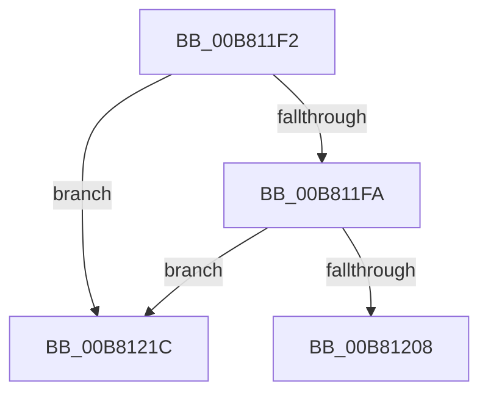

# sub_00B811F2

- RVA: `0x00B811F2`–`0x00B81231` (길이 `63` bytes)
- VA: `0x0000000140B811F2`
- 실행 섹션: `PAGELK`
- PDB 이름 있음: `아니요`; PDB Function 태그: `아니요`
- unwind 정보 RVA: `0x000BB940`
- 디코드: `20`개 명령, `63/63` bytes 표시
- 미해석 바이트: `0` (있으면 어셈블리에 `.byte`로 보존)

> 이 문서는 커널 이미지의 기계어와 PDB 기호를 분석해 생성했습니다. 4번과 5번은 함수 원형과 자료형을 바이너리 사용 방식에서 추정한 C 해석이며 원본 소스 복구 결과는 아닙니다.

## 1. Dependencies

- 직접 호출 지점: **3**; 고유 호출 대상: **3**
- 직접 호출자로 확인된 함수: **0**
- RIP 상대 이미지 참조: **0**

### Outgoing calls
- `0x00B811FD` → [HalpDispatchSystemStateTransition](../../text/4C/HalpDispatchSystemStateTransition_function_004C8E34.md) (function, `0x004C8E34`)
- `0x00B81210` → [IofCompleteRequest](../../text/29/IofCompleteRequest_function_0029B5C0.md) (function, `0x0029B5C0`)
- `0x00B81225` → [HalpPassIrpFromFdoToPdo](../../text/4E/HalpPassIrpFromFdoToPdo_function_004E15F4.md) (function, `0x004E15F4`)

### Direct callers
- 이 함수 시작 RVA로 연결되는 직접 call은 확인되지 않았습니다. 간접 호출은 완전히 역산할 수 없습니다.

### Static image references
- 디코드된 RIP-relative 메모리 참조가 없습니다.

## 2. Other-region calls and transfers

- 다른 실행 섹션으로 향하는 call: **3**
  - `0x00B811FD` → [HalpDispatchSystemStateTransition](../../text/4C/HalpDispatchSystemStateTransition_function_004C8E34.md) (`PAGELK` → `.text`)
  - `0x00B81210` → [IofCompleteRequest](../../text/29/IofCompleteRequest_function_0029B5C0.md) (`PAGELK` → `.text`)
  - `0x00B81225` → [HalpPassIrpFromFdoToPdo](../../text/4E/HalpPassIrpFromFdoToPdo_function_004E15F4.md) (`PAGELK` → `.text`)
- call이 아닌 외부 분기/꼬리 이동: **2**
  - `0x00B81217` → [HalpDispatchPower + 0x4D](../B7/HalpDispatchPower_function_00B7C0A0.md) (`tail-transfer`)
  - `0x00B8122C` → [HalpDispatchPower + 0x4B](../B7/HalpDispatchPower_function_00B7C0A0.md) (`tail-transfer`)

## 3. Assembly (complete function range)

```asm
00B811F2  33 DB                           xor ebx, ebx
00B811F4  41 39 58 10                     cmp dword ptr [r8 + 0x10], ebx
00B811F8  75 22                           jne 0x140b8121c
00B811FA  48 8B CF                        mov rcx, rdi
00B811FD  E8 32 7C 94 FF                  call 0x1404c8e34
00B81202  8B F0                           mov esi, eax
00B81204  85 C0                           test eax, eax
00B81206  79 14                           jns 0x140b8121c
00B81208  33 D2                           xor edx, edx
00B8120A  89 47 30                        mov dword ptr [rdi + 0x30], eax
00B8120D  48 8B CF                        mov rcx, rdi
00B81210  E8 AB A3 71 FF                  call 0x14029b5c0
00B81215  8B C6                           mov eax, esi
00B81217  E9 D1 AE FF FF                  jmp 0x140b7c0ed
00B8121C  89 5F 30                        mov dword ptr [rdi + 0x30], ebx
00B8121F  48 8B D7                        mov rdx, rdi
00B81222  48 8B CD                        mov rcx, rbp
00B81225  E8 CA 03 96 FF                  call 0x1404e15f4
00B8122A  8B D8                           mov ebx, eax
00B8122C  E9 BA AE FF FF                  jmp 0x140b7c0eb
```

## 4. C-style interpretation (structured pseudocode)

```c
__int64 __fastcall sub_00B811F2(__int64 a1, int a2, __int64 a3)
{
    __int64 result;
    __int64 v_rbx;

    v_rbx = 0;
    if ((*(unsigned int *)(a3 + 16)) != 0) goto loc_00B8121C;
    result = HalpDispatchSystemStateTransition(v_rdi, a2, a3, a4);
    if (!sign_flag) goto loc_00B8121C;
    a2 = 0;
    *(unsigned int *)(v_rdi + 48) = (unsigned int)(result);
    result = IofCompleteRequest(v_rdi, a2, a3, a4);
loc_00B8121C:
    *(unsigned int *)(v_rdi + 48) = 0;
    result = HalpPassIrpFromFdoToPdo(v_rbp, v_rdi, a3, a4);
}
```

## 5. (Beta) C Style

```c
int64_t sub_00B811F2(int64_t Arg1, int32_t Arg2, void *Arg3)
{
    uint8_t *arg3 = (uint8_t *)Arg3;

    int64_t result;
    int64_t local_rbx;

    local_rbx = 0;
    if ((*(uint32_t *)(arg3 + 0x10)) != 0) goto loc_00B8121C;
    result = HalpDispatchSystemStateTransition(local_rdi, Arg2, Arg3, a4);
    if (!sign_flag) goto loc_00B8121C;
    Arg2 = 0;
    *(uint32_t *)(local_rdi + 0x30) = (uint32_t)(result);
    result = IofCompleteRequest(local_rdi, Arg2, Arg3, a4);
loc_00B8121C:
    *(uint32_t *)(local_rdi + 0x30) = 0;
    result = HalpPassIrpFromFdoToPdo(local_rbp, local_rdi, Arg3, a4);
}
```

### 관측된 메모리 오프셋

구조체 형식이 확인되지 않은 접근은 인자 기준의 오프셋으로만 기록했습니다.

| 기준 인자 | 오프셋 표현 | 폭 (bit) | 접근 |
|---|---:|---:|---|
| `Arg3` | `+ 0x10` | `32` | `R` |

## 6. Execution-region graph

[열기: 2D/3D 그래프와 함수 탐색 컨트롤 패널](../../../control-panel.html?section=pagelk&rva=0x00B811F2&view=graph)

- 2D 그래프는 위에서 아래로 흐르고, 3D 그래프는 빈 공간을 드래그해 회전합니다. Shift+드래그는 이동, 휠은 확대·축소, 함수 노드 선택은 대상 보고서 이동입니다.

### Static fallback


