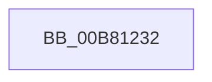

# sub_00B81232

- RVA: `0x00B81232`–`0x00B81249` (길이 `23` bytes)
- VA: `0x0000000140B81232`
- 실행 섹션: `PAGELK`
- PDB 이름 있음: `아니요`; PDB Function 태그: `아니요`
- unwind 정보 RVA: `0x000BB9DC`
- 디코드: `6`개 명령, `23/23` bytes 표시
- 미해석 바이트: `0` (있으면 어셈블리에 `.byte`로 보존)

> 이 문서는 커널 이미지의 기계어와 PDB 기호를 분석해 생성했습니다. 4번과 5번은 함수 원형과 자료형을 바이너리 사용 방식에서 추정한 C 해석이며 원본 소스 복구 결과는 아닙니다.

## 1. Dependencies

- 직접 호출 지점: **1**; 고유 호출 대상: **1**
- 직접 호출자로 확인된 함수: **0**
- RIP 상대 이미지 참조: **1**

### Outgoing calls
- `0x00B8123E` → [HalpInterruptSetProblemEx](../../text/48/HalpInterruptSetProblemEx_function_0048AC8C.md) (function, `0x0048AC8C`)

### Direct callers
- 이 함수 시작 RVA로 연결되는 직접 call은 확인되지 않았습니다. 간접 호출은 완전히 역산할 수 없습니다.

### Static image references
- `0x00B81235` → RVA `0x00023C30` (`.rdata`; read)

## 2. Other-region calls and transfers

- 다른 실행 섹션으로 향하는 call: **1**
  - `0x00B8123E` → [HalpInterruptSetProblemEx](../../text/48/HalpInterruptSetProblemEx_function_0048AC8C.md) (`PAGELK` → `.text`)
- call이 아닌 외부 분기/꼬리 이동: **1**
  - `0x00B81244` → [HalpInterruptMaskAcpi + 0x85](../B7/HalpInterruptMaskAcpi_function_00B7C128.md) (`tail-transfer`)

## 3. Assembly (complete function range)

```asm
00B81232  45 33 C0                        xor r8d, r8d
00B81235  4C 8D 0D F4 29 4A FF            lea r9, [rip - 0xb5d60c]
00B8123C  33 C9                           xor ecx, ecx
00B8123E  E8 49 9A 90 FF                  call 0x14048ac8c
00B81243  90                              nop
00B81244  E9 64 AF FF FF                  jmp 0x140b7c1ad
```

## 4. C-style interpretation (structured pseudocode)

```c
__int64 __fastcall sub_00B81232(int a1, __int64 a2, int a3)
{
    __int64 result;

    a3 = 0;
    a1 = 0;
    result = HalpInterruptSetProblemEx(a1, a2, a3, v_rip - 11916812);
}
```

## 5. (Beta) C Style

```c
int64_t sub_00B81232(int32_t Arg1, int64_t Arg2, int32_t Arg3)
{
    int64_t result;

    Arg3 = 0;
    Arg1 = 0;
    result = HalpInterruptSetProblemEx(Arg1, Arg2, Arg3, v_rip - 11916812);
}
```

## 6. Execution-region graph

[열기: 2D/3D 그래프와 함수 탐색 컨트롤 패널](../../../control-panel.html?section=pagelk&rva=0x00B81232&view=graph)

- 2D 그래프는 위에서 아래로 흐르고, 3D 그래프는 빈 공간을 드래그해 회전합니다. Shift+드래그는 이동, 휠은 확대·축소, 함수 노드 선택은 대상 보고서 이동입니다.

### Static fallback


