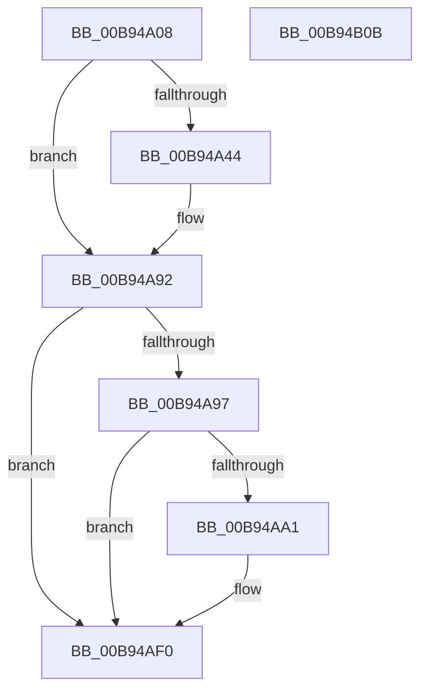

# ADD_MAP_REGISTERS

- RVA: `0x00B94A08`–`0x00B94B0C` (길이 `260` bytes)
- VA: `0x0000000140B94A08`
- 실행 섹션: `PAGEVRFY`
- PDB 이름 있음: `예`; PDB Function 태그: `아니요`
- unwind 정보 RVA: `0x0005D7BC`
- 디코드: `62`개 명령, `260/260` bytes 표시
- 미해석 바이트: `0` (있으면 어셈블리에 `.byte`로 보존)

> 이 문서는 커널 이미지의 기계어와 PDB 기호를 분석해 생성했습니다. 4번과 5번은 함수 원형과 자료형을 바이너리 사용 방식에서 추정한 C 해석이며 원본 소스 복구 결과는 아닙니다.

## 1. Dependencies

- 직접 호출 지점: **4**; 고유 호출 대상: **2**
- 직접 호출자로 확인된 함수: **5**
- RIP 상대 이미지 참조: **4**

### Outgoing calls
- `0x00B94A69` → [ViHalPreprocessOptions](ViHalPreprocessOptions_function_00B9920C.md) (function, `0x00B9920C`)
- `0x00B94A8D` → [VfReportIssueWithOptions](../../text/61/VfReportIssueWithOptions_function_00614444.md) (function, `0x00614444`)
- `0x00B94ACA` → [ViHalPreprocessOptions](ViHalPreprocessOptions_function_00B9920C.md) (function, `0x00B9920C`)
- `0x00B94AEB` → [VfReportIssueWithOptions](../../text/61/VfReportIssueWithOptions_function_00614444.md) (function, `0x00614444`)

### Direct callers
- [VfAllocateAdapterChannel](VfAllocateAdapterChannel_function_00B95180.md) at `0x00B95253`
- [VfAllocateAdapterChannelEx](VfAllocateAdapterChannelEx_function_00B95360.md) at `0x00B9542C`
- [VfAllocateCrashDumpRegisters](VfAllocateCrashDumpRegisters_function_00B95860.md) at `0x00B958C6`
- [VfHalAllocateMapRegisters](VfHalAllocateMapRegisters_function_00B970B0.md) at `0x00B97155`
- [ViScatterGatherCallback](ViScatterGatherCallback_function_00B99B20.md) at `0x00B99B51`

### Static image references
- `0x00B94A49` → RVA `0x00E0E9A8` (`.data`; read)
- `0x00B94A5E` → RVA `0x00BBA170` (` ?? ::JKADOLAD::`string'`; read)
- `0x00B94AA7` → RVA `0x00BBA140` (` ?? ::JKADOLAD::`string'`; read)
- `0x00B94ABB` → RVA `0x00E0E9A4` (`.data`; read)

## 2. Other-region calls and transfers

- 다른 실행 섹션으로 향하는 call: **2**
  - `0x00B94A8D` → [VfReportIssueWithOptions](../../text/61/VfReportIssueWithOptions_function_00614444.md) (`PAGEVRFY` → `.text`)
  - `0x00B94AEB` → [VfReportIssueWithOptions](../../text/61/VfReportIssueWithOptions_function_00614444.md) (`PAGEVRFY` → `.text`)
- 별도 외부 분기/꼬리 이동을 확인하지 못했습니다.

## 3. Assembly (complete function range)

```asm
00B94A08  4C 8B DC                        mov r11, rsp
00B94A0B  49 89 5B 08                     mov qword ptr [r11 + 8], rbx
00B94A0F  49 89 6B 10                     mov qword ptr [r11 + 0x10], rbp
00B94A13  49 89 73 18                     mov qword ptr [r11 + 0x18], rsi
00B94A17  49 89 7B 20                     mov qword ptr [r11 + 0x20], rdi
00B94A1B  41 56                           push r14
00B94A1D  48 83 EC 30                     sub rsp, 0x30
00B94A21  41 8A E8                        mov bpl, r8b
00B94A24  48 8B F9                        mov rdi, rcx
00B94A27  8B F2                           mov esi, edx
00B94A29  F0 0F C1 B1 C0 00 00 00         lock xadd dword ptr [rcx + 0xc0], esi
00B94A31  03 F2                           add esi, edx
00B94A33  F0 01 91 BC 00 00 00            lock add dword ptr [rcx + 0xbc], edx
00B94A3A  8B 81 B8 00 00 00               mov eax, dword ptr [rcx + 0xb8]
00B94A40  3B D0                           cmp edx, eax
00B94A42  76 4E                           jbe 0x140b94a92
00B94A44  49 83 63 F0 00                  and qword ptr [r11 - 0x10], 0
00B94A49  4C 8D 35 58 9F 27 00            lea r14, [rip + 0x279f58]
00B94A50  8B DA                           mov ebx, edx
00B94A52  49 8B CE                        mov rcx, r14
00B94A55  44 8B CA                        mov r9d, edx
00B94A58  41 B8 0C 00 00 00               mov r8d, 0xc
00B94A5E  48 8D 15 0B 57 02 00            lea rdx, [rip + 0x2570b]
00B94A65  49 89 43 E8                     mov qword ptr [r11 - 0x18], rax
00B94A69  E8 9E 47 00 00                  call 0x140b9920c
00B94A6E  44 8B 8F B8 00 00 00            mov r9d, dword ptr [rdi + 0xb8]
00B94A75  44 8B C3                        mov r8d, ebx
00B94A78  4C 89 74 24 28                  mov qword ptr [rsp + 0x28], r14
00B94A7D  BA 0C 00 00 00                  mov edx, 0xc
00B94A82  48 83 64 24 20 00               and qword ptr [rsp + 0x20], 0
00B94A88  B9 E6 00 00 00                  mov ecx, 0xe6
00B94A8D  E8 B2 F9 A7 FF                  call 0x140614444
00B94A92  40 84 ED                        test bpl, bpl
00B94A95  75 59                           jne 0x140b94af0
00B94A97  8B 87 B8 00 00 00               mov eax, dword ptr [rdi + 0xb8]
00B94A9D  3B F0                           cmp esi, eax
00B94A9F  76 4F                           jbe 0x140b94af0
00B94AA1  48 83 64 24 28 00               and qword ptr [rsp + 0x28], 0
00B94AA7  48 8D 15 92 56 02 00            lea rdx, [rip + 0x25692]
00B94AAE  44 8B CE                        mov r9d, esi
00B94AB1  BD 15 00 00 00                  mov ebp, 0x15
00B94AB6  8B DE                           mov ebx, esi
00B94AB8  44 8B C5                        mov r8d, ebp
00B94ABB  48 8D 35 E2 9E 27 00            lea rsi, [rip + 0x279ee2]
00B94AC2  48 89 44 24 20                  mov qword ptr [rsp + 0x20], rax
00B94AC7  48 8B CE                        mov rcx, rsi
00B94ACA  E8 3D 47 00 00                  call 0x140b9920c
00B94ACF  44 8B 8F B8 00 00 00            mov r9d, dword ptr [rdi + 0xb8]
00B94AD6  44 8B C3                        mov r8d, ebx
00B94AD9  48 89 74 24 28                  mov qword ptr [rsp + 0x28], rsi
00B94ADE  8B D5                           mov edx, ebp
00B94AE0  48 83 64 24 20 00               and qword ptr [rsp + 0x20], 0
00B94AE6  B9 E6 00 00 00                  mov ecx, 0xe6
00B94AEB  E8 54 F9 A7 FF                  call 0x140614444
00B94AF0  48 8B 5C 24 40                  mov rbx, qword ptr [rsp + 0x40]
00B94AF5  48 8B 6C 24 48                  mov rbp, qword ptr [rsp + 0x48]
00B94AFA  48 8B 74 24 50                  mov rsi, qword ptr [rsp + 0x50]
00B94AFF  48 8B 7C 24 58                  mov rdi, qword ptr [rsp + 0x58]
00B94B04  48 83 C4 30                     add rsp, 0x30
00B94B08  41 5E                           pop r14
00B94B0A  C3                              ret
00B94B0B  CC                              int3
```

## 4. C-style interpretation (structured pseudocode)

```c
__int64 __fastcall ADD_MAP_REGISTERS(__int64 a1, int a2, unsigned __int8 a3)
{
    __int64 result;
    __int64 v_r14;
    __int64 v_rbp;
    __int64 v_rbx;
    __int64 v_rsi;
    __int64 v_rsp;
    unsigned __int64 v_stack_m10;
    unsigned __int64 v_stack_m18;
    unsigned __int64 v_stack_p10;
    unsigned __int64 v_stack_p18;
    unsigned __int64 v_stack_p20;
    unsigned __int64 v_stack_p8;

    *(unsigned __int64 *)(v_rsp + 8) = v_rbx;
    *(unsigned __int64 *)(v_rsp + 16) = v_rbp;
    *(unsigned __int64 *)(v_rsp + 24) = v_rsi;
    *(unsigned __int64 *)(v_rsp + 32) = v_rdi;
    v_rsp = (v_rsp) - (48);
    v_rsi = (unsigned int)(((unsigned int)(a2)) + (a2));
    result = (unsigned int)(*(unsigned int *)(a1 + 184));
    if (a2 >= = ((unsigned int)((unsigned int)(*(unsigned int *)(a1 + 184))))) {
        v_r14 = v_rip + 2596696;
        v_rbx = a2;
        a1 = v_r14;
        a4 = a2;
        a3 = 12;
        a2 = v_rip + 153355;
        *(unsigned __int64 *)(v_rsp - 24) = (unsigned int)(*(unsigned int *)(a1 + 184));
        result = ViHalPreprocessOptions(a1, a2, a3, a4);
        a4 = *(unsigned int *)(a1 + 184);
        a3 = (unsigned int)(v_rbx);
        v_stack_m10 = v_r14;
        a2 = 12;
        a1 = 230;
        result = VfReportIssueWithOptions(a1, a2, a3, a4);
    }
    if (a3 != 0) goto loc_00B94AF0;
    result = (unsigned int)(*(unsigned int *)(a1 + 184));
    v_rbp = a3;
    if (((unsigned int)(v_rsi)) >= = ((unsigned int)((unsigned int)(*(unsigned int *)(a1 + 184))))) {
        a2 = v_rip + 153234;
        a4 = (unsigned int)(v_rsi);
        v_rbp = 21;
        v_rbx = (unsigned int)(v_rsi);
        a3 = (unsigned int)(v_rbp);
        v_rsi = v_rip + 2596578;
        v_stack_m18 = (unsigned int)(*(unsigned int *)(a1 + 184));
        a1 = v_rsi;
        result = ViHalPreprocessOptions(a1, a2, a3, a4);
        a4 = *(unsigned int *)(a1 + 184);
        a3 = (unsigned int)(v_rbx);
        v_stack_m10 = v_rsi;
        a2 = (unsigned int)(v_rbp);
        a1 = 230;
        result = VfReportIssueWithOptions(a1, a2, a3, a4);
    }
    v_rsp = (v_rsp) + (48);
    return result;
}
```

## 5. (Beta) C Style

```c
int64_t ADD_MAP_REGISTERS(void *Arg1, int32_t Arg2, uint8_t Arg3)
{
    uint8_t *arg1 = (uint8_t *)Arg1;

    int64_t result;
    int64_t local_r14;
    int64_t local_rbp;
    int64_t local_rbx;
    int64_t local_rsi;
    int64_t local_rsp;
    uint64_t v_stack_m10;
    uint64_t v_stack_m18;
    uint64_t v_stack_p10;
    uint64_t v_stack_p18;
    uint64_t v_stack_p20;
    uint64_t v_stack_p8;

    *(uint64_t *)(local_rsp + 0x8) = local_rbx;
    *(uint64_t *)(local_rsp + 0x10) = local_rbp;
    *(uint64_t *)(local_rsp + 0x18) = local_rsi;
    *(uint64_t *)(local_rsp + 0x20) = local_rdi;
    local_rsp = (local_rsp) - (48);
    local_rsi = (uint32_t)(((uint32_t)(Arg2)) + (Arg2));
    result = (uint32_t)(*(uint32_t *)(arg1 + 0xB8));
    if (Arg2 >= = ((uint32_t)((uint32_t)(*(uint32_t *)(arg1 + 0xB8))))) {
        local_r14 = v_rip + 2596696;
        local_rbx = Arg2;
        Arg1 = local_r14;
        a4 = Arg2;
        Arg3 = 12;
        Arg2 = v_rip + 153355;
        *(uint64_t *)(local_rsp - 0x18) = (uint32_t)(*(uint32_t *)(arg1 + 0xB8));
        result = ViHalPreprocessOptions(Arg1, Arg2, Arg3, a4);
        a4 = *(uint32_t *)(arg1 + 0xB8);
        Arg3 = (uint32_t)(local_rbx);
        v_stack_m10 = local_r14;
        Arg2 = 12;
        Arg1 = 230;
        result = VfReportIssueWithOptions(Arg1, Arg2, Arg3, a4);
    }
    if (Arg3 != 0) goto loc_00B94AF0;
    result = (uint32_t)(*(uint32_t *)(arg1 + 0xB8));
    local_rbp = Arg3;
    if (((uint32_t)(local_rsi)) >= = ((uint32_t)((uint32_t)(*(uint32_t *)(arg1 + 0xB8))))) {
        Arg2 = v_rip + 153234;
        a4 = (uint32_t)(local_rsi);
        local_rbp = 21;
        local_rbx = (uint32_t)(local_rsi);
        Arg3 = (uint32_t)(local_rbp);
        local_rsi = v_rip + 2596578;
        v_stack_m18 = (uint32_t)(*(uint32_t *)(arg1 + 0xB8));
        Arg1 = local_rsi;
        result = ViHalPreprocessOptions(Arg1, Arg2, Arg3, a4);
        a4 = *(uint32_t *)(arg1 + 0xB8);
        Arg3 = (uint32_t)(local_rbx);
        v_stack_m10 = local_rsi;
        Arg2 = (uint32_t)(local_rbp);
        Arg1 = 230;
        result = VfReportIssueWithOptions(Arg1, Arg2, Arg3, a4);
    }
    local_rsp = (local_rsp) + (48);
    return result;
}
```

### 관측된 메모리 오프셋

구조체 형식이 확인되지 않은 접근은 인자 기준의 오프셋으로만 기록했습니다.

| 기준 인자 | 오프셋 표현 | 폭 (bit) | 접근 |
|---|---:|---:|---|
| `Arg1` | `+ 0xB8` | `32` | `R` |
| `Arg1` | `+ 0xBC` | `32` | `R/W` |
| `Arg1` | `+ 0xC0` | `32` | `R/W` |

## 6. Execution-region graph

[열기: 2D/3D 그래프와 함수 탐색 컨트롤 패널](../../../control-panel.html?section=pagevrfy&rva=0x00B94A08&view=graph)

- 2D 그래프는 위에서 아래로 흐르고, 3D 그래프는 빈 공간을 드래그해 회전합니다. Shift+드래그는 이동, 휠은 확대·축소, 함수 노드 선택은 대상 보고서 이동입니다.

### Static fallback


