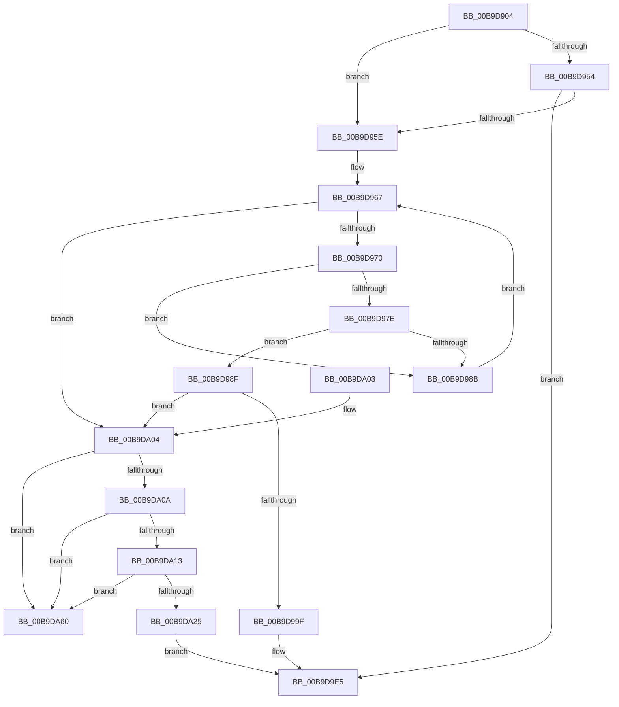

# CarReportRuleViolationFromNt

- RVA: `0x00B9D904`–`0x00B9DA7E` (길이 `378` bytes)
- VA: `0x0000000140B9D904`
- 실행 섹션: `PAGEVRFY`
- PDB 이름 있음: `예`; PDB Function 태그: `아니요`
- unwind 정보 RVA: `0x000D2484`
- 디코드: `86`개 명령, `378/378` bytes 표시
- 미해석 바이트: `0` (있으면 어셈블리에 `.byte`로 보존)

> 이 문서는 커널 이미지의 기계어와 PDB 기호를 분석해 생성했습니다. 4번과 5번은 함수 원형과 자료형을 바이너리 사용 방식에서 추정한 C 해석이며 원본 소스 복구 결과는 아닙니다.

## 1. Dependencies

- 직접 호출 지점: **5**; 고유 호출 대상: **5**
- 직접 호출자로 확인된 함수: **85**
- RIP 상대 이미지 참조: **5**

### Outgoing calls
- `0x00B9D935` → [memset](../../text/6C/memset_function_006C6C40.md) (function, `0x006C6C40`)
- `0x00B9D943` → [CarInitializeRuleViolationDetails](../../text/61/CarInitializeRuleViolationDetails_function_00618B80.md) (function, `0x00618B80`)
- `0x00B9DA1C` → [CarQueryReportActionForTriage](../../text/61/CarQueryReportActionForTriage_function_00618E10.md) (function, `0x00618E10`)
- `0x00B9DA59` → [CarReportDifPluginRuleViolation](../../text/61/CarReportDifPluginRuleViolation_function_00619250.md) (function, `0x00619250`)
- `0x00B9DA78` → [KeBugCheckEx](../../text/4F/KeBugCheckEx_function_004FD660.md) (function, `0x004FD660`)

### Direct callers
- [VfFailDeviceNode](../../text/4B/VfFailDeviceNode_function_004B4EC0.md) at `0x004B4F10`
- [VfMiscCheckKernelAddress](../../text/4B/VfMiscCheckKernelAddress_function_004BC694.md) at `0x004BC6EF`
- [VfFailDriver](../../text/61/VfFailDriver_function_00612720.md) at `0x00612759`
- [VfFailSystemBIOS](../../text/61/VfFailSystemBIOS_function_00612770.md) at `0x006127CD`
- [MdlInvariantPostProcessing1](../../text/61/MdlInvariantPostProcessing1_function_00613AE0.md) at `0x00613CCB`
- [MdlInvariantPreProcessing1](../../text/61/MdlInvariantPreProcessing1_function_00613CEC.md) at `0x00613F6C`
- [VfReportIssueWithOptions](../../text/61/VfReportIssueWithOptions_function_00614444.md) at `0x0061455E`
- [ViSpMmProbeAndLockProcessPages_Entry](../../text/6A/ViSpMmProbeAndLockProcessPages_Entry_function_006AA9F0.md) at `0x006AAA2C`
- [ViSpMmProbeAndLockProcessPages_Entry](../../text/6A/ViSpMmProbeAndLockProcessPages_Entry_function_006AA9F0.md) at `0x006AAA69`
- [ViIoInitializeTimer_Entry](../../text/6A/ViIoInitializeTimer_Entry_function_006AACE0.md) at `0x006AAD11`
- [VerifierIoAllocateIrp](VerifierIoAllocateIrp_function_00B9AC70.md) at `0x00B9ACD1`
- [VerifierIoAllocateIrp](VerifierIoAllocateIrp_function_00B9AC70.md) at `0x00B9AD03`
- [VerifierIoAllocateIrpEx](VerifierIoAllocateIrpEx_function_00B9AD90.md) at `0x00B9ADF9`
- [VerifierIoAllocateIrpEx](VerifierIoAllocateIrpEx_function_00B9AD90.md) at `0x00B9AE2B`
- [VerifierPortIoAllocateIrp](VerifierPortIoAllocateIrp_function_00B9B0C0.md) at `0x00B9B11F`
- [VerifierPortIoAllocateIrp](VerifierPortIoAllocateIrp_function_00B9B0C0.md) at `0x00B9B151`
- [VfTargetEtwUnregister](VfTargetEtwUnregister_function_00B9B590.md) at `0x00B9B67F`
- [ViTargetRemovingCheckContiguousMemory](ViTargetRemovingCheckContiguousMemory_function_00B9BAA8.md) at `0x00B9BAF2`
- [ViTargetRemovingCheckEtwWmi](ViTargetRemovingCheckEtwWmi_function_00B9BB34.md) at `0x00B9BB76`
- [ViTargetRemovingCheckEtwWmi](ViTargetRemovingCheckEtwWmi_function_00B9BB34.md) at `0x00B9BBB8`
- [ViIrpCheckKernelAddressForIrp](ViIrpCheckKernelAddressForIrp_function_00B9E218.md) at `0x00B9E2A2`
- [VerifierIoVolumeDeviceToDosName](../BA/VerifierIoVolumeDeviceToDosName_function_00BA2180.md) at `0x00BA21CA`
- [ViDevObjRemove](../BA/ViDevObjRemove_function_00BA248C.md) at `0x00BA2522`
- [VerifierIoInitializeRemoveLockEx](../BA/VerifierIoInitializeRemoveLockEx_function_00BA2610.md) at `0x00BA269F`
- [VfRemLockReportBadReleaseAndWaitTag](../BA/VfRemLockReportBadReleaseAndWaitTag_function_00BA287C.md) at `0x00BA28A0`
- [VfRemLockReportBadReleaseTag](../BA/VfRemLockReportBadReleaseTag_function_00BA28B8.md) at `0x00BA28DD`
- [ViErrorFinishReport](../BA/ViErrorFinishReport_function_00BA366C.md) at `0x00BA376A`
- [VfZwNotifyChangeKey_Entry](../BA/VfZwNotifyChangeKey_Entry_function_00BA45F0.md) at `0x00BA4645`
- [ViZwCheckApcRequirement](../BA/ViZwCheckApcRequirement_function_00BA4C18.md) at `0x00BA4C68`
- [ViZwCheckUnicodeString](../BA/ViZwCheckUnicodeString_function_00BA4CD0.md) at `0x00BA4D47`
- [ViZwCheckVirtualAddress](../BA/ViZwCheckVirtualAddress_function_00BA4D68.md) at `0x00BA4DA0`
- [ViShutdownWatchdogExecuteDpc](../BA/ViShutdownWatchdogExecuteDpc_function_00BA4E70.md) at `0x00BA4EDD`
- [VfPoolCheckForLeaks](../BA/VfPoolCheckForLeaks_function_00BAA340.md) at `0x00BAA39B`
- [VerifierPortExAllocatePoolWithQuotaTag](../BA/VerifierPortExAllocatePoolWithQuotaTag_function_00BABE80.md) at `0x00BABEE1`
- [VerifierPortExAllocatePoolWithQuotaTag](../BA/VerifierPortExAllocatePoolWithQuotaTag_function_00BABE80.md) at `0x00BABF13`
- [Below4gb_AllocateCommonBuffer_Entry](../BA/Below4gb_AllocateCommonBuffer_Entry_function_00BAC140.md) at `0x00BAC17C`
- [Below4gb_MmAllocateContiguousMemorySpecifyCacheNode_Entry](../BA/Below4gb_MmAllocateContiguousMemorySpecifyCacheNode_Entry_function_00BAC190.md) at `0x00BAC1CB`
- [Below4gb_MmAllocateContiguousMemory_Entry](../BA/Below4gb_MmAllocateContiguousMemory_Entry_function_00BAC1E0.md) at `0x00BAC21B`
- [Below4gb_MmAllocateNodePagesForMdlEx_Entry](../BA/Below4gb_MmAllocateNodePagesForMdlEx_Entry_function_00BAC230.md) at `0x00BAC269`
- [Below4gb_MmAllocatePagesForMdlEx_Entry](../BA/Below4gb_MmAllocatePagesForMdlEx_Entry_function_00BAC280.md) at `0x00BAC2B9`
- [Below4gb_MmAllocatePagesForMdl_Entry](../BA/Below4gb_MmAllocatePagesForMdl_Entry_function_00BAC2D0.md) at `0x00BAC309`
- [ViWdIrpTimerDpcRoutine](../BA/ViWdIrpTimerDpcRoutine_function_00BACC10.md) at `0x00BACCF9`
- [ViIrqlKeLeaveCriticalRegion_Entry](../BA/ViIrqlKeLeaveCriticalRegion_Entry_function_00BAD690.md) at `0x00BAD6D5`
- [VfMiscExInitializeLookasideListEx_Entry](../BA/VfMiscExInitializeLookasideListEx_Entry_function_00BAD8A0.md) at `0x00BAD8DC`
- [VfMiscExInitializeNPagedLookasideList_Entry](../BA/VfMiscExInitializeNPagedLookasideList_Entry_function_00BAD930.md) at `0x00BAD96C`
- [VfMiscIoFreeMdl_Entry](../BA/VfMiscIoFreeMdl_Entry_function_00BADB00.md) at `0x00BADB4B`
- [VfMiscIoInitializeWorkItem_Entry](../BA/VfMiscIoInitializeWorkItem_Entry_function_00BADB60.md) at `0x00BADBB4`
- [VfMiscKeAcquireInStackQueuedSpinLockAtDpcLevel_Entry](../BA/VfMiscKeAcquireInStackQueuedSpinLockAtDpcLevel_Entry_function_00BADBD0.md) at `0x00BADC3A`
- [VfMiscKeReleaseInStackQueuedSpinLockForDpc_Entry](../BA/VfMiscKeReleaseInStackQueuedSpinLockForDpc_Entry_function_00BADDD0.md) at `0x00BADE17`
- [VfMiscKeReleaseInStackQueuedSpinLock_Entry](../BA/VfMiscKeReleaseInStackQueuedSpinLock_Entry_function_00BADE30.md) at `0x00BADE73`
- [VfMiscKeTryToAcquireSpinLockAtDpcLevel_Entry](../BA/VfMiscKeTryToAcquireSpinLockAtDpcLevel_Entry_function_00BADFC0.md) at `0x00BAE019`
- [VfMiscMmBuildMdlForNonPagedPool_Entry](../BA/VfMiscMmBuildMdlForNonPagedPool_Entry_function_00BAE0F0.md) at `0x00BAE134`
- [VfMiscMmBuildMdlForNonPagedPool_Exit](../BA/VfMiscMmBuildMdlForNonPagedPool_Exit_function_00BAE150.md) at `0x00BAE1B3`
- [VfMiscMmUnmapLockedPages_Entry](../BA/VfMiscMmUnmapLockedPages_Entry_function_00BAE1D0.md) at `0x00BAE259`
- [VfMiscMmUnmapLockedPages_Entry](../BA/VfMiscMmUnmapLockedPages_Entry_function_00BAE1D0.md) at `0x00BAE416`
- [VfMiscObReferenceObjectByHandle_Exit](../BA/VfMiscObReferenceObjectByHandle_Exit_function_00BAE4A0.md) at `0x00BAE537`
- [VfMiscObReferenceObjectByPointer_Entry](../BA/VfMiscObReferenceObjectByPointer_Entry_function_00BAE580.md) at `0x00BAE5C9`
- [VfMiscObfReferenceObject_Exit](../BA/VfMiscObfReferenceObject_Exit_function_00BAE610.md) at `0x00BAE643`
- [ViMiscCheckResourceAcquire](../BA/ViMiscCheckResourceAcquire_function_00BAF330.md) at `0x00BAF36C`
- [ViMiscCheckResourceAcquire](../BA/ViMiscCheckResourceAcquire_function_00BAF330.md) at `0x00BAF3D8`
- [ViMiscCheckResourceRelease](../BA/ViMiscCheckResourceRelease_function_00BAF3F4.md) at `0x00BAF45C`
- [ViMiscEnforceRule](../BA/ViMiscEnforceRule_function_00BAF470.md) at `0x00BAF4BE`
- [ViMiscExCheckAPCsDisabled](../BA/ViMiscExCheckAPCsDisabled_function_00BAF4D8.md) at `0x00BAF53F`
- [ViMiscValidateKeWaitUsage](../BA/ViMiscValidateKeWaitUsage_function_00BAF554.md) at `0x00BAF5E7`
- [ViMiscValidateKeWaitUsage](../BA/ViMiscValidateKeWaitUsage_function_00BAF554.md) at `0x00BAF667`
- [ViMiscValidateSynchronizationObject](../BA/ViMiscValidateSynchronizationObject_function_00BAF698.md) at `0x00BAF6DA`
- [ViRlrsMmMapLockedPages_Entry](../BA/ViRlrsMmMapLockedPages_Entry_function_00BAF760.md) at `0x00BAF7A3`
- [VfLookasideAdd](../BA/VfLookasideAdd_function_00BAFE34.md) at `0x00BAFEEE`
- [VfLookasideDelete](../BA/VfLookasideDelete_function_00BAFF58.md) at `0x00BAFFED`
- [VerifierMmMapLockedPagesSpecifyCache](../BB/VerifierMmMapLockedPagesSpecifyCache_function_00BB0B30.md) at `0x00BB0B95`
- [VerifierMmUnlockPages](../BB/VerifierMmUnlockPages_function_00BB0D20.md) at `0x00BB0D6E`
- [VerifierMmUnlockPages](../BB/VerifierMmUnlockPages_function_00BB0D20.md) at `0x00BB0DA9`
- [VerifierMmUnlockPages](../BB/VerifierMmUnlockPages_function_00BB0D20.md) at `0x00BB0DE8`
- [VerifierMmUnlockPages](../BB/VerifierMmUnlockPages_function_00BB0D20.md) at `0x00BB0E21`
- [VerifierMmUnmapIoSpace](../BB/VerifierMmUnmapIoSpace_function_00BB0EA0.md) at `0x00BB0EEB`
- [VfDeleteResource](../BB/VfDeleteResource_function_00BB187C.md) at `0x00BB191B`
- [VfTrackResource](../BB/VfTrackResource_function_00BB19A0.md) at `0x00BB1A58`
- [ViCtxCheckAndReleaseIsrState](../BB/ViCtxCheckAndReleaseIsrState_function_00BB1F40.md) at `0x00BB203B`
- [VfIrpDatabaseCheckExFreePool](../BB/VfIrpDatabaseCheckExFreePool_function_00BB3E54.md) at `0x00BB3EE6`
- [ExAllocatePoolSanityChecks](../BB/ExAllocatePoolSanityChecks_function_00BB42E4.md) at `0x00BB4340`
- [ExAllocatePoolSanityChecks](../BB/ExAllocatePoolSanityChecks_function_00BB42E4.md) at `0x00BB4383`
- [ExAllocatePoolSanityChecks](../BB/ExAllocatePoolSanityChecks_function_00BB42E4.md) at `0x00BB43E1`
- [ExAllocatePoolSanityChecks](../BB/ExAllocatePoolSanityChecks_function_00BB42E4.md) at `0x00BB4420`
- [ExAllocatePoolSanityChecks](../BB/ExAllocatePoolSanityChecks_function_00BB42E4.md) at `0x00BB4476`
- [ExFreePoolSanityChecks](../BB/ExFreePoolSanityChecks_function_00BB44A0.md) at `0x00BB44FE`
- [ExFreePoolSanityChecks](../BB/ExFreePoolSanityChecks_function_00BB44A0.md) at `0x00BB45BE`
- [ExFreePoolSanityChecks](../BB/ExFreePoolSanityChecks_function_00BB44A0.md) at `0x00BB45F0`
- [ExFreePoolSanityChecks](../BB/ExFreePoolSanityChecks_function_00BB44A0.md) at `0x00BB4631`
- [ExFreePoolSanityChecks](../BB/ExFreePoolSanityChecks_function_00BB44A0.md) at `0x00BB465D`
- [ViSpMmMapIoSpace_Entry](../BB/ViSpMmMapIoSpace_Entry_function_00BB4A80.md) at `0x00BB4AC8`
- [ViSpMmMapIoSpace_Entry](../BB/ViSpMmMapIoSpace_Entry_function_00BB4A80.md) at `0x00BB4B1E`
- [ViSpMmMapLockedPagesSanityChecks](../BB/ViSpMmMapLockedPagesSanityChecks_function_00BB4B50.md) at `0x00BB4BA4`
- [ViSpMmMapLockedPagesSanityChecks](../BB/ViSpMmMapLockedPagesSanityChecks_function_00BB4B50.md) at `0x00BB4BCE`
- [ViSpMmMapLockedPagesSanityChecks](../BB/ViSpMmMapLockedPagesSanityChecks_function_00BB4B50.md) at `0x00BB4C16`
- [ViSpMmMapLockedPagesSanityChecks](../BB/ViSpMmMapLockedPagesSanityChecks_function_00BB4B50.md) at `0x00BB4C54`
- [ViSpMmMapLockedPagesSanityChecks](../BB/ViSpMmMapLockedPagesSanityChecks_function_00BB4B50.md) at `0x00BB4CA9`
- [ViSpMmProbeAndLockPages_Entry](../BB/ViSpMmProbeAndLockPages_Entry_function_00BB4D00.md) at `0x00BB4D45`
- [ViSpMmProbeAndLockPages_Entry](../BB/ViSpMmProbeAndLockPages_Entry_function_00BB4D00.md) at `0x00BB4D89`
- [IovCompleteRequest](../BB/IovCompleteRequest_function_00BB6758.md) at `0x00BB6937`
- [IovCompleteRequest](../BB/IovCompleteRequest_function_00BB6758.md) at `0x00BB6960`
- [IovCompleteRequest](../BB/IovCompleteRequest_function_00BB6758.md) at `0x00BB698A`
- [IovCompleteRequest](../BB/IovCompleteRequest_function_00BB6758.md) at `0x00BB69BB`
- [IovFreeIrpPrivate](../BB/IovFreeIrpPrivate_function_00BB6F20.md) at `0x00BB6FAA`
- [IovFreeIrpPrivate](../BB/IovFreeIrpPrivate_function_00BB6F20.md) at `0x00BB6FCB`
- [VfIoCompletionCheckState](../BB/VfIoCompletionCheckState_function_00BB70FC.md) at `0x00BB716D`
- [VfIoCompletionCheckState](../BB/VfIoCompletionCheckState_function_00BB70FC.md) at `0x00BB71B5`
- [VfCheckForResource](../BB/VfCheckForResource_function_00BB71C8.md) at `0x00BB7301`
- [VfCheckForLookaside](../BB/VfCheckForLookaside_function_00BB7C80.md) at `0x00BB7D22`
- [ViMiscCheckKeRaiseIrql](../BB/ViMiscCheckKeRaiseIrql_function_00BB800C.md) at `0x00BB806F`
- [ViMiscCheckKeRaiseIrql](../BB/ViMiscCheckKeRaiseIrql_function_00BB800C.md) at `0x00BB8099`
- [ViMiscCheckReleaseSpinlock](../BB/ViMiscCheckReleaseSpinlock_function_00BB8140.md) at `0x00BB8195`
- [ViMiscCheckKeLowerIrql](../BB/ViMiscCheckKeLowerIrql_function_00BB81C4.md) at `0x00BB820E`
- [ViMiscCheckKeLowerIrql](../BB/ViMiscCheckKeLowerIrql_function_00BB81C4.md) at `0x00BB8268`
- [VfHandlePoolAlloc](../BB/VfHandlePoolAlloc_function_00BB8A90.md) at `0x00BB8C04`
- [ViFreeTrackedPool](../BB/ViFreeTrackedPool_function_00BB8FC0.md) at `0x00BB906F`
- [ViFreeTrackedPool](../BB/ViFreeTrackedPool_function_00BB8FC0.md) at `0x00BB90A0`
- [ViFreeTrackedPool](../BB/ViFreeTrackedPool_function_00BB8FC0.md) at `0x00BB90DB`
- [ViFreeTrackedPool](../BB/ViFreeTrackedPool_function_00BB8FC0.md) at `0x00BB9107`
- [ViFreeTrackedPool](../BB/ViFreeTrackedPool_function_00BB8FC0.md) at `0x00BB912D`
- [ViFreeTrackedPool](../BB/ViFreeTrackedPool_function_00BB8FC0.md) at `0x00BB9158`
- [VfCheckUserHandle](../BB/VfCheckUserHandle_function_00BB9218.md) at `0x00BB93AC`
- [VfFastIoCheckState](../BB/VfFastIoCheckState_function_00BB9440.md) at `0x00BB9484`
- [VfFastIoCheckState](../BB/VfFastIoCheckState_function_00BB9440.md) at `0x00BB94C7`
- [VfFastIoCheckState](../BB/VfFastIoCheckState_function_00BB9440.md) at `0x00BB9517`
- [VfFastIoSnapState](../BB/VfFastIoSnapState_function_00BB97BC.md) at `0x00BB9806`

### Static image references
- `0x00B9D948` → RVA `0x00E681A0` (`.data`; read)
- `0x00B9D960` → RVA `0x00000000` (`image boundary/outside`; read)
- `0x00B9D997` → RVA `0x00E0E944` (`.data`; read)
- `0x00B9D9A4` → RVA `0x00FFDD1C` (`PAGEVRFD`; read/write)
- `0x00B9DA0A` → RVA `0x00F04380` (`.data`; read)

## 2. Other-region calls and transfers

- 다른 실행 섹션으로 향하는 call: **5**
  - `0x00B9D935` → [memset](../../text/6C/memset_function_006C6C40.md) (`PAGEVRFY` → `.text`)
  - `0x00B9D943` → [CarInitializeRuleViolationDetails](../../text/61/CarInitializeRuleViolationDetails_function_00618B80.md) (`PAGEVRFY` → `.text`)
  - `0x00B9DA1C` → [CarQueryReportActionForTriage](../../text/61/CarQueryReportActionForTriage_function_00618E10.md) (`PAGEVRFY` → `.text`)
  - `0x00B9DA59` → [CarReportDifPluginRuleViolation](../../text/61/CarReportDifPluginRuleViolation_function_00619250.md) (`PAGEVRFY` → `.text`)
  - `0x00B9DA78` → [KeBugCheckEx](../../text/4F/KeBugCheckEx_function_004FD660.md) (`PAGEVRFY` → `.text`)
- 별도 외부 분기/꼬리 이동을 확인하지 못했습니다.

## 3. Assembly (complete function range)

```asm
00B9D904  48 8B C4                        mov rax, rsp
00B9D907  48 89 58 08                     mov qword ptr [rax + 8], rbx
00B9D90B  48 89 68 10                     mov qword ptr [rax + 0x10], rbp
00B9D90F  48 89 70 18                     mov qword ptr [rax + 0x18], rsi
00B9D913  48 89 78 20                     mov qword ptr [rax + 0x20], rdi
00B9D917  41 56                           push r14
00B9D919  48 81 EC A0 00 00 00            sub rsp, 0xa0
00B9D920  48 8B DA                        mov rbx, rdx
00B9D923  4D 8B F0                        mov r14, r8
00B9D926  33 D2                           xor edx, edx
00B9D928  8B F9                           mov edi, ecx
00B9D92A  48 8D 48 98                     lea rcx, [rax - 0x68]
00B9D92E  49 8B E9                        mov rbp, r9
00B9D931  44 8D 42 58                     lea r8d, [rdx + 0x58]
00B9D935  E8 06 93 B2 FF                  call 0x1406c6c40
00B9D93A  44 0F 20 C6                     mov rsi, cr8
00B9D93E  48 8D 4C 24 40                  lea rcx, [rsp + 0x40]
00B9D943  E8 38 B2 A7 FF                  call 0x140618b80
00B9D948  F7 05 4E A8 2C 00 00 00 40 00   test dword ptr [rip + 0x2ca84e], 0x400000
00B9D952  74 0A                           je 0x140b9d95e
00B9D954  40 80 FE 02                     cmp sil, 2
00B9D958  0F 87 87 00 00 00               ja 0x140b9d9e5
00B9D95E  33 C9                           xor ecx, ecx
00B9D960  4C 8D 05 99 26 46 FF            lea r8, [rip - 0xb9d967]
00B9D967  83 F9 0D                        cmp ecx, 0xd
00B9D96A  0F 83 94 00 00 00               jae 0x140b9da04
00B9D970  48 8D 14 49                     lea rdx, [rcx + rcx*2]
00B9D974  41 39 BC 90 E0 B3 B8 00         cmp dword ptr [r8 + rdx*4 + 0xb8b3e0], edi
00B9D97C  75 0D                           jne 0x140b9d98b
00B9D97E  41 8B 84 90 E4 B3 B8 00         mov eax, dword ptr [r8 + rdx*4 + 0xb8b3e4]
00B9D986  48 3B C3                        cmp rax, rbx
00B9D989  74 04                           je 0x140b9d98f
00B9D98B  FF C1                           inc ecx
00B9D98D  EB D8                           jmp 0x140b9d967
00B9D98F  41 8B 84 90 E8 B3 B8 00         mov eax, dword ptr [r8 + rdx*4 + 0xb8b3e8]
00B9D997  39 05 A7 0F 27 00               cmp dword ptr [rip + 0x270fa7], eax
00B9D99D  7D 65                           jge 0x140b9da04
00B9D99F  B8 01 00 00 00                  mov eax, 1
00B9D9A4  F0 0F C1 05 70 03 46 00         lock xadd dword ptr [rip + 0x460370], eax
00B9D9AC  FF C0                           inc eax
00B9D9AE  83 E0 0F                        and eax, 0xf
00B9D9B1  48 8D 0C 80                     lea rcx, [rax + rax*4]
00B9D9B5  48 8B 84 24 D0 00 00 00         mov rax, qword ptr [rsp + 0xd0]
00B9D9BD  49 89 84 C8 B0 F9 FF 00         mov qword ptr [r8 + rcx*8 + 0xfff9b0], rax
00B9D9C5  41 89 BC C8 90 F9 FF 00         mov dword ptr [r8 + rcx*8 + 0xfff990], edi
00B9D9CD  49 89 9C C8 98 F9 FF 00         mov qword ptr [r8 + rcx*8 + 0xfff998], rbx
00B9D9D5  4D 89 B4 C8 A0 F9 FF 00         mov qword ptr [r8 + rcx*8 + 0xfff9a0], r14
00B9D9DD  49 89 AC C8 A8 F9 FF 00         mov qword ptr [r8 + rcx*8 + 0xfff9a8], rbp
00B9D9E5  4C 8D 9C 24 A0 00 00 00         lea r11, [rsp + 0xa0]
00B9D9ED  49 8B 5B 10                     mov rbx, qword ptr [r11 + 0x10]
00B9D9F1  49 8B 6B 18                     mov rbp, qword ptr [r11 + 0x18]
00B9D9F5  49 8B 73 20                     mov rsi, qword ptr [r11 + 0x20]
00B9D9F9  49 8B 7B 28                     mov rdi, qword ptr [r11 + 0x28]
00B9D9FD  49 8B E3                        mov rsp, r11
00B9DA00  41 5E                           pop r14
00B9DA02  C3                              ret
00B9DA03  CC                              int3
00B9DA04  40 80 FE 02                     cmp sil, 2
00B9DA08  77 56                           ja 0x140b9da60
00B9DA0A  83 3D 6F 69 36 00 00            cmp dword ptr [rip + 0x36696f], 0
00B9DA11  75 4D                           jne 0x140b9da60
00B9DA13  4C 8D 44 24 30                  lea r8, [rsp + 0x30]
00B9DA18  8B D3                           mov edx, ebx
00B9DA1A  8B CF                           mov ecx, edi
00B9DA1C  E8 EF B3 A7 FF                  call 0x140618e10
00B9DA21  85 C0                           test eax, eax
00B9DA23  78 3B                           js 0x140b9da60
00B9DA25  48 8B 84 24 D0 00 00 00         mov rax, qword ptr [rsp + 0xd0]
00B9DA2D  4C 8D 4C 24 40                  lea r9, [rsp + 0x40]
00B9DA32  4C 8B 84 24 E0 00 00 00         mov r8, qword ptr [rsp + 0xe0]
00B9DA3A  8B D3                           mov edx, ebx
00B9DA3C  8B 8C 24 D8 00 00 00            mov ecx, dword ptr [rsp + 0xd8]
00B9DA43  48 89 44 24 50                  mov qword ptr [rsp + 0x50], rax
00B9DA48  89 BC 24 90 00 00 00            mov dword ptr [rsp + 0x90], edi
00B9DA4F  4C 89 74 24 40                  mov qword ptr [rsp + 0x40], r14
00B9DA54  48 89 6C 24 48                  mov qword ptr [rsp + 0x48], rbp
00B9DA59  E8 F2 B7 A7 FF                  call 0x140619250
00B9DA5E  EB 85                           jmp 0x140b9d9e5
00B9DA60  48 8B 84 24 D0 00 00 00         mov rax, qword ptr [rsp + 0xd0]
00B9DA68  4C 8B CD                        mov r9, rbp
00B9DA6B  4D 8B C6                        mov r8, r14
00B9DA6E  48 89 44 24 20                  mov qword ptr [rsp + 0x20], rax
00B9DA73  48 8B D3                        mov rdx, rbx
00B9DA76  8B CF                           mov ecx, edi
00B9DA78  E8 E3 FB 95 FF                  call 0x1404fd660
00B9DA7D  CC                              int3
```

## 4. C-style interpretation (structured pseudocode)

```c
__int64 __fastcall CarReportRuleViolationFromNt(int a1, __int64 a2, __int64 a3, __int64 a4, __int64 a5, unsigned int a6, __int64 a7)
{
    __int64 result;
    __int64 v_rsp;
    unsigned int v_stack_m10;
    unsigned __int64 v_stack_m50;
    unsigned __int64 v_stack_m58;
    unsigned __int64 v_stack_m60;
    unsigned __int64 v_stack_m68;
    unsigned __int64 v_stack_m70;
    unsigned __int64 v_stack_m8;
    unsigned __int64 v_stack_m80;

    *(unsigned __int64 *)(v_rsp + 8) = v_rbx;
    *(unsigned __int64 *)(v_rsp + 16) = v_rbp;
    *(unsigned __int64 *)(v_rsp + 24) = v_rsi;
    *(unsigned __int64 *)(v_rsp + 32) = v_rdi;
    v_rsp = (v_rsp) - (160);
    a2 = 0;
    result = memset(v_rsp - 104, a2, a2 + 88, a4);
    result = CarInitializeRuleViolationDetails(v_stack_m68, a2, a2 + 88, a4);
    if (((*(unsigned int *)(v_rip + 2926670)) & (0x400000ULL)) == 0) goto loc_00B9D95E;
    if (((unsigned __int8)(v_cr8)) > 2) goto loc_00B9D9E5;
loc_00B9D95E:
    a1 = 0;
loc_00B9D967:
    if (0 >= 13) goto loc_00B9DA04;
    if ((*(unsigned int *)(v_rip - 12179815 + a1 + a1 * 2 * 4 + 12104672)) != ((unsigned int)((unsigned int)(a1)))) goto loc_00B9D98B;
    if (((unsigned int)(*(unsigned int *)(v_rip - 12179815 + a1 + a1 * 2 * 4 + 12104676))) == 0) goto loc_00B9D98F;
loc_00B9D98B:
    a1 = (unsigned int)((a1) + 1);
    goto loc_00B9D967;
loc_00B9D98F:
    if ((*(unsigned int *)(v_rip + 2559911)) >= ((unsigned int)((unsigned int)(*(unsigned int *)(v_rip - 12179815 + a1 + a1 * 2 * 4 + 12104680))))) goto loc_00B9DA04;
    result = (unsigned int)((1) + 1);
    result = (unsigned int)((result) & (15));
    *(unsigned __int64 *)(v_rip - 12179815 + result + result * 4 * 8 + 16775600) = a5;
    *(unsigned int *)(v_rip - 12179815 + result + result * 4 * 8 + 16775568) = (unsigned int)((unsigned int)(a1));
    *(unsigned __int64 *)(v_rip - 12179815 + result + result * 4 * 8 + 16775576) = 0;
    *(unsigned __int64 *)(v_rip - 12179815 + result + result * 4 * 8 + 16775584) = a3;
    *(unsigned __int64 *)(v_rip - 12179815 + result + result * 4 * 8 + 16775592) = a4;
loc_00B9D9E5:
    return a5;
loc_00B9DA04:
    if (((unsigned __int8)(*(unsigned __int64 *)(v_stack_m8 + 32))) > 2) goto loc_00B9DA60;
    if ((*(unsigned int *)(v_rip + 3565935)) != 0) goto loc_00B9DA60;
    result = CarQueryReportActionForTriage((unsigned int)((unsigned int)(*(unsigned __int64 *)(v_stack_m8 + 40))), (unsigned int)((unsigned int)(*(unsigned __int64 *)(v_stack_m8 + 16))), v_stack_m70, a4);
    if (sign_flag) goto loc_00B9DA60;
    v_stack_m50 = a5;
    v_stack_m10 = (unsigned int)(*(unsigned __int64 *)(v_stack_m8 + 40));
    v_stack_m60 = a3;
    v_stack_m58 = *(unsigned __int64 *)(v_stack_m8 + 24);
    result = CarReportDifPluginRuleViolation((unsigned int)(a6), (unsigned int)((unsigned int)(*(unsigned __int64 *)(v_stack_m8 + 16))), a7, v_stack_m60);
    goto loc_00B9D9E5;
loc_00B9DA60:
    v_stack_m80 = a5;
    result = KeBugCheckEx((unsigned int)((unsigned int)(*(unsigned __int64 *)(v_stack_m8 + 40))), *(unsigned __int64 *)(v_stack_m8 + 16), a3, *(unsigned __int64 *)(v_stack_m8 + 24));
    return result;
}
```

## 5. (Beta) C Style

```c
int64_t CarReportRuleViolationFromNt(int32_t Arg1, int64_t Arg2, int64_t Arg3, int64_t Arg4, int64_t Arg5, uint32_t Arg6, int64_t Arg7)
{
    int64_t result;
    int64_t local_rsp;
    uint32_t v_stack_m10;
    uint64_t v_stack_m50;
    uint64_t v_stack_m58;
    uint64_t v_stack_m60;
    uint64_t v_stack_m68;
    uint64_t v_stack_m70;
    uint64_t v_stack_m8;
    uint64_t v_stack_m80;

    *(uint64_t *)(local_rsp + 0x8) = local_rbx;
    *(uint64_t *)(local_rsp + 0x10) = local_rbp;
    *(uint64_t *)(local_rsp + 0x18) = local_rsi;
    *(uint64_t *)(local_rsp + 0x20) = local_rdi;
    local_rsp = (local_rsp) - (160);
    Arg2 = 0;
    result = memset(local_rsp - 104, Arg2, Arg2 + 88, Arg4);
    result = CarInitializeRuleViolationDetails(v_stack_m68, Arg2, Arg2 + 88, Arg4);
    if (((*(uint32_t *)(v_rip + 0x2CA84E)) & (0x400000ULL)) == 0) goto loc_00B9D95E;
    if (((uint8_t)(v_cr8)) > 2) goto loc_00B9D9E5;
loc_00B9D95E:
    Arg1 = 0;
loc_00B9D967:
    if (0 >= 13) goto loc_00B9DA04;
    if ((*(uint32_t *)(v_rip - 0xB9D967 + Arg1 + Arg1 * 2 * 4 + 0xB8B3E0)) != ((uint32_t)((uint32_t)(Arg1)))) goto loc_00B9D98B;
    if (((uint32_t)(*(uint32_t *)(v_rip - 0xB9D967 + Arg1 + Arg1 * 2 * 4 + 0xB8B3E4))) == 0) goto loc_00B9D98F;
loc_00B9D98B:
    Arg1 = (uint32_t)((Arg1) + 1);
    goto loc_00B9D967;
loc_00B9D98F:
    if ((*(uint32_t *)(v_rip + 0x270FA7)) >= ((uint32_t)((uint32_t)(*(uint32_t *)(v_rip - 0xB9D967 + Arg1 + Arg1 * 2 * 4 + 0xB8B3E8))))) goto loc_00B9DA04;
    result = (uint32_t)((1) + 1);
    result = (uint32_t)((result) & (15));
    *(uint64_t *)(v_rip - 0xB9D967 + result + result * 4 * 8 + 0xFFF9B0) = Arg5;
    *(uint32_t *)(v_rip - 0xB9D967 + result + result * 4 * 8 + 0xFFF990) = (uint32_t)((uint32_t)(Arg1));
    *(uint64_t *)(v_rip - 0xB9D967 + result + result * 4 * 8 + 0xFFF998) = 0;
    *(uint64_t *)(v_rip - 0xB9D967 + result + result * 4 * 8 + 0xFFF9A0) = Arg3;
    *(uint64_t *)(v_rip - 0xB9D967 + result + result * 4 * 8 + 0xFFF9A8) = Arg4;
loc_00B9D9E5:
    return Arg5;
loc_00B9DA04:
    if (((uint8_t)(*(uint64_t *)(v_stack_m8 + 0x20))) > 2) goto loc_00B9DA60;
    if ((*(uint32_t *)(v_rip + 0x36696F)) != 0) goto loc_00B9DA60;
    result = CarQueryReportActionForTriage((uint32_t)((uint32_t)(*(uint64_t *)(v_stack_m8 + 0x28))), (uint32_t)((uint32_t)(*(uint64_t *)(v_stack_m8 + 0x10))), v_stack_m70, Arg4);
    if (sign_flag) goto loc_00B9DA60;
    v_stack_m50 = Arg5;
    v_stack_m10 = (uint32_t)(*(uint64_t *)(v_stack_m8 + 0x28));
    v_stack_m60 = Arg3;
    v_stack_m58 = *(uint64_t *)(v_stack_m8 + 0x18);
    result = CarReportDifPluginRuleViolation((uint32_t)(Arg6), (uint32_t)((uint32_t)(*(uint64_t *)(v_stack_m8 + 0x10))), Arg7, v_stack_m60);
    goto loc_00B9D9E5;
loc_00B9DA60:
    v_stack_m80 = Arg5;
    result = KeBugCheckEx((uint32_t)((uint32_t)(*(uint64_t *)(v_stack_m8 + 0x28))), *(uint64_t *)(v_stack_m8 + 0x10), Arg3, *(uint64_t *)(v_stack_m8 + 0x18));
    return result;
}
```

## 6. Execution-region graph

[열기: 2D/3D 그래프와 함수 탐색 컨트롤 패널](../../../control-panel.html?section=pagevrfy&rva=0x00B9D904&view=graph)

- 2D 그래프는 위에서 아래로 흐르고, 3D 그래프는 빈 공간을 드래그해 회전합니다. Shift+드래그는 이동, 휠은 확대·축소, 함수 노드 선택은 대상 보고서 이동입니다.

### Static fallback


