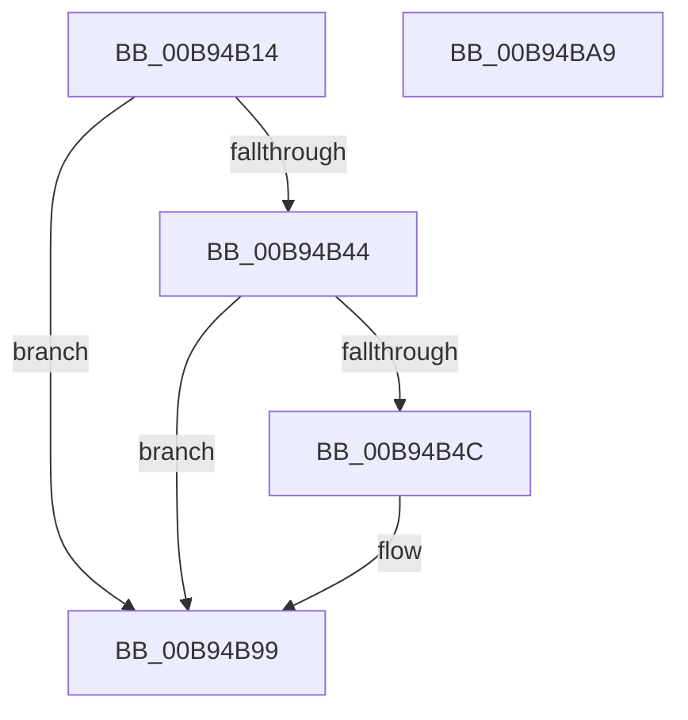

# DECREMENT_ADAPTER_CHANNELS

- RVA: `0x00B94B14`–`0x00B94BAA` (길이 `150` bytes)
- VA: `0x0000000140B94B14`
- 실행 섹션: `PAGEVRFY`
- PDB 이름 있음: `예`; PDB Function 태그: `아니요`
- unwind 정보 RVA: `0x000733E4`
- 디코드: `36`개 명령, `150/150` bytes 표시
- 미해석 바이트: `0` (있으면 어셈블리에 `.byte`로 보존)

> 이 문서는 커널 이미지의 기계어와 PDB 기호를 분석해 생성했습니다. 4번과 5번은 함수 원형과 자료형을 바이너리 사용 방식에서 추정한 C 해석이며 원본 소스 복구 결과는 아닙니다.

## 1. Dependencies

- 직접 호출 지점: **2**; 고유 호출 대상: **2**
- 직접 호출자로 확인된 함수: **6**
- RIP 상대 이미지 참조: **2**

### Outgoing calls
- `0x00B94B6B` → [ViHalPreprocessOptions](ViHalPreprocessOptions_function_00B9920C.md) (function, `0x00B9920C`)
- `0x00B94B94` → [VfReportIssueWithOptions](../../text/61/VfReportIssueWithOptions_function_00614444.md) (function, `0x00614444`)

### Direct callers
- [VfAllocateAdapterChannel](VfAllocateAdapterChannel_function_00B95180.md) at `0x00B952F9`
- [VfAllocateAdapterChannelEx](VfAllocateAdapterChannelEx_function_00B95360.md) at `0x00B95534`
- [VfCancelAdapterChannel](VfCancelAdapterChannel_function_00B95FD0.md) at `0x00B96044`
- [VfFreeAdapterChannel](VfFreeAdapterChannel_function_00B96480.md) at `0x00B964E1`
- [VfFreeAdapterObject](VfFreeAdapterObject_function_00B96530.md) at `0x00B965BB`
- [ViAdapterCallback](ViAdapterCallback_function_00B97B40.md) at `0x00B97BAC`
- [ViAdapterCallback](ViAdapterCallback_function_00B97B40.md) at `0x00B97C37`

### Static image references
- `0x00B94B51` → RVA `0x00E0E9BC` (`.data`; read)
- `0x00B94B64` → RVA `0x00BBA640` (` ?? ::JKADOLAD::`string'`; read)

## 2. Other-region calls and transfers

- 다른 실행 섹션으로 향하는 call: **1**
  - `0x00B94B94` → [VfReportIssueWithOptions](../../text/61/VfReportIssueWithOptions_function_00614444.md) (`PAGEVRFY` → `.text`)
- 별도 외부 분기/꼬리 이동을 확인하지 못했습니다.

## 3. Assembly (complete function range)

```asm
00B94B14  48 8B C4                        mov rax, rsp
00B94B17  48 89 58 08                     mov qword ptr [rax + 8], rbx
00B94B1B  48 89 70 10                     mov qword ptr [rax + 0x10], rsi
00B94B1F  57                              push rdi
00B94B20  48 83 EC 30                     sub rsp, 0x30
00B94B24  41 B9 01 00 00 00               mov r9d, 1
00B94B2A  48 8B F9                        mov rdi, rcx
00B94B2D  41 8B D9                        mov ebx, r9d
00B94B30  F0 0F C1 99 D8 00 00 00         lock xadd dword ptr [rcx + 0xd8], ebx
00B94B38  41 03 D9                        add ebx, r9d
00B94B3B  83 B9 E0 00 00 00 03            cmp dword ptr [rcx + 0xe0], 3
00B94B42  73 55                           jae 0x140b94b99
00B94B44  3B 99 D4 00 00 00               cmp ebx, dword ptr [rcx + 0xd4]
00B94B4A  74 4D                           je 0x140b94b99
00B94B4C  48 83 60 F0 00                  and qword ptr [rax - 0x10], 0
00B94B51  48 8D 35 64 9E 27 00            lea rsi, [rip + 0x279e64]
00B94B58  48 83 60 E8 00                  and qword ptr [rax - 0x18], 0
00B94B5D  45 8D 41 03                     lea r8d, [r9 + 3]
00B94B61  48 8B CE                        mov rcx, rsi
00B94B64  48 8D 15 D5 5A 02 00            lea rdx, [rip + 0x25ad5]
00B94B6B  E8 9C 46 00 00                  call 0x140b9920c
00B94B70  45 33 C0                        xor r8d, r8d
00B94B73  48 89 74 24 28                  mov qword ptr [rsp + 0x28], rsi
00B94B78  3B 9F D4 00 00 00               cmp ebx, dword ptr [rdi + 0xd4]
00B94B7E  B9 E6 00 00 00                  mov ecx, 0xe6
00B94B83  41 0F 95 C0                     setne r8b
00B94B87  48 83 64 24 20 00               and qword ptr [rsp + 0x20], 0
00B94B8D  45 33 C9                        xor r9d, r9d
00B94B90  41 8D 51 04                     lea edx, [r9 + 4]
00B94B94  E8 AB F8 A7 FF                  call 0x140614444
00B94B99  48 8B 5C 24 40                  mov rbx, qword ptr [rsp + 0x40]
00B94B9E  48 8B 74 24 48                  mov rsi, qword ptr [rsp + 0x48]
00B94BA3  48 83 C4 30                     add rsp, 0x30
00B94BA7  5F                              pop rdi
00B94BA8  C3                              ret
00B94BA9  CC                              int3
```

## 4. C-style interpretation (structured pseudocode)

```c
__int64 __fastcall DECREMENT_ADAPTER_CHANNELS(__int64 a1)
{
    __int64 result;
    __int64 v_rbx;
    __int64 v_rsi;
    __int64 v_rsp;
    unsigned __int64 v_stack_m10;
    unsigned __int64 v_stack_m18;
    unsigned __int64 v_stack_p10;
    unsigned __int64 v_stack_p8;

    *(unsigned __int64 *)(v_rsp + 8) = v_rbx;
    *(unsigned __int64 *)(v_rsp + 16) = v_rsi;
    v_rsp = (v_rsp) - (48);
    v_rbx = (unsigned int)((1) + (1));
    if ((*(unsigned int *)(a1 + 224)) >= 3) goto loc_00B94B99;
    result = v_rsp;
    if (((unsigned int)(v_rbx)) != (*(unsigned int *)(a1 + 212))) {
        v_rsi = v_rip + 2596452;
        a3 = 1 + 3;
        a1 = v_rsi;
        a2 = v_rip + 154325;
        result = ViHalPreprocessOptions(a1, a2, a3, 1);
        a3 = 0;
        v_stack_m10 = v_rsi;
        a1 = 230;
        a3 = (((unsigned int)(v_rbx)) != (*(unsigned int *)(a1 + 212))) ? 1 : 0;
        a4 = 0;
        a2 = a4 + 4;
        result = VfReportIssueWithOptions(a1, a2, a3, a4);
    }
    v_rsp = (v_rsp) + (48);
    return result;
}
```

## 5. (Beta) C Style

```c
int64_t DECREMENT_ADAPTER_CHANNELS(void *Arg1)
{
    uint8_t *arg1 = (uint8_t *)Arg1;

    int64_t result;
    int64_t local_rbx;
    int64_t local_rsi;
    int64_t local_rsp;
    uint64_t v_stack_m10;
    uint64_t v_stack_m18;
    uint64_t v_stack_p10;
    uint64_t v_stack_p8;

    *(uint64_t *)(local_rsp + 0x8) = local_rbx;
    *(uint64_t *)(local_rsp + 0x10) = local_rsi;
    local_rsp = (local_rsp) - (48);
    local_rbx = (uint32_t)((1) + (1));
    if ((*(uint32_t *)(arg1 + 0xE0)) >= 3) goto loc_00B94B99;
    result = local_rsp;
    if (((uint32_t)(local_rbx)) != (*(uint32_t *)(arg1 + 0xD4))) {
        local_rsi = v_rip + 2596452;
        a3 = 1 + 3;
        Arg1 = local_rsi;
        a2 = v_rip + 154325;
        result = ViHalPreprocessOptions(Arg1, a2, a3, 1);
        a3 = 0;
        v_stack_m10 = local_rsi;
        Arg1 = 230;
        a3 = (((uint32_t)(local_rbx)) != (*(uint32_t *)(arg1 + 0xD4))) ? 1 : 0;
        a4 = 0;
        a2 = a4 + 4;
        result = VfReportIssueWithOptions(Arg1, a2, a3, a4);
    }
    local_rsp = (local_rsp) + (48);
    return result;
}
```

### 관측된 메모리 오프셋

구조체 형식이 확인되지 않은 접근은 인자 기준의 오프셋으로만 기록했습니다.

| 기준 인자 | 오프셋 표현 | 폭 (bit) | 접근 |
|---|---:|---:|---|
| `Arg1` | `+ 0xD4` | `32` | `R` |
| `Arg1` | `+ 0xD8` | `32` | `R/W` |
| `Arg1` | `+ 0xE0` | `32` | `R` |

## 6. Execution-region graph

[열기: 2D/3D 그래프와 함수 탐색 컨트롤 패널](../../../control-panel.html?section=pagevrfy&rva=0x00B94B14&view=graph)

- 2D 그래프는 위에서 아래로 흐르고, 3D 그래프는 빈 공간을 드래그해 회전합니다. Shift+드래그는 이동, 휠은 확대·축소, 함수 노드 선택은 대상 보고서 이동입니다.

### Static fallback


