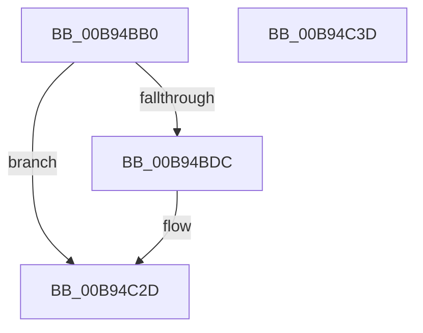

# DECREMENT_COMMON_BUFFERS

- RVA: `0x00B94BB0`–`0x00B94C3E` (길이 `142` bytes)
- VA: `0x0000000140B94BB0`
- 실행 섹션: `PAGEVRFY`
- PDB 이름 있음: `예`; PDB Function 태그: `아니요`
- unwind 정보 RVA: `0x000733E4`
- 디코드: `35`개 명령, `142/142` bytes 표시
- 미해석 바이트: `0` (있으면 어셈블리에 `.byte`로 보존)

> 이 문서는 커널 이미지의 기계어와 PDB 기호를 분석해 생성했습니다. 4번과 5번은 함수 원형과 자료형을 바이너리 사용 방식에서 추정한 C 해석이며 원본 소스 복구 결과는 아닙니다.

## 1. Dependencies

- 직접 호출 지점: **2**; 고유 호출 대상: **2**
- 직접 호출자로 확인된 함수: **2**
- RIP 상대 이미지 참조: **2**

### Outgoing calls
- `0x00B94C03` → [ViHalPreprocessOptions](ViHalPreprocessOptions_function_00B9920C.md) (function, `0x00B9920C`)
- `0x00B94C28` → [VfReportIssueWithOptions](../../text/61/VfReportIssueWithOptions_function_00614444.md) (function, `0x00614444`)

### Direct callers
- [VfFreeCommonBuffer](VfFreeCommonBuffer_function_00B96650.md) at `0x00B966F7`
- [ViSpecialFreeCommonBuffer](ViSpecialFreeCommonBuffer_function_00B99D2C.md) at `0x00B99E2E`

### Static image references
- `0x00B94BE1` → RVA `0x00E0E998` (`.data`; read)
- `0x00B94BED` → RVA `0x00BBA1B0` (` ?? ::JKADOLAD::`string'`; read)

## 2. Other-region calls and transfers

- 다른 실행 섹션으로 향하는 call: **1**
  - `0x00B94C28` → [VfReportIssueWithOptions](../../text/61/VfReportIssueWithOptions_function_00614444.md) (`PAGEVRFY` → `.text`)
- 별도 외부 분기/꼬리 이동을 확인하지 못했습니다.

## 3. Assembly (complete function range)

```asm
00B94BB0  48 8B C4                        mov rax, rsp
00B94BB3  48 89 58 08                     mov qword ptr [rax + 8], rbx
00B94BB7  48 89 70 10                     mov qword ptr [rax + 0x10], rsi
00B94BBB  57                              push rdi
00B94BBC  48 83 EC 30                     sub rsp, 0x30
00B94BC0  48 8B F9                        mov rdi, rcx
00B94BC3  BB 01 00 00 00                  mov ebx, 1
00B94BC8  F0 0F C1 99 D0 00 00 00         lock xadd dword ptr [rcx + 0xd0], ebx
00B94BD0  8B 89 CC 00 00 00               mov ecx, dword ptr [rcx + 0xcc]
00B94BD6  FF C3                           inc ebx
00B94BD8  3B D9                           cmp ebx, ecx
00B94BDA  76 51                           jbe 0x140b94c2d
00B94BDC  48 83 60 F0 00                  and qword ptr [rax - 0x10], 0
00B94BE1  48 8D 35 B0 9D 27 00            lea rsi, [rip + 0x279db0]
00B94BE8  48 83 60 E8 00                  and qword ptr [rax - 0x18], 0
00B94BED  48 8D 15 BC 55 02 00            lea rdx, [rip + 0x255bc]
00B94BF4  44 8B CB                        mov r9d, ebx
00B94BF7  41 B8 03 00 00 00               mov r8d, 3
00B94BFD  44 2B C9                        sub r9d, ecx
00B94C00  48 8B CE                        mov rcx, rsi
00B94C03  E8 04 46 00 00                  call 0x140b9920c
00B94C08  2B 9F CC 00 00 00               sub ebx, dword ptr [rdi + 0xcc]
00B94C0E  45 33 C9                        xor r9d, r9d
00B94C11  48 89 74 24 28                  mov qword ptr [rsp + 0x28], rsi
00B94C16  B9 E6 00 00 00                  mov ecx, 0xe6
00B94C1B  48 83 64 24 20 00               and qword ptr [rsp + 0x20], 0
00B94C21  44 8B C3                        mov r8d, ebx
00B94C24  41 8D 51 03                     lea edx, [r9 + 3]
00B94C28  E8 17 F8 A7 FF                  call 0x140614444
00B94C2D  48 8B 5C 24 40                  mov rbx, qword ptr [rsp + 0x40]
00B94C32  48 8B 74 24 48                  mov rsi, qword ptr [rsp + 0x48]
00B94C37  48 83 C4 30                     add rsp, 0x30
00B94C3B  5F                              pop rdi
00B94C3C  C3                              ret
00B94C3D  CC                              int3
```

## 4. C-style interpretation (structured pseudocode)

```c
__int64 __fastcall DECREMENT_COMMON_BUFFERS(__int64 a1)
{
    __int64 result;
    __int64 v_rbx;
    __int64 v_rsi;
    __int64 v_rsp;
    unsigned __int64 v_stack_m10;
    unsigned __int64 v_stack_m18;
    unsigned __int64 v_stack_p10;
    unsigned __int64 v_stack_p8;

    *(unsigned __int64 *)(v_rsp + 8) = v_rbx;
    *(unsigned __int64 *)(v_rsp + 16) = v_rsi;
    v_rsp = (v_rsp) - (48);
    v_rbx = (unsigned int)((1) + 1);
    result = v_rsp;
    if (((unsigned int)(v_rbx)) >= = ((unsigned int)((unsigned int)(*(unsigned int *)(a1 + 204))))) {
        v_rsi = v_rip + 2596272;
        a2 = v_rip + 153020;
        a4 = (unsigned int)(v_rbx);
        a3 = 3;
        a4 = (unsigned int)((a4) - ((unsigned int)((unsigned int)(*(unsigned int *)(a1 + 204)))));
        a1 = v_rsi;
        result = ViHalPreprocessOptions(a1, a2, a3, a4);
        v_rbx = (unsigned int)((v_rbx) - (*(unsigned int *)(a1 + 204)));
        a4 = 0;
        v_stack_m10 = v_rsi;
        a1 = 230;
        a3 = (unsigned int)(v_rbx);
        a2 = a4 + 3;
        result = VfReportIssueWithOptions(a1, a2, a3, a4);
    }
    v_rsp = (v_rsp) + (48);
    return result;
}
```

## 5. (Beta) C Style

```c
int64_t DECREMENT_COMMON_BUFFERS(void *Arg1)
{
    uint8_t *arg1 = (uint8_t *)Arg1;

    int64_t result;
    int64_t local_rbx;
    int64_t local_rsi;
    int64_t local_rsp;
    uint64_t v_stack_m10;
    uint64_t v_stack_m18;
    uint64_t v_stack_p10;
    uint64_t v_stack_p8;

    *(uint64_t *)(local_rsp + 0x8) = local_rbx;
    *(uint64_t *)(local_rsp + 0x10) = local_rsi;
    local_rsp = (local_rsp) - (48);
    local_rbx = (uint32_t)((1) + 1);
    result = local_rsp;
    if (((uint32_t)(local_rbx)) >= = ((uint32_t)((uint32_t)(*(uint32_t *)(arg1 + 0xCC))))) {
        local_rsi = v_rip + 2596272;
        a2 = v_rip + 153020;
        a4 = (uint32_t)(local_rbx);
        a3 = 3;
        a4 = (uint32_t)((a4) - ((uint32_t)((uint32_t)(*(uint32_t *)(arg1 + 0xCC)))));
        Arg1 = local_rsi;
        result = ViHalPreprocessOptions(Arg1, a2, a3, a4);
        local_rbx = (uint32_t)((local_rbx) - (*(uint32_t *)(arg1 + 0xCC)));
        a4 = 0;
        v_stack_m10 = local_rsi;
        Arg1 = 230;
        a3 = (uint32_t)(local_rbx);
        a2 = a4 + 3;
        result = VfReportIssueWithOptions(Arg1, a2, a3, a4);
    }
    local_rsp = (local_rsp) + (48);
    return result;
}
```

### 관측된 메모리 오프셋

구조체 형식이 확인되지 않은 접근은 인자 기준의 오프셋으로만 기록했습니다.

| 기준 인자 | 오프셋 표현 | 폭 (bit) | 접근 |
|---|---:|---:|---|
| `Arg1` | `+ 0xCC` | `32` | `R` |
| `Arg1` | `+ 0xD0` | `32` | `R/W` |

## 6. Execution-region graph

[열기: 2D/3D 그래프와 함수 탐색 컨트롤 패널](../../../control-panel.html?section=pagevrfy&rva=0x00B94BB0&view=graph)

- 2D 그래프는 위에서 아래로 흐르고, 3D 그래프는 빈 공간을 드래그해 회전합니다. Shift+드래그는 이동, 휠은 확대·축소, 함수 노드 선택은 대상 보고서 이동입니다.

### Static fallback


