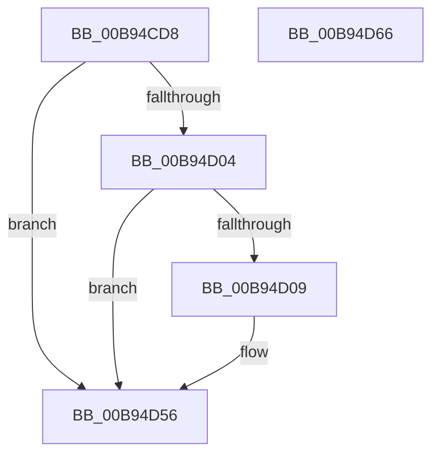

# INCREASE_MAPPED_TRANSFER_BYTE_COUNT

- RVA: `0x00B94CD8`–`0x00B94D67` (길이 `143` bytes)
- VA: `0x0000000140B94CD8`
- 실행 섹션: `PAGEVRFY`
- PDB 이름 있음: `예`; PDB Function 태그: `아니요`
- unwind 정보 RVA: `0x000733E4`
- 디코드: `37`개 명령, `143/143` bytes 표시
- 미해석 바이트: `0` (있으면 어셈블리에 `.byte`로 보존)

> 이 문서는 커널 이미지의 기계어와 PDB 기호를 분석해 생성했습니다. 4번과 5번은 함수 원형과 자료형을 바이너리 사용 방식에서 추정한 C 해석이며 원본 소스 복구 결과는 아닙니다.

## 1. Dependencies

- 직접 호출 지점: **2**; 고유 호출 대상: **2**
- 직접 호출자로 확인된 함수: **2**
- RIP 상대 이미지 참조: **2**

### Outgoing calls
- `0x00B94D31` → [ViHalPreprocessOptions](ViHalPreprocessOptions_function_00B9920C.md) (function, `0x00B9920C`)
- `0x00B94D51` → [VfReportIssueWithOptions](../../text/61/VfReportIssueWithOptions_function_00614444.md) (function, `0x00614444`)

### Direct callers
- [VfMapTransfer](VfMapTransfer_function_00B97300.md) at `0x00B97488`
- [VfMapTransferEx](VfMapTransferEx_function_00B974B0.md) at `0x00B975EC`

### Static image references
- `0x00B94D0E` → RVA `0x00E0E9A0` (`.data`; read)
- `0x00B94D18` → RVA `0x00BBA5A0` (` ?? ::JKADOLAD::`string'`; read)

## 2. Other-region calls and transfers

- 다른 실행 섹션으로 향하는 call: **1**
  - `0x00B94D51` → [VfReportIssueWithOptions](../../text/61/VfReportIssueWithOptions_function_00614444.md) (`PAGEVRFY` → `.text`)
- 별도 외부 분기/꼬리 이동을 확인하지 못했습니다.

## 3. Assembly (complete function range)

```asm
00B94CD8  4C 8B DC                        mov r11, rsp
00B94CDB  49 89 5B 08                     mov qword ptr [r11 + 8], rbx
00B94CDF  49 89 73 10                     mov qword ptr [r11 + 0x10], rsi
00B94CE3  57                              push rdi
00B94CE4  48 83 EC 30                     sub rsp, 0x30
00B94CE8  44 8B 89 C0 00 00 00            mov r9d, dword ptr [rcx + 0xc0]
00B94CEF  8B C2                           mov eax, edx
00B94CF1  41 C1 E1 0C                     shl r9d, 0xc
00B94CF5  F0 0F C1 81 DC 00 00 00         lock xadd dword ptr [rcx + 0xdc], eax
00B94CFD  03 C2                           add eax, edx
00B94CFF  45 84 C0                        test r8b, r8b
00B94D02  75 52                           jne 0x140b94d56
00B94D04  41 3B C1                        cmp eax, r9d
00B94D07  76 4D                           jbe 0x140b94d56
00B94D09  49 83 63 F0 00                  and qword ptr [r11 - 0x10], 0
00B94D0E  48 8D 35 8B 9C 27 00            lea rsi, [rip + 0x279c8b]
00B94D15  41 8B D9                        mov ebx, r9d
00B94D18  48 8D 15 81 58 02 00            lea rdx, [rip + 0x25881]
00B94D1F  48 8B CE                        mov rcx, rsi
00B94D22  44 8B C8                        mov r9d, eax
00B94D25  41 B8 0D 00 00 00               mov r8d, 0xd
00B94D2B  8B F8                           mov edi, eax
00B94D2D  49 89 5B E8                     mov qword ptr [r11 - 0x18], rbx
00B94D31  E8 D6 44 00 00                  call 0x140b9920c
00B94D36  48 89 74 24 28                  mov qword ptr [rsp + 0x28], rsi
00B94D3B  44 8B CB                        mov r9d, ebx
00B94D3E  48 83 64 24 20 00               and qword ptr [rsp + 0x20], 0
00B94D44  44 8B C7                        mov r8d, edi
00B94D47  BA 0D 00 00 00                  mov edx, 0xd
00B94D4C  B9 E6 00 00 00                  mov ecx, 0xe6
00B94D51  E8 EE F6 A7 FF                  call 0x140614444
00B94D56  48 8B 5C 24 40                  mov rbx, qword ptr [rsp + 0x40]
00B94D5B  48 8B 74 24 48                  mov rsi, qword ptr [rsp + 0x48]
00B94D60  48 83 C4 30                     add rsp, 0x30
00B94D64  5F                              pop rdi
00B94D65  C3                              ret
00B94D66  CC                              int3
```

## 4. C-style interpretation (structured pseudocode)

```c
__int64 __fastcall INCREASE_MAPPED_TRANSFER_BYTE_COUNT(__int64 a1, int a2, unsigned __int8 a3)
{
    __int64 result;
    __int64 v_rbx;
    __int64 v_rdi;
    __int64 v_rsi;
    __int64 v_rsp;
    unsigned __int64 v_stack_m10;
    unsigned __int64 v_stack_m18;
    unsigned __int64 v_stack_p10;
    unsigned __int64 v_stack_p8;

    *(unsigned __int64 *)(v_rsp + 8) = v_rbx;
    *(unsigned __int64 *)(v_rsp + 16) = v_rsi;
    v_rsp = (v_rsp) - (48);
    a4 = (unsigned int)(((unsigned int)(*(unsigned int *)(a1 + 192))) << (12));
    result = (unsigned int)(((unsigned int)(a2)) + (a2));
    if (a3 != 0) goto loc_00B94D56;
    if (((unsigned int)(result)) >= = ((unsigned int)(a4))) {
        v_rsi = v_rip + 2595979;
        v_rbx = (unsigned int)(a4);
        a2 = v_rip + 153729;
        a1 = v_rsi;
        a4 = (unsigned int)(result);
        a3 = 13;
        v_rdi = (unsigned int)(result);
        *(unsigned __int64 *)(v_rsp - 24) = v_rbx;
        result = ViHalPreprocessOptions(a1, a2, a3, a4);
        v_stack_m10 = v_rsi;
        a4 = (unsigned int)(v_rbx);
        a3 = (unsigned int)(v_rdi);
        a2 = 13;
        a1 = 230;
        result = VfReportIssueWithOptions(a1, a2, a3, a4);
    }
    v_rsp = (v_rsp) + (48);
    return result;
}
```

## 5. (Beta) C Style

```c
int64_t INCREASE_MAPPED_TRANSFER_BYTE_COUNT(void *Arg1, int32_t Arg2, uint8_t Arg3)
{
    uint8_t *arg1 = (uint8_t *)Arg1;

    int64_t result;
    int64_t local_rbx;
    int64_t local_rdi;
    int64_t local_rsi;
    int64_t local_rsp;
    uint64_t v_stack_m10;
    uint64_t v_stack_m18;
    uint64_t v_stack_p10;
    uint64_t v_stack_p8;

    *(uint64_t *)(local_rsp + 0x8) = local_rbx;
    *(uint64_t *)(local_rsp + 0x10) = local_rsi;
    local_rsp = (local_rsp) - (48);
    a4 = (uint32_t)(((uint32_t)(*(uint32_t *)(arg1 + 0xC0))) << (12));
    result = (uint32_t)(((uint32_t)(Arg2)) + (Arg2));
    if (Arg3 != 0) goto loc_00B94D56;
    if (((uint32_t)(result)) >= = ((uint32_t)(a4))) {
        local_rsi = v_rip + 2595979;
        local_rbx = (uint32_t)(a4);
        Arg2 = v_rip + 153729;
        Arg1 = local_rsi;
        a4 = (uint32_t)(result);
        Arg3 = 13;
        local_rdi = (uint32_t)(result);
        *(uint64_t *)(local_rsp - 0x18) = local_rbx;
        result = ViHalPreprocessOptions(Arg1, Arg2, Arg3, a4);
        v_stack_m10 = local_rsi;
        a4 = (uint32_t)(local_rbx);
        Arg3 = (uint32_t)(local_rdi);
        Arg2 = 13;
        Arg1 = 230;
        result = VfReportIssueWithOptions(Arg1, Arg2, Arg3, a4);
    }
    local_rsp = (local_rsp) + (48);
    return result;
}
```

### 관측된 메모리 오프셋

구조체 형식이 확인되지 않은 접근은 인자 기준의 오프셋으로만 기록했습니다.

| 기준 인자 | 오프셋 표현 | 폭 (bit) | 접근 |
|---|---:|---:|---|
| `Arg1` | `+ 0xC0` | `32` | `R` |
| `Arg1` | `+ 0xDC` | `32` | `R/W` |

## 6. Execution-region graph

[열기: 2D/3D 그래프와 함수 탐색 컨트롤 패널](../../../control-panel.html?section=pagevrfy&rva=0x00B94CD8&view=graph)

- 2D 그래프는 위에서 아래로 흐르고, 3D 그래프는 빈 공간을 드래그해 회전합니다. Shift+드래그는 이동, 휠은 확대·축소, 함수 노드 선택은 대상 보고서 이동입니다.

### Static fallback


