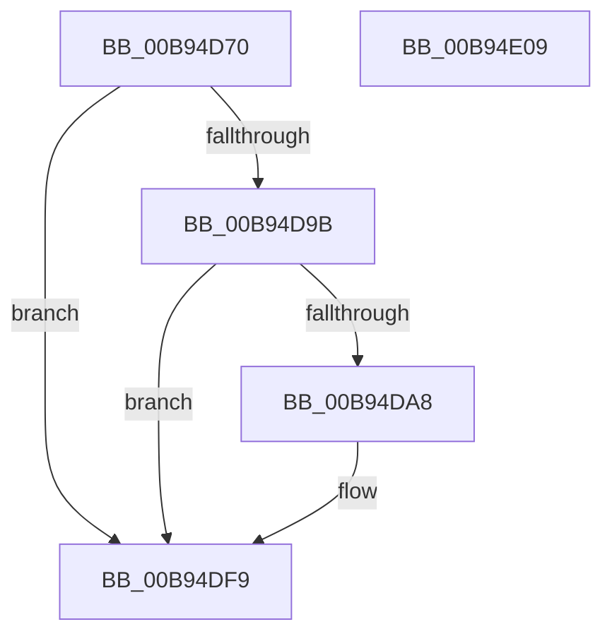

# INCREMENT_ADAPTER_CHANNELS

- RVA: `0x00B94D70`–`0x00B94E0A` (길이 `154` bytes)
- VA: `0x0000000140B94D70`
- 실행 섹션: `PAGEVRFY`
- PDB 이름 있음: `예`; PDB Function 태그: `아니요`
- unwind 정보 RVA: `0x000733E4`
- 디코드: `38`개 명령, `154/154` bytes 표시
- 미해석 바이트: `0` (있으면 어셈블리에 `.byte`로 보존)

> 이 문서는 커널 이미지의 기계어와 PDB 기호를 분석해 생성했습니다. 4번과 5번은 함수 원형과 자료형을 바이너리 사용 방식에서 추정한 C 해석이며 원본 소스 복구 결과는 아닙니다.

## 1. Dependencies

- 직접 호출 지점: **2**; 고유 호출 대상: **2**
- 직접 호출자로 확인된 함수: **2**
- RIP 상대 이미지 참조: **2**

### Outgoing calls
- `0x00B94DCF` → [ViHalPreprocessOptions](ViHalPreprocessOptions_function_00B9920C.md) (function, `0x00B9920C`)
- `0x00B94DF4` → [VfReportIssueWithOptions](../../text/61/VfReportIssueWithOptions_function_00614444.md) (function, `0x00614444`)

### Direct callers
- [VfAllocateAdapterChannel](VfAllocateAdapterChannel_function_00B95180.md) at `0x00B95246`
- [VfAllocateAdapterChannelEx](VfAllocateAdapterChannelEx_function_00B95360.md) at `0x00B9541E`

### Static image references
- `0x00B94DAD` → RVA `0x00E0E99C` (`.data`; read)
- `0x00B94DB9` → RVA `0x00BBA560` (` ?? ::JKADOLAD::`string'`; read)

## 2. Other-region calls and transfers

- 다른 실행 섹션으로 향하는 call: **1**
  - `0x00B94DF4` → [VfReportIssueWithOptions](../../text/61/VfReportIssueWithOptions_function_00614444.md) (`PAGEVRFY` → `.text`)
- 별도 외부 분기/꼬리 이동을 확인하지 못했습니다.

## 3. Assembly (complete function range)

```asm
00B94D70  4C 8B DC                        mov r11, rsp
00B94D73  49 89 5B 08                     mov qword ptr [r11 + 8], rbx
00B94D77  49 89 73 10                     mov qword ptr [r11 + 0x10], rsi
00B94D7B  57                              push rdi
00B94D7C  48 83 EC 30                     sub rsp, 0x30
00B94D80  48 8B F9                        mov rdi, rcx
00B94D83  BB 01 00 00 00                  mov ebx, 1
00B94D88  F0 0F C1 99 D4 00 00 00         lock xadd dword ptr [rcx + 0xd4], ebx
00B94D90  FF C3                           inc ebx
00B94D92  83 B9 E0 00 00 00 03            cmp dword ptr [rcx + 0xe0], 3
00B94D99  73 5E                           jae 0x140b94df9
00B94D9B  8B 89 D8 00 00 00               mov ecx, dword ptr [rcx + 0xd8]
00B94DA1  8D 41 01                        lea eax, [rcx + 1]
00B94DA4  3B D8                           cmp ebx, eax
00B94DA6  74 51                           je 0x140b94df9
00B94DA8  49 83 63 F0 00                  and qword ptr [r11 - 0x10], 0
00B94DAD  48 8D 35 E8 9B 27 00            lea rsi, [rip + 0x279be8]
00B94DB4  49 83 63 E8 00                  and qword ptr [r11 - 0x18], 0
00B94DB9  48 8D 15 A0 57 02 00            lea rdx, [rip + 0x257a0]
00B94DC0  44 8B CB                        mov r9d, ebx
00B94DC3  41 B8 0B 00 00 00               mov r8d, 0xb
00B94DC9  44 2B C9                        sub r9d, ecx
00B94DCC  48 8B CE                        mov rcx, rsi
00B94DCF  E8 38 44 00 00                  call 0x140b9920c
00B94DD4  2B 9F D8 00 00 00               sub ebx, dword ptr [rdi + 0xd8]
00B94DDA  45 33 C9                        xor r9d, r9d
00B94DDD  48 89 74 24 28                  mov qword ptr [rsp + 0x28], rsi
00B94DE2  B9 E6 00 00 00                  mov ecx, 0xe6
00B94DE7  48 83 64 24 20 00               and qword ptr [rsp + 0x20], 0
00B94DED  44 8B C3                        mov r8d, ebx
00B94DF0  41 8D 51 0B                     lea edx, [r9 + 0xb]
00B94DF4  E8 4B F6 A7 FF                  call 0x140614444
00B94DF9  48 8B 5C 24 40                  mov rbx, qword ptr [rsp + 0x40]
00B94DFE  48 8B 74 24 48                  mov rsi, qword ptr [rsp + 0x48]
00B94E03  48 83 C4 30                     add rsp, 0x30
00B94E07  5F                              pop rdi
00B94E08  C3                              ret
00B94E09  CC                              int3
```

## 4. C-style interpretation (structured pseudocode)

```c
__int64 __fastcall INCREMENT_ADAPTER_CHANNELS(__int64 a1)
{
    __int64 result;
    __int64 v_rbx;
    __int64 v_rsi;
    __int64 v_rsp;
    unsigned __int64 v_stack_m10;
    unsigned __int64 v_stack_m18;
    unsigned __int64 v_stack_p10;
    unsigned __int64 v_stack_p8;

    *(unsigned __int64 *)(v_rsp + 8) = v_rbx;
    *(unsigned __int64 *)(v_rsp + 16) = v_rsi;
    v_rsp = (v_rsp) - (48);
    v_rbx = (unsigned int)((1) + 1);
    if ((*(unsigned int *)(a1 + 224)) >= 3) goto loc_00B94DF9;
    result = (unsigned int)(*(unsigned int *)(a1 + 216)) + 1;
    if (((unsigned int)(v_rbx)) != ((unsigned int)((unsigned int)(*(unsigned int *)(a1 + 216)) + 1))) {
        v_rsi = v_rip + 2595816;
        a2 = v_rip + 153504;
        a4 = (unsigned int)(v_rbx);
        a3 = 11;
        a4 = (unsigned int)((a4) - ((unsigned int)((unsigned int)(*(unsigned int *)(a1 + 216)))));
        a1 = v_rsi;
        result = ViHalPreprocessOptions(a1, a2, a3, a4);
        v_rbx = (unsigned int)((v_rbx) - (*(unsigned int *)(a1 + 216)));
        a4 = 0;
        v_stack_m10 = v_rsi;
        a1 = 230;
        a3 = (unsigned int)(v_rbx);
        a2 = a4 + 11;
        result = VfReportIssueWithOptions(a1, a2, a3, a4);
    }
    v_rsp = (v_rsp) + (48);
    return result;
}
```

## 5. (Beta) C Style

```c
int64_t INCREMENT_ADAPTER_CHANNELS(void *Arg1)
{
    uint8_t *arg1 = (uint8_t *)Arg1;

    int64_t result;
    int64_t local_rbx;
    int64_t local_rsi;
    int64_t local_rsp;
    uint64_t v_stack_m10;
    uint64_t v_stack_m18;
    uint64_t v_stack_p10;
    uint64_t v_stack_p8;

    *(uint64_t *)(local_rsp + 0x8) = local_rbx;
    *(uint64_t *)(local_rsp + 0x10) = local_rsi;
    local_rsp = (local_rsp) - (48);
    local_rbx = (uint32_t)((1) + 1);
    if ((*(uint32_t *)(arg1 + 0xE0)) >= 3) goto loc_00B94DF9;
    result = (uint32_t)(*(uint32_t *)(arg1 + 0xD8)) + 1;
    if (((uint32_t)(local_rbx)) != ((uint32_t)((uint32_t)(*(uint32_t *)(arg1 + 0xD8)) + 1))) {
        local_rsi = v_rip + 2595816;
        a2 = v_rip + 153504;
        a4 = (uint32_t)(local_rbx);
        a3 = 11;
        a4 = (uint32_t)((a4) - ((uint32_t)((uint32_t)(*(uint32_t *)(arg1 + 0xD8)))));
        Arg1 = local_rsi;
        result = ViHalPreprocessOptions(Arg1, a2, a3, a4);
        local_rbx = (uint32_t)((local_rbx) - (*(uint32_t *)(arg1 + 0xD8)));
        a4 = 0;
        v_stack_m10 = local_rsi;
        Arg1 = 230;
        a3 = (uint32_t)(local_rbx);
        a2 = a4 + 11;
        result = VfReportIssueWithOptions(Arg1, a2, a3, a4);
    }
    local_rsp = (local_rsp) + (48);
    return result;
}
```

### 관측된 메모리 오프셋

구조체 형식이 확인되지 않은 접근은 인자 기준의 오프셋으로만 기록했습니다.

| 기준 인자 | 오프셋 표현 | 폭 (bit) | 접근 |
|---|---:|---:|---|
| `Arg1` | `+ 0xD4` | `32` | `R/W` |
| `Arg1` | `+ 0xD8` | `32` | `R` |
| `Arg1` | `+ 0xE0` | `32` | `R` |

## 6. Execution-region graph

[열기: 2D/3D 그래프와 함수 탐색 컨트롤 패널](../../../control-panel.html?section=pagevrfy&rva=0x00B94D70&view=graph)

- 2D 그래프는 위에서 아래로 흐르고, 3D 그래프는 빈 공간을 드래그해 회전합니다. Shift+드래그는 이동, 휠은 확대·축소, 함수 노드 선택은 대상 보고서 이동입니다.

### Static fallback


