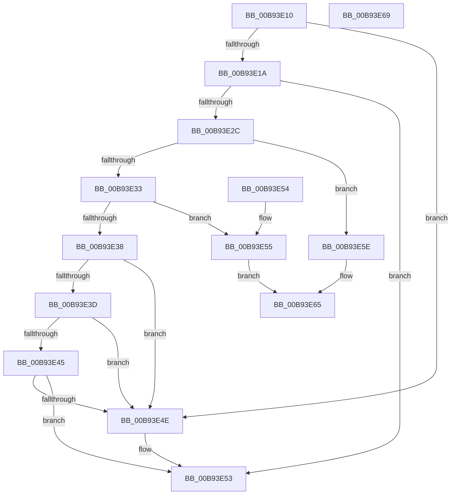

# IoIsValidIrpStatus

- RVA: `0x00B93E10`–`0x00B93E6A` (길이 `90` bytes)
- VA: `0x0000000140B93E10`
- 실행 섹션: `PAGEVRFY`
- PDB 이름 있음: `예`; PDB Function 태그: `아니요`
- unwind 정보 RVA: `0x000DB714`
- 디코드: `28`개 명령, `90/90` bytes 표시
- 미해석 바이트: `0` (있으면 어셈블리에 `.byte`로 보존)

> 이 문서는 커널 이미지의 기계어와 PDB 기호를 분석해 생성했습니다. 4번과 5번은 함수 원형과 자료형을 바이너리 사용 방식에서 추정한 C 해석이며 원본 소스 복구 결과는 아닙니다.

## 1. Dependencies

- 직접 호출 지점: **0**; 고유 호출 대상: **0**
- 직접 호출자로 확인된 함수: **1**
- RIP 상대 이미지 참조: **0**

### Outgoing calls
- 직접 디코드된 call 명령이 없습니다.

### Direct callers
- [ViGenericIsValidIrpStatus](ViGenericIsValidIrpStatus_function_00B93F60.md) at `0x00B93F66`

### Static image references
- 디코드된 RIP-relative 메모리 참조가 없습니다.

## 2. Other-region calls and transfers

- 다른 실행 섹션으로 향하는 call: **0**
- 별도 외부 분기/꼬리 이동을 확인하지 못했습니다.

## 3. Assembly (complete function range)

```asm
00B93E10  44 0F B7 C1                     movzx r8d, cx
00B93E14  0F BA E1 1D                     bt ecx, 0x1d
00B93E18  72 34                           jb 0x140b93e4e
00B93E1A  8B D1                           mov edx, ecx
00B93E1C  33 C0                           xor eax, eax
00B93E1E  81 E2 00 00 FF 0F               and edx, 0xfff0000
00B93E24  81 FA 00 00 F0 00               cmp edx, 0xf00000
00B93E2A  73 27                           jae 0x140b93e53
00B93E2C  C1 E9 1E                        shr ecx, 0x1e
00B93E2F  85 C9                           test ecx, ecx
00B93E31  74 2B                           je 0x140b93e5e
00B93E33  83 E9 01                        sub ecx, 1
00B93E36  74 1D                           je 0x140b93e55
00B93E38  83 F9 01                        cmp ecx, 1
00B93E3B  75 11                           jne 0x140b93e4e
00B93E3D  81 FA 00 00 07 00               cmp edx, 0x70000
00B93E43  74 09                           je 0x140b93e4e
00B93E45  41 81 F8 00 04 00 00            cmp r8d, 0x400
00B93E4C  73 05                           jae 0x140b93e53
00B93E4E  B8 01 00 00 00                  mov eax, 1
00B93E53  C3                              ret
00B93E54  CC                              int3
00B93E55  41 81 F8 00 04 00 00            cmp r8d, 0x400
00B93E5C  EB 07                           jmp 0x140b93e65
00B93E5E  41 81 F8 50 02 00 00            cmp r8d, 0x250
00B93E65  0F 92 C0                        setb al
00B93E68  C3                              ret
00B93E69  CC                              int3
```

## 4. C-style interpretation (structured pseudocode)

```c
__int64 __fastcall IoIsValidIrpStatus(int a1)
{
    __int64 result;

    if (condition_is_below) goto loc_00B93E4E;
    result = 0;
    a2 = (unsigned int)(((unsigned int)(a1)) & (0xFFF0000ULL));
    if (((unsigned int)(a2)) >= 0xF00000ULL) goto loc_00B93E53;
    a1 = (unsigned int)((a1) >> (30));
    if (a1 == 0) goto loc_00B93E5E;
    a1 = (unsigned int)((a1) - (1));
    if (condition_is_equal) goto loc_00B93E55;
    if (a1 != 1) goto loc_00B93E4E;
    if (((unsigned int)(a2)) == 0x70000ULL) goto loc_00B93E4E;
    if (((unsigned int)((unsigned __int16)(a1))) < 0x400ULL) {
        result = 1;
    }
    return result;
loc_00B93E55:
    goto loc_00B93E65;
loc_00B93E5E:
loc_00B93E65:
    result = (((unsigned int)((unsigned __int16)(a1))) < 592) ? 1 : 0;
    return result;
}
```

## 5. (Beta) C Style

```c
int64_t IoIsValidIrpStatus(int32_t Arg1)
{
    int64_t result;

    if (condition_is_below) goto loc_00B93E4E;
    result = 0;
    a2 = (uint32_t)(((uint32_t)(Arg1)) & (0xFFF0000ULL));
    if (((uint32_t)(a2)) >= 0xF00000ULL) goto loc_00B93E53;
    Arg1 = (uint32_t)((Arg1) >> (30));
    if (Arg1 == 0) goto loc_00B93E5E;
    Arg1 = (uint32_t)((Arg1) - (1));
    if (condition_is_equal) goto loc_00B93E55;
    if (Arg1 != 1) goto loc_00B93E4E;
    if (((uint32_t)(a2)) == 0x70000ULL) goto loc_00B93E4E;
    if (((uint32_t)((uint16_t)(Arg1))) < 0x400ULL) {
        result = 1;
    }
    return result;
loc_00B93E55:
    goto loc_00B93E65;
loc_00B93E5E:
loc_00B93E65:
    result = (((uint32_t)((uint16_t)(Arg1))) < 592) ? 1 : 0;
    return result;
}
```

## 6. Execution-region graph

[열기: 2D/3D 그래프와 함수 탐색 컨트롤 패널](../../../control-panel.html?section=pagevrfy&rva=0x00B93E10&view=graph)

- 2D 그래프는 위에서 아래로 흐르고, 3D 그래프는 빈 공간을 드래그해 회전합니다. Shift+드래그는 이동, 휠은 확대·축소, 함수 노드 선택은 대상 보고서 이동입니다.

### Static fallback


