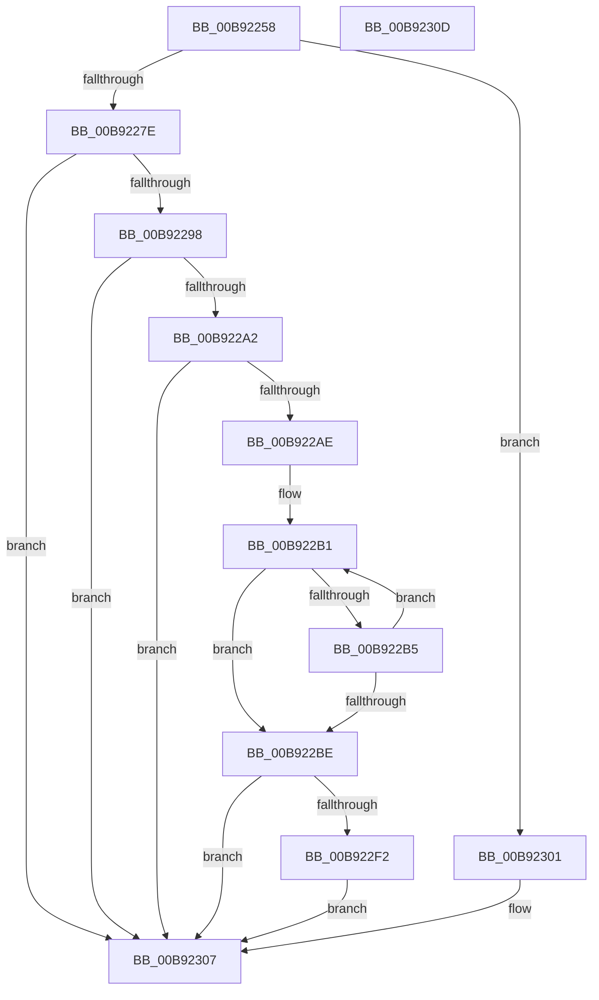

# IoVerifierCheckForSettingsChange

- RVA: `0x00B92258`–`0x00B9230E` (길이 `182` bytes)
- VA: `0x0000000140B92258`
- 실행 섹션: `PAGEVRFY`
- PDB 이름 있음: `예`; PDB Function 태그: `아니요`
- unwind 정보 RVA: `0x000697A4`
- 디코드: `47`개 명령, `182/182` bytes 표시
- 미해석 바이트: `0` (있으면 어셈블리에 `.byte`로 보존)

> 이 문서는 커널 이미지의 기계어와 PDB 기호를 분석해 생성했습니다. 4번과 5번은 함수 원형과 자료형을 바이너리 사용 방식에서 추정한 C 해석이며 원본 소스 복구 결과는 아닙니다.

## 1. Dependencies

- 직접 호출 지점: **2**; 고유 호출 대상: **2**
- 직접 호출자로 확인된 함수: **2**
- RIP 상대 이미지 참조: **7**

### Outgoing calls
- `0x00B922E1` → [ExAllocatePool3](../../poolcode/B8/ExAllocatePool3_function_00B84270.md) (function, `0x00B84270`)
- `0x00B922FA` → [memset](../../text/6C/memset_function_006C6C40.md) (function, `0x006C6C40`)

### Direct callers
- [IoVerifierInit](IoVerifierInit_function_00B92314.md) at `0x00B92336`
- [ViSettingsIoCheckForChanges](../BA/ViSettingsIoCheckForChanges_function_00BAB3BC.md) at `0x00BAB3F8`

### Static image references
- `0x00B92282` → RVA `0x00E66220` (`.data`; read/write)
- `0x00B92288` → RVA `0x00E6621C` (`.data`; read/write)
- `0x00B9228E` → RVA `0x00F049F8` (`.data`; read)
- `0x00B92298` → RVA `0x00E0E930` (`.data`; read)
- `0x00B922A2` → RVA `0x00E681A0` (`.data`; read)
- `0x00B922DB` → RVA `0x00E0E930` (`.data`; write)
- `0x00B922E6` → RVA `0x00F049F8` (`.data`; write)

## 2. Other-region calls and transfers

- 다른 실행 섹션으로 향하는 call: **2**
  - `0x00B922E1` → [ExAllocatePool3](../../poolcode/B8/ExAllocatePool3_function_00B84270.md) (`PAGEVRFY` → `POOLCODE`)
  - `0x00B922FA` → [memset](../../text/6C/memset_function_006C6C40.md) (`PAGEVRFY` → `.text`)
- 별도 외부 분기/꼬리 이동을 확인하지 못했습니다.

## 3. Assembly (complete function range)

```asm
00B92258  40 53                           push rbx
00B9225A  48 83 EC 40                     sub rsp, 0x40
00B9225E  83 64 24 3C 00                  and dword ptr [rsp + 0x3c], 0
00B92263  BA 01 00 00 00                  mov edx, 1
00B92268  48 89 54 24 30                  mov qword ptr [rsp + 0x30], rdx
00B9226D  C7 44 24 38 20 00 00 00         mov dword ptr [rsp + 0x38], 0x20
00B92275  F6 C1 10                        test cl, 0x10
00B92278  0F 84 83 00 00 00               je 0x140b92301
00B9227E  33 C9                           xor ecx, ecx
00B92280  8B C2                           mov eax, edx
00B92282  87 05 98 3F 2D 00               xchg dword ptr [rip + 0x2d3f98], eax
00B92288  87 0D 8E 3F 2D 00               xchg dword ptr [rip + 0x2d3f8e], ecx
00B9228E  48 83 3D 62 27 37 00 00         cmp qword ptr [rip + 0x372762], 0
00B92296  75 6F                           jne 0x140b92307
00B92298  8B 0D 92 C6 27 00               mov ecx, dword ptr [rip + 0x27c692]
00B9229E  85 C9                           test ecx, ecx
00B922A0  74 65                           je 0x140b92307
00B922A2  F7 05 F4 5E 2D 00 00 00 40 00   test dword ptr [rip + 0x2d5ef4], 0x400000
00B922AC  75 59                           jne 0x140b92307
00B922AE  8D 42 01                        lea eax, [rdx + 1]
00B922B1  3B C1                           cmp eax, ecx
00B922B3  73 09                           jae 0x140b922be
00B922B5  03 C0                           add eax, eax
00B922B7  3D 00 00 10 00                  cmp eax, 0x100000
00B922BC  72 F3                           jb 0x140b922b1
00B922BE  8B D8                           mov ebx, eax
00B922C0  4C 8D 4C 24 30                  lea r9, [rsp + 0x30]
00B922C5  89 54 24 20                     mov dword ptr [rsp + 0x20], edx
00B922C9  41 B8 56 66 49 54               mov r8d, 0x54496656
00B922CF  48 C1 E3 07                     shl rbx, 7
00B922D3  B9 40 00 00 00                  mov ecx, 0x40
00B922D8  48 8B D3                        mov rdx, rbx
00B922DB  89 05 4F C6 27 00               mov dword ptr [rip + 0x27c64f], eax
00B922E1  E8 8A 1F FF FF                  call 0x140b84270
00B922E6  48 89 05 0B 27 37 00            mov qword ptr [rip + 0x37270b], rax
00B922ED  48 85 C0                        test rax, rax
00B922F0  74 15                           je 0x140b92307
00B922F2  4C 8B C3                        mov r8, rbx
00B922F5  33 D2                           xor edx, edx
00B922F7  48 8B C8                        mov rcx, rax
00B922FA  E8 41 49 B3 FF                  call 0x1406c6c40
00B922FF  EB 06                           jmp 0x140b92307
00B92301  87 15 15 3F 2D 00               xchg dword ptr [rip + 0x2d3f15], edx
00B92307  48 83 C4 40                     add rsp, 0x40
00B9230B  5B                              pop rbx
00B9230C  C3                              ret
00B9230D  CC                              int3
```

## 4. C-style interpretation (structured pseudocode)

```c
__int64 __fastcall IoVerifierCheckForSettingsChange(int a1)
{
    __int64 result;
    __int64 v_rbx;
    __int64 v_rsp;
    unsigned int v_stack_m10;
    unsigned __int64 v_stack_m18;
    unsigned int v_stack_m28;
    unsigned int v_stack_mC;

    v_rsp = (v_rsp) - (64);
    v_stack_m18 = 1;
    v_stack_m10 = 32;
    if ((((unsigned __int8)(a1)) & (16)) == 0) goto loc_00B92301;
    a1 = 0;
    if ((*(unsigned __int64 *)(v_rip + 3614562)) != 0) goto loc_00B92307;
    if ((unsigned int)((unsigned int)(*(unsigned int *)(v_rip + 2606738))) == 0) goto loc_00B92307;
    if (((*(unsigned int *)(v_rip + 2973428)) & (0x400000ULL)) != 0) goto loc_00B92307;
loc_00B922B1:
    if (((unsigned int)(1 + 1)) >= ((unsigned int)((unsigned int)(*(unsigned int *)(v_rip + 2606738))))) goto loc_00B922BE;
    result = (unsigned int)((1 + 1) + ((unsigned int)(1 + 1)));
    if (((unsigned int)(result)) < 0x100000ULL) goto loc_00B922B1;
loc_00B922BE:
    v_stack_m28 = 1;
    v_rbx = ((unsigned int)((unsigned int)(result))) << (7);
    *(unsigned int *)(v_rip + 2606671) = (unsigned int)(result);
    result = ExAllocatePool3(64, v_rbx, (unsigned int)(0x54496656ULL), v_stack_m18);
    *(unsigned __int64 *)(v_rip + 3614475) = result;
    if (result == 0) goto loc_00B92307;
    a2 = 0;
    result = memset(result, a2, v_rbx, v_stack_m18);
    goto loc_00B92307;
loc_00B92301:
loc_00B92307:
    v_rsp = (v_rsp) + (64);
    return result;
}
```

## 5. (Beta) C Style

```c
int64_t IoVerifierCheckForSettingsChange(int32_t Arg1)
{
    int64_t result;
    int64_t local_rbx;
    int64_t local_rsp;
    uint32_t v_stack_m10;
    uint64_t v_stack_m18;
    uint32_t v_stack_m28;
    uint32_t v_stack_mC;

    local_rsp = (local_rsp) - (64);
    v_stack_m18 = 1;
    v_stack_m10 = 32;
    if ((((uint8_t)(Arg1)) & (16)) == 0) goto loc_00B92301;
    Arg1 = 0;
    if ((*(uint64_t *)(v_rip + 0x372762)) != 0) goto loc_00B92307;
    if ((uint32_t)((uint32_t)(*(uint32_t *)(v_rip + 0x27C692))) == 0) goto loc_00B92307;
    if (((*(uint32_t *)(v_rip + 0x2D5EF4)) & (0x400000ULL)) != 0) goto loc_00B92307;
loc_00B922B1:
    if (((uint32_t)(1 + 1)) >= ((uint32_t)((uint32_t)(*(uint32_t *)(v_rip + 0x27C692))))) goto loc_00B922BE;
    result = (uint32_t)((1 + 1) + ((uint32_t)(1 + 1)));
    if (((uint32_t)(result)) < 0x100000ULL) goto loc_00B922B1;
loc_00B922BE:
    v_stack_m28 = 1;
    local_rbx = ((uint32_t)((uint32_t)(result))) << (7);
    *(uint32_t *)(v_rip + 0x27C64F) = (uint32_t)(result);
    result = ExAllocatePool3(64, local_rbx, (uint32_t)(0x54496656ULL), v_stack_m18);
    *(uint64_t *)(v_rip + 0x37270B) = result;
    if (result == 0) goto loc_00B92307;
    a2 = 0;
    result = memset(result, a2, local_rbx, v_stack_m18);
    goto loc_00B92307;
loc_00B92301:
loc_00B92307:
    local_rsp = (local_rsp) + (64);
    return result;
}
```

## 6. Execution-region graph

[열기: 2D/3D 그래프와 함수 탐색 컨트롤 패널](../../../control-panel.html?section=pagevrfy&rva=0x00B92258&view=graph)

- 2D 그래프는 위에서 아래로 흐르고, 3D 그래프는 빈 공간을 드래그해 회전합니다. Shift+드래그는 이동, 휠은 확대·축소, 함수 노드 선택은 대상 보고서 이동입니다.

### Static fallback


