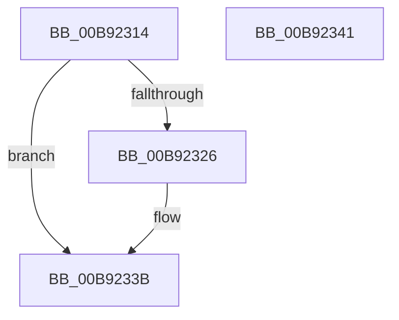

# IoVerifierInit

- RVA: `0x00B92314`–`0x00B92342` (길이 `46` bytes)
- VA: `0x0000000140B92314`
- 실행 섹션: `PAGEVRFY`
- PDB 이름 있음: `예`; PDB Function 태그: `아니요`
- unwind 정보 RVA: `0x0005CF00`
- 디코드: `16`개 명령, `46/46` bytes 표시
- 미해석 바이트: `0` (있으면 어셈블리에 `.byte`로 보존)

> 이 문서는 커널 이미지의 기계어와 PDB 기호를 분석해 생성했습니다. 4번과 5번은 함수 원형과 자료형을 바이너리 사용 방식에서 추정한 C 해석이며 원본 소스 복구 결과는 아닙니다.

## 1. Dependencies

- 직접 호출 지점: **2**; 고유 호출 대상: **2**
- 직접 호출자로 확인된 함수: **2**
- RIP 상대 이미지 참조: **1**

### Outgoing calls
- `0x00B9232F` → [IopUpdateFunctionPointers](../../text/59/IopUpdateFunctionPointers_function_0059762C.md) (function, `0x0059762C`)
- `0x00B92336` → [IoVerifierCheckForSettingsChange](IoVerifierCheckForSettingsChange_function_00B92258.md) (function, `0x00B92258`)

### Direct callers
- [VfInitSystemNoRebootNeeded](VfInitSystemNoRebootNeeded_function_00B93970.md) at `0x00B93A84`
- [ViIovInitialization](../BB/ViIovInitialization_function_00BB4EC4.md) at `0x00BB529A`

### Static image references
- `0x00B9231A` → RVA `0x00F04A20` (`.data`; read)

## 2. Other-region calls and transfers

- 다른 실행 섹션으로 향하는 call: **1**
  - `0x00B9232F` → [IopUpdateFunctionPointers](../../text/59/IopUpdateFunctionPointers_function_0059762C.md) (`PAGEVRFY` → `.text`)
- 별도 외부 분기/꼬리 이동을 확인하지 못했습니다.

## 3. Assembly (complete function range)

```asm
00B92314  40 53                           push rbx
00B92316  48 83 EC 20                     sub rsp, 0x20
00B9231A  8B 05 00 27 37 00               mov eax, dword ptr [rip + 0x372700]
00B92320  8B D9                           mov ebx, ecx
00B92322  A8 10                           test al, 0x10
00B92324  74 15                           je 0x140b9233b
00B92326  45 33 C0                        xor r8d, r8d
00B92329  B2 01                           mov dl, 1
00B9232B  41 8D 48 01                     lea ecx, [r8 + 1]
00B9232F  E8 F8 52 A0 FF                  call 0x14059762c
00B92334  8B CB                           mov ecx, ebx
00B92336  E8 1D FF FF FF                  call 0x140b92258
00B9233B  48 83 C4 20                     add rsp, 0x20
00B9233F  5B                              pop rbx
00B92340  C3                              ret
00B92341  CC                              int3
```

## 4. C-style interpretation (structured pseudocode)

```c
__int64 __fastcall IoVerifierInit(int a1, __int64 a2, int a3)
{
    __int64 result;
    __int64 v_rsp;

    v_rsp = (v_rsp) - (32);
    result = (unsigned int)(*(unsigned int *)(v_rip + 3614464));
    if ((((unsigned __int8)((unsigned int)(*(unsigned int *)(v_rip + 3614464)))) & (16)) != 0) {
        a3 = 0;
        a2 = 1;
        a1 = a3 + 1;
        result = IopUpdateFunctionPointers(a1, a2, a3, a4);
        a1 = (unsigned int)((unsigned int)(a1));
        result = IoVerifierCheckForSettingsChange(a1, a2, a3, a4);
    }
    v_rsp = (v_rsp) + (32);
    return result;
}
```

## 5. (Beta) C Style

```c
int64_t IoVerifierInit(int32_t Arg1, int64_t Arg2, int32_t Arg3)
{
    int64_t result;
    int64_t local_rsp;

    local_rsp = (local_rsp) - (32);
    result = (uint32_t)(*(uint32_t *)(v_rip + 0x372700));
    if ((((uint8_t)((uint32_t)(*(uint32_t *)(v_rip + 0x372700)))) & (16)) != 0) {
        Arg3 = 0;
        Arg2 = 1;
        Arg1 = Arg3 + 1;
        result = IopUpdateFunctionPointers(Arg1, Arg2, Arg3, a4);
        Arg1 = (uint32_t)((uint32_t)(Arg1));
        result = IoVerifierCheckForSettingsChange(Arg1, Arg2, Arg3, a4);
    }
    local_rsp = (local_rsp) + (32);
    return result;
}
```

## 6. Execution-region graph

[열기: 2D/3D 그래프와 함수 탐색 컨트롤 패널](../../../control-panel.html?section=pagevrfy&rva=0x00B92314&view=graph)

- 2D 그래프는 위에서 아래로 흐르고, 3D 그래프는 빈 공간을 드래그해 회전합니다. Shift+드래그는 이동, 휠은 확대·축소, 함수 노드 선택은 대상 보고서 이동입니다.

### Static fallback


