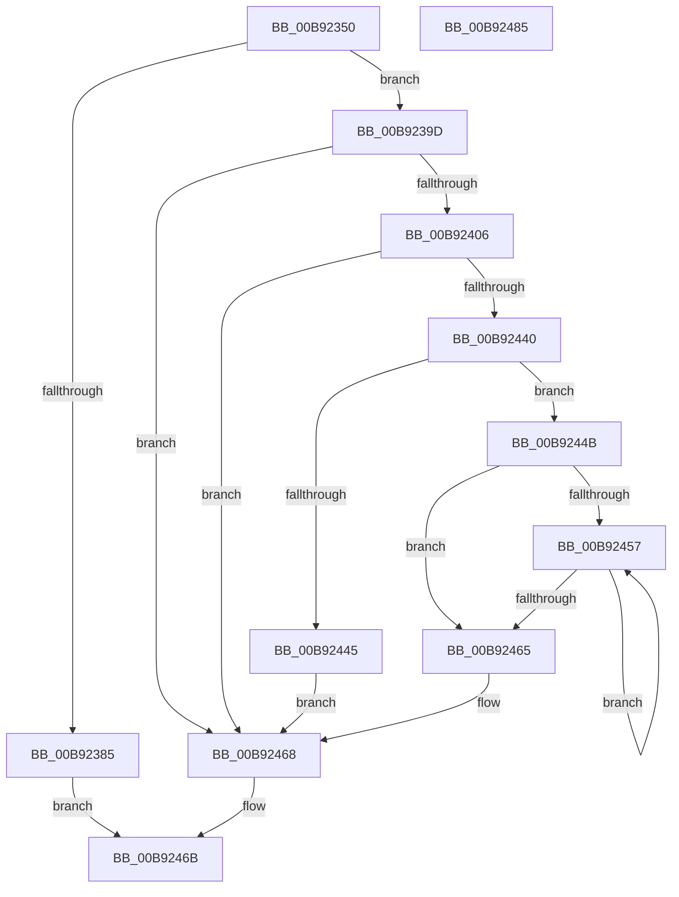

# IovAllocateMdl

- RVA: `0x00B92350`–`0x00B92486` (길이 `310` bytes)
- VA: `0x0000000140B92350`
- 실행 섹션: `PAGEVRFY`
- PDB 이름 있음: `예`; PDB Function 태그: `아니요`
- unwind 정보 RVA: `0x0007EE78`
- 디코드: `82`개 명령, `310/310` bytes 표시
- 미해석 바이트: `0` (있으면 어셈블리에 `.byte`로 보존)

> 이 문서는 커널 이미지의 기계어와 PDB 기호를 분석해 생성했습니다. 4번과 5번은 함수 원형과 자료형을 바이너리 사용 방식에서 추정한 C 해석이며 원본 소스 복구 결과는 아닙니다.

## 1. Dependencies

- 직접 호출 지점: **2**; 고유 호출 대상: **2**
- 직접 호출자로 확인된 함수: **0**
- RIP 상대 이미지 참조: **1**

### Outgoing calls
- `0x00B92393` → [IoAllocateMdl](../../text/29/IoAllocateMdl_function_0029EBF0.md) (function, `0x0029EBF0`)
- `0x00B923F9` → [VfHandlePoolAlloc](../BB/VfHandlePoolAlloc_function_00BB8A90.md) (function, `0x00BB8A90`)

### Direct callers
- 이 함수 시작 RVA로 연결되는 직접 call은 확인되지 않았습니다. 간접 호출은 완전히 역산할 수 없습니다.

### Static image references
- `0x00B92368` → RVA `0x00E681A0` (`.data`; read)

## 2. Other-region calls and transfers

- 다른 실행 섹션으로 향하는 call: **1**
  - `0x00B92393` → [IoAllocateMdl](../../text/29/IoAllocateMdl_function_0029EBF0.md) (`PAGEVRFY` → `.text`)
- 별도 외부 분기/꼬리 이동을 확인하지 못했습니다.

## 3. Assembly (complete function range)

```asm
00B92350  4C 8B DC                        mov r11, rsp
00B92353  49 89 5B 08                     mov qword ptr [r11 + 8], rbx
00B92357  49 89 6B 10                     mov qword ptr [r11 + 0x10], rbp
00B9235B  49 89 73 18                     mov qword ptr [r11 + 0x18], rsi
00B9235F  57                              push rdi
00B92360  41 56                           push r14
00B92362  41 57                           push r15
00B92364  48 83 EC 50                     sub rsp, 0x50
00B92368  8B 05 32 5E 2D 00               mov eax, dword ptr [rip + 0x2d5e32]
00B9236E  45 33 FF                        xor r15d, r15d
00B92371  8B EA                           mov ebp, edx
00B92373  41 8A F0                        mov sil, r8b
00B92376  48 8B F9                        mov rdi, rcx
00B92379  45 89 7B E4                     mov dword ptr [r11 - 0x1c], r15d
00B9237D  41 8D 57 01                     lea edx, [r15 + 1]
00B92381  84 C2                           test dl, al
00B92383  75 18                           jne 0x140b9239d
00B92385  48 8B 84 24 90 00 00 00         mov rax, qword ptr [rsp + 0x90]
00B9238D  8B D5                           mov edx, ebp
00B9238F  49 89 43 B8                     mov qword ptr [r11 - 0x48], rax
00B92393  E8 58 C8 70 FF                  call 0x14029ebf0
00B92398  E9 CE 00 00 00                  jmp 0x140b9246b
00B9239D  48 8B 84 24 98 00 00 00         mov rax, qword ptr [rsp + 0x98]
00B923A5  48 8D 9D FF 0F 00 00            lea rbx, [rbp + 0xfff]
00B923AC  48 89 44 24 38                  mov qword ptr [rsp + 0x38], rax
00B923B1  44 8B F7                        mov r14d, edi
00B923B4  89 54 24 30                     mov dword ptr [rsp + 0x30], edx
00B923B8  48 8D 44 24 40                  lea rax, [rsp + 0x40]
00B923BD  41 8B CE                        mov ecx, r14d
00B923C0  48 89 54 24 40                  mov qword ptr [rsp + 0x40], rdx
00B923C5  81 E1 FF 0F 00 00               and ecx, 0xfff
00B923CB  48 89 44 24 28                  mov qword ptr [rsp + 0x28], rax
00B923D0  48 03 D9                        add rbx, rcx
00B923D3  C7 44 24 48 20 00 00 00         mov dword ptr [rsp + 0x48], 0x20
00B923DB  48 C1 EB 0C                     shr rbx, 0xc
00B923DF  BA 40 02 00 00                  mov edx, 0x240
00B923E4  33 C9                           xor ecx, ecx
00B923E6  44 89 7C 24 20                  mov dword ptr [rsp + 0x20], r15d
00B923EB  41 B9 4D 64 6C 20               mov r9d, 0x206c644d
00B923F1  4C 8D 04 DD 30 00 00 00         lea r8, [rbx*8 + 0x30]
00B923F9  E8 92 66 02 00                  call 0x140bb8a90
00B923FE  48 8B C8                        mov rcx, rax
00B92401  48 85 C0                        test rax, rax
00B92404  74 62                           je 0x140b92468
00B92406  4C 8B 84 24 90 00 00 00         mov r8, qword ptr [rsp + 0x90]
00B9240E  66 83 C3 06                     add bx, 6
00B92412  66 C1 E3 03                     shl bx, 3
00B92416  48 81 E7 00 F0 FF FF            and rdi, 0xfffffffffffff000
00B9241D  41 81 E6 FF 0F 00 00            and r14d, 0xfff
00B92424  4C 89 38                        mov qword ptr [rax], r15
00B92427  66 89 58 08                     mov word ptr [rax + 8], bx
00B9242B  66 44 89 78 0A                  mov word ptr [rax + 0xa], r15w
00B92430  48 89 78 20                     mov qword ptr [rax + 0x20], rdi
00B92434  44 89 70 2C                     mov dword ptr [rax + 0x2c], r14d
00B92438  89 68 28                        mov dword ptr [rax + 0x28], ebp
00B9243B  4D 85 C0                        test r8, r8
00B9243E  74 28                           je 0x140b92468
00B92440  40 84 F6                        test sil, sil
00B92443  75 06                           jne 0x140b9244b
00B92445  49 89 40 08                     mov qword ptr [r8 + 8], rax
00B92449  EB 1D                           jmp 0x140b92468
00B9244B  4D 8B 40 08                     mov r8, qword ptr [r8 + 8]
00B9244F  49 8B 10                        mov rdx, qword ptr [r8]
00B92452  48 85 D2                        test rdx, rdx
00B92455  74 0E                           je 0x140b92465
00B92457  48 8B 02                        mov rax, qword ptr [rdx]
00B9245A  4C 8B C2                        mov r8, rdx
00B9245D  48 8B D0                        mov rdx, rax
00B92460  48 85 C0                        test rax, rax
00B92463  75 F2                           jne 0x140b92457
00B92465  49 89 08                        mov qword ptr [r8], rcx
00B92468  48 8B C1                        mov rax, rcx
00B9246B  4C 8D 5C 24 50                  lea r11, [rsp + 0x50]
00B92470  49 8B 5B 20                     mov rbx, qword ptr [r11 + 0x20]
00B92474  49 8B 6B 28                     mov rbp, qword ptr [r11 + 0x28]
00B92478  49 8B 73 30                     mov rsi, qword ptr [r11 + 0x30]
00B9247C  49 8B E3                        mov rsp, r11
00B9247F  41 5F                           pop r15
00B92481  41 5E                           pop r14
00B92483  5F                              pop rdi
00B92484  C3                              ret
00B92485  CC                              int3
```

## 4. C-style interpretation (structured pseudocode)

```c
__int64 __fastcall IovAllocateMdl(__int64 a1, int a2, unsigned __int8 a3, __int64 a4, __int64 a5, __int64 a6)
{
    __int64 result;
    __int64 v_r14;
    __int64 v_r15;
    __int64 v_rbx;
    __int64 v_rdi;
    __int64 v_rsp;
    unsigned __int64 v_stack_m18;
    unsigned int v_stack_m20;
    unsigned __int64 v_stack_m28;
    unsigned __int64 v_stack_m30;
    unsigned int v_stack_m38;
    unsigned __int64 v_stack_m40;
    unsigned int v_stack_m48;

    *(unsigned __int64 *)(v_rsp + 8) = v_rbx;
    *(unsigned __int64 *)(v_rsp + 16) = v_rbp;
    *(unsigned __int64 *)(v_rsp + 24) = v_rsi;
    v_rsp = (v_rsp) - (80);
    v_r15 = 0;
    *(unsigned int *)(v_rsp - 28) = 0;
    if ((((unsigned __int8)(v_r15 + 1)) & ((unsigned __int8)((unsigned int)(*(unsigned int *)(v_rip + 2973234))))) != 0) goto loc_00B9239D;
    *(unsigned __int64 *)(v_rsp - 72) = a5;
    result = IoAllocateMdl(a1, (unsigned int)((unsigned int)((unsigned int)(a2))), a3, a4);
    goto loc_00B9246B;
loc_00B9239D:
    v_stack_m30 = a6;
    v_stack_m38 = (unsigned int)((unsigned int)((unsigned int)((unsigned int)(a2))));
    v_stack_m28 = (unsigned int)((unsigned int)((unsigned int)(a2)));
    a1 = (unsigned int)(((unsigned int)((unsigned int)((unsigned int)((unsigned int)(a1))))) & (0xFFFULL));
    v_stack_m40 = v_stack_m28;
    v_rbx = ((unsigned int)(a2) + 4095) + (a1);
    v_stack_m20 = 32;
    v_rbx = (v_rbx) >> (12);
    a1 = 0;
    v_stack_m48 = 0;
    result = VfHandlePoolAlloc(a1, 576, v_rbx * 8 + 48, (unsigned int)(0x206C644DULL));
    if (result == 0) goto loc_00B92468;
    v_rbx = (unsigned __int16)((v_rbx) + (6));
    v_rbx = (unsigned __int16)((v_rbx) << (3));
    v_rdi = (a1) & (0xFFFFFFFFFFFFF000ULL);
    v_r14 = (unsigned int)(((unsigned int)((unsigned int)(a1))) & (0xFFFULL));
    *(unsigned __int64 *)(result) = 0;
    *(unsigned __int16 *)(result + 8) = (unsigned __int16)(v_rbx);
    *(unsigned __int16 *)(result + 10) = 0;
    *(unsigned __int64 *)(result + 32) = v_rdi;
    *(unsigned int *)(result + 44) = (unsigned int)(v_r14);
    *(unsigned int *)(result + 40) = (unsigned int)((unsigned int)(a2));
    if (a5 == 0) goto loc_00B92468;
    if (a3 != 0) goto loc_00B9244B;
    *(unsigned __int64 *)(a5 + 8) = result;
    goto loc_00B92468;
loc_00B9244B:
    if (*(unsigned __int64 *)(*(unsigned __int64 *)(a5 + 8)) == 0) goto loc_00B92465;
loc_00B92457:
    if (*(unsigned __int64 *)(*(unsigned __int64 *)(*(unsigned __int64 *)(a5 + 8))) != 0) goto loc_00B92457;
loc_00B92465:
    *(unsigned __int64 *)(*(unsigned __int64 *)(*(unsigned __int64 *)(a5 + 8))) = result;
loc_00B92468:
loc_00B9246B:
    return result;
}
```

## 5. (Beta) C Style

```c
int64_t IovAllocateMdl(int64_t Arg1, void *Arg2, uint8_t Arg3, int64_t Arg4, int64_t Arg5, int64_t Arg6)
{
    uint8_t *arg2 = (uint8_t *)Arg2;

    int64_t result;
    int64_t local_r14;
    int64_t local_r15;
    int64_t local_rbx;
    int64_t local_rdi;
    int64_t local_rsp;
    uint64_t v_stack_m18;
    uint32_t v_stack_m20;
    uint64_t v_stack_m28;
    uint64_t v_stack_m30;
    uint32_t v_stack_m38;
    uint64_t v_stack_m40;
    uint32_t v_stack_m48;

    *(uint64_t *)(local_rsp + 0x8) = local_rbx;
    *(uint64_t *)(local_rsp + 0x10) = local_rbp;
    *(uint64_t *)(local_rsp + 0x18) = local_rsi;
    local_rsp = (local_rsp) - (80);
    local_r15 = 0;
    *(uint32_t *)(local_rsp - 0x1C) = 0;
    if ((((uint8_t)(local_r15 + 1)) & ((uint8_t)((uint32_t)(*(uint32_t *)(v_rip + 0x2D5E32))))) != 0) goto loc_00B9239D;
    *(uint64_t *)(local_rsp - 0x48) = Arg5;
    result = IoAllocateMdl(Arg1, (uint32_t)((uint32_t)((uint32_t)(Arg2))), Arg3, Arg4);
    goto loc_00B9246B;
loc_00B9239D:
    v_stack_m30 = Arg6;
    v_stack_m38 = (uint32_t)((uint32_t)((uint32_t)((uint32_t)(Arg2))));
    v_stack_m28 = (uint32_t)((uint32_t)((uint32_t)(Arg2)));
    Arg1 = (uint32_t)(((uint32_t)((uint32_t)((uint32_t)((uint32_t)(Arg1))))) & (0xFFFULL));
    v_stack_m40 = v_stack_m28;
    local_rbx = ((uint32_t)(Arg2) + 4095) + (Arg1);
    v_stack_m20 = 32;
    local_rbx = (local_rbx) >> (12);
    Arg1 = 0;
    v_stack_m48 = 0;
    result = VfHandlePoolAlloc(Arg1, 576, local_rbx * 8 + 48, (uint32_t)(0x206C644DULL));
    if (result == 0) goto loc_00B92468;
    local_rbx = (uint16_t)((local_rbx) + (6));
    local_rbx = (uint16_t)((local_rbx) << (3));
    local_rdi = (Arg1) & (0xFFFFFFFFFFFFF000ULL);
    local_r14 = (uint32_t)(((uint32_t)((uint32_t)(Arg1))) & (0xFFFULL));
    *(uint64_t *)(result) = 0;
    *(uint16_t *)(result + 0x8) = (uint16_t)(local_rbx);
    *(uint16_t *)(result + 0xA) = 0;
    *(uint64_t *)(result + 0x20) = local_rdi;
    *(uint32_t *)(result + 0x2C) = (uint32_t)(local_r14);
    *(uint32_t *)(result + 0x28) = (uint32_t)((uint32_t)(Arg2));
    if (Arg5 == 0) goto loc_00B92468;
    if (Arg3 != 0) goto loc_00B9244B;
    *(uint64_t *)(Arg5 + 0x8) = result;
    goto loc_00B92468;
loc_00B9244B:
    if (*(uint64_t *)(*(uint64_t *)(Arg5 + 0x8)) == 0) goto loc_00B92465;
loc_00B92457:
    if (*(uint64_t *)(*(uint64_t *)(*(uint64_t *)(Arg5 + 0x8))) != 0) goto loc_00B92457;
loc_00B92465:
    *(uint64_t *)(*(uint64_t *)(*(uint64_t *)(Arg5 + 0x8))) = result;
loc_00B92468:
loc_00B9246B:
    return result;
}
```

### 관측된 메모리 오프셋

구조체 형식이 확인되지 않은 접근은 인자 기준의 오프셋으로만 기록했습니다.

| 기준 인자 | 오프셋 표현 | 폭 (bit) | 접근 |
|---|---:|---:|---|
| `Arg2` | `+ 0xFFF` | `64` | `R` |

## 6. Execution-region graph

[열기: 2D/3D 그래프와 함수 탐색 컨트롤 패널](../../../control-panel.html?section=pagevrfy&rva=0x00B92350&view=graph)

- 2D 그래프는 위에서 아래로 흐르고, 3D 그래프는 빈 공간을 드래그해 회전합니다. Shift+드래그는 이동, 휠은 확대·축소, 함수 노드 선택은 대상 보고서 이동입니다.

### Static fallback


