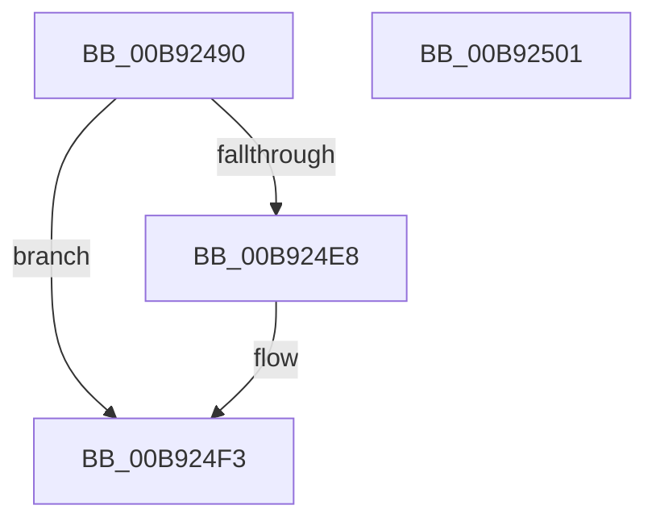

# IovAllocateWorkItem

- RVA: `0x00B92490`–`0x00B92502` (길이 `114` bytes)
- VA: `0x0000000140B92490`
- 실행 섹션: `PAGEVRFY`
- PDB 이름 있음: `예`; PDB Function 태그: `아니요`
- unwind 정보 RVA: `0x00089EA4`
- 디코드: `31`개 명령, `114/114` bytes 표시
- 미해석 바이트: `0` (있으면 어셈블리에 `.byte`로 보존)

> 이 문서는 커널 이미지의 기계어와 PDB 기호를 분석해 생성했습니다. 4번과 5번은 함수 원형과 자료형을 바이너리 사용 방식에서 추정한 C 해석이며 원본 소스 복구 결과는 아닙니다.

## 1. Dependencies

- 직접 호출 지점: **2**; 고유 호출 대상: **2**
- 직접 호출자로 확인된 함수: **0**
- RIP 상대 이미지 참조: **0**

### Outgoing calls
- `0x00B924DB` → [VfHandlePoolAlloc](../BB/VfHandlePoolAlloc_function_00BB8A90.md) (function, `0x00BB8A90`)
- `0x00B924EE` → [IoInitializeWorkItem](../../text/45/IoInitializeWorkItem_function_0045D380.md) (function, `0x0045D380`)

### Direct callers
- 이 함수 시작 RVA로 연결되는 직접 call은 확인되지 않았습니다. 간접 호출은 완전히 역산할 수 없습니다.

### Static image references
- 디코드된 RIP-relative 메모리 참조가 없습니다.

## 2. Other-region calls and transfers

- 다른 실행 섹션으로 향하는 call: **1**
  - `0x00B924EE` → [IoInitializeWorkItem](../../text/45/IoInitializeWorkItem_function_0045D380.md) (`PAGEVRFY` → `.text`)
- 별도 외부 분기/꼬리 이동을 확인하지 못했습니다.

## 3. Assembly (complete function range)

```asm
00B92490  4C 8B DC                        mov r11, rsp
00B92493  49 89 5B 08                     mov qword ptr [r11 + 8], rbx
00B92497  57                              push rdi
00B92498  48 83 EC 50                     sub rsp, 0x50
00B9249C  83 64 24 4C 00                  and dword ptr [rsp + 0x4c], 0
00B924A1  B8 01 00 00 00                  mov eax, 1
00B924A6  49 89 53 E0                     mov qword ptr [r11 - 0x20], rdx
00B924AA  48 8B F9                        mov rdi, rcx
00B924AD  89 44 24 30                     mov dword ptr [rsp + 0x30], eax
00B924B1  33 C9                           xor ecx, ecx
00B924B3  49 89 43 E8                     mov qword ptr [r11 - 0x18], rax
00B924B7  BA 40 02 00 00                  mov edx, 0x240
00B924BC  49 8D 43 E8                     lea rax, [r11 - 0x18]
00B924C0  C7 44 24 48 20 00 00 00         mov dword ptr [rsp + 0x48], 0x20
00B924C8  49 89 43 D0                     mov qword ptr [r11 - 0x30], rax
00B924CC  41 B9 56 66 77 69               mov r9d, 0x69776656
00B924D2  83 64 24 20 00                  and dword ptr [rsp + 0x20], 0
00B924D7  44 8D 41 60                     lea r8d, [rcx + 0x60]
00B924DB  E8 B0 65 02 00                  call 0x140bb8a90
00B924E0  48 8B D8                        mov rbx, rax
00B924E3  48 85 C0                        test rax, rax
00B924E6  74 0B                           je 0x140b924f3
00B924E8  48 8B D0                        mov rdx, rax
00B924EB  48 8B CF                        mov rcx, rdi
00B924EE  E8 8D AE 8C FF                  call 0x14045d380
00B924F3  48 8B C3                        mov rax, rbx
00B924F6  48 8B 5C 24 60                  mov rbx, qword ptr [rsp + 0x60]
00B924FB  48 83 C4 50                     add rsp, 0x50
00B924FF  5F                              pop rdi
00B92500  C3                              ret
00B92501  CC                              int3
```

## 4. C-style interpretation (structured pseudocode)

```c
__int64 __fastcall IovAllocateWorkItem(__int64 a1, __int64 a2)
{
    __int64 result;
    __int64 v_rsp;
    unsigned int v_stack_m10;
    unsigned int v_stack_m28;
    unsigned int v_stack_m38;
    unsigned int v_stack_mC;
    unsigned __int64 v_stack_p8;

    *(unsigned __int64 *)(v_rsp + 8) = v_rbx;
    v_rsp = (v_rsp) - (80);
    *(unsigned __int64 *)(v_rsp - 32) = a2;
    v_stack_m28 = 1;
    a1 = 0;
    *(unsigned __int64 *)(v_rsp - 24) = 1;
    v_stack_m10 = 32;
    *(unsigned __int64 *)(v_rsp - 48) = v_rsp - 24;
    result = VfHandlePoolAlloc(a1, 576, a1 + 96, (unsigned int)(0x69776656ULL));
    if (result != 0) {
        a2 = result;
        a1 = 0;
        result = IoInitializeWorkItem(a1, a2, a1 + 96, (unsigned int)(0x69776656ULL));
    }
    v_rsp = (v_rsp) + (80);
    return result;
}
```

## 5. (Beta) C Style

```c
int64_t IovAllocateWorkItem(int64_t Arg1, int64_t Arg2)
{
    int64_t result;
    int64_t local_rsp;
    uint32_t v_stack_m10;
    uint32_t v_stack_m28;
    uint32_t v_stack_m38;
    uint32_t v_stack_mC;
    uint64_t v_stack_p8;

    *(uint64_t *)(local_rsp + 0x8) = local_rbx;
    local_rsp = (local_rsp) - (80);
    *(uint64_t *)(local_rsp - 0x20) = Arg2;
    v_stack_m28 = 1;
    Arg1 = 0;
    *(uint64_t *)(local_rsp - 0x18) = 1;
    v_stack_m10 = 32;
    *(uint64_t *)(local_rsp - 0x30) = local_rsp - 24;
    result = VfHandlePoolAlloc(Arg1, 576, Arg1 + 96, (uint32_t)(0x69776656ULL));
    if (result != 0) {
        Arg2 = result;
        Arg1 = 0;
        result = IoInitializeWorkItem(Arg1, Arg2, Arg1 + 96, (uint32_t)(0x69776656ULL));
    }
    local_rsp = (local_rsp) + (80);
    return result;
}
```

## 6. Execution-region graph

[열기: 2D/3D 그래프와 함수 탐색 컨트롤 패널](../../../control-panel.html?section=pagevrfy&rva=0x00B92490&view=graph)

- 2D 그래프는 위에서 아래로 흐르고, 3D 그래프는 빈 공간을 드래그해 회전합니다. Shift+드래그는 이동, 휠은 확대·축소, 함수 노드 선택은 대상 보고서 이동입니다.

### Static fallback


