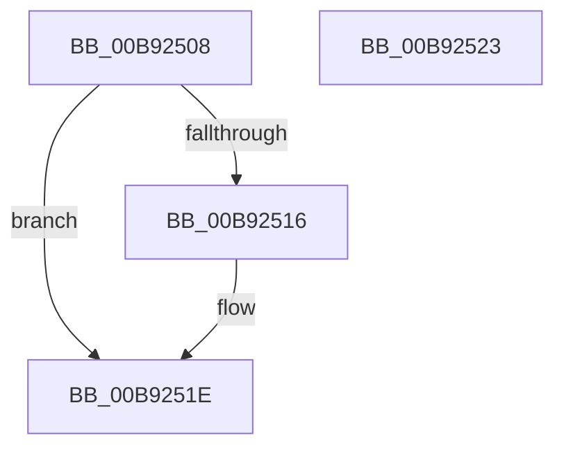

# IovAttachDeviceToDeviceStack

- RVA: `0x00B92508`–`0x00B92524` (길이 `28` bytes)
- VA: `0x0000000140B92508`
- 실행 섹션: `PAGEVRFY`
- PDB 이름 있음: `예`; PDB Function 태그: `아니요`
- unwind 정보 RVA: `0x0005C788`
- 디코드: `9`개 명령, `28/28` bytes 표시
- 미해석 바이트: `0` (있으면 어셈블리에 `.byte`로 보존)

> 이 문서는 커널 이미지의 기계어와 PDB 기호를 분석해 생성했습니다. 4번과 5번은 함수 원형과 자료형을 바이너리 사용 방식에서 추정한 C 해석이며 원본 소스 복구 결과는 아닙니다.

## 1. Dependencies

- 직접 호출 지점: **1**; 고유 호출 대상: **1**
- 직접 호출자로 확인된 함수: **1**
- RIP 상대 이미지 참조: **1**

### Outgoing calls
- `0x00B92519` → [IovUtilFlushStackCache](../BA/IovUtilFlushStackCache_function_00BA29EC.md) (function, `0x00BA29EC`)

### Direct callers
- [IopAttachDeviceToDeviceStackSafe](../../text/41/IopAttachDeviceToDeviceStackSafe_function_00410574.md) at `0x004107AB`

### Static image references
- `0x00B9250C` → RVA `0x00FF4000` (`PAGEVRFD`; read)

## 2. Other-region calls and transfers

- 다른 실행 섹션으로 향하는 call: **0**
- 별도 외부 분기/꼬리 이동을 확인하지 못했습니다.

## 3. Assembly (complete function range)

```asm
00B92508  48 83 EC 28                     sub rsp, 0x28
00B9250C  8B 05 EE 1A 46 00               mov eax, dword ptr [rip + 0x461aee]
00B92512  85 C0                           test eax, eax
00B92514  75 08                           jne 0x140b9251e
00B92516  48 8B CA                        mov rcx, rdx
00B92519  E8 CE 04 01 00                  call 0x140ba29ec
00B9251E  48 83 C4 28                     add rsp, 0x28
00B92522  C3                              ret
00B92523  CC                              int3
```

## 4. C-style interpretation (structured pseudocode)

```c
__int64 __fastcall IovAttachDeviceToDeviceStack(__int64 a1, __int64 a2)
{
    __int64 result;
    __int64 v_rsp;

    v_rsp = (v_rsp) - (40);
    result = (unsigned int)(*(unsigned int *)(v_rip + 4594414));
    if ((unsigned int)((unsigned int)(*(unsigned int *)(v_rip + 4594414))) == 0) {
        a1 = a2;
        result = IovUtilFlushStackCache(a1, a2, a3, a4);
    }
    v_rsp = (v_rsp) + (40);
    return result;
}
```

## 5. (Beta) C Style

```c
int64_t IovAttachDeviceToDeviceStack(int64_t Arg1, int64_t Arg2)
{
    int64_t result;
    int64_t local_rsp;

    local_rsp = (local_rsp) - (40);
    result = (uint32_t)(*(uint32_t *)(v_rip + 0x461AEE));
    if ((uint32_t)((uint32_t)(*(uint32_t *)(v_rip + 0x461AEE))) == 0) {
        Arg1 = Arg2;
        result = IovUtilFlushStackCache(Arg1, Arg2, a3, a4);
    }
    local_rsp = (local_rsp) + (40);
    return result;
}
```

## 6. Execution-region graph

[열기: 2D/3D 그래프와 함수 탐색 컨트롤 패널](../../../control-panel.html?section=pagevrfy&rva=0x00B92508&view=graph)

- 2D 그래프는 위에서 아래로 흐르고, 3D 그래프는 빈 공간을 드래그해 회전합니다. Shift+드래그는 이동, 휠은 확대·축소, 함수 노드 선택은 대상 보고서 이동입니다.

### Static fallback


