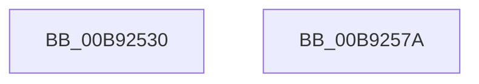

# IovBuildAsynchronousFsdRequest

- RVA: `0x00B92530`–`0x00B9259C` (길이 `108` bytes)
- VA: `0x0000000140B92530`
- 실행 섹션: `PAGEVRFY`
- PDB 이름 있음: `예`; PDB Function 태그: `아니요`
- unwind 정보 RVA: `0x000C7EDC`
- 디코드: `25`개 명령, `108/108` bytes 표시
- 미해석 바이트: `0` (있으면 어셈블리에 `.byte`로 보존)

> 이 문서는 커널 이미지의 기계어와 PDB 기호를 분석해 생성했습니다. 4번과 5번은 함수 원형과 자료형을 바이너리 사용 방식에서 추정한 C 해석이며 원본 소스 복구 결과는 아닙니다.

## 1. Dependencies

- 직접 호출 지점: **2**; 고유 호출 대상: **2**
- 직접 호출자로 확인된 함수: **0**
- RIP 상대 이미지 참조: **1**

### Outgoing calls
- `0x00B9256B` → [XdvIopBuildAsynchronousFsdRequest](../../text/61/XdvIopBuildAsynchronousFsdRequest_function_00614250.md) (function, `0x00614250`)
- `0x00B92596` → [KeBugCheckEx](../../text/4F/KeBugCheckEx_function_004FD660.md) (function, `0x004FD660`)

### Direct callers
- 이 함수 시작 RVA로 연결되는 직접 call은 확인되지 않았습니다. 간접 호출은 완전히 역산할 수 없습니다.

### Static image references
- `0x00B92544` → RVA `0x0029DD40` (`IopBuildAsynchronousFsdRequest`; read)

## 2. Other-region calls and transfers

- 다른 실행 섹션으로 향하는 call: **2**
  - `0x00B9256B` → [XdvIopBuildAsynchronousFsdRequest](../../text/61/XdvIopBuildAsynchronousFsdRequest_function_00614250.md) (`PAGEVRFY` → `.text`)
  - `0x00B92596` → [KeBugCheckEx](../../text/4F/KeBugCheckEx_function_004FD660.md) (`PAGEVRFY` → `.text`)
- 별도 외부 분기/꼬리 이동을 확인하지 못했습니다.

## 3. Assembly (complete function range)

```asm
00B92530  4C 8B DC                        mov r11, rsp
00B92533  49 89 53 10                     mov qword ptr [r11 + 0x10], rdx
00B92537  89 4C 24 08                     mov dword ptr [rsp + 8], ecx
00B9253B  48 83 EC 58                     sub rsp, 0x58
00B9253F  48 8B 44 24 58                  mov rax, qword ptr [rsp + 0x58]
00B92544  4C 8D 15 F5 B7 70 FF            lea r10, [rip - 0x8f480b]
00B9254B  4D 89 53 E0                     mov qword ptr [r11 - 0x20], r10
00B9254F  49 89 43 D8                     mov qword ptr [r11 - 0x28], rax
00B92553  48 8B 84 24 88 00 00 00         mov rax, qword ptr [rsp + 0x88]
00B9255B  49 89 43 D0                     mov qword ptr [r11 - 0x30], rax
00B9255F  48 8B 84 24 80 00 00 00         mov rax, qword ptr [rsp + 0x80]
00B92567  49 89 43 C8                     mov qword ptr [r11 - 0x38], rax
00B9256B  E8 E0 1C A8 FF                  call 0x140614250
00B92570  48 89 44 24 40                  mov qword ptr [rsp + 0x40], rax
00B92575  48 83 C4 58                     add rsp, 0x58
00B92579  C3                              ret
00B9257A  CC                              int3
00B9257B  8B C8                           mov ecx, eax
00B9257D  44 8B 4C 24 60                  mov r9d, dword ptr [rsp + 0x60]
00B92582  48 89 4C 24 20                  mov qword ptr [rsp + 0x20], rcx
00B92587  4C 8B 44 24 68                  mov r8, qword ptr [rsp + 0x68]
00B9258C  BA 08 00 00 00                  mov edx, 8
00B92591  B9 C9 00 00 00                  mov ecx, 0xc9
00B92596  E8 C5 B0 96 FF                  call 0x1404fd660
00B9259B  90                              nop
```

## 4. C-style interpretation (structured pseudocode)

```c
__int64 __fastcall IovBuildAsynchronousFsdRequest(int a1, __int64 a2, __int64 a3, __int64 a4, __int64 a5, __int64 a6)
{
    __int64 result;
    __int64 v_rsp;
    unsigned __int64 v_stack_m18;
    unsigned __int64 v_stack_p0;
    unsigned __int64 v_stack_p20;
    unsigned int v_stack_p60;
    unsigned __int64 v_stack_p68;
    unsigned int v_stack_p8;

    *(unsigned __int64 *)(v_rsp + 16) = a2;
    v_stack_p8 = a1;
    v_rsp = (v_rsp) - (88);
    *(unsigned __int64 *)(v_rsp - 32) = v_rip - 9390091;
    *(unsigned __int64 *)(v_rsp - 40) = v_stack_p0;
    *(unsigned __int64 *)(v_rsp - 48) = a6;
    *(unsigned __int64 *)(v_rsp - 56) = a5;
    result = XdvIopBuildAsynchronousFsdRequest(a1, a2, a3, a4);
    v_stack_m18 = result;
    v_rsp = (v_rsp) + (88);
    return result;
}
```

## 5. (Beta) C Style

```c
int64_t IovBuildAsynchronousFsdRequest(int32_t Arg1, int64_t Arg2, int64_t Arg3, int64_t Arg4, int64_t Arg5, int64_t Arg6)
{
    int64_t result;
    int64_t local_rsp;
    uint64_t v_stack_m18;
    uint64_t v_stack_p0;
    uint64_t v_stack_p20;
    uint32_t v_stack_p60;
    uint64_t v_stack_p68;
    uint32_t v_stack_p8;

    *(uint64_t *)(local_rsp + 0x10) = Arg2;
    v_stack_p8 = Arg1;
    local_rsp = (local_rsp) - (88);
    *(uint64_t *)(local_rsp - 0x20) = v_rip - 9390091;
    *(uint64_t *)(local_rsp - 0x28) = v_stack_p0;
    *(uint64_t *)(local_rsp - 0x30) = Arg6;
    *(uint64_t *)(local_rsp - 0x38) = Arg5;
    result = XdvIopBuildAsynchronousFsdRequest(Arg1, Arg2, Arg3, Arg4);
    v_stack_m18 = result;
    local_rsp = (local_rsp) + (88);
    return result;
}
```

## 6. Execution-region graph

[열기: 2D/3D 그래프와 함수 탐색 컨트롤 패널](../../../control-panel.html?section=pagevrfy&rva=0x00B92530&view=graph)

- 2D 그래프는 위에서 아래로 흐르고, 3D 그래프는 빈 공간을 드래그해 회전합니다. Shift+드래그는 이동, 휠은 확대·축소, 함수 노드 선택은 대상 보고서 이동입니다.

### Static fallback


