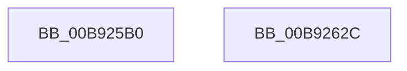

# IovBuildDeviceIoControlRequest

- RVA: `0x00B925B0`–`0x00B92654` (길이 `164` bytes)
- VA: `0x0000000140B925B0`
- 실행 섹션: `PAGEVRFY`
- PDB 이름 있음: `예`; PDB Function 태그: `아니요`
- unwind 정보 RVA: `0x000C7E94`
- 디코드: `33`개 명령, `164/164` bytes 표시
- 미해석 바이트: `0` (있으면 어셈블리에 `.byte`로 보존)

> 이 문서는 커널 이미지의 기계어와 PDB 기호를 분석해 생성했습니다. 4번과 5번은 함수 원형과 자료형을 바이너리 사용 방식에서 추정한 C 해석이며 원본 소스 복구 결과는 아닙니다.

## 1. Dependencies

- 직접 호출 지점: **2**; 고유 호출 대상: **2**
- 직접 호출자로 확인된 함수: **0**
- RIP 상대 이미지 참조: **2**

### Outgoing calls
- `0x00B9261D` → [guard_dispatch_icall](../../text/6B/guard_dispatch_icall_function_006BAAD0.md) (function, `0x006BAAD0`)
- `0x00B9264E` → [KeBugCheckEx](../../text/4F/KeBugCheckEx_function_004FD660.md) (function, `0x004FD660`)

### Direct callers
- 이 함수 시작 RVA로 연결되는 직접 call은 확인되지 않았습니다. 간접 호출은 완전히 역산할 수 없습니다.

### Static image references
- `0x00B925C5` → RVA `0x00205B00` (`IopBuildDeviceIoControlRequest`; read)
- `0x00B92616` → RVA `0x00FF4148` (`PAGEVRFD`; read)

## 2. Other-region calls and transfers

- 다른 실행 섹션으로 향하는 call: **2**
  - `0x00B9261D` → [guard_dispatch_icall](../../text/6B/guard_dispatch_icall_function_006BAAD0.md) (`PAGEVRFY` → `.text`)
  - `0x00B9264E` → [KeBugCheckEx](../../text/4F/KeBugCheckEx_function_004FD660.md) (`PAGEVRFY` → `.text`)
- 별도 외부 분기/꼬리 이동을 확인하지 못했습니다.

## 3. Assembly (complete function range)

```asm
00B925B0  48 89 54 24 10                  mov qword ptr [rsp + 0x10], rdx
00B925B5  89 4C 24 08                     mov dword ptr [rsp + 8], ecx
00B925B9  48 83 EC 78                     sub rsp, 0x78
00B925BD  44 8B D9                        mov r11d, ecx
00B925C0  48 8B 44 24 78                  mov rax, qword ptr [rsp + 0x78]
00B925C5  48 8D 0D 34 35 67 FF            lea rcx, [rip - 0x98cacc]
00B925CC  48 89 4C 24 50                  mov qword ptr [rsp + 0x50], rcx
00B925D1  48 89 44 24 48                  mov qword ptr [rsp + 0x48], rax
00B925D6  48 8B 8C 24 C0 00 00 00         mov rcx, qword ptr [rsp + 0xc0]
00B925DE  48 89 4C 24 40                  mov qword ptr [rsp + 0x40], rcx
00B925E3  48 8B 8C 24 B8 00 00 00         mov rcx, qword ptr [rsp + 0xb8]
00B925EB  48 89 4C 24 38                  mov qword ptr [rsp + 0x38], rcx
00B925F0  8A 8C 24 B0 00 00 00            mov cl, byte ptr [rsp + 0xb0]
00B925F7  88 4C 24 30                     mov byte ptr [rsp + 0x30], cl
00B925FB  8B 8C 24 A8 00 00 00            mov ecx, dword ptr [rsp + 0xa8]
00B92602  89 4C 24 28                     mov dword ptr [rsp + 0x28], ecx
00B92606  48 8B 8C 24 A0 00 00 00         mov rcx, qword ptr [rsp + 0xa0]
00B9260E  48 89 4C 24 20                  mov qword ptr [rsp + 0x20], rcx
00B92613  41 8B CB                        mov ecx, r11d
00B92616  48 8B 05 2B 1B 46 00            mov rax, qword ptr [rip + 0x461b2b]
00B9261D  E8 AE 84 B2 FF                  call 0x1406baad0
00B92622  48 89 44 24 60                  mov qword ptr [rsp + 0x60], rax
00B92627  48 83 C4 78                     add rsp, 0x78
00B9262B  C3                              ret
00B9262C  CC                              int3
00B9262D  8B C8                           mov ecx, eax
00B9262F  44 8B 8C 24 80 00 00 00         mov r9d, dword ptr [rsp + 0x80]
00B92637  48 89 4C 24 20                  mov qword ptr [rsp + 0x20], rcx
00B9263C  4C 8B 84 24 88 00 00 00         mov r8, qword ptr [rsp + 0x88]
00B92644  BA 09 00 00 00                  mov edx, 9
00B92649  B9 C9 00 00 00                  mov ecx, 0xc9
00B9264E  E8 0D B0 96 FF                  call 0x1404fd660
00B92653  90                              nop
```

## 4. C-style interpretation (structured pseudocode)

```c
__int64 __fastcall IovBuildDeviceIoControlRequest(int a1, __int64 a2, __int64 a3, __int64 a4, __int64 a5, unsigned int a6, unsigned __int8 a7, __int64 a8, __int64 a9)
{
    __int64 result;
    __int64 v_rsp;
    unsigned __int64 v_stack_m18;
    unsigned __int64 v_stack_m28;
    unsigned __int64 v_stack_m30;
    unsigned __int64 v_stack_m38;
    unsigned __int64 v_stack_m40;
    unsigned __int8 v_stack_m48;
    unsigned int v_stack_m50;
    unsigned __int64 v_stack_m58;
    unsigned __int64 v_stack_p0;
    unsigned __int64 v_stack_p10;
    unsigned __int64 v_stack_p20;
    unsigned int v_stack_p8;
    unsigned int v_stack_p80;
    unsigned __int64 v_stack_p88;

    v_stack_p10 = a2;
    v_stack_p8 = a1;
    v_rsp = (v_rsp) - (120);
    v_stack_m28 = v_rip - 10013388;
    v_stack_m30 = v_stack_p0;
    v_stack_m38 = a9;
    v_stack_m40 = a8;
    v_stack_m48 = a7;
    v_stack_m50 = (unsigned int)((unsigned int)(a6));
    v_stack_m58 = a5;
    result = guard_dispatch_icall((unsigned int)((unsigned int)((unsigned int)(a1))), a2, a3, a4);
    v_stack_m18 = result;
    v_rsp = (v_rsp) + (120);
    return result;
}
```

## 5. (Beta) C Style

```c
int64_t IovBuildDeviceIoControlRequest(int32_t Arg1, int64_t Arg2, int64_t Arg3, int64_t Arg4, int64_t Arg5, uint32_t Arg6, uint8_t Arg7, int64_t Arg8, int64_t Arg9)
{
    int64_t result;
    int64_t local_rsp;
    uint64_t v_stack_m18;
    uint64_t v_stack_m28;
    uint64_t v_stack_m30;
    uint64_t v_stack_m38;
    uint64_t v_stack_m40;
    uint8_t v_stack_m48;
    uint32_t v_stack_m50;
    uint64_t v_stack_m58;
    uint64_t v_stack_p0;
    uint64_t v_stack_p10;
    uint64_t v_stack_p20;
    uint32_t v_stack_p8;
    uint32_t v_stack_p80;
    uint64_t v_stack_p88;

    v_stack_p10 = Arg2;
    v_stack_p8 = Arg1;
    local_rsp = (local_rsp) - (120);
    v_stack_m28 = v_rip - 10013388;
    v_stack_m30 = v_stack_p0;
    v_stack_m38 = Arg9;
    v_stack_m40 = Arg8;
    v_stack_m48 = Arg7;
    v_stack_m50 = (uint32_t)((uint32_t)(Arg6));
    v_stack_m58 = Arg5;
    result = guard_dispatch_icall((uint32_t)((uint32_t)((uint32_t)(Arg1))), Arg2, Arg3, Arg4);
    v_stack_m18 = result;
    local_rsp = (local_rsp) + (120);
    return result;
}
```

## 6. Execution-region graph

[열기: 2D/3D 그래프와 함수 탐색 컨트롤 패널](../../../control-panel.html?section=pagevrfy&rva=0x00B925B0&view=graph)

- 2D 그래프는 위에서 아래로 흐르고, 3D 그래프는 빈 공간을 드래그해 회전합니다. Shift+드래그는 이동, 휠은 확대·축소, 함수 노드 선택은 대상 보고서 이동입니다.

### Static fallback


