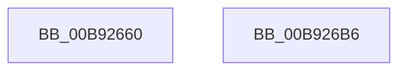

# IovBuildSynchronousFsdRequest

- RVA: `0x00B92660`–`0x00B926D8` (길이 `120` bytes)
- VA: `0x0000000140B92660`
- 실행 섹션: `PAGEVRFY`
- PDB 이름 있음: `예`; PDB Function 태그: `아니요`
- unwind 정보 RVA: `0x000C7EB8`
- 디코드: `27`개 명령, `120/120` bytes 표시
- 미해석 바이트: `0` (있으면 어셈블리에 `.byte`로 보존)

> 이 문서는 커널 이미지의 기계어와 PDB 기호를 분석해 생성했습니다. 4번과 5번은 함수 원형과 자료형을 바이너리 사용 방식에서 추정한 C 해석이며 원본 소스 복구 결과는 아닙니다.

## 1. Dependencies

- 직접 호출 지점: **2**; 고유 호출 대상: **2**
- 직접 호출자로 확인된 함수: **0**
- RIP 상대 이미지 참조: **1**

### Outgoing calls
- `0x00B926A7` → [XdvIoBuildSynchronousFsdRequest](../../text/61/XdvIoBuildSynchronousFsdRequest_function_00614200.md) (function, `0x00614200`)
- `0x00B926D2` → [KeBugCheckEx](../../text/4F/KeBugCheckEx_function_004FD660.md) (function, `0x004FD660`)

### Direct callers
- 이 함수 시작 RVA로 연결되는 직접 call은 확인되지 않았습니다. 간접 호출은 완전히 역산할 수 없습니다.

### Static image references
- `0x00B92674` → RVA `0x00A498C0` (`IopBuildSynchronousFsdRequest`; read)

## 2. Other-region calls and transfers

- 다른 실행 섹션으로 향하는 call: **2**
  - `0x00B926A7` → [XdvIoBuildSynchronousFsdRequest](../../text/61/XdvIoBuildSynchronousFsdRequest_function_00614200.md) (`PAGEVRFY` → `.text`)
  - `0x00B926D2` → [KeBugCheckEx](../../text/4F/KeBugCheckEx_function_004FD660.md) (`PAGEVRFY` → `.text`)
- 별도 외부 분기/꼬리 이동을 확인하지 못했습니다.

## 3. Assembly (complete function range)

```asm
00B92660  4C 8B DC                        mov r11, rsp
00B92663  49 89 53 10                     mov qword ptr [r11 + 0x10], rdx
00B92667  89 4C 24 08                     mov dword ptr [rsp + 8], ecx
00B9266B  48 83 EC 68                     sub rsp, 0x68
00B9266F  48 8B 44 24 68                  mov rax, qword ptr [rsp + 0x68]
00B92674  4C 8D 15 45 72 EB FF            lea r10, [rip - 0x148dbb]
00B9267B  4D 89 53 D8                     mov qword ptr [r11 - 0x28], r10
00B9267F  49 89 43 D0                     mov qword ptr [r11 - 0x30], rax
00B92683  48 8B 84 24 A0 00 00 00         mov rax, qword ptr [rsp + 0xa0]
00B9268B  49 89 43 C8                     mov qword ptr [r11 - 0x38], rax
00B9268F  48 8B 84 24 98 00 00 00         mov rax, qword ptr [rsp + 0x98]
00B92697  49 89 43 C0                     mov qword ptr [r11 - 0x40], rax
00B9269B  48 8B 84 24 90 00 00 00         mov rax, qword ptr [rsp + 0x90]
00B926A3  49 89 43 B8                     mov qword ptr [r11 - 0x48], rax
00B926A7  E8 54 1B A8 FF                  call 0x140614200
00B926AC  48 89 44 24 50                  mov qword ptr [rsp + 0x50], rax
00B926B1  48 83 C4 68                     add rsp, 0x68
00B926B5  C3                              ret
00B926B6  CC                              int3
00B926B7  8B C8                           mov ecx, eax
00B926B9  44 8B 4C 24 70                  mov r9d, dword ptr [rsp + 0x70]
00B926BE  48 89 4C 24 20                  mov qword ptr [rsp + 0x20], rcx
00B926C3  4C 8B 44 24 78                  mov r8, qword ptr [rsp + 0x78]
00B926C8  BA 08 00 00 00                  mov edx, 8
00B926CD  B9 C9 00 00 00                  mov ecx, 0xc9
00B926D2  E8 89 AF 96 FF                  call 0x1404fd660
00B926D7  90                              nop
```

## 4. C-style interpretation (structured pseudocode)

```c
__int64 __fastcall IovBuildSynchronousFsdRequest(int a1, __int64 a2, __int64 a3, __int64 a4, __int64 a5, __int64 a6, __int64 a7)
{
    __int64 result;
    __int64 v_rsp;
    unsigned __int64 v_stack_m18;
    unsigned __int64 v_stack_p0;
    unsigned __int64 v_stack_p20;
    unsigned int v_stack_p70;
    unsigned __int64 v_stack_p78;
    unsigned int v_stack_p8;

    *(unsigned __int64 *)(v_rsp + 16) = a2;
    v_stack_p8 = a1;
    v_rsp = (v_rsp) - (104);
    *(unsigned __int64 *)(v_rsp - 40) = v_rip - 1347003;
    *(unsigned __int64 *)(v_rsp - 48) = v_stack_p0;
    *(unsigned __int64 *)(v_rsp - 56) = a7;
    *(unsigned __int64 *)(v_rsp - 64) = a6;
    *(unsigned __int64 *)(v_rsp - 72) = a5;
    result = XdvIoBuildSynchronousFsdRequest(a1, a2, a3, a4);
    v_stack_m18 = result;
    v_rsp = (v_rsp) + (104);
    return result;
}
```

## 5. (Beta) C Style

```c
int64_t IovBuildSynchronousFsdRequest(int32_t Arg1, int64_t Arg2, int64_t Arg3, int64_t Arg4, int64_t Arg5, int64_t Arg6, int64_t Arg7)
{
    int64_t result;
    int64_t local_rsp;
    uint64_t v_stack_m18;
    uint64_t v_stack_p0;
    uint64_t v_stack_p20;
    uint32_t v_stack_p70;
    uint64_t v_stack_p78;
    uint32_t v_stack_p8;

    *(uint64_t *)(local_rsp + 0x10) = Arg2;
    v_stack_p8 = Arg1;
    local_rsp = (local_rsp) - (104);
    *(uint64_t *)(local_rsp - 0x28) = v_rip - 1347003;
    *(uint64_t *)(local_rsp - 0x30) = v_stack_p0;
    *(uint64_t *)(local_rsp - 0x38) = Arg7;
    *(uint64_t *)(local_rsp - 0x40) = Arg6;
    *(uint64_t *)(local_rsp - 0x48) = Arg5;
    result = XdvIoBuildSynchronousFsdRequest(Arg1, Arg2, Arg3, Arg4);
    v_stack_m18 = result;
    local_rsp = (local_rsp) + (104);
    return result;
}
```

## 6. Execution-region graph

[열기: 2D/3D 그래프와 함수 탐색 컨트롤 패널](../../../control-panel.html?section=pagevrfy&rva=0x00B92660&view=graph)

- 2D 그래프는 위에서 아래로 흐르고, 3D 그래프는 빈 공간을 드래그해 회전합니다. Shift+드래그는 이동, 휠은 확대·축소, 함수 노드 선택은 대상 보고서 이동입니다.

### Static fallback


