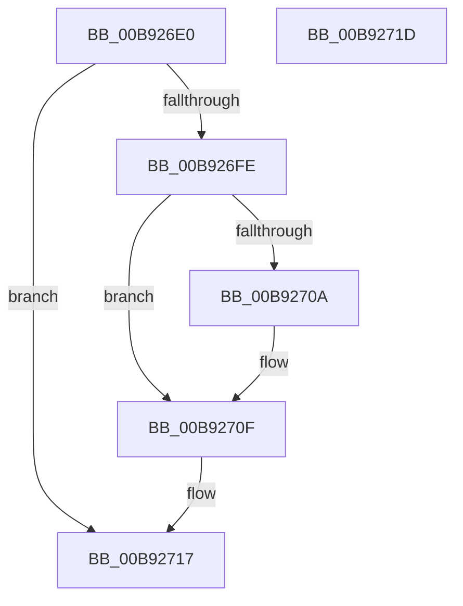

# IovCancelIrp

- RVA: `0x00B926E0`–`0x00B9271E` (길이 `62` bytes)
- VA: `0x0000000140B926E0`
- 실행 섹션: `PAGEVRFY`
- PDB 이름 있음: `예`; PDB Function 태그: `아니요`
- unwind 정보 RVA: `0x0005CF00`
- 디코드: `19`개 명령, `62/62` bytes 표시
- 미해석 바이트: `0` (있으면 어셈블리에 `.byte`로 보존)

> 이 문서는 커널 이미지의 기계어와 PDB 기호를 분석해 생성했습니다. 4번과 5번은 함수 원형과 자료형을 바이너리 사용 방식에서 추정한 C 해석이며 원본 소스 복구 결과는 아닙니다.

## 1. Dependencies

- 직접 호출 지점: **4**; 고유 호출 대상: **4**
- 직접 호출자로 확인된 함수: **1**
- RIP 상대 이미지 참조: **0**

### Outgoing calls
- `0x00B926E9` → [IovpLogStackTrace](../BB/IovpLogStackTrace_function_00BB6A5C.md) (function, `0x00BB6A5C`)
- `0x00B926F1` → [VfIrpDatabaseEntryFindAndLock](../BB/VfIrpDatabaseEntryFindAndLock_function_00BB7074.md) (function, `0x00BB7074`)
- `0x00B9270A` → [ViWdBeforeCancelIrp](../BA/ViWdBeforeCancelIrp_function_00BACA68.md) (function, `0x00BACA68`)
- `0x00B92712` → [VfIrpDatabaseEntryReleaseLock](../BB/VfIrpDatabaseEntryReleaseLock_function_00BB3FD4.md) (function, `0x00BB3FD4`)

### Direct callers
- [IoCancelIrp](../../text/27/IoCancelIrp_function_002720E0.md) at `0x002721A7`

### Static image references
- 디코드된 RIP-relative 메모리 참조가 없습니다.

## 2. Other-region calls and transfers

- 다른 실행 섹션으로 향하는 call: **0**
- 별도 외부 분기/꼬리 이동을 확인하지 못했습니다.

## 3. Assembly (complete function range)

```asm
00B926E0  40 53                           push rbx
00B926E2  48 83 EC 20                     sub rsp, 0x20
00B926E6  48 8B D9                        mov rbx, rcx
00B926E9  E8 6E 43 02 00                  call 0x140bb6a5c
00B926EE  48 8B CB                        mov rcx, rbx
00B926F1  E8 7E 49 02 00                  call 0x140bb7074
00B926F6  48 8B D8                        mov rbx, rax
00B926F9  48 85 C0                        test rax, rax
00B926FC  74 19                           je 0x140b92717
00B926FE  48 8B 88 F8 00 00 00            mov rcx, qword ptr [rax + 0xf8]
00B92705  48 85 C9                        test rcx, rcx
00B92708  74 05                           je 0x140b9270f
00B9270A  E8 59 A3 01 00                  call 0x140baca68
00B9270F  48 8B CB                        mov rcx, rbx
00B92712  E8 BD 18 02 00                  call 0x140bb3fd4
00B92717  48 83 C4 20                     add rsp, 0x20
00B9271B  5B                              pop rbx
00B9271C  C3                              ret
00B9271D  CC                              int3
```

## 4. C-style interpretation (structured pseudocode)

```c
__int64 __fastcall IovCancelIrp(__int64 a1)
{
    __int64 result;
    __int64 v_rsp;

    v_rsp = (v_rsp) - (32);
    result = IovpLogStackTrace(a1, a2, a3, a4);
    result = VfIrpDatabaseEntryFindAndLock(a1, a2, a3, a4);
    if (result == 0) goto loc_00B92717;
    if (*(unsigned __int64 *)(result + 248) != 0) {
        result = ViWdBeforeCancelIrp(*(unsigned __int64 *)(result + 248), a2, a3, a4);
    }
    result = VfIrpDatabaseEntryReleaseLock(result, a2, a3, a4);
loc_00B92717:
    v_rsp = (v_rsp) + (32);
    return result;
}
```

## 5. (Beta) C Style

```c
int64_t IovCancelIrp(int64_t Arg1)
{
    int64_t result;
    int64_t local_rsp;

    local_rsp = (local_rsp) - (32);
    result = IovpLogStackTrace(Arg1, a2, a3, a4);
    result = VfIrpDatabaseEntryFindAndLock(Arg1, a2, a3, a4);
    if (result == 0) goto loc_00B92717;
    if (*(uint64_t *)(result + 0xF8) != 0) {
        result = ViWdBeforeCancelIrp(*(uint64_t *)(result + 0xF8), a2, a3, a4);
    }
    result = VfIrpDatabaseEntryReleaseLock(result, a2, a3, a4);
loc_00B92717:
    local_rsp = (local_rsp) + (32);
    return result;
}
```

## 6. Execution-region graph

[열기: 2D/3D 그래프와 함수 탐색 컨트롤 패널](../../../control-panel.html?section=pagevrfy&rva=0x00B926E0&view=graph)

- 2D 그래프는 위에서 아래로 흐르고, 3D 그래프는 빈 공간을 드래그해 회전합니다. Shift+드래그는 이동, 휠은 확대·축소, 함수 노드 선택은 대상 보고서 이동입니다.

### Static fallback


