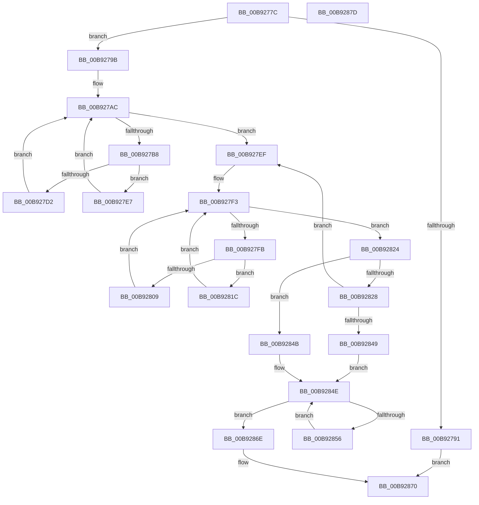

# IovUnloadDrivers

- RVA: `0x00B9277C`–`0x00B9287E` (길이 `258` bytes)
- VA: `0x0000000140B9277C`
- 실행 섹션: `PAGEVRFY`
- PDB 이름 있음: `예`; PDB Function 태그: `아니요`
- unwind 정보 RVA: `0x000C7F20`
- 디코드: `80`개 명령, `258/258` bytes 표시
- 미해석 바이트: `0` (있으면 어셈블리에 `.byte`로 보존)

> 이 문서는 커널 이미지의 기계어와 PDB 기호를 분석해 생성했습니다. 4번과 5번은 함수 원형과 자료형을 바이너리 사용 방식에서 추정한 C 해석이며 원본 소스 복구 결과는 아닙니다.

## 1. Dependencies

- 직접 호출 지점: **9**; 고유 호출 대상: **5**
- 직접 호출자로 확인된 함수: **1**
- RIP 상대 이미지 참조: **4**

### Outgoing calls
- `0x00B927A5` → [ObEnumerateObjectsByType](../../page/74/ObEnumerateObjectsByType_function_0074EF90.md) (function, `0x0074EF90`)
- `0x00B927C6` → [IovpUnloadDriver](IovpUnloadDriver_function_00B92AE8.md) (function, `0x00B92AE8`)
- `0x00B927D6` → [ObfDereferenceObject](../../text/2F/ObfDereferenceObject_function_002F9350.md) (function, `0x002F9350`)
- `0x00B927E0` → [ExFreePoolWithTag](../../poolcode/B8/ExFreePoolWithTag_function_00B82870.md) (function, `0x00B82870`)
- `0x00B92809` → [ObfDereferenceObject](../../text/2F/ObfDereferenceObject_function_002F9350.md) (function, `0x002F9350`)
- `0x00B92813` → [ExFreePoolWithTag](../../poolcode/B8/ExFreePoolWithTag_function_00B82870.md) (function, `0x00B82870`)
- `0x00B9283C` → [ZwDelayExecution](../../text/6A/ZwDelayExecution_function_006AD750.md) (function, `0x006AD750`)
- `0x00B9285D` → [ObfDereferenceObject](../../text/2F/ObfDereferenceObject_function_002F9350.md) (function, `0x002F9350`)
- `0x00B92867` → [ExFreePoolWithTag](../../poolcode/B8/ExFreePoolWithTag_function_00B82870.md) (function, `0x00B82870`)

### Direct callers
- [IoShutdownSystem](../../pagelk/B6/IoShutdownSystem_function_00B63B8C.md) at `0x00B63CD3`

### Static image references
- `0x00B92788` → RVA `0x00F0C8B0` (`.data`; read)
- `0x00B9279B` → RVA `0x00F8CFE0` (`.data`; read/write)
- `0x00B927AC` → RVA `0x00F8CFE0` (`.data`; read)
- `0x00B927BB` → RVA `0x00F8CFE0` (`.data`; write)

## 2. Other-region calls and transfers

- 다른 실행 섹션으로 향하는 call: **8**
  - `0x00B927A5` → [ObEnumerateObjectsByType](../../page/74/ObEnumerateObjectsByType_function_0074EF90.md) (`PAGEVRFY` → `PAGE`)
  - `0x00B927D6` → [ObfDereferenceObject](../../text/2F/ObfDereferenceObject_function_002F9350.md) (`PAGEVRFY` → `.text`)
  - `0x00B927E0` → [ExFreePoolWithTag](../../poolcode/B8/ExFreePoolWithTag_function_00B82870.md) (`PAGEVRFY` → `POOLCODE`)
  - `0x00B92809` → [ObfDereferenceObject](../../text/2F/ObfDereferenceObject_function_002F9350.md) (`PAGEVRFY` → `.text`)
  - `0x00B92813` → [ExFreePoolWithTag](../../poolcode/B8/ExFreePoolWithTag_function_00B82870.md) (`PAGEVRFY` → `POOLCODE`)
  - `0x00B9283C` → [ZwDelayExecution](../../text/6A/ZwDelayExecution_function_006AD750.md) (`PAGEVRFY` → `.text`)
  - `0x00B9285D` → [ObfDereferenceObject](../../text/2F/ObfDereferenceObject_function_002F9350.md) (`PAGEVRFY` → `.text`)
  - `0x00B92867` → [ExFreePoolWithTag](../../poolcode/B8/ExFreePoolWithTag_function_00B82870.md) (`PAGEVRFY` → `POOLCODE`)
- 별도 외부 분기/꼬리 이동을 확인하지 못했습니다.

## 3. Assembly (complete function range)

```asm
00B9277C  48 89 5C 24 18                  mov qword ptr [rsp + 0x18], rbx
00B92781  55                              push rbp
00B92782  56                              push rsi
00B92783  57                              push rdi
00B92784  48 83 EC 20                     sub rsp, 0x20
00B92788  83 3D 21 A1 37 00 00            cmp dword ptr [rip + 0x37a121], 0
00B9278F  75 0A                           jne 0x140b9279b
00B92791  B8 01 00 00 C0                  mov eax, 0xc0000001
00B92796  E9 D5 00 00 00                  jmp 0x140b92870
00B9279B  48 83 25 3D A8 3F 00 00         and qword ptr [rip + 0x3fa83d], 0
00B927A3  33 DB                           xor ebx, ebx
00B927A5  E8 E6 C7 BB FF                  call 0x14074ef90
00B927AA  8B E8                           mov ebp, eax
00B927AC  48 8B 3D 2D A8 3F 00            mov rdi, qword ptr [rip + 0x3fa82d]
00B927B3  48 85 FF                        test rdi, rdi
00B927B6  74 37                           je 0x140b927ef
00B927B8  48 8B 17                        mov rdx, qword ptr [rdi]
00B927BB  48 89 15 1E A8 3F 00            mov qword ptr [rip + 0x3fa81e], rdx
00B927C2  48 8B 4F 08                     mov rcx, qword ptr [rdi + 8]
00B927C6  E8 1D 03 00 00                  call 0x140b92ae8
00B927CB  3D 03 01 00 00                  cmp eax, 0x103
00B927D0  74 15                           je 0x140b927e7
00B927D2  48 8B 4F 08                     mov rcx, qword ptr [rdi + 8]
00B927D6  E8 75 6B 76 FF                  call 0x1402f9350
00B927DB  33 D2                           xor edx, edx
00B927DD  48 8B CF                        mov rcx, rdi
00B927E0  E8 8B 00 FF FF                  call 0x140b82870
00B927E5  EB C5                           jmp 0x140b927ac
00B927E7  48 89 1F                        mov qword ptr [rdi], rbx
00B927EA  48 8B DF                        mov rbx, rdi
00B927ED  EB BD                           jmp 0x140b927ac
00B927EF  32 D2                           xor dl, dl
00B927F1  33 FF                           xor edi, edi
00B927F3  48 8B F3                        mov rsi, rbx
00B927F6  48 85 DB                        test rbx, rbx
00B927F9  74 29                           je 0x140b92824
00B927FB  48 8B 4E 08                     mov rcx, qword ptr [rsi + 8]
00B927FF  48 8B 1B                        mov rbx, qword ptr [rbx]
00B92802  8B 41 10                        mov eax, dword ptr [rcx + 0x10]
00B92805  A8 01                           test al, 1
00B92807  74 13                           je 0x140b9281c
00B92809  E8 42 6B 76 FF                  call 0x1402f9350
00B9280E  33 D2                           xor edx, edx
00B92810  48 8B CE                        mov rcx, rsi
00B92813  E8 58 00 FF FF                  call 0x140b82870
00B92818  B2 01                           mov dl, 1
00B9281A  EB D7                           jmp 0x140b927f3
00B9281C  48 89 3E                        mov qword ptr [rsi], rdi
00B9281F  48 8B FE                        mov rdi, rsi
00B92822  EB CF                           jmp 0x140b927f3
00B92824  84 D2                           test dl, dl
00B92826  74 23                           je 0x140b9284b
00B92828  83 4C 24 44 FF                  or dword ptr [rsp + 0x44], 0xffffffff
00B9282D  48 8D 54 24 40                  lea rdx, [rsp + 0x40]
00B92832  33 C9                           xor ecx, ecx
00B92834  C7 44 24 40 00 1F 0A FA         mov dword ptr [rsp + 0x40], 0xfa0a1f00
00B9283C  E8 0F AF B1 FF                  call 0x1406ad750
00B92841  48 8B DF                        mov rbx, rdi
00B92844  48 85 FF                        test rdi, rdi
00B92847  75 A6                           jne 0x140b927ef
00B92849  EB 03                           jmp 0x140b9284e
00B9284B  48 8B DF                        mov rbx, rdi
00B9284E  48 8B FB                        mov rdi, rbx
00B92851  48 85 DB                        test rbx, rbx
00B92854  74 18                           je 0x140b9286e
00B92856  48 8B 4F 08                     mov rcx, qword ptr [rdi + 8]
00B9285A  48 8B 1B                        mov rbx, qword ptr [rbx]
00B9285D  E8 EE 6A 76 FF                  call 0x1402f9350
00B92862  33 D2                           xor edx, edx
00B92864  48 8B CF                        mov rcx, rdi
00B92867  E8 04 00 FF FF                  call 0x140b82870
00B9286C  EB E0                           jmp 0x140b9284e
00B9286E  8B C5                           mov eax, ebp
00B92870  48 8B 5C 24 50                  mov rbx, qword ptr [rsp + 0x50]
00B92875  48 83 C4 20                     add rsp, 0x20
00B92879  5F                              pop rdi
00B9287A  5E                              pop rsi
00B9287B  5D                              pop rbp
00B9287C  C3                              ret
00B9287D  CC                              int3
```

## 4. C-style interpretation (structured pseudocode)

```c
__int64 __fastcall IovUnloadDrivers(void)
{
    __int64 result;
    __int64 v_rbx;
    __int64 v_rdi;
    __int64 v_rsp;
    unsigned __int64 v_stack_p18;
    unsigned __int64 v_stack_p8;
    unsigned int v_stack_pC;

    v_stack_p18 = v_rbx;
    v_rsp = (v_rsp) - (32);
    if ((*(unsigned int *)(v_rip + 3645729)) != 0) goto loc_00B9279B;
    goto loc_00B92870;
loc_00B9279B:
    v_rbx = 0;
    result = ObEnumerateObjectsByType(a1, a2, a3, a4);
loc_00B927AC:
    if (*(unsigned __int64 *)(v_rip + 4171821) == 0) goto loc_00B927EF;
    *(unsigned __int64 *)(v_rip + 4171806) = *(unsigned __int64 *)(*(unsigned __int64 *)(v_rip + 4171821));
    result = IovpUnloadDriver(*(unsigned __int64 *)(*(unsigned __int64 *)(v_rip + 4171821) + 8), *(unsigned __int64 *)(*(unsigned __int64 *)(v_rip + 4171821)), a3, a4);
    if (((unsigned int)(result)) == 259) goto loc_00B927E7;
    result = ObfDereferenceObject(*(unsigned __int64 *)(*(unsigned __int64 *)(v_rip + 4171821) + 8), *(unsigned __int64 *)(*(unsigned __int64 *)(v_rip + 4171821)), a3, a4);
    a2 = 0;
    result = ExFreePoolWithTag(*(unsigned __int64 *)(v_rip + 4171821), a2, a3, a4);
    goto loc_00B927AC;
loc_00B927E7:
    *(unsigned __int64 *)(*(unsigned __int64 *)(v_rip + 4171821)) = 0;
    goto loc_00B927AC;
loc_00B927EF:
    a2 = 0;
    v_rdi = 0;
loc_00B927F3:
    if (*(unsigned __int64 *)(v_rip + 4171821) == 0) goto loc_00B92824;
    if ((((unsigned __int8)((unsigned int)(*(unsigned int *)(*(unsigned __int64 *)(*(unsigned __int64 *)(v_rip + 4171821) + 8) + 16)))) & (1)) == 0) goto loc_00B9281C;
    result = ObfDereferenceObject(*(unsigned __int64 *)(*(unsigned __int64 *)(v_rip + 4171821) + 8), a2, a3, a4);
    a2 = 0;
    result = ExFreePoolWithTag(*(unsigned __int64 *)(v_rip + 4171821), a2, a3, a4);
    goto loc_00B927F3;
loc_00B9281C:
    *(unsigned __int64 *)(*(unsigned __int64 *)(v_rip + 4171821)) = 0;
    goto loc_00B927F3;
loc_00B92824:
    if (1 == 0) goto loc_00B9284B;
    a1 = 0;
    v_stack_p8 = 0xFA0A1F00ULL;
    result = ZwDelayExecution(a1, v_stack_p8, a3, a4);
    if (*(unsigned __int64 *)(v_rip + 4171821) != 0) goto loc_00B927EF;
    goto loc_00B9284E;
loc_00B9284B:
loc_00B9284E:
    if (*(unsigned __int64 *)(v_rip + 4171821) == 0) goto loc_00B9286E;
    result = ObfDereferenceObject(*(unsigned __int64 *)(*(unsigned __int64 *)(v_rip + 4171821) + 8), v_stack_p8, a3, a4);
    a2 = 0;
    result = ExFreePoolWithTag(*(unsigned __int64 *)(v_rip + 4171821), a2, a3, a4);
    goto loc_00B9284E;
loc_00B9286E:
loc_00B92870:
    v_rsp = (v_rsp) + (32);
    return (unsigned int)((unsigned int)((unsigned int)((unsigned int)(result))));
}
```

## 5. (Beta) C Style

```c
void IovUnloadDrivers(void)
{
    int64_t result;
    int64_t local_rbx;
    int64_t local_rdi;
    int64_t local_rsp;
    uint64_t v_stack_p18;
    uint64_t v_stack_p8;
    uint32_t v_stack_pC;

    v_stack_p18 = local_rbx;
    local_rsp = (local_rsp) - (32);
    if ((*(uint32_t *)(v_rip + 0x37A121)) != 0) goto loc_00B9279B;
    goto loc_00B92870;
loc_00B9279B:
    local_rbx = 0;
    result = ObEnumerateObjectsByType(a1, a2, a3, a4);
loc_00B927AC:
    if (*(uint64_t *)(v_rip + 0x3FA82D) == 0) goto loc_00B927EF;
    *(uint64_t *)(v_rip + 0x3FA81E) = *(uint64_t *)(*(uint64_t *)(v_rip + 0x3FA82D));
    result = IovpUnloadDriver(*(uint64_t *)(*(uint64_t *)(v_rip + 0x3FA82D) + 0x8), *(uint64_t *)(*(uint64_t *)(v_rip + 0x3FA82D)), a3, a4);
    if (((uint32_t)(result)) == 259) goto loc_00B927E7;
    result = ObfDereferenceObject(*(uint64_t *)(*(uint64_t *)(v_rip + 0x3FA82D) + 0x8), *(uint64_t *)(*(uint64_t *)(v_rip + 0x3FA82D)), a3, a4);
    a2 = 0;
    result = ExFreePoolWithTag(*(uint64_t *)(v_rip + 0x3FA82D), a2, a3, a4);
    goto loc_00B927AC;
loc_00B927E7:
    *(uint64_t *)(*(uint64_t *)(v_rip + 0x3FA82D)) = 0;
    goto loc_00B927AC;
loc_00B927EF:
    a2 = 0;
    local_rdi = 0;
loc_00B927F3:
    if (*(uint64_t *)(v_rip + 0x3FA82D) == 0) goto loc_00B92824;
    if ((((uint8_t)((uint32_t)(*(uint32_t *)(*(uint64_t *)(*(uint64_t *)(v_rip + 0x3FA82D) + 0x8) + 0x10)))) & (1)) == 0) goto loc_00B9281C;
    result = ObfDereferenceObject(*(uint64_t *)(*(uint64_t *)(v_rip + 0x3FA82D) + 0x8), a2, a3, a4);
    a2 = 0;
    result = ExFreePoolWithTag(*(uint64_t *)(v_rip + 0x3FA82D), a2, a3, a4);
    goto loc_00B927F3;
loc_00B9281C:
    *(uint64_t *)(*(uint64_t *)(v_rip + 0x3FA82D)) = 0;
    goto loc_00B927F3;
loc_00B92824:
    if (1 == 0) goto loc_00B9284B;
    a1 = 0;
    v_stack_p8 = 0xFA0A1F00ULL;
    result = ZwDelayExecution(a1, v_stack_p8, a3, a4);
    if (*(uint64_t *)(v_rip + 0x3FA82D) != 0) goto loc_00B927EF;
    goto loc_00B9284E;
loc_00B9284B:
loc_00B9284E:
    if (*(uint64_t *)(v_rip + 0x3FA82D) == 0) goto loc_00B9286E;
    result = ObfDereferenceObject(*(uint64_t *)(*(uint64_t *)(v_rip + 0x3FA82D) + 0x8), v_stack_p8, a3, a4);
    a2 = 0;
    result = ExFreePoolWithTag(*(uint64_t *)(v_rip + 0x3FA82D), a2, a3, a4);
    goto loc_00B9284E;
loc_00B9286E:
loc_00B92870:
    local_rsp = (local_rsp) + (32);
    return (uint32_t)((uint32_t)((uint32_t)((uint32_t)(result))));
}
```

## 6. Execution-region graph

[열기: 2D/3D 그래프와 함수 탐색 컨트롤 패널](../../../control-panel.html?section=pagevrfy&rva=0x00B9277C&view=graph)

- 2D 그래프는 위에서 아래로 흐르고, 3D 그래프는 빈 공간을 드래그해 회전합니다. Shift+드래그는 이동, 휠은 확대·축소, 함수 노드 선택은 대상 보고서 이동입니다.

### Static fallback


