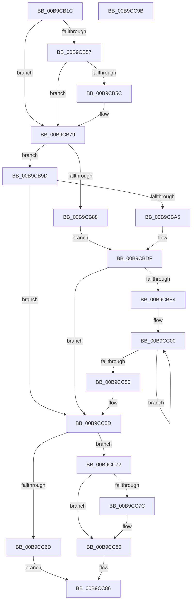

# IovpAdvanceStackDownwards

- RVA: `0x00B9CB1C`–`0x00B9CC9C` (길이 `384` bytes)
- VA: `0x0000000140B9CB1C`
- 실행 섹션: `PAGEVRFY`
- PDB 이름 있음: `예`; PDB Function 태그: `아니요`
- unwind 정보 RVA: `0x000D244C`
- 디코드: `105`개 명령, `384/384` bytes 표시
- 미해석 바이트: `0` (있으면 어셈블리에 `.byte`로 보존)

> 이 문서는 커널 이미지의 기계어와 PDB 기호를 분석해 생성했습니다. 4번과 5번은 함수 원형과 자료형을 바이너리 사용 방식에서 추정한 C 해석이며 원본 소스 복구 결과는 아닙니다.

## 1. Dependencies

- 직접 호출 지점: **2**; 고유 호출 대상: **1**
- 직접 호출자로 확인된 함수: **2**
- RIP 상대 이미지 참조: **0**

### Outgoing calls
- `0x00B9CB65` → [memset](../../text/6C/memset_function_006C6C40.md) (function, `0x006C6C40`)
- `0x00B9CC12` → [memset](../../text/6C/memset_function_006C6C40.md) (function, `0x006C6C40`)

### Direct callers
- [IovpCallDriver1](IovpCallDriver1_function_00B9CCA4.md) at `0x00B9CF55`
- [sub_00BBBCB2](../BB/Unknown_function_00BBBCB2.md) at `0x00BBBD3E`

### Static image references
- 디코드된 RIP-relative 메모리 참조가 없습니다.

## 2. Other-region calls and transfers

- 다른 실행 섹션으로 향하는 call: **2**
  - `0x00B9CB65` → [memset](../../text/6C/memset_function_006C6C40.md) (`PAGEVRFY` → `.text`)
  - `0x00B9CC12` → [memset](../../text/6C/memset_function_006C6C40.md) (`PAGEVRFY` → `.text`)
- 별도 외부 분기/꼬리 이동을 확인하지 못했습니다.

## 3. Assembly (complete function range)

```asm
00B9CB1C  48 89 5C 24 10                  mov qword ptr [rsp + 0x10], rbx
00B9CB21  55                              push rbp
00B9CB22  56                              push rsi
00B9CB23  57                              push rdi
00B9CB24  41 54                           push r12
00B9CB26  41 55                           push r13
00B9CB28  41 56                           push r14
00B9CB2A  41 57                           push r15
00B9CB2C  48 83 EC 30                     sub rsp, 0x30
00B9CB30  44 8B B4 24 A0 00 00 00         mov r14d, dword ptr [rsp + 0xa0]
00B9CB38  49 8B D9                        mov rbx, r9
00B9CB3B  48 0F BE C2                     movsx rax, dl
00B9CB3F  4D 8B F8                        mov r15, r8
00B9CB42  48 6B F8 78                     imul rdi, rax, 0x78
00B9CB46  48 83 C7 88                     add rdi, -0x78
00B9CB4A  48 03 F9                        add rdi, rcx
00B9CB4D  48 89 7C 24 20                  mov qword ptr [rsp + 0x20], rdi
00B9CB52  80 3F 00                        cmp byte ptr [rdi], 0
00B9CB55  75 22                           jne 0x140b9cb79
00B9CB57  45 85 F6                        test r14d, r14d
00B9CB5A  74 1D                           je 0x140b9cb79
00B9CB5C  33 D2                           xor edx, edx
00B9CB5E  48 8B CF                        mov rcx, rdi
00B9CB61  44 8D 42 78                     lea r8d, [rdx + 0x78]
00B9CB65  E8 D6 A0 B2 FF                  call 0x1406c6c40
00B9CB6A  48 8D 47 10                     lea rax, [rdi + 0x10]
00B9CB6E  48 89 40 08                     mov qword ptr [rax + 8], rax
00B9CB72  48 89 00                        mov qword ptr [rax], rax
00B9CB75  4C 89 7F 20                     mov qword ptr [rdi + 0x20], r15
00B9CB79  48 63 94 24 90 00 00 00         movsxd rdx, dword ptr [rsp + 0x90]
00B9CB81  33 ED                           xor ebp, ebp
00B9CB83  48 85 DB                        test rbx, rbx
00B9CB86  75 15                           jne 0x140b9cb9d
00B9CB88  48 21 6C 24 70                  and qword ptr [rsp + 0x70], rbp
00B9CB8D  45 33 ED                        xor r13d, r13d
00B9CB90  45 33 E4                        xor r12d, r12d
00B9CB93  48 21 AC 24 80 00 00 00         and qword ptr [rsp + 0x80], rbp
00B9CB9B  EB 42                           jmp 0x140b9cbdf
00B9CB9D  85 D2                           test edx, edx
00B9CB9F  0F 8E B8 00 00 00               jle 0x140b9cc5d
00B9CBA5  48 6B CA 78                     imul rcx, rdx, 0x78
00B9CBA9  4C 8B 64 39 08                  mov r12, qword ptr [rcx + rdi + 8]
00B9CBAE  48 8D 41 30                     lea rax, [rcx + 0x30]
00B9CBB2  4C 8B 6C 39 28                  mov r13, qword ptr [rcx + rdi + 0x28]
00B9CBB7  48 03 C7                        add rax, rdi
00B9CBBA  48 89 84 24 80 00 00 00         mov qword ptr [rsp + 0x80], rax
00B9CBC2  48 8D 41 38                     lea rax, [rcx + 0x38]
00B9CBC6  48 03 C7                        add rax, rdi
00B9CBC9  4C 89 67 08                     mov qword ptr [rdi + 8], r12
00B9CBCD  8B 6C 39 04                     mov ebp, dword ptr [rcx + rdi + 4]
00B9CBD1  81 E5 00 00 00 10               and ebp, 0x10000000
00B9CBD7  48 89 44 24 70                  mov qword ptr [rsp + 0x70], rax
00B9CBDC  09 6F 04                        or dword ptr [rdi + 4], ebp
00B9CBDF  83 FA 01                        cmp edx, 1
00B9CBE2  7E 79                           jle 0x140b9cc5d
00B9CBE4  4C 8B 74 24 70                  mov r14, qword ptr [rsp + 0x70]
00B9CBE9  8D 4A FF                        lea ecx, [rdx - 1]
00B9CBEC  48 8D 77 10                     lea rsi, [rdi + 0x10]
00B9CBF0  48 89 8C 24 88 00 00 00         mov qword ptr [rsp + 0x88], rcx
00B9CBF8  48 8B BC 24 80 00 00 00         mov rdi, qword ptr [rsp + 0x80]
00B9CC00  33 D2                           xor edx, edx
00B9CC02  48 83 C6 78                     add rsi, 0x78
00B9CC06  49 83 C7 48                     add r15, 0x48
00B9CC0A  44 8D 42 78                     lea r8d, [rdx + 0x78]
00B9CC0E  48 8D 4E F0                     lea rcx, [rsi - 0x10]
00B9CC12  E8 29 A0 B2 FF                  call 0x1406c6c40
00B9CC17  48 89 76 08                     mov qword ptr [rsi + 8], rsi
00B9CC1B  48 89 36                        mov qword ptr [rsi], rsi
00B9CC1E  C6 46 F0 01                     mov byte ptr [rsi - 0x10], 1
00B9CC22  4C 89 7E 10                     mov qword ptr [rsi + 0x10], r15
00B9CC26  4C 89 66 F8                     mov qword ptr [rsi - 8], r12
00B9CC2A  48 8B 07                        mov rax, qword ptr [rdi]
00B9CC2D  48 89 46 20                     mov qword ptr [rsi + 0x20], rax
00B9CC31  49 8B 06                        mov rax, qword ptr [r14]
00B9CC34  48 89 46 28                     mov qword ptr [rsi + 0x28], rax
00B9CC38  8B C5                           mov eax, ebp
00B9CC3A  0F BA E8 17                     bts eax, 0x17
00B9CC3E  4C 89 6E 18                     mov qword ptr [rsi + 0x18], r13
00B9CC42  09 46 F4                        or dword ptr [rsi - 0xc], eax
00B9CC45  48 83 AC 24 88 00 00 00 01      sub qword ptr [rsp + 0x88], 1
00B9CC4E  75 B0                           jne 0x140b9cc00
00B9CC50  48 8B 7C 24 20                  mov rdi, qword ptr [rsp + 0x20]
00B9CC55  44 8B B4 24 A0 00 00 00         mov r14d, dword ptr [rsp + 0xa0]
00B9CC5D  48 8B 84 24 A8 00 00 00         mov rax, qword ptr [rsp + 0xa8]
00B9CC65  48 89 38                        mov qword ptr [rax], rdi
00B9CC68  45 85 F6                        test r14d, r14d
00B9CC6B  75 05                           jne 0x140b9cc72
00B9CC6D  0F B6 07                        movzx eax, byte ptr [rdi]
00B9CC70  EB 14                           jmp 0x140b9cc86
00B9CC72  83 BC 24 98 00 00 00 00         cmp dword ptr [rsp + 0x98], 0
00B9CC7A  74 04                           je 0x140b9cc80
00B9CC7C  48 89 7F 08                     mov qword ptr [rdi + 8], rdi
00B9CC80  0F B6 07                        movzx eax, byte ptr [rdi]
00B9CC83  C6 07 01                        mov byte ptr [rdi], 1
00B9CC86  48 8B 5C 24 78                  mov rbx, qword ptr [rsp + 0x78]
00B9CC8B  48 83 C4 30                     add rsp, 0x30
00B9CC8F  41 5F                           pop r15
00B9CC91  41 5E                           pop r14
00B9CC93  41 5D                           pop r13
00B9CC95  41 5C                           pop r12
00B9CC97  5F                              pop rdi
00B9CC98  5E                              pop rsi
00B9CC99  5D                              pop rbp
00B9CC9A  C3                              ret
00B9CC9B  CC                              int3
```

## 4. C-style interpretation (structured pseudocode)

```c
__int64 __fastcall IovpAdvanceStackDownwards(__int64 a1, int a2, __int64 a3, __int64 a4, unsigned int a5, unsigned int a6, unsigned int a7, __int64 a8)
{
    __int64 result;
    __int64 v_r12;
    __int64 v_r13;
    __int64 v_r15;
    __int64 v_rbp;
    __int64 v_rdi;
    __int64 v_rsi;
    __int64 v_rsp;
    unsigned __int64 v_stack_m48;
    unsigned __int64 v_stack_p10;
    unsigned __int64 v_stack_p18;
    unsigned __int64 v_stack_p20;
    unsigned __int64 v_stack_p8;

    v_stack_p10 = v_rbx;
    v_rsp = (v_rsp) - (48);
    v_rdi = (v_rdi) * ((__int8)((unsigned __int8)(a2)));
    v_rdi = (v_rdi) + (-120);
    v_rdi = (v_rdi) + (a1);
    v_stack_m48 = v_rdi;
    if ((*(unsigned __int8 *)(v_rdi)) != 0) goto loc_00B9CB79;
    result = (__int8)((unsigned __int8)(a2));
    if ((unsigned int)((unsigned int)(a7)) != 0) {
        a2 = 0;
        a1 = v_rdi;
        a3 = a2 + 120;
        result = memset(a1, a2, a3, a4);
        result = v_rdi + 16;
        *(unsigned __int64 *)(result + 8) = result;
        *(unsigned __int64 *)(result) = result;
        *(unsigned __int64 *)(v_rdi + 32) = a3;
    }
    v_rbp = 0;
    if (a4 != 0) goto loc_00B9CB9D;
    v_r13 = 0;
    v_r12 = 0;
    goto loc_00B9CBDF;
loc_00B9CB9D:
    if (condition_is_less_or_equal) goto loc_00B9CC5D;
    a1 = (a1) * ((int)(a5));
    result = (a1 + 48) + (v_rdi);
    v_stack_p18 = result;
    result = (a1 + 56) + (v_rdi);
    *(unsigned __int64 *)(v_rdi + 8) = *(unsigned __int64 *)(a1 + v_rdi * 1 + 8);
    v_rbp = (unsigned int)(((unsigned int)(*(unsigned int *)(a1 + v_rdi * 1 + 4))) & (0x10000000ULL));
    v_stack_p8 = result;
loc_00B9CBDF:
    if (((unsigned int)((int)(a5))) <= 1) goto loc_00B9CC5D;
    v_stack_p20 = (int)(a5) - 1;
loc_00B9CC00:
    a2 = 0;
    v_rsi = (v_rdi + 16) + (120);
    v_r15 = (a3) + (72);
    result = memset(v_rsi - 16, a2, a2 + 120, a4);
    *(unsigned __int64 *)(v_rsi + 8) = v_rsi;
    *(unsigned __int64 *)(v_rsi) = v_rsi;
    *(unsigned __int8 *)(v_rsi - 16) = 1;
    *(unsigned __int64 *)(v_rsi + 16) = v_r15;
    *(unsigned __int64 *)(v_rsi - 8) = *(unsigned __int64 *)(a1 + v_rdi * 1 + 8);
    *(unsigned __int64 *)(v_rsi + 32) = *(unsigned __int64 *)(v_stack_p18);
    *(unsigned __int64 *)(v_rsi + 40) = *(unsigned __int64 *)(v_stack_p8);
    *(unsigned __int64 *)(v_rsi + 24) = *(unsigned __int64 *)(a1 + v_rdi * 1 + 40);
    if (condition_is_not_equal) goto loc_00B9CC00;
loc_00B9CC5D:
    *(unsigned __int64 *)(a8) = v_stack_m48;
    if ((unsigned int)((unsigned int)(a7)) != 0) goto loc_00B9CC72;
    goto loc_00B9CC86;
loc_00B9CC72:
    if (a6 != 0) {
        *(unsigned __int64 *)(v_stack_m48 + 8) = v_stack_m48;
    }
    *(unsigned __int8 *)(v_stack_m48) = 1;
loc_00B9CC86:
    v_rsp = (v_rsp) + (48);
    return *(unsigned __int8 *)(v_stack_m48);
}
```

## 5. (Beta) C Style

```c
int64_t IovpAdvanceStackDownwards(int64_t Arg1, int32_t Arg2, int64_t Arg3, int64_t Arg4, uint32_t Arg5, uint32_t Arg6, uint32_t Arg7, void *Arg8)
{
    uint8_t *arg8 = (uint8_t *)Arg8;

    int64_t result;
    int64_t local_r12;
    int64_t local_r13;
    int64_t local_r15;
    int64_t local_rbp;
    int64_t local_rdi;
    int64_t local_rsi;
    int64_t local_rsp;
    uint64_t v_stack_m48;
    uint64_t v_stack_p10;
    uint64_t v_stack_p18;
    uint64_t v_stack_p20;
    uint64_t v_stack_p8;

    v_stack_p10 = local_rbx;
    local_rsp = (local_rsp) - (48);
    local_rdi = (local_rdi) * ((int8_t)((uint8_t)(Arg2)));
    local_rdi = (local_rdi) + (-120);
    local_rdi = (local_rdi) + (Arg1);
    v_stack_m48 = local_rdi;
    if ((*(uint8_t *)(local_rdi)) != 0) goto loc_00B9CB79;
    result = (int8_t)((uint8_t)(Arg2));
    if ((uint32_t)((uint32_t)(Arg7)) != 0) {
        Arg2 = 0;
        Arg1 = local_rdi;
        Arg3 = Arg2 + 120;
        result = memset(Arg1, Arg2, Arg3, Arg4);
        result = local_rdi + 16;
        *(uint64_t *)(result + 0x8) = result;
        *(uint64_t *)(result) = result;
        *(uint64_t *)(local_rdi + 0x20) = Arg3;
    }
    local_rbp = 0;
    if (Arg4 != 0) goto loc_00B9CB9D;
    local_r13 = 0;
    local_r12 = 0;
    goto loc_00B9CBDF;
loc_00B9CB9D:
    if (condition_is_less_or_equal) goto loc_00B9CC5D;
    Arg1 = (Arg1) * ((int32_t)(Arg5));
    result = (Arg1 + 48) + (local_rdi);
    v_stack_p18 = result;
    result = (Arg1 + 56) + (local_rdi);
    *(uint64_t *)(local_rdi + 0x8) = *(uint64_t *)(Arg1 + local_rdi * 1 + 0x8);
    local_rbp = (uint32_t)(((uint32_t)(*(uint32_t *)(Arg1 + local_rdi * 1 + 0x4))) & (0x10000000ULL));
    v_stack_p8 = result;
loc_00B9CBDF:
    if (((uint32_t)((int32_t)(Arg5))) <= 1) goto loc_00B9CC5D;
    v_stack_p20 = (int32_t)(Arg5) - 1;
loc_00B9CC00:
    Arg2 = 0;
    local_rsi = (local_rdi + 16) + (120);
    local_r15 = (Arg3) + (72);
    result = memset(local_rsi - 16, Arg2, Arg2 + 120, Arg4);
    *(uint64_t *)(local_rsi + 0x8) = local_rsi;
    *(uint64_t *)(local_rsi) = local_rsi;
    *(uint8_t *)(local_rsi - 0x10) = 1;
    *(uint64_t *)(local_rsi + 0x10) = local_r15;
    *(uint64_t *)(local_rsi - 0x8) = *(uint64_t *)(Arg1 + local_rdi * 1 + 0x8);
    *(uint64_t *)(local_rsi + 0x20) = *(uint64_t *)(v_stack_p18);
    *(uint64_t *)(local_rsi + 0x28) = *(uint64_t *)(v_stack_p8);
    *(uint64_t *)(local_rsi + 0x18) = *(uint64_t *)(Arg1 + local_rdi * 1 + 0x28);
    if (condition_is_not_equal) goto loc_00B9CC00;
loc_00B9CC5D:
    *(uint64_t *)(arg8) = v_stack_m48;
    if ((uint32_t)((uint32_t)(Arg7)) != 0) goto loc_00B9CC72;
    goto loc_00B9CC86;
loc_00B9CC72:
    if (Arg6 != 0) {
        *(uint64_t *)(v_stack_m48 + 0x8) = v_stack_m48;
    }
    *(uint8_t *)(v_stack_m48) = 1;
loc_00B9CC86:
    local_rsp = (local_rsp) + (48);
    return *(uint8_t *)(v_stack_m48);
}
```

### 관측된 메모리 오프셋

구조체 형식이 확인되지 않은 접근은 인자 기준의 오프셋으로만 기록했습니다.

| 기준 인자 | 오프셋 표현 | 폭 (bit) | 접근 |
|---|---:|---:|---|
| `Arg8` | `+ 0x0` | `64` | `W` |

## 6. Execution-region graph

[열기: 2D/3D 그래프와 함수 탐색 컨트롤 패널](../../../control-panel.html?section=pagevrfy&rva=0x00B9CB1C&view=graph)

- 2D 그래프는 위에서 아래로 흐르고, 3D 그래프는 빈 공간을 드래그해 회전합니다. Shift+드래그는 이동, 휠은 확대·축소, 함수 노드 선택은 대상 보고서 이동입니다.

### Static fallback


