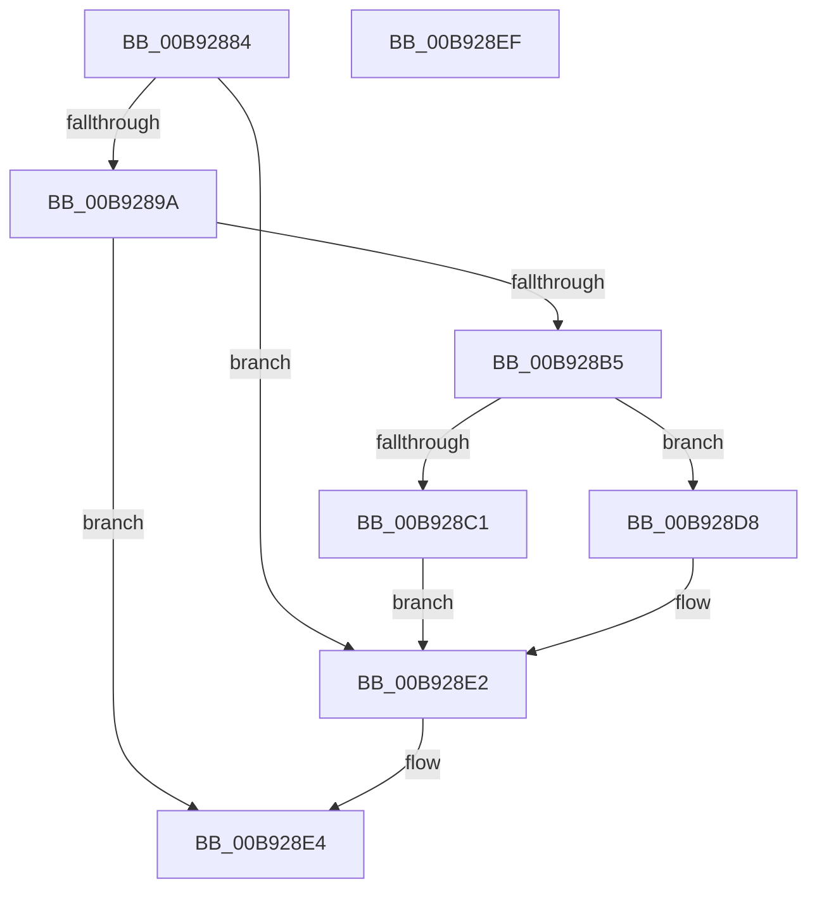

# IovpBuildDriverObjectList

- RVA: `0x00B92884`–`0x00B928F0` (길이 `108` bytes)
- VA: `0x0000000140B92884`
- 실행 섹션: `PAGEVRFY`
- PDB 이름 있음: `예`; PDB Function 태그: `아니요`
- unwind 정보 RVA: `0x0005CAAC`
- 디코드: `32`개 명령, `108/108` bytes 표시
- 미해석 바이트: `0` (있으면 어셈블리에 `.byte`로 보존)

> 이 문서는 커널 이미지의 기계어와 PDB 기호를 분석해 생성했습니다. 4번과 5번은 함수 원형과 자료형을 바이너리 사용 방식에서 추정한 C 해석이며 원본 소스 복구 결과는 아닙니다.

## 1. Dependencies

- 직접 호출 지점: **4**; 고유 호출 대상: **4**
- 직접 호출자로 확인된 함수: **1**
- RIP 상대 이미지 참조: **2**

### Outgoing calls
- `0x00B92891` → [PnpIsLegacyDriver](../../page/99/PnpIsLegacyDriver_function_00996220.md) (function, `0x00996220`)
- `0x00B928A8` → [ExAllocatePool2](../../poolcode/B8/ExAllocatePool2_function_00B820F0.md) (function, `0x00B820F0`)
- `0x00B928B8` → [ObReferenceObjectSafe](../../text/41/ObReferenceObjectSafe_function_0041DAE0.md) (function, `0x0041DAE0`)
- `0x00B928DD` → [ExFreePoolWithTag](../../poolcode/B8/ExFreePoolWithTag_function_00B82870.md) (function, `0x00B82870`)

### Direct callers
- [ObEnumerateObjectsByType](../../page/74/ObEnumerateObjectsByType_function_0074EF90.md) at `0x0074F019`

### Static image references
- `0x00B928C5` → RVA `0x00F8CFE0` (`.data`; read)
- `0x00B928CF` → RVA `0x00F8CFE0` (`.data`; write)

## 2. Other-region calls and transfers

- 다른 실행 섹션으로 향하는 call: **4**
  - `0x00B92891` → [PnpIsLegacyDriver](../../page/99/PnpIsLegacyDriver_function_00996220.md) (`PAGEVRFY` → `PAGE`)
  - `0x00B928A8` → [ExAllocatePool2](../../poolcode/B8/ExAllocatePool2_function_00B820F0.md) (`PAGEVRFY` → `POOLCODE`)
  - `0x00B928B8` → [ObReferenceObjectSafe](../../text/41/ObReferenceObjectSafe_function_0041DAE0.md) (`PAGEVRFY` → `.text`)
  - `0x00B928DD` → [ExFreePoolWithTag](../../poolcode/B8/ExFreePoolWithTag_function_00B82870.md) (`PAGEVRFY` → `POOLCODE`)
- 별도 외부 분기/꼬리 이동을 확인하지 못했습니다.

## 3. Assembly (complete function range)

```asm
00B92884  48 89 5C 24 08                  mov qword ptr [rsp + 8], rbx
00B92889  57                              push rdi
00B9288A  48 83 EC 20                     sub rsp, 0x20
00B9288E  48 8B F9                        mov rdi, rcx
00B92891  E8 8A 39 E0 FF                  call 0x140996220
00B92896  85 C0                           test eax, eax
00B92898  74 48                           je 0x140b928e2
00B9289A  BA 10 00 00 00                  mov edx, 0x10
00B9289F  41 B8 49 76 6F 00               mov r8d, 0x6f7649
00B928A5  8D 4A 30                        lea ecx, [rdx + 0x30]
00B928A8  E8 43 F8 FE FF                  call 0x140b820f0
00B928AD  48 8B D8                        mov rbx, rax
00B928B0  48 85 C0                        test rax, rax
00B928B3  74 2F                           je 0x140b928e4
00B928B5  48 8B CF                        mov rcx, rdi
00B928B8  E8 23 B2 88 FF                  call 0x14041dae0
00B928BD  84 C0                           test al, al
00B928BF  74 17                           je 0x140b928d8
00B928C1  48 89 7B 08                     mov qword ptr [rbx + 8], rdi
00B928C5  48 8B 05 14 A7 3F 00            mov rax, qword ptr [rip + 0x3fa714]
00B928CC  48 89 03                        mov qword ptr [rbx], rax
00B928CF  48 89 1D 0A A7 3F 00            mov qword ptr [rip + 0x3fa70a], rbx
00B928D6  EB 0A                           jmp 0x140b928e2
00B928D8  33 D2                           xor edx, edx
00B928DA  48 8B CB                        mov rcx, rbx
00B928DD  E8 8E FF FE FF                  call 0x140b82870
00B928E2  B0 01                           mov al, 1
00B928E4  48 8B 5C 24 30                  mov rbx, qword ptr [rsp + 0x30]
00B928E9  48 83 C4 20                     add rsp, 0x20
00B928ED  5F                              pop rdi
00B928EE  C3                              ret
00B928EF  CC                              int3
```

## 4. C-style interpretation (structured pseudocode)

```c
__int64 __fastcall IovpBuildDriverObjectList(__int64 a1)
{
    __int64 result;
    __int64 v_rsp;
    unsigned __int64 v_stack_p8;

    v_stack_p8 = v_rbx;
    v_rsp = (v_rsp) - (32);
    result = PnpIsLegacyDriver(a1, a2, a3, a4);
    if ((unsigned int)(result) == 0) goto loc_00B928E2;
    result = ExAllocatePool2(16 + 48, 16, (unsigned int)(0x6F7649ULL), a4);
    if (result == 0) goto loc_00B928E4;
    result = ObReferenceObjectSafe(a1, 16, (unsigned int)(0x6F7649ULL), a4);
    if ((unsigned __int8)(result) == 0) goto loc_00B928D8;
    *(unsigned __int64 *)(result + 8) = a1;
    *(unsigned __int64 *)(result) = *(unsigned __int64 *)(v_rip + 4171540);
    *(unsigned __int64 *)(v_rip + 4171530) = result;
    goto loc_00B928E2;
loc_00B928D8:
    a2 = 0;
    result = ExFreePoolWithTag(result, a2, (unsigned int)(0x6F7649ULL), a4);
loc_00B928E2:
loc_00B928E4:
    v_rsp = (v_rsp) + (32);
    return 1;
}
```

## 5. (Beta) C Style

```c
int64_t IovpBuildDriverObjectList(int64_t Arg1)
{
    int64_t result;
    int64_t local_rsp;
    uint64_t v_stack_p8;

    v_stack_p8 = local_rbx;
    local_rsp = (local_rsp) - (32);
    result = PnpIsLegacyDriver(Arg1, a2, a3, a4);
    if ((uint32_t)(result) == 0) goto loc_00B928E2;
    result = ExAllocatePool2(16 + 48, 16, (uint32_t)(0x6F7649ULL), a4);
    if (result == 0) goto loc_00B928E4;
    result = ObReferenceObjectSafe(Arg1, 16, (uint32_t)(0x6F7649ULL), a4);
    if ((uint8_t)(result) == 0) goto loc_00B928D8;
    *(uint64_t *)(result + 0x8) = Arg1;
    *(uint64_t *)(result) = *(uint64_t *)(v_rip + 0x3FA714);
    *(uint64_t *)(v_rip + 0x3FA70A) = result;
    goto loc_00B928E2;
loc_00B928D8:
    a2 = 0;
    result = ExFreePoolWithTag(result, a2, (uint32_t)(0x6F7649ULL), a4);
loc_00B928E2:
loc_00B928E4:
    local_rsp = (local_rsp) + (32);
    return 1;
}
```

## 6. Execution-region graph

[열기: 2D/3D 그래프와 함수 탐색 컨트롤 패널](../../../control-panel.html?section=pagevrfy&rva=0x00B92884&view=graph)

- 2D 그래프는 위에서 아래로 흐르고, 3D 그래프는 빈 공간을 드래그해 회전합니다. Shift+드래그는 이동, 휠은 확대·축소, 함수 노드 선택은 대상 보고서 이동입니다.

### Static fallback


