# IovpCallDriver2

- RVA: `0x00B9D270`–`0x00B9D4F2` (길이 `642` bytes)
- VA: `0x0000000140B9D270`
- 실행 섹션: `PAGEVRFY`
- PDB 이름 있음: `예`; PDB Function 태그: `아니요`
- unwind 정보 RVA: `0x000CC474`
- 디코드: `184`개 명령, `642/642` bytes 표시
- 미해석 바이트: `0` (있으면 어셈블리에 `.byte`로 보존)

> 이 문서는 커널 이미지의 기계어와 PDB 기호를 분석해 생성했습니다. 4번과 5번은 함수 원형과 자료형을 바이너리 사용 방식에서 추정한 C 해석이며 원본 소스 복구 결과는 아닙니다.

## 1. Dependencies

- 직접 호출 지점: **13**; 고유 호출 대상: **10**
- 직접 호출자로 확인된 함수: **1**
- RIP 상대 이미지 참조: **0**

### Outgoing calls
- `0x00B9D2A7` → [KeAcquireSpinLockRaiseToDpc](../../text/20/KeAcquireSpinLockRaiseToDpc_function_00208470.md) (function, `0x00208470`)
- `0x00B9D2F5` → [IovUtilGetLowerDeviceObjectWithTag](../BA/IovUtilGetLowerDeviceObjectWithTag_function_00BA2A84.md) (function, `0x00BA2A84`)
- `0x00B9D32A` → [IovUtilIsDeviceObjectMarked](../BA/IovUtilIsDeviceObjectMarked_function_00BA2B34.md) (function, `0x00BA2B34`)
- `0x00B9D349` → [ViErrorReport10](../../text/61/ViErrorReport10_function_00614608.md) (function, `0x00614608`)
- `0x00B9D359` → [IovUtilIsDeviceObjectMarked](../BA/IovUtilIsDeviceObjectMarked_function_00BA2B34.md) (function, `0x00BA2B34`)
- `0x00B9D39F` → [ViErrorReport10](../../text/61/ViErrorReport10_function_00614608.md) (function, `0x00614608`)
- `0x00B9D3AC` → [ObfDereferenceObjectWithTag](../../text/2F/ObfDereferenceObjectWithTag_function_002F78E0.md) (function, `0x002F78E0`)
- `0x00B9D3F4` → [ViErrorReport6](../../text/61/ViErrorReport6_function_00614740.md) (function, `0x00614740`)
- `0x00B9D42C` → [ViErrorReport4](../../text/61/ViErrorReport4_function_0061469C.md) (function, `0x0061469C`)
- `0x00B9D44C` → [ViErrorReport6](../../text/61/ViErrorReport6_function_00614740.md) (function, `0x00614740`)
- `0x00B9D46F` → [ViErrorReport1](../../text/61/ViErrorReport1_function_00614584.md) (function, `0x00614584`)
- `0x00B9D4BA` → [IovpSessionDataDereference](../BA/IovpSessionDataDereference_function_00BAC808.md) (function, `0x00BAC808`)
- `0x00B9D4C6` → [VfIrpDatabaseEntryReleaseLock](../BB/VfIrpDatabaseEntryReleaseLock_function_00BB3FD4.md) (function, `0x00BB3FD4`)

### Direct callers
- [VfAfterCallDriver](VfAfterCallDriver_function_00B9DA84.md) at `0x00B9DC39`

### Static image references
- 디코드된 RIP-relative 메모리 참조가 없습니다.

## 2. Other-region calls and transfers

- 다른 실행 섹션으로 향하는 call: **8**
  - `0x00B9D2A7` → [KeAcquireSpinLockRaiseToDpc](../../text/20/KeAcquireSpinLockRaiseToDpc_function_00208470.md) (`PAGEVRFY` → `.text`)
  - `0x00B9D349` → [ViErrorReport10](../../text/61/ViErrorReport10_function_00614608.md) (`PAGEVRFY` → `.text`)
  - `0x00B9D39F` → [ViErrorReport10](../../text/61/ViErrorReport10_function_00614608.md) (`PAGEVRFY` → `.text`)
  - `0x00B9D3AC` → [ObfDereferenceObjectWithTag](../../text/2F/ObfDereferenceObjectWithTag_function_002F78E0.md) (`PAGEVRFY` → `.text`)
  - `0x00B9D3F4` → [ViErrorReport6](../../text/61/ViErrorReport6_function_00614740.md) (`PAGEVRFY` → `.text`)
  - `0x00B9D42C` → [ViErrorReport4](../../text/61/ViErrorReport4_function_0061469C.md) (`PAGEVRFY` → `.text`)
  - `0x00B9D44C` → [ViErrorReport6](../../text/61/ViErrorReport6_function_00614740.md) (`PAGEVRFY` → `.text`)
  - `0x00B9D46F` → [ViErrorReport1](../../text/61/ViErrorReport1_function_00614584.md) (`PAGEVRFY` → `.text`)
- 별도 외부 분기/꼬리 이동을 확인하지 못했습니다.

## 3. Assembly (complete function range)

```asm
00B9D270  48 8B C4                        mov rax, rsp
00B9D273  48 89 58 08                     mov qword ptr [rax + 8], rbx
00B9D277  48 89 68 10                     mov qword ptr [rax + 0x10], rbp
00B9D27B  48 89 70 18                     mov qword ptr [rax + 0x18], rsi
00B9D27F  48 89 78 20                     mov qword ptr [rax + 0x20], rdi
00B9D283  41 54                           push r12
00B9D285  41 56                           push r14
00B9D287  41 57                           push r15
00B9D289  48 83 EC 30                     sub rsp, 0x30
00B9D28D  48 8B 29                        mov rbp, qword ptr [rcx]
00B9D290  4C 8B F2                        mov r14, rdx
00B9D293  48 8B D9                        mov rbx, rcx
00B9D296  48 85 ED                        test rbp, rbp
00B9D299  0F 84 2C 02 00 00               je 0x140b9d4cb
00B9D29F  48 8B 79 10                     mov rdi, qword ptr [rcx + 0x10]
00B9D2A3  48 8D 4F 08                     lea rcx, [rdi + 8]
00B9D2A7  E8 C4 B1 66 FF                  call 0x140208470
00B9D2AC  48 83 BF D8 00 00 00 00         cmp qword ptr [rdi + 0xd8], 0
00B9D2B4  41 BC 03 01 00 00               mov r12d, 0x103
00B9D2BA  88 47 10                        mov byte ptr [rdi + 0x10], al
00B9D2BD  74 0C                           je 0x140b9d2cb
00B9D2BF  F7 43 18 00 00 00 02            test dword ptr [rbx + 0x18], 0x2000000
00B9D2C6  74 03                           je 0x140b9d2cb
00B9D2C8  45 89 26                        mov dword ptr [r14], r12d
00B9D2CB  8B 43 18                        mov eax, dword ptr [rbx + 0x18]
00B9D2CE  48 8B B3 A0 00 00 00            mov rsi, qword ptr [rbx + 0xa0]
00B9D2D5  0F BA E0 1D                     bt eax, 0x1d
00B9D2D9  0F 83 D2 00 00 00               jae 0x140b9d3b1
00B9D2DF  45 39 26                        cmp dword ptr [r14], r12d
00B9D2E2  0F 84 C9 00 00 00               je 0x140b9d3b1
00B9D2E8  0F BA E0 18                     bt eax, 0x18
00B9D2EC  0F 82 BF 00 00 00               jb 0x140b9d3b1
00B9D2F2  48 8B CE                        mov rcx, rsi
00B9D2F5  E8 8A 57 00 00                  call 0x140ba2a84
00B9D2FA  F7 43 18 00 00 00 10            test dword ptr [rbx + 0x18], 0x10000000
00B9D301  4C 8B F8                        mov r15, rax
00B9D304  75 70                           jne 0x140b9d376
00B9D306  48 8B 4B 40                     mov rcx, qword ptr [rbx + 0x40]
00B9D30A  48 8B 91 38 01 00 00            mov rdx, qword ptr [rcx + 0x138]
00B9D311  48 8B 4A 28                     mov rcx, qword ptr [rdx + 0x28]
00B9D315  48 85 C9                        test rcx, rcx
00B9D318  74 55                           je 0x140b9d36f
00B9D31A  8B 89 8C 01 00 00               mov ecx, dword ptr [rcx + 0x18c]
00B9D320  F6 C1 10                        test cl, 0x10
00B9D323  74 44                           je 0x140b9d369
00B9D325  33 D2                           xor edx, edx
00B9D327  48 8B CE                        mov rcx, rsi
00B9D32A  E8 05 58 00 00                  call 0x140ba2b34
00B9D32F  48 3B 73 40                     cmp rsi, qword ptr [rbx + 0x40]
00B9D333  75 1B                           jne 0x140b9d350
00B9D335  85 C0                           test eax, eax
00B9D337  74 36                           je 0x140b9d36f
00B9D339  B9 21 02 00 00                  mov ecx, 0x221
00B9D33E  48 8B 53 30                     mov rdx, qword ptr [rbx + 0x30]
00B9D342  4C 8B CE                        mov r9, rsi
00B9D345  4C 8B 43 48                     mov r8, qword ptr [rbx + 0x48]
00B9D349  E8 BA 72 A7 FF                  call 0x140614608
00B9D34E  EB 1F                           jmp 0x140b9d36f
00B9D350  85 C0                           test eax, eax
00B9D352  75 1B                           jne 0x140b9d36f
00B9D354  33 D2                           xor edx, edx
00B9D356  48 8B CE                        mov rcx, rsi
00B9D359  E8 D6 57 00 00                  call 0x140ba2b34
00B9D35E  85 C0                           test eax, eax
00B9D360  74 0D                           je 0x140b9d36f
00B9D362  B9 23 02 00 00                  mov ecx, 0x223
00B9D367  EB D5                           jmp 0x140b9d33e
00B9D369  0F BA E1 10                     bt ecx, 0x10
00B9D36D  72 07                           jb 0x140b9d376
00B9D36F  4D 85 FF                        test r15, r15
00B9D372  74 3D                           je 0x140b9d3b1
00B9D374  EB 2E                           jmp 0x140b9d3a4
00B9D376  4D 85 FF                        test r15, r15
00B9D379  74 36                           je 0x140b9d3b1
00B9D37B  48 8B 46 08                     mov rax, qword ptr [rsi + 8]
00B9D37F  48 8B 48 50                     mov rcx, qword ptr [rax + 0x50]
00B9D383  48 85 C9                        test rcx, rcx
00B9D386  74 07                           je 0x140b9d38f
00B9D388  48 83 79 68 00                  cmp qword ptr [rcx + 0x68], 0
00B9D38D  75 15                           jne 0x140b9d3a4
00B9D38F  4C 8B 43 48                     mov r8, qword ptr [rbx + 0x48]
00B9D393  4C 8B CE                        mov r9, rsi
00B9D396  48 8B 53 30                     mov rdx, qword ptr [rbx + 0x30]
00B9D39A  B9 1D 02 00 00                  mov ecx, 0x21d
00B9D39F  E8 64 72 A7 FF                  call 0x140614608
00B9D3A4  BA 56 72 66 49                  mov edx, 0x49667256
00B9D3A9  49 8B CF                        mov rcx, r15
00B9D3AC  E8 2F A5 75 FF                  call 0x1402f78e0
00B9D3B1  8B 4B 18                        mov ecx, dword ptr [rbx + 0x18]
00B9D3B4  0F BA E1 1E                     bt ecx, 0x1e
00B9D3B8  73 43                           jae 0x140b9d3fd
00B9D3BA  8B 45 20                        mov eax, dword ptr [rbp + 0x20]
00B9D3BD  A8 02                           test al, 2
00B9D3BF  75 3C                           jne 0x140b9d3fd
00B9D3C1  45 8B 0E                        mov r9d, dword ptr [r14]
00B9D3C4  0F BA E1 19                     bt ecx, 0x19
00B9D3C8  73 12                           jae 0x140b9d3dc
00B9D3CA  45 3B CC                        cmp r9d, r12d
00B9D3CD  74 2E                           je 0x140b9d3fd
00B9D3CF  0F BA E1 18                     bt ecx, 0x18
00B9D3D3  72 28                           jb 0x140b9d3fd
00B9D3D5  B9 3E 02 00 00                  mov ecx, 0x23e
00B9D3DA  EB 10                           jmp 0x140b9d3ec
00B9D3DC  45 3B CC                        cmp r9d, r12d
00B9D3DF  74 06                           je 0x140b9d3e7
00B9D3E1  0F BA E1 18                     bt ecx, 0x18
00B9D3E5  73 16                           jae 0x140b9d3fd
00B9D3E7  B9 4C 02 00 00                  mov ecx, 0x24c
00B9D3EC  4C 8B 43 48                     mov r8, qword ptr [rbx + 0x48]
00B9D3F0  48 8B 53 30                     mov rdx, qword ptr [rbx + 0x30]
00B9D3F4  E8 47 73 A7 FF                  call 0x140614740
00B9D3F9  83 4D 20 02                     or dword ptr [rbp + 0x20], 2
00B9D3FD  0F BA 63 18 1E                  bt dword ptr [rbx + 0x18], 0x1e
00B9D402  41 8B 0E                        mov ecx, dword ptr [r14]
00B9D405  73 4C                           jae 0x140b9d453
00B9D407  44 8B 4B 38                     mov r9d, dword ptr [rbx + 0x38]
00B9D40B  41 3B C9                        cmp ecx, r9d
00B9D40E  74 27                           je 0x140b9d437
00B9D410  41 3B CC                        cmp ecx, r12d
00B9D413  0F 84 84 00 00 00               je 0x140b9d49d
00B9D419  8B 45 20                        mov eax, dword ptr [rbp + 0x20]
00B9D41C  A8 01                           test al, 1
00B9D41E  75 11                           jne 0x140b9d431
00B9D420  48 8B 53 30                     mov rdx, qword ptr [rbx + 0x30]
00B9D424  4C 8D 43 48                     lea r8, [rbx + 0x48]
00B9D428  89 4C 24 20                     mov dword ptr [rsp + 0x20], ecx
00B9D42C  E8 6B 72 A7 FF                  call 0x14061469c
00B9D431  83 4D 20 01                     or dword ptr [rbp + 0x20], 1
00B9D435  EB 66                           jmp 0x140b9d49d
00B9D437  83 F9 FF                        cmp ecx, -1
00B9D43A  75 61                           jne 0x140b9d49d
00B9D43C  4C 8B 43 48                     mov r8, qword ptr [rbx + 0x48]
00B9D440  44 8B C9                        mov r9d, ecx
00B9D443  48 8B 53 30                     mov rdx, qword ptr [rbx + 0x30]
00B9D447  B9 25 02 00 00                  mov ecx, 0x225
00B9D44C  E8 EF 72 A7 FF                  call 0x140614740
00B9D451  EB 4A                           jmp 0x140b9d49d
00B9D453  41 3B CC                        cmp ecx, r12d
00B9D456  74 1F                           je 0x140b9d477
00B9D458  BE 00 00 40 00                  mov esi, 0x400000
00B9D45D  85 77 38                        test dword ptr [rdi + 0x38], esi
00B9D460  75 12                           jne 0x140b9d474
00B9D462  4C 8B 43 48                     mov r8, qword ptr [rbx + 0x48]
00B9D466  B9 26 02 00 00                  mov ecx, 0x226
00B9D46B  48 8B 53 30                     mov rdx, qword ptr [rbx + 0x30]
00B9D46F  E8 10 71 A7 FF                  call 0x140614584
00B9D474  09 77 38                        or dword ptr [rdi + 0x38], esi
00B9D477  48 8B 43 08                     mov rax, qword ptr [rbx + 8]
00B9D47B  0F BA 68 04 1A                  bts dword ptr [rax + 4], 0x1a
00B9D480  48 8D 43 20                     lea rax, [rbx + 0x20]
00B9D484  48 8B 10                        mov rdx, qword ptr [rax]
00B9D487  48 39 42 08                     cmp qword ptr [rdx + 8], rax
00B9D48B  75 5E                           jne 0x140b9d4eb
00B9D48D  48 8B 48 08                     mov rcx, qword ptr [rax + 8]
00B9D491  48 39 01                        cmp qword ptr [rcx], rax
00B9D494  75 55                           jne 0x140b9d4eb
00B9D496  48 89 11                        mov qword ptr [rcx], rdx
00B9D499  48 89 4A 08                     mov qword ptr [rdx + 8], rcx
00B9D49D  8B 43 18                        mov eax, dword ptr [rbx + 0x18]
00B9D4A0  0F BA E0 1B                     bt eax, 0x1b
00B9D4A4  73 11                           jae 0x140b9d4b7
00B9D4A6  45 39 26                        cmp dword ptr [r14], r12d
00B9D4A9  74 0C                           je 0x140b9d4b7
00B9D4AB  0F BA E0 18                     bt eax, 0x18
00B9D4AF  72 06                           jb 0x140b9d4b7
00B9D4B1  8B 43 3C                        mov eax, dword ptr [rbx + 0x3c]
00B9D4B4  41 89 06                        mov dword ptr [r14], eax
00B9D4B7  48 8B CD                        mov rcx, rbp
00B9D4BA  E8 49 F3 00 00                  call 0x140bac808
00B9D4BF  F0 FF 4F 14                     lock dec dword ptr [rdi + 0x14]
00B9D4C3  48 8B CF                        mov rcx, rdi
00B9D4C6  E8 09 6B 01 00                  call 0x140bb3fd4
00B9D4CB  48 8B 5C 24 50                  mov rbx, qword ptr [rsp + 0x50]
00B9D4D0  48 8B 6C 24 58                  mov rbp, qword ptr [rsp + 0x58]
00B9D4D5  48 8B 74 24 60                  mov rsi, qword ptr [rsp + 0x60]
00B9D4DA  48 8B 7C 24 68                  mov rdi, qword ptr [rsp + 0x68]
00B9D4DF  48 83 C4 30                     add rsp, 0x30
00B9D4E3  41 5F                           pop r15
00B9D4E5  41 5E                           pop r14
00B9D4E7  41 5C                           pop r12
00B9D4E9  C3                              ret
00B9D4EA  CC                              int3
00B9D4EB  B9 03 00 00 00                  mov ecx, 3
00B9D4F0  CD 29                           int 0x29
```

## 4. C-style interpretation (structured pseudocode)

```c
__int64 __fastcall IovpCallDriver2(__int64 a1, __int64 a2)
{
    __int64 result;
    __int64 v_rsp;
    unsigned int v_stack_m28;
    unsigned __int64 v_stack_p10;
    unsigned __int64 v_stack_p18;
    unsigned __int64 v_stack_p20;
    unsigned __int64 v_stack_p8;

    *(unsigned __int64 *)(v_rsp + 8) = v_rbx;
    *(unsigned __int64 *)(v_rsp + 16) = v_rbp;
    *(unsigned __int64 *)(v_rsp + 24) = v_rsi;
    *(unsigned __int64 *)(v_rsp + 32) = v_rdi;
    v_rsp = (v_rsp) - (48);
    if (*(unsigned __int64 *)(a1) == 0) goto loc_00B9D4CB;
    result = KeAcquireSpinLockRaiseToDpc(*(unsigned __int64 *)(a1 + 16) + 8, a2, a3, a4);
    *(unsigned __int8 *)(*(unsigned __int64 *)(a1 + 16) + 16) = (unsigned __int8)(result);
    if ((*(unsigned __int64 *)(*(unsigned __int64 *)(a1 + 16) + 216)) == 0) goto loc_00B9D2CB;
    if (((*(unsigned int *)(a1 + 24)) & (0x2000000ULL)) != 0) {
        *(unsigned int *)(a2) = 259;
    }
    if (condition_is_above_or_equal) goto loc_00B9D3B1;
    if ((*(unsigned int *)(a2)) == 259) goto loc_00B9D3B1;
    if ((*(unsigned int *)(a2)) < 259) goto loc_00B9D3B1;
    result = IovUtilGetLowerDeviceObjectWithTag(*(unsigned __int64 *)(a1 + 160), a2, a3, a4);
    if (((*(unsigned int *)(a1 + 24)) & (0x10000000ULL)) != 0) goto loc_00B9D376;
    if (*(unsigned __int64 *)(*(unsigned __int64 *)(*(unsigned __int64 *)(a1 + 64) + 312) + 40) == 0) goto loc_00B9D36F;
    if ((((unsigned __int8)((unsigned int)(*(unsigned int *)(*(unsigned __int64 *)(*(unsigned __int64 *)(*(unsigned __int64 *)(a1 + 64) + 312) + 40) + 396)))) & (16)) == 0) goto loc_00B9D369;
    a2 = 0;
    result = IovUtilIsDeviceObjectMarked(*(unsigned __int64 *)(a1 + 160), a2, a3, a4);
    if ((*(unsigned __int64 *)(a1 + 160)) != (*(unsigned __int64 *)(a1 + 64))) goto loc_00B9D350;
    if ((unsigned int)(result) == 0) goto loc_00B9D36F;
loc_00B9D33E:
    result = ViErrorReport10(545, *(unsigned __int64 *)(a1 + 48), *(unsigned __int64 *)(a1 + 72), *(unsigned __int64 *)(a1 + 160));
    goto loc_00B9D36F;
loc_00B9D350:
    if ((unsigned int)(result) != 0) goto loc_00B9D36F;
    a2 = 0;
    result = IovUtilIsDeviceObjectMarked(*(unsigned __int64 *)(a1 + 160), a2, *(unsigned __int64 *)(a1 + 72), *(unsigned __int64 *)(a1 + 160));
    if ((unsigned int)(result) == 0) goto loc_00B9D36F;
    goto loc_00B9D33E;
loc_00B9D369:
    if (condition_is_below) goto loc_00B9D376;
loc_00B9D36F:
    if (result == 0) goto loc_00B9D3B1;
    goto loc_00B9D3A4;
loc_00B9D376:
    if (result == 0) goto loc_00B9D3B1;
    if (*(unsigned __int64 *)(*(unsigned __int64 *)(*(unsigned __int64 *)(a1 + 160) + 8) + 80) == 0) goto loc_00B9D38F;
    result = *(unsigned __int64 *)(*(unsigned __int64 *)(a1 + 160) + 8);
    if ((*(unsigned __int64 *)(*(unsigned __int64 *)(*(unsigned __int64 *)(*(unsigned __int64 *)(a1 + 160) + 8) + 80) + 104)) == 0) {
        a3 = *(unsigned __int64 *)(a1 + 72);
        a4 = *(unsigned __int64 *)(a1 + 160);
        a2 = *(unsigned __int64 *)(a1 + 48);
        a1 = 541;
        result = ViErrorReport10(a1, a2, a3, a4);
    }
    result = ObfDereferenceObjectWithTag(result, (unsigned int)(0x49667256ULL), a3, a4);
loc_00B9D3B1:
    if ((*(unsigned __int64 *)(*(unsigned __int64 *)(*(unsigned __int64 *)(*(unsigned __int64 *)(a1 + 160) + 8) + 80) + 104)) >= 0) goto loc_00B9D3FD;
    if ((((unsigned __int8)((unsigned int)(*(unsigned int *)(*(unsigned __int64 *)(a1) + 32)))) & (2)) != 0) goto loc_00B9D3FD;
    if (condition_is_above_or_equal) goto loc_00B9D3DC;
    if (((unsigned int)((unsigned int)(*(unsigned int *)(a2)))) == 259) goto loc_00B9D3FD;
    if (((unsigned int)((unsigned int)(*(unsigned int *)(a2)))) < 259) goto loc_00B9D3FD;
    goto loc_00B9D3EC;
loc_00B9D3DC:
    if (((unsigned int)((unsigned int)(*(unsigned int *)(a2)))) == 259) goto loc_00B9D3E7;
    if (((unsigned int)((unsigned int)(*(unsigned int *)(a2)))) >= 259) goto loc_00B9D3FD;
loc_00B9D3E7:
loc_00B9D3EC:
    result = ViErrorReport6(588, *(unsigned __int64 *)(a1 + 48), *(unsigned __int64 *)(a1 + 72), (unsigned int)(*(unsigned int *)(a2)));
loc_00B9D3FD:
    if (((unsigned int)((unsigned int)(*(unsigned int *)(a2)))) >= 259) goto loc_00B9D453;
    if (((unsigned int)((unsigned int)(*(unsigned int *)(a2)))) == ((unsigned int)((unsigned int)(*(unsigned int *)(a1 + 56))))) goto loc_00B9D437;
    if (((unsigned int)((unsigned int)(*(unsigned int *)(a2)))) == 259) goto loc_00B9D49D;
    result = (unsigned int)(*(unsigned int *)(*(unsigned __int64 *)(a1) + 32));
    if ((((unsigned __int8)((unsigned int)(*(unsigned int *)(*(unsigned __int64 *)(a1) + 32)))) & (1)) == 0) {
        a2 = *(unsigned __int64 *)(a1 + 48);
        a3 = a1 + 72;
        v_stack_m28 = (unsigned int)((unsigned int)(*(unsigned int *)(a2)));
        result = ViErrorReport4((unsigned int)(*(unsigned int *)(a2)), a2, a3, (unsigned int)(*(unsigned int *)(a1 + 56)));
    }
    goto loc_00B9D49D;
loc_00B9D437:
    if (((unsigned int)((unsigned int)(*(unsigned int *)(a2)))) != -1) goto loc_00B9D49D;
    result = ViErrorReport6(549, *(unsigned __int64 *)(a1 + 48), *(unsigned __int64 *)(a1 + 72), (unsigned int)((unsigned int)((unsigned int)(*(unsigned int *)(a2)))));
    goto loc_00B9D49D;
loc_00B9D453:
    if (549 == 259) goto loc_00B9D477;
    if (((*(unsigned int *)(*(unsigned __int64 *)(a1 + 16) + 56)) & ((unsigned int)((unsigned int)(0x400000ULL)))) == 0) {
        a3 = *(unsigned __int64 *)(a1 + 72);
        a1 = 550;
        a2 = *(unsigned __int64 *)(a1 + 48);
        result = ViErrorReport1(a1, a2, a3, (unsigned int)((unsigned int)((unsigned int)(*(unsigned int *)(a2)))));
    }
loc_00B9D477:
    if ((*(unsigned __int64 *)(*(unsigned __int64 *)(a1 + 32) + 8)) != (a1 + 32)) goto loc_00B9D4EB;
    if ((*(unsigned __int64 *)(*(unsigned __int64 *)(a1 + 32 + 8))) != (a1 + 32)) goto loc_00B9D4EB;
    *(unsigned __int64 *)(*(unsigned __int64 *)(a1 + 32 + 8)) = *(unsigned __int64 *)(a1 + 32);
    *(unsigned __int64 *)(*(unsigned __int64 *)(a1 + 32) + 8) = *(unsigned __int64 *)(a1 + 32 + 8);
loc_00B9D49D:
    if ((*(unsigned __int64 *)(*(unsigned __int64 *)(a1 + 32 + 8))) >= (a1 + 32)) goto loc_00B9D4B7;
    if ((*(unsigned int *)(a2)) == 259) goto loc_00B9D4B7;
    result = (unsigned int)(*(unsigned int *)(a1 + 24));
    if ((*(unsigned int *)(a2)) >= 259) {
        result = *(unsigned int *)(a1 + 60);
        *(unsigned int *)(a2) = (unsigned int)(result);
    }
    result = IovpSessionDataDereference(*(unsigned __int64 *)(a1), *(unsigned __int64 *)(a1 + 32), a3, (unsigned int)((unsigned int)((unsigned int)(*(unsigned int *)(a2)))));
    result = VfIrpDatabaseEntryReleaseLock(*(unsigned __int64 *)(a1 + 16), *(unsigned __int64 *)(a1 + 32), a3, (unsigned int)((unsigned int)((unsigned int)(*(unsigned int *)(a2)))));
loc_00B9D4CB:
    v_rsp = (v_rsp) + (48);
    return result;
loc_00B9D4EB:
    return result;
}
```

## 5. (Beta) C Style

```c
int64_t IovpCallDriver2(void *Arg1, void *Arg2)
{
    uint8_t *arg1 = (uint8_t *)Arg1;
    uint8_t *arg2 = (uint8_t *)Arg2;

    int64_t result;
    int64_t local_rsp;
    uint32_t v_stack_m28;
    uint64_t v_stack_p10;
    uint64_t v_stack_p18;
    uint64_t v_stack_p20;
    uint64_t v_stack_p8;

    *(uint64_t *)(local_rsp + 0x8) = local_rbx;
    *(uint64_t *)(local_rsp + 0x10) = local_rbp;
    *(uint64_t *)(local_rsp + 0x18) = local_rsi;
    *(uint64_t *)(local_rsp + 0x20) = local_rdi;
    local_rsp = (local_rsp) - (48);
    if (*(uint64_t *)(arg1) == 0) goto loc_00B9D4CB;
    result = KeAcquireSpinLockRaiseToDpc(*(uint64_t *)(arg1 + 0x10) + 8, Arg2, a3, a4);
    *(uint8_t *)(*(uint64_t *)(arg1 + 0x10) + 0x10) = (uint8_t)(result);
    if ((*(uint64_t *)(*(uint64_t *)(arg1 + 0x10) + 0xD8)) == 0) goto loc_00B9D2CB;
    if (((*(uint32_t *)(arg1 + 0x18)) & (0x2000000ULL)) != 0) {
        *(uint32_t *)(arg2) = 259;
    }
    if (condition_is_above_or_equal) goto loc_00B9D3B1;
    if ((*(uint32_t *)(arg2)) == 259) goto loc_00B9D3B1;
    if ((*(uint32_t *)(arg2)) < 259) goto loc_00B9D3B1;
    result = IovUtilGetLowerDeviceObjectWithTag(*(uint64_t *)(arg1 + 0xA0), Arg2, a3, a4);
    if (((*(uint32_t *)(arg1 + 0x18)) & (0x10000000ULL)) != 0) goto loc_00B9D376;
    if (*(uint64_t *)(*(uint64_t *)(*(uint64_t *)(arg1 + 0x40) + 0x138) + 0x28) == 0) goto loc_00B9D36F;
    if ((((uint8_t)((uint32_t)(*(uint32_t *)(*(uint64_t *)(*(uint64_t *)(*(uint64_t *)(arg1 + 0x40) + 0x138) + 0x28) + 0x18C)))) & (16)) == 0) goto loc_00B9D369;
    Arg2 = 0;
    result = IovUtilIsDeviceObjectMarked(*(uint64_t *)(arg1 + 0xA0), Arg2, a3, a4);
    if ((*(uint64_t *)(arg1 + 0xA0)) != (*(uint64_t *)(arg1 + 0x40))) goto loc_00B9D350;
    if ((uint32_t)(result) == 0) goto loc_00B9D36F;
loc_00B9D33E:
    result = ViErrorReport10(545, *(uint64_t *)(arg1 + 0x30), *(uint64_t *)(arg1 + 0x48), *(uint64_t *)(arg1 + 0xA0));
    goto loc_00B9D36F;
loc_00B9D350:
    if ((uint32_t)(result) != 0) goto loc_00B9D36F;
    Arg2 = 0;
    result = IovUtilIsDeviceObjectMarked(*(uint64_t *)(arg1 + 0xA0), Arg2, *(uint64_t *)(arg1 + 0x48), *(uint64_t *)(arg1 + 0xA0));
    if ((uint32_t)(result) == 0) goto loc_00B9D36F;
    goto loc_00B9D33E;
loc_00B9D369:
    if (condition_is_below) goto loc_00B9D376;
loc_00B9D36F:
    if (result == 0) goto loc_00B9D3B1;
    goto loc_00B9D3A4;
loc_00B9D376:
    if (result == 0) goto loc_00B9D3B1;
    if (*(uint64_t *)(*(uint64_t *)(*(uint64_t *)(arg1 + 0xA0) + 0x8) + 0x50) == 0) goto loc_00B9D38F;
    result = *(uint64_t *)(*(uint64_t *)(arg1 + 0xA0) + 0x8);
    if ((*(uint64_t *)(*(uint64_t *)(*(uint64_t *)(*(uint64_t *)(arg1 + 0xA0) + 0x8) + 0x50) + 0x68)) == 0) {
        a3 = *(uint64_t *)(arg1 + 0x48);
        a4 = *(uint64_t *)(arg1 + 0xA0);
        Arg2 = *(uint64_t *)(arg1 + 0x30);
        Arg1 = 541;
        result = ViErrorReport10(Arg1, Arg2, a3, a4);
    }
    result = ObfDereferenceObjectWithTag(result, (uint32_t)(0x49667256ULL), a3, a4);
loc_00B9D3B1:
    if ((*(uint64_t *)(*(uint64_t *)(*(uint64_t *)(*(uint64_t *)(arg1 + 0xA0) + 0x8) + 0x50) + 0x68)) >= 0) goto loc_00B9D3FD;
    if ((((uint8_t)((uint32_t)(*(uint32_t *)(*(uint64_t *)(arg1) + 0x20)))) & (2)) != 0) goto loc_00B9D3FD;
    if (condition_is_above_or_equal) goto loc_00B9D3DC;
    if (((uint32_t)((uint32_t)(*(uint32_t *)(arg2)))) == 259) goto loc_00B9D3FD;
    if (((uint32_t)((uint32_t)(*(uint32_t *)(arg2)))) < 259) goto loc_00B9D3FD;
    goto loc_00B9D3EC;
loc_00B9D3DC:
    if (((uint32_t)((uint32_t)(*(uint32_t *)(arg2)))) == 259) goto loc_00B9D3E7;
    if (((uint32_t)((uint32_t)(*(uint32_t *)(arg2)))) >= 259) goto loc_00B9D3FD;
loc_00B9D3E7:
loc_00B9D3EC:
    result = ViErrorReport6(588, *(uint64_t *)(arg1 + 0x30), *(uint64_t *)(arg1 + 0x48), (uint32_t)(*(uint32_t *)(arg2)));
loc_00B9D3FD:
    if (((uint32_t)((uint32_t)(*(uint32_t *)(arg2)))) >= 259) goto loc_00B9D453;
    if (((uint32_t)((uint32_t)(*(uint32_t *)(arg2)))) == ((uint32_t)((uint32_t)(*(uint32_t *)(arg1 + 0x38))))) goto loc_00B9D437;
    if (((uint32_t)((uint32_t)(*(uint32_t *)(arg2)))) == 259) goto loc_00B9D49D;
    result = (uint32_t)(*(uint32_t *)(*(uint64_t *)(arg1) + 0x20));
    if ((((uint8_t)((uint32_t)(*(uint32_t *)(*(uint64_t *)(arg1) + 0x20)))) & (1)) == 0) {
        Arg2 = *(uint64_t *)(arg1 + 0x30);
        a3 = Arg1 + 72;
        v_stack_m28 = (uint32_t)((uint32_t)(*(uint32_t *)(arg2)));
        result = ViErrorReport4((uint32_t)(*(uint32_t *)(arg2)), Arg2, a3, (uint32_t)(*(uint32_t *)(arg1 + 0x38)));
    }
    goto loc_00B9D49D;
loc_00B9D437:
    if (((uint32_t)((uint32_t)(*(uint32_t *)(arg2)))) != -1) goto loc_00B9D49D;
    result = ViErrorReport6(549, *(uint64_t *)(arg1 + 0x30), *(uint64_t *)(arg1 + 0x48), (uint32_t)((uint32_t)((uint32_t)(*(uint32_t *)(arg2)))));
    goto loc_00B9D49D;
loc_00B9D453:
    if (549 == 259) goto loc_00B9D477;
    if (((*(uint32_t *)(*(uint64_t *)(arg1 + 0x10) + 0x38)) & ((uint32_t)((uint32_t)(0x400000ULL)))) == 0) {
        a3 = *(uint64_t *)(arg1 + 0x48);
        Arg1 = 550;
        Arg2 = *(uint64_t *)(arg1 + 0x30);
        result = ViErrorReport1(Arg1, Arg2, a3, (uint32_t)((uint32_t)((uint32_t)(*(uint32_t *)(arg2)))));
    }
loc_00B9D477:
    if ((*(uint64_t *)(*(uint64_t *)(arg1 + 0x20) + 0x8)) != (Arg1 + 32)) goto loc_00B9D4EB;
    if ((*(uint64_t *)(*(uint64_t *)(arg1 + 0x20 + 0x8))) != (Arg1 + 32)) goto loc_00B9D4EB;
    *(uint64_t *)(*(uint64_t *)(arg1 + 0x20 + 0x8)) = *(uint64_t *)(arg1 + 0x20);
    *(uint64_t *)(*(uint64_t *)(arg1 + 0x20) + 0x8) = *(uint64_t *)(arg1 + 0x20 + 0x8);
loc_00B9D49D:
    if ((*(uint64_t *)(*(uint64_t *)(arg1 + 0x20 + 0x8))) >= (Arg1 + 32)) goto loc_00B9D4B7;
    if ((*(uint32_t *)(arg2)) == 259) goto loc_00B9D4B7;
    result = (uint32_t)(*(uint32_t *)(arg1 + 0x18));
    if ((*(uint32_t *)(arg2)) >= 259) {
        result = *(uint32_t *)(arg1 + 0x3C);
        *(uint32_t *)(arg2) = (uint32_t)(result);
    }
    result = IovpSessionDataDereference(*(uint64_t *)(arg1), *(uint64_t *)(arg1 + 0x20), a3, (uint32_t)((uint32_t)((uint32_t)(*(uint32_t *)(arg2)))));
    result = VfIrpDatabaseEntryReleaseLock(*(uint64_t *)(arg1 + 0x10), *(uint64_t *)(arg1 + 0x20), a3, (uint32_t)((uint32_t)((uint32_t)(*(uint32_t *)(arg2)))));
loc_00B9D4CB:
    local_rsp = (local_rsp) + (48);
    return result;
loc_00B9D4EB:
    return result;
}
```

### 관측된 메모리 오프셋

구조체 형식이 확인되지 않은 접근은 인자 기준의 오프셋으로만 기록했습니다.

| 기준 인자 | 오프셋 표현 | 폭 (bit) | 접근 |
|---|---:|---:|---|
| `Arg1` | `+ 0x0` | `64` | `R` |
| `Arg1` | `+ 0x8` | `64` | `R` |
| `Arg1` | `+ 0x10` | `64` | `R` |
| `Arg1` | `+ 0x18` | `32` | `R` |
| `Arg1` | `+ 0x20` | `64` | `R` |
| `Arg1` | `+ 0x30` | `64` | `R` |
| `Arg1` | `+ 0x38` | `32` | `R` |
| `Arg1` | `+ 0x3C` | `32` | `R` |
| `Arg1` | `+ 0x40` | `64` | `R` |
| `Arg1` | `+ 0x48` | `64` | `R` |
| `Arg1` | `+ 0xA0` | `64` | `R` |
| `Arg2` | `+ 0x0` | `32` | `R` |
| `Arg2` | `+ 0x0` | `32` | `W` |

## 6. Execution-region graph

[열기: 2D/3D 그래프와 함수 탐색 컨트롤 패널](../../../control-panel.html?section=pagevrfy&rva=0x00B9D270&view=graph)

- 2D 그래프는 위에서 아래로 흐르고, 3D 그래프는 빈 공간을 드래그해 회전합니다. Shift+드래그는 이동, 휠은 확대·축소, 함수 노드 선택은 대상 보고서 이동입니다.

### Static fallback

```mermaid
flowchart TD
  bb_00B9D270[BB_00B9D270]
  bb_00B9D29F[BB_00B9D29F]
  bb_00B9D2BF[BB_00B9D2BF]
  bb_00B9D2C8[BB_00B9D2C8]
  bb_00B9D2CB[BB_00B9D2CB]
  bb_00B9D2DF[BB_00B9D2DF]
  bb_00B9D2E8[BB_00B9D2E8]
  bb_00B9D2F2[BB_00B9D2F2]
  bb_00B9D306[BB_00B9D306]
  bb_00B9D31A[BB_00B9D31A]
  bb_00B9D325[BB_00B9D325]
  bb_00B9D335[BB_00B9D335]
  bb_00B9D339[BB_00B9D339]
  bb_00B9D33E[BB_00B9D33E]
  bb_00B9D350[BB_00B9D350]
  bb_00B9D354[BB_00B9D354]
  bb_00B9D362[BB_00B9D362]
  bb_00B9D369[BB_00B9D369]
  bb_00B9D36F[BB_00B9D36F]
  bb_00B9D374[BB_00B9D374]
  bb_00B9D376[BB_00B9D376]
  bb_00B9D37B[BB_00B9D37B]
  bb_00B9D388[BB_00B9D388]
  bb_00B9D38F[BB_00B9D38F]
  bb_00B9D3A4[BB_00B9D3A4]
  bb_00B9D3B1[BB_00B9D3B1]
  bb_00B9D3BA[BB_00B9D3BA]
  bb_00B9D3C1[BB_00B9D3C1]
  bb_00B9D3CA[BB_00B9D3CA]
  bb_00B9D3CF[BB_00B9D3CF]
  bb_00B9D3D5[BB_00B9D3D5]
  bb_00B9D3DC[BB_00B9D3DC]
  bb_00B9D3E1[BB_00B9D3E1]
  bb_00B9D3E7[BB_00B9D3E7]
  bb_00B9D3EC[BB_00B9D3EC]
  bb_00B9D3FD[BB_00B9D3FD]
  bb_00B9D407[BB_00B9D407]
  bb_00B9D410[BB_00B9D410]
  bb_00B9D419[BB_00B9D419]
  bb_00B9D420[BB_00B9D420]
  bb_00B9D431[BB_00B9D431]
  bb_00B9D437[BB_00B9D437]
  bb_00B9D43C[BB_00B9D43C]
  bb_00B9D453[BB_00B9D453]
  bb_00B9D458[BB_00B9D458]
  bb_00B9D462[BB_00B9D462]
  bb_00B9D474[BB_00B9D474]
  bb_00B9D477[BB_00B9D477]
  bb_00B9D48D[BB_00B9D48D]
  bb_00B9D496[BB_00B9D496]
  bb_00B9D49D[BB_00B9D49D]
  bb_00B9D4A6[BB_00B9D4A6]
  bb_00B9D4AB[BB_00B9D4AB]
  bb_00B9D4B1[BB_00B9D4B1]
  bb_00B9D4B7[BB_00B9D4B7]
  bb_00B9D4CB[BB_00B9D4CB]
  bb_00B9D4EA[BB_00B9D4EA]
  bb_00B9D4EB[BB_00B9D4EB]
  bb_00B9D270 -->|branch| bb_00B9D4CB
  bb_00B9D270 -->|fallthrough| bb_00B9D29F
  bb_00B9D29F -->|branch| bb_00B9D2CB
  bb_00B9D29F -->|fallthrough| bb_00B9D2BF
  bb_00B9D2BF -->|branch| bb_00B9D2CB
  bb_00B9D2BF -->|fallthrough| bb_00B9D2C8
  bb_00B9D2C8 -->|flow| bb_00B9D2CB
  bb_00B9D2CB -->|branch| bb_00B9D3B1
  bb_00B9D2CB -->|fallthrough| bb_00B9D2DF
  bb_00B9D2DF -->|branch| bb_00B9D3B1
  bb_00B9D2DF -->|fallthrough| bb_00B9D2E8
  bb_00B9D2E8 -->|branch| bb_00B9D3B1
  bb_00B9D2E8 -->|fallthrough| bb_00B9D2F2
  bb_00B9D2F2 -->|branch| bb_00B9D376
  bb_00B9D2F2 -->|fallthrough| bb_00B9D306
  bb_00B9D306 -->|branch| bb_00B9D36F
  bb_00B9D306 -->|fallthrough| bb_00B9D31A
  bb_00B9D31A -->|branch| bb_00B9D369
  bb_00B9D31A -->|fallthrough| bb_00B9D325
  bb_00B9D325 -->|branch| bb_00B9D350
  bb_00B9D325 -->|fallthrough| bb_00B9D335
  bb_00B9D335 -->|branch| bb_00B9D36F
  bb_00B9D335 -->|fallthrough| bb_00B9D339
  bb_00B9D339 -->|flow| bb_00B9D33E
  bb_00B9D33E -->|branch| bb_00B9D36F
  bb_00B9D350 -->|branch| bb_00B9D36F
  bb_00B9D350 -->|fallthrough| bb_00B9D354
  bb_00B9D354 -->|branch| bb_00B9D36F
  bb_00B9D354 -->|fallthrough| bb_00B9D362
  bb_00B9D362 -->|branch| bb_00B9D33E
  bb_00B9D369 -->|branch| bb_00B9D376
  bb_00B9D369 -->|fallthrough| bb_00B9D36F
  bb_00B9D36F -->|branch| bb_00B9D3B1
  bb_00B9D36F -->|fallthrough| bb_00B9D374
  bb_00B9D374 -->|branch| bb_00B9D3A4
  bb_00B9D376 -->|branch| bb_00B9D3B1
  bb_00B9D376 -->|fallthrough| bb_00B9D37B
  bb_00B9D37B -->|branch| bb_00B9D38F
  bb_00B9D37B -->|fallthrough| bb_00B9D388
  bb_00B9D388 -->|branch| bb_00B9D3A4
  bb_00B9D388 -->|fallthrough| bb_00B9D38F
  bb_00B9D38F -->|flow| bb_00B9D3A4
  bb_00B9D3A4 -->|flow| bb_00B9D3B1
  bb_00B9D3B1 -->|branch| bb_00B9D3FD
  bb_00B9D3B1 -->|fallthrough| bb_00B9D3BA
  bb_00B9D3BA -->|branch| bb_00B9D3FD
  bb_00B9D3BA -->|fallthrough| bb_00B9D3C1
  bb_00B9D3C1 -->|branch| bb_00B9D3DC
  bb_00B9D3C1 -->|fallthrough| bb_00B9D3CA
  bb_00B9D3CA -->|branch| bb_00B9D3FD
  bb_00B9D3CA -->|fallthrough| bb_00B9D3CF
  bb_00B9D3CF -->|branch| bb_00B9D3FD
  bb_00B9D3CF -->|fallthrough| bb_00B9D3D5
  bb_00B9D3D5 -->|branch| bb_00B9D3EC
  bb_00B9D3DC -->|branch| bb_00B9D3E7
  bb_00B9D3DC -->|fallthrough| bb_00B9D3E1
  bb_00B9D3E1 -->|branch| bb_00B9D3FD
  bb_00B9D3E1 -->|fallthrough| bb_00B9D3E7
  bb_00B9D3E7 -->|flow| bb_00B9D3EC
  bb_00B9D3EC -->|flow| bb_00B9D3FD
  bb_00B9D3FD -->|branch| bb_00B9D453
  bb_00B9D3FD -->|fallthrough| bb_00B9D407
  bb_00B9D407 -->|branch| bb_00B9D437
  bb_00B9D407 -->|fallthrough| bb_00B9D410
  bb_00B9D410 -->|branch| bb_00B9D49D
  bb_00B9D410 -->|fallthrough| bb_00B9D419
  bb_00B9D419 -->|branch| bb_00B9D431
  bb_00B9D419 -->|fallthrough| bb_00B9D420
  bb_00B9D420 -->|flow| bb_00B9D431
  bb_00B9D431 -->|branch| bb_00B9D49D
  bb_00B9D437 -->|branch| bb_00B9D49D
  bb_00B9D437 -->|fallthrough| bb_00B9D43C
  bb_00B9D43C -->|branch| bb_00B9D49D
  bb_00B9D453 -->|branch| bb_00B9D477
  bb_00B9D453 -->|fallthrough| bb_00B9D458
  bb_00B9D458 -->|branch| bb_00B9D474
  bb_00B9D458 -->|fallthrough| bb_00B9D462
  bb_00B9D462 -->|flow| bb_00B9D474
  bb_00B9D474 -->|flow| bb_00B9D477
  bb_00B9D477 -->|branch| bb_00B9D4EB
  bb_00B9D477 -->|fallthrough| bb_00B9D48D
  bb_00B9D48D -->|branch| bb_00B9D4EB
  bb_00B9D48D -->|fallthrough| bb_00B9D496
  bb_00B9D496 -->|flow| bb_00B9D49D
  bb_00B9D49D -->|branch| bb_00B9D4B7
  bb_00B9D49D -->|fallthrough| bb_00B9D4A6
  bb_00B9D4A6 -->|branch| bb_00B9D4B7
  bb_00B9D4A6 -->|fallthrough| bb_00B9D4AB
  bb_00B9D4AB -->|branch| bb_00B9D4B7
  bb_00B9D4AB -->|fallthrough| bb_00B9D4B1
  bb_00B9D4B1 -->|flow| bb_00B9D4B7
  bb_00B9D4B7 -->|flow| bb_00B9D4CB
  bb_00B9D4EA -->|flow| bb_00B9D4EB
```


