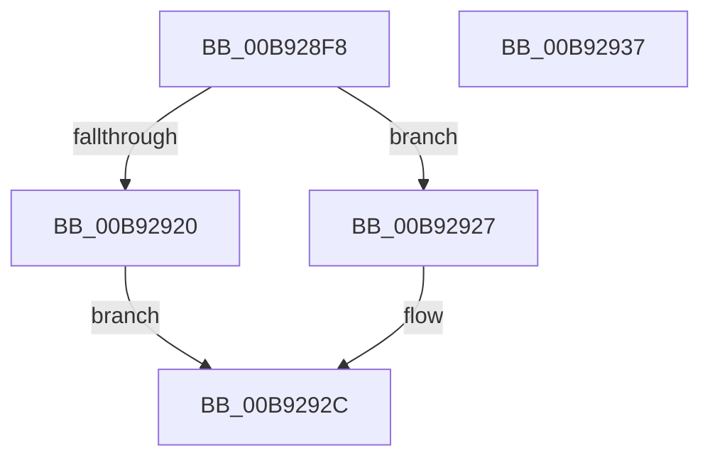

# IovpCallDriverNoIrpTracking

- RVA: `0x00B928F8`–`0x00B92938` (길이 `64` bytes)
- VA: `0x0000000140B928F8`
- 실행 섹션: `PAGEVRFY`
- PDB 이름 있음: `예`; PDB Function 태그: `아니요`
- unwind 정보 RVA: `0x0005CAAC`
- 디코드: `20`개 명령, `64/64` bytes 표시
- 미해석 바이트: `0` (있으면 어셈블리에 `.byte`로 보존)

> 이 문서는 커널 이미지의 기계어와 PDB 기호를 분석해 생성했습니다. 4번과 5번은 함수 원형과 자료형을 바이너리 사용 방식에서 추정한 C 해석이며 원본 소스 복구 결과는 아닙니다.

## 1. Dependencies

- 직접 호출 지점: **3**; 고유 호출 대상: **3**
- 직접 호출자로 확인된 함수: **1**
- RIP 상대 이미지 참조: **1**

### Outgoing calls
- `0x00B9290B` → [VfBeforeCallDriver](VfBeforeCallDriver_function_00B9DC58.md) (function, `0x00B9DC58`)
- `0x00B92920` → [IopPerfCallDriver](../../text/4A/IopPerfCallDriver_function_004A9680.md) (function, `0x004A9680`)
- `0x00B92927` → [IopfCallDriver](../../text/29/IopfCallDriver_function_0029C474.md) (function, `0x0029C474`)

### Direct callers
- [sub_00BBC34E](../BB/Unknown_function_00BBC34E.md) at `0x00BBC383`

### Static image references
- `0x00B92910` → RVA `0x00E66114` (`.data`; read)

## 2. Other-region calls and transfers

- 다른 실행 섹션으로 향하는 call: **2**
  - `0x00B92920` → [IopPerfCallDriver](../../text/4A/IopPerfCallDriver_function_004A9680.md) (`PAGEVRFY` → `.text`)
  - `0x00B92927` → [IopfCallDriver](../../text/29/IopfCallDriver_function_0029C474.md) (`PAGEVRFY` → `.text`)
- 별도 외부 분기/꼬리 이동을 확인하지 못했습니다.

## 3. Assembly (complete function range)

```asm
00B928F8  48 89 5C 24 08                  mov qword ptr [rsp + 8], rbx
00B928FD  57                              push rdi
00B928FE  48 83 EC 20                     sub rsp, 0x20
00B92902  45 33 C0                        xor r8d, r8d
00B92905  48 8B DA                        mov rbx, rdx
00B92908  48 8B F9                        mov rdi, rcx
00B9290B  E8 48 B3 00 00                  call 0x140b9dc58
00B92910  8B 05 FE 37 2D 00               mov eax, dword ptr [rip + 0x2d37fe]
00B92916  48 8B D3                        mov rdx, rbx
00B92919  48 8B CF                        mov rcx, rdi
00B9291C  A8 02                           test al, 2
00B9291E  74 07                           je 0x140b92927
00B92920  E8 5B 6D 91 FF                  call 0x1404a9680
00B92925  EB 05                           jmp 0x140b9292c
00B92927  E8 48 9B 70 FF                  call 0x14029c474
00B9292C  48 8B 5C 24 30                  mov rbx, qword ptr [rsp + 0x30]
00B92931  48 83 C4 20                     add rsp, 0x20
00B92935  5F                              pop rdi
00B92936  C3                              ret
00B92937  CC                              int3
```

## 4. C-style interpretation (structured pseudocode)

```c
__int64 __fastcall IovpCallDriverNoIrpTracking(__int64 a1, __int64 a2, int a3)
{
    __int64 result;
    __int64 v_rsp;
    unsigned __int64 v_stack_p8;

    v_stack_p8 = v_rbx;
    v_rsp = (v_rsp) - (32);
    a3 = 0;
    result = VfBeforeCallDriver(a1, a2, a3, a4);
    if ((((unsigned __int8)((unsigned int)(*(unsigned int *)(v_rip + 2963454)))) & (2)) == 0) goto loc_00B92927;
    result = IopPerfCallDriver(a1, a2, a3, a4);
    goto loc_00B9292C;
loc_00B92927:
    result = IopfCallDriver(a1, a2, a3, a4);
loc_00B9292C:
    v_rsp = (v_rsp) + (32);
    return result;
}
```

## 5. (Beta) C Style

```c
int64_t IovpCallDriverNoIrpTracking(int64_t Arg1, int64_t Arg2, int32_t Arg3)
{
    int64_t result;
    int64_t local_rsp;
    uint64_t v_stack_p8;

    v_stack_p8 = local_rbx;
    local_rsp = (local_rsp) - (32);
    Arg3 = 0;
    result = VfBeforeCallDriver(Arg1, Arg2, Arg3, a4);
    if ((((uint8_t)((uint32_t)(*(uint32_t *)(v_rip + 0x2D37FE)))) & (2)) == 0) goto loc_00B92927;
    result = IopPerfCallDriver(Arg1, Arg2, Arg3, a4);
    goto loc_00B9292C;
loc_00B92927:
    result = IopfCallDriver(Arg1, Arg2, Arg3, a4);
loc_00B9292C:
    local_rsp = (local_rsp) + (32);
    return result;
}
```

## 6. Execution-region graph

[열기: 2D/3D 그래프와 함수 탐색 컨트롤 패널](../../../control-panel.html?section=pagevrfy&rva=0x00B928F8&view=graph)

- 2D 그래프는 위에서 아래로 흐르고, 3D 그래프는 빈 공간을 드래그해 회전합니다. Shift+드래그는 이동, 휠은 확대·축소, 함수 노드 선택은 대상 보고서 이동입니다.

### Static fallback


