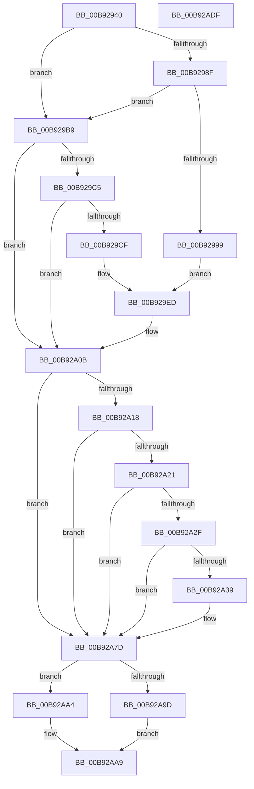

# IovpCallDriverWithStackBuffer

- RVA: `0x00B92940`–`0x00B92AE0` (길이 `416` bytes)
- VA: `0x0000000140B92940`
- 실행 섹션: `PAGEVRFY`
- PDB 이름 있음: `예`; PDB Function 태그: `아니요`
- unwind 정보 RVA: `0x000C7F00`
- 디코드: `95`개 명령, `416/416` bytes 표시
- 미해석 바이트: `0` (있으면 어셈블리에 `.byte`로 보존)

> 이 문서는 커널 이미지의 기계어와 PDB 기호를 분석해 생성했습니다. 4번과 5번은 함수 원형과 자료형을 바이너리 사용 방식에서 추정한 C 해석이며 원본 소스 복구 결과는 아닙니다.

## 1. Dependencies

- 직접 호출 지점: **12**; 고유 호출 대상: **9**
- 직접 호출자로 확인된 함수: **1**
- RIP 상대 이미지 참조: **10**

### Outgoing calls
- `0x00B92978` → [memset](../../text/6C/memset_function_006C6C40.md) (function, `0x006C6C40`)
- `0x00B929A0` → [KeAcquireSpinLockRaiseToDpc](../../text/20/KeAcquireSpinLockRaiseToDpc_function_00208470.md) (function, `0x00208470`)
- `0x00B929BC` → [IovpValidateDeviceObject](IovpValidateDeviceObject_function_00B92C10.md) (function, `0x00B92C10`)
- `0x00B929D6` → [KeAcquireSpinLockRaiseToDpc](../../text/20/KeAcquireSpinLockRaiseToDpc_function_00208470.md) (function, `0x00208470`)
- `0x00B92A05` → [VfBugCheckNoStackUsage](../../text/61/VfBugCheckNoStackUsage_function_00613F98.md) (function, `0x00613F98`)
- `0x00B92A40` → [KeAcquireSpinLockRaiseToDpc](../../text/20/KeAcquireSpinLockRaiseToDpc_function_00208470.md) (function, `0x00208470`)
- `0x00B92A77` → [VfBugCheckNoStackUsage](../../text/61/VfBugCheckNoStackUsage_function_00613F98.md) (function, `0x00613F98`)
- `0x00B92A88` → [VfBeforeCallDriver](VfBeforeCallDriver_function_00B9DC58.md) (function, `0x00B9DC58`)
- `0x00B92A9D` → [IopPerfCallDriver](../../text/4A/IopPerfCallDriver_function_004A9680.md) (function, `0x004A9680`)
- `0x00B92AA4` → [IopfCallDriver](../../text/29/IopfCallDriver_function_0029C474.md) (function, `0x0029C474`)
- `0x00B92AB7` → [VfAfterCallDriver](VfAfterCallDriver_function_00B9DA84.md) (function, `0x00B9DA84`)
- `0x00B92AC7` → [_security_check_cookie](../../text/6A/_security_check_cookie_function_006AC640.md) (function, `0x006AC640`)

### Direct callers
- [sub_00BBC34E](../BB/Unknown_function_00BBC34E.md) at `0x00BBC368`

### Static image references
- `0x00B92954` → RVA `0x00E0A740` (`.data`; read)
- `0x00B9298F` → RVA `0x00E681A0` (`.data`; read)
- `0x00B92999` → RVA `0x00FFDA70` (`PAGEVRFD`; read)
- `0x00B929A5` → RVA `0x00FFDA38` (`PAGEVRFD`; write)
- `0x00B929B0` → RVA `0x00FFDA40` (`PAGEVRFD`; write)
- `0x00B929F0` → RVA `0x00FFDA30` (`PAGEVRFD`; write)
- `0x00B929FB` → RVA `0x00FFDA48` (`PAGEVRFD`; read)
- `0x00B92A4C` → RVA `0x00FFDA50` (`PAGEVRFD`; write)
- `0x00B92A70` → RVA `0x00FFDA48` (`PAGEVRFD`; write)
- `0x00B92A8D` → RVA `0x00E66114` (`.data`; read)

## 2. Other-region calls and transfers

- 다른 실행 섹션으로 향하는 call: **9**
  - `0x00B92978` → [memset](../../text/6C/memset_function_006C6C40.md) (`PAGEVRFY` → `.text`)
  - `0x00B929A0` → [KeAcquireSpinLockRaiseToDpc](../../text/20/KeAcquireSpinLockRaiseToDpc_function_00208470.md) (`PAGEVRFY` → `.text`)
  - `0x00B929D6` → [KeAcquireSpinLockRaiseToDpc](../../text/20/KeAcquireSpinLockRaiseToDpc_function_00208470.md) (`PAGEVRFY` → `.text`)
  - `0x00B92A05` → [VfBugCheckNoStackUsage](../../text/61/VfBugCheckNoStackUsage_function_00613F98.md) (`PAGEVRFY` → `.text`)
  - `0x00B92A40` → [KeAcquireSpinLockRaiseToDpc](../../text/20/KeAcquireSpinLockRaiseToDpc_function_00208470.md) (`PAGEVRFY` → `.text`)
  - `0x00B92A77` → [VfBugCheckNoStackUsage](../../text/61/VfBugCheckNoStackUsage_function_00613F98.md) (`PAGEVRFY` → `.text`)
  - `0x00B92A9D` → [IopPerfCallDriver](../../text/4A/IopPerfCallDriver_function_004A9680.md) (`PAGEVRFY` → `.text`)
  - `0x00B92AA4` → [IopfCallDriver](../../text/29/IopfCallDriver_function_0029C474.md) (`PAGEVRFY` → `.text`)
  - `0x00B92AC7` → [_security_check_cookie](../../text/6A/_security_check_cookie_function_006AC640.md) (`PAGEVRFY` → `.text`)
- 별도 외부 분기/꼬리 이동을 확인하지 못했습니다.

## 3. Assembly (complete function range)

```asm
00B92940  48 89 5C 24 20                  mov qword ptr [rsp + 0x20], rbx
00B92945  55                              push rbp
00B92946  56                              push rsi
00B92947  57                              push rdi
00B92948  48 8D 6C 24 B9                  lea rbp, [rsp - 0x47]
00B9294D  48 81 EC F0 00 00 00            sub rsp, 0xf0
00B92954  48 8B 05 E5 7D 27 00            mov rax, qword ptr [rip + 0x277de5]
00B9295B  48 33 C4                        xor rax, rsp
00B9295E  48 89 45 3F                     mov qword ptr [rbp + 0x3f], rax
00B92962  49 8B D8                        mov rbx, r8
00B92965  48 8B FA                        mov rdi, rdx
00B92968  48 8B F1                        mov rsi, rcx
00B9296B  33 D2                           xor edx, edx
00B9296D  41 B8 C0 00 00 00               mov r8d, 0xc0
00B92973  48 8D 4C 24 28                  lea rcx, [rsp + 0x28]
00B92978  E8 C3 42 B3 FF                  call 0x1406c6c40
00B9297D  66 83 3F 06                     cmp word ptr [rdi], 6
00B92981  48 89 75 1F                     mov qword ptr [rbp + 0x1f], rsi
00B92985  48 89 7D 27                     mov qword ptr [rbp + 0x27], rdi
00B92989  48 89 5D 2F                     mov qword ptr [rbp + 0x2f], rbx
00B9298D  74 2A                           je 0x140b929b9
00B9298F  0F BA 25 09 58 2D 00 16         bt dword ptr [rip + 0x2d5809], 0x16
00B92997  72 20                           jb 0x140b929b9
00B92999  48 8D 0D D0 B0 46 00            lea rcx, [rip + 0x46b0d0]
00B929A0  E8 CB 5A 67 FF                  call 0x140208470
00B929A5  48 C7 05 88 B0 46 00 03 00 00 00  mov qword ptr [rip + 0x46b088], 3
00B929B0  48 89 3D 89 B0 46 00            mov qword ptr [rip + 0x46b089], rdi
00B929B7  EB 34                           jmp 0x140b929ed
00B929B9  48 8B CE                        mov rcx, rsi
00B929BC  E8 4F 02 00 00                  call 0x140b92c10
00B929C1  84 C0                           test al, al
00B929C3  75 46                           jne 0x140b92a0b
00B929C5  0F BA 25 D3 57 2D 00 16         bt dword ptr [rip + 0x2d57d3], 0x16
00B929CD  72 3C                           jb 0x140b92a0b
00B929CF  48 8D 0D 9A B0 46 00            lea rcx, [rip + 0x46b09a]
00B929D6  E8 95 5A 67 FF                  call 0x140208470
00B929DB  48 C7 05 52 B0 46 00 04 00 00 00  mov qword ptr [rip + 0x46b052], 4
00B929E6  48 89 35 53 B0 46 00            mov qword ptr [rip + 0x46b053], rsi
00B929ED  0F 57 C0                        xorps xmm0, xmm0
00B929F0  48 C7 05 35 B0 46 00 C9 00 00 00  mov qword ptr [rip + 0x46b035], 0xc9
00B929FB  0F 11 05 46 B0 46 00            movups xmmword ptr [rip + 0x46b046], xmm0
00B92A02  88 45 1C                        mov byte ptr [rbp + 0x1c], al
00B92A05  E8 8E 15 A8 FF                  call 0x140613f98
00B92A0A  CC                              int3
00B92A0B  48 8B 9F B8 00 00 00            mov rbx, qword ptr [rdi + 0xb8]
00B92A12  80 7B B8 00                     cmp byte ptr [rbx - 0x48], 0
00B92A16  75 65                           jne 0x140b92a7d
00B92A18  48 8B 43 E8                     mov rax, qword ptr [rbx - 0x18]
00B92A1C  48 85 C0                        test rax, rax
00B92A1F  74 5C                           je 0x140b92a7d
00B92A21  8B 40 50                        mov eax, dword ptr [rax + 0x50]
00B92A24  B9 00 40 20 00                  mov ecx, 0x204000
00B92A29  23 C1                           and eax, ecx
00B92A2B  3B C1                           cmp eax, ecx
00B92A2D  75 4E                           jne 0x140b92a7d
00B92A2F  0F BA 25 69 57 2D 00 16         bt dword ptr [rip + 0x2d5769], 0x16
00B92A37  72 44                           jb 0x140b92a7d
00B92A39  48 8D 0D 30 B0 46 00            lea rcx, [rip + 0x46b030]
00B92A40  E8 2B 5A 67 FF                  call 0x140208470
00B92A45  88 45 1C                        mov byte ptr [rbp + 0x1c], al
00B92A48  48 8B 43 E8                     mov rax, qword ptr [rbx - 0x18]
00B92A4C  48 89 05 FD AF 46 00            mov qword ptr [rip + 0x46affd], rax
00B92A53  48 C7 05 D2 AF 46 00 C9 00 00 00  mov qword ptr [rip + 0x46afd2], 0xc9
00B92A5E  48 C7 05 CF AF 46 00 0F 00 00 00  mov qword ptr [rip + 0x46afcf], 0xf
00B92A69  48 89 35 D0 AF 46 00            mov qword ptr [rip + 0x46afd0], rsi
00B92A70  48 89 3D D1 AF 46 00            mov qword ptr [rip + 0x46afd1], rdi
00B92A77  E8 1C 15 A8 FF                  call 0x140613f98
00B92A7C  CC                              int3
00B92A7D  4C 8D 44 24 28                  lea r8, [rsp + 0x28]
00B92A82  48 8B D7                        mov rdx, rdi
00B92A85  48 8B CE                        mov rcx, rsi
00B92A88  E8 CB B1 00 00                  call 0x140b9dc58
00B92A8D  8B 05 81 36 2D 00               mov eax, dword ptr [rip + 0x2d3681]
00B92A93  48 8B D7                        mov rdx, rdi
00B92A96  48 8B CE                        mov rcx, rsi
00B92A99  A8 02                           test al, 2
00B92A9B  74 07                           je 0x140b92aa4
00B92A9D  E8 DE 6B 91 FF                  call 0x1404a9680
00B92AA2  EB 05                           jmp 0x140b92aa9
00B92AA4  E8 CB 99 70 FF                  call 0x14029c474
00B92AA9  48 8D 54 24 20                  lea rdx, [rsp + 0x20]
00B92AAE  89 44 24 20                     mov dword ptr [rsp + 0x20], eax
00B92AB2  48 8D 4C 24 28                  lea rcx, [rsp + 0x28]
00B92AB7  E8 C8 AF 00 00                  call 0x140b9da84
00B92ABC  8B 44 24 20                     mov eax, dword ptr [rsp + 0x20]
00B92AC0  48 8B 4D 3F                     mov rcx, qword ptr [rbp + 0x3f]
00B92AC4  48 33 CC                        xor rcx, rsp
00B92AC7  E8 74 9B B1 FF                  call 0x1406ac640
00B92ACC  48 8B 9C 24 28 01 00 00         mov rbx, qword ptr [rsp + 0x128]
00B92AD4  48 81 C4 F0 00 00 00            add rsp, 0xf0
00B92ADB  5F                              pop rdi
00B92ADC  5E                              pop rsi
00B92ADD  5D                              pop rbp
00B92ADE  C3                              ret
00B92ADF  CC                              int3
```

## 4. C-style interpretation (structured pseudocode)

```c
__int64 __fastcall IovpCallDriverWithStackBuffer(__int64 a1, __int64 a2, __int64 a3)
{
    __int64 result;
    __int64 v_rsp;
    unsigned __int64 v_stack_m20;
    unsigned __int64 v_stack_m30;
    unsigned __int64 v_stack_m38;
    unsigned __int64 v_stack_m40;
    unsigned __int8 v_stack_m43;
    unsigned __int64 v_stack_m5F;
    unsigned __int64 v_stack_mE0;
    unsigned __int64 v_stack_mE8;
    unsigned __int64 v_stack_p20;

    v_stack_p20 = v_rbx;
    v_rsp = (v_rsp) - (240);
    result = (*(unsigned __int64 *)(v_rip + 2588133)) ^ (v_rsp);
    v_stack_m20 = result;
    a2 = 0;
    result = memset(v_stack_mE0, a2, 192, a4);
    v_stack_m40 = a1;
    v_stack_m38 = 0;
    v_stack_m30 = a3;
    if ((*(unsigned __int16 *)(a2)) == 6) goto loc_00B929B9;
    if ((*(unsigned __int16 *)(a2)) < 6) goto loc_00B929B9;
    result = KeAcquireSpinLockRaiseToDpc(v_rip + 4632784, a2, 192, a4);
    *(unsigned __int64 *)(v_rip + 4632712) = 3;
    *(unsigned __int64 *)(v_rip + 4632713) = 0;
    goto loc_00B929ED;
loc_00B929B9:
    result = IovpValidateDeviceObject(a1, a2, 192, a4);
    if ((unsigned __int8)(result) != 0) goto loc_00B92A0B;
    if (condition_is_below) goto loc_00B92A0B;
    result = KeAcquireSpinLockRaiseToDpc(v_rip + 4632730, a2, 192, a4);
    *(unsigned __int64 *)(v_rip + 4632658) = 4;
    *(unsigned __int64 *)(v_rip + 4632659) = a1;
loc_00B929ED:
    *(unsigned __int64 *)(v_rip + 4632629) = 201;
    *(unsigned __int64 *)(v_rip + 4632646) = v_xmm0;
    v_stack_m43 = (unsigned __int8)(result);
    result = VfBugCheckNoStackUsage(v_rip + 4632730, a2, 192, a4);
loc_00B92A0B:
    if ((*(unsigned __int8 *)(*(unsigned __int64 *)(a2 + 184) - 72)) != 0) goto loc_00B92A7D;
    if (*(unsigned __int64 *)(*(unsigned __int64 *)(a2 + 184) - 24) == 0) goto loc_00B92A7D;
    result = (unsigned int)(((unsigned int)(*(unsigned int *)(*(unsigned __int64 *)(*(unsigned __int64 *)(a2 + 184) - 24) + 80))) & ((unsigned int)((unsigned int)(0x204000ULL))));
    if (((unsigned int)(result)) != ((unsigned int)((unsigned int)(0x204000ULL)))) goto loc_00B92A7D;
    if (((unsigned int)(result)) >= ((unsigned int)((unsigned int)(0x204000ULL)))) {
        a1 = v_rip + 4632624;
        result = KeAcquireSpinLockRaiseToDpc(a1, a2, 192, a4);
        v_stack_m43 = (unsigned __int8)(result);
        result = *(unsigned __int64 *)(*(unsigned __int64 *)(a2 + 184) - 24);
        *(unsigned __int64 *)(v_rip + 4632573) = result;
        *(unsigned __int64 *)(v_rip + 4632530) = 201;
        *(unsigned __int64 *)(v_rip + 4632527) = 15;
        *(unsigned __int64 *)(v_rip + 4632528) = a1;
        *(unsigned __int64 *)(v_rip + 4632529) = 0;
        result = VfBugCheckNoStackUsage(a1, a2, 192, a4);
    }
    result = VfBeforeCallDriver(a1, 0, v_stack_mE0, a4);
    if ((((unsigned __int8)((unsigned int)(*(unsigned int *)(v_rip + 2963073)))) & (2)) == 0) goto loc_00B92AA4;
    result = IopPerfCallDriver(a1, 0, v_stack_mE0, a4);
    goto loc_00B92AA9;
loc_00B92AA4:
    result = IopfCallDriver(a1, 0, v_stack_mE0, a4);
loc_00B92AA9:
    v_stack_mE8 = (unsigned int)(result);
    result = VfAfterCallDriver(v_stack_mE0, v_stack_mE8, v_stack_mE0, a4);
    a1 = (v_stack_m20) ^ (v_rsp);
    result = _security_check_cookie(a1, v_stack_mE8, v_stack_mE0, a4);
    v_rsp = (v_rsp) + (240);
    return result;
}
```

## 5. (Beta) C Style

```c
int64_t IovpCallDriverWithStackBuffer(int64_t Arg1, void *Arg2, int64_t Arg3)
{
    uint8_t *arg2 = (uint8_t *)Arg2;

    int64_t result;
    int64_t local_rsp;
    uint64_t v_stack_m20;
    uint64_t v_stack_m30;
    uint64_t v_stack_m38;
    uint64_t v_stack_m40;
    uint8_t v_stack_m43;
    uint64_t v_stack_m5F;
    uint64_t v_stack_mE0;
    uint64_t v_stack_mE8;
    uint64_t v_stack_p20;

    v_stack_p20 = local_rbx;
    local_rsp = (local_rsp) - (240);
    result = (*(uint64_t *)(v_rip + 0x277DE5)) ^ (local_rsp);
    v_stack_m20 = result;
    Arg2 = 0;
    result = memset(v_stack_mE0, Arg2, 192, a4);
    v_stack_m40 = Arg1;
    v_stack_m38 = 0;
    v_stack_m30 = Arg3;
    if ((*(uint16_t *)(arg2)) == 6) goto loc_00B929B9;
    if ((*(uint16_t *)(arg2)) < 6) goto loc_00B929B9;
    result = KeAcquireSpinLockRaiseToDpc(v_rip + 4632784, Arg2, 192, a4);
    *(uint64_t *)(v_rip + 0x46B088) = 3;
    *(uint64_t *)(v_rip + 0x46B089) = 0;
    goto loc_00B929ED;
loc_00B929B9:
    result = IovpValidateDeviceObject(Arg1, Arg2, 192, a4);
    if ((uint8_t)(result) != 0) goto loc_00B92A0B;
    if (condition_is_below) goto loc_00B92A0B;
    result = KeAcquireSpinLockRaiseToDpc(v_rip + 4632730, Arg2, 192, a4);
    *(uint64_t *)(v_rip + 0x46B052) = 4;
    *(uint64_t *)(v_rip + 0x46B053) = Arg1;
loc_00B929ED:
    *(uint64_t *)(v_rip + 0x46B035) = 201;
    *(uint64_t *)(v_rip + 0x46B046) = v_xmm0;
    v_stack_m43 = (uint8_t)(result);
    result = VfBugCheckNoStackUsage(v_rip + 4632730, Arg2, 192, a4);
loc_00B92A0B:
    if ((*(uint8_t *)(*(uint64_t *)(arg2 + 0xB8) - 0x48)) != 0) goto loc_00B92A7D;
    if (*(uint64_t *)(*(uint64_t *)(arg2 + 0xB8) - 0x18) == 0) goto loc_00B92A7D;
    result = (uint32_t)(((uint32_t)(*(uint32_t *)(*(uint64_t *)(*(uint64_t *)(arg2 + 0xB8) - 0x18) + 0x50))) & ((uint32_t)((uint32_t)(0x204000ULL))));
    if (((uint32_t)(result)) != ((uint32_t)((uint32_t)(0x204000ULL)))) goto loc_00B92A7D;
    if (((uint32_t)(result)) >= ((uint32_t)((uint32_t)(0x204000ULL)))) {
        Arg1 = v_rip + 4632624;
        result = KeAcquireSpinLockRaiseToDpc(Arg1, Arg2, 192, a4);
        v_stack_m43 = (uint8_t)(result);
        result = *(uint64_t *)(*(uint64_t *)(arg2 + 0xB8) - 0x18);
        *(uint64_t *)(v_rip + 0x46AFFD) = result;
        *(uint64_t *)(v_rip + 0x46AFD2) = 201;
        *(uint64_t *)(v_rip + 0x46AFCF) = 15;
        *(uint64_t *)(v_rip + 0x46AFD0) = Arg1;
        *(uint64_t *)(v_rip + 0x46AFD1) = 0;
        result = VfBugCheckNoStackUsage(Arg1, Arg2, 192, a4);
    }
    result = VfBeforeCallDriver(Arg1, 0, v_stack_mE0, a4);
    if ((((uint8_t)((uint32_t)(*(uint32_t *)(v_rip + 0x2D3681)))) & (2)) == 0) goto loc_00B92AA4;
    result = IopPerfCallDriver(Arg1, 0, v_stack_mE0, a4);
    goto loc_00B92AA9;
loc_00B92AA4:
    result = IopfCallDriver(Arg1, 0, v_stack_mE0, a4);
loc_00B92AA9:
    v_stack_mE8 = (uint32_t)(result);
    result = VfAfterCallDriver(v_stack_mE0, v_stack_mE8, v_stack_mE0, a4);
    Arg1 = (v_stack_m20) ^ (local_rsp);
    result = _security_check_cookie(Arg1, v_stack_mE8, v_stack_mE0, a4);
    local_rsp = (local_rsp) + (240);
    return result;
}
```

### 관측된 메모리 오프셋

구조체 형식이 확인되지 않은 접근은 인자 기준의 오프셋으로만 기록했습니다.

| 기준 인자 | 오프셋 표현 | 폭 (bit) | 접근 |
|---|---:|---:|---|
| `Arg2` | `+ 0x0` | `16` | `R` |
| `Arg2` | `+ 0xB8` | `64` | `R` |

## 6. Execution-region graph

[열기: 2D/3D 그래프와 함수 탐색 컨트롤 패널](../../../control-panel.html?section=pagevrfy&rva=0x00B92940&view=graph)

- 2D 그래프는 위에서 아래로 흐르고, 3D 그래프는 빈 공간을 드래그해 회전합니다. Shift+드래그는 이동, 휠은 확대·축소, 함수 노드 선택은 대상 보고서 이동입니다.

### Static fallback


