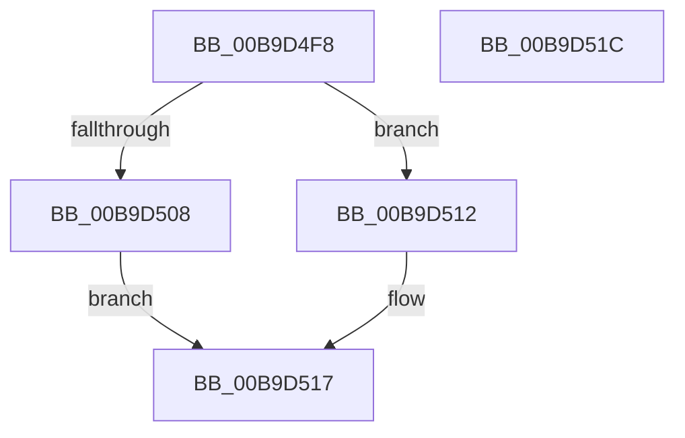

# IovpCancelRoutine

- RVA: `0x00B9D4F8`–`0x00B9D51D` (길이 `37` bytes)
- VA: `0x0000000140B9D4F8`
- 실행 섹션: `PAGEVRFY`
- PDB 이름 있음: `예`; PDB Function 태그: `아니요`
- unwind 정보 RVA: `0x0005C788`
- 디코드: `11`개 명령, `37/37` bytes 표시
- 미해석 바이트: `0` (있으면 어셈블리에 `.byte`로 보존)

> 이 문서는 커널 이미지의 기계어와 PDB 기호를 분석해 생성했습니다. 4번과 5번은 함수 원형과 자료형을 바이너리 사용 방식에서 추정한 C 해석이며 원본 소스 복구 결과는 아닙니다.

## 1. Dependencies

- 직접 호출 지점: **2**; 고유 호출 대상: **1**
- 직접 호출자로 확인된 함수: **1**
- RIP 상대 이미지 참조: **1**

### Outgoing calls
- `0x00B9D50B` → [guard_dispatch_icall](../../text/6B/guard_dispatch_icall_function_006BAAD0.md) (function, `0x006BAAD0`)
- `0x00B9D512` → [guard_dispatch_icall](../../text/6B/guard_dispatch_icall_function_006BAAD0.md) (function, `0x006BAAD0`)

### Direct callers
- [IoCancelIrp](../../text/27/IoCancelIrp_function_002720E0.md) at `0x002721E8`

### Static image references
- `0x00B9D4FC` → RVA `0x00F04308` (`.data`; read)

## 2. Other-region calls and transfers

- 다른 실행 섹션으로 향하는 call: **2**
  - `0x00B9D50B` → [guard_dispatch_icall](../../text/6B/guard_dispatch_icall_function_006BAAD0.md) (`PAGEVRFY` → `.text`)
  - `0x00B9D512` → [guard_dispatch_icall](../../text/6B/guard_dispatch_icall_function_006BAAD0.md) (`PAGEVRFY` → `.text`)
- 별도 외부 분기/꼬리 이동을 확인하지 못했습니다.

## 3. Assembly (complete function range)

```asm
00B9D4F8  48 83 EC 28                     sub rsp, 0x28
00B9D4FC  48 8B 05 05 6E 36 00            mov rax, qword ptr [rip + 0x366e05]
00B9D503  48 85 C0                        test rax, rax
00B9D506  75 0A                           jne 0x140b9d512
00B9D508  49 8B C0                        mov rax, r8
00B9D50B  E8 C0 D5 B1 FF                  call 0x1406baad0
00B9D510  EB 05                           jmp 0x140b9d517
00B9D512  E8 B9 D5 B1 FF                  call 0x1406baad0
00B9D517  48 83 C4 28                     add rsp, 0x28
00B9D51B  C3                              ret
00B9D51C  CC                              int3
```

## 4. C-style interpretation (structured pseudocode)

```c
__int64 __fastcall IovpCancelRoutine(__int64 a1, __int64 a2, __int64 a3)
{
    __int64 result;
    __int64 v_rsp;

    v_rsp = (v_rsp) - (40);
    if (*(unsigned __int64 *)(v_rip + 3567109) != 0) goto loc_00B9D512;
    result = guard_dispatch_icall(a1, a2, a3, a4);
    goto loc_00B9D517;
loc_00B9D512:
    result = guard_dispatch_icall(a1, a2, a3, a4);
loc_00B9D517:
    v_rsp = (v_rsp) + (40);
    return result;
}
```

## 5. (Beta) C Style

```c
int64_t IovpCancelRoutine(int64_t Arg1, int64_t Arg2, int64_t Arg3)
{
    int64_t result;
    int64_t local_rsp;

    local_rsp = (local_rsp) - (40);
    if (*(uint64_t *)(v_rip + 0x366E05) != 0) goto loc_00B9D512;
    result = guard_dispatch_icall(Arg1, Arg2, Arg3, a4);
    goto loc_00B9D517;
loc_00B9D512:
    result = guard_dispatch_icall(Arg1, Arg2, Arg3, a4);
loc_00B9D517:
    local_rsp = (local_rsp) + (40);
    return result;
}
```

## 6. Execution-region graph

[열기: 2D/3D 그래프와 함수 탐색 컨트롤 패널](../../../control-panel.html?section=pagevrfy&rva=0x00B9D4F8&view=graph)

- 2D 그래프는 위에서 아래로 흐르고, 3D 그래프는 빈 공간을 드래그해 회전합니다. Shift+드래그는 이동, 휠은 확대·축소, 함수 노드 선택은 대상 보고서 이동입니다.

### Static fallback


