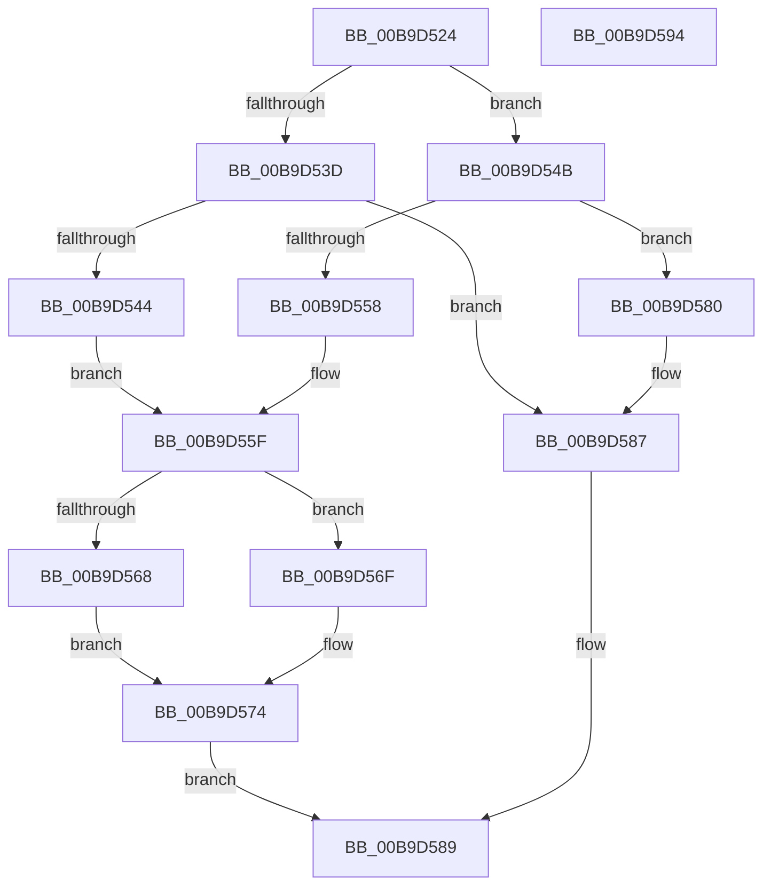

# IovpCheckIrpForCriticalTracking

- RVA: `0x00B9D524`–`0x00B9D595` (길이 `113` bytes)
- VA: `0x0000000140B9D524`
- 실행 섹션: `PAGEVRFY`
- PDB 이름 있음: `예`; PDB Function 태그: `아니요`
- unwind 정보 RVA: `0x0005CAAC`
- 디코드: `35`개 명령, `113/113` bytes 표시
- 미해석 바이트: `0` (있으면 어셈블리에 `.byte`로 보존)

> 이 문서는 커널 이미지의 기계어와 PDB 기호를 분석해 생성했습니다. 4번과 5번은 함수 원형과 자료형을 바이너리 사용 방식에서 추정한 C 해석이며 원본 소스 복구 결과는 아닙니다.

## 1. Dependencies

- 직접 호출 지점: **3**; 고유 호출 대상: **2**
- 직접 호출자로 확인된 함수: **1**
- RIP 상대 이미지 참조: **0**

### Outgoing calls
- `0x00B9D544` → [VfIrpDatabaseEntryFindAndLock](../BB/VfIrpDatabaseEntryFindAndLock_function_00BB7074.md) (function, `0x00BB7074`)
- `0x00B9D54B` → [VfIrpDatabaseEntryFindAndLock](../BB/VfIrpDatabaseEntryFindAndLock_function_00BB7074.md) (function, `0x00BB7074`)
- `0x00B9D577` → [VfIrpDatabaseEntryReleaseLock](../BB/VfIrpDatabaseEntryReleaseLock_function_00BB3FD4.md) (function, `0x00BB3FD4`)

### Direct callers
- [VfIrpAllocateCallDriverData](VfIrpAllocateCallDriverData_function_00B9DE90.md) at `0x00B9DEB9`

### Static image references
- 디코드된 RIP-relative 메모리 참조가 없습니다.

## 2. Other-region calls and transfers

- 다른 실행 섹션으로 향하는 call: **0**
- 별도 외부 분기/꼬리 이동을 확인하지 못했습니다.

## 3. Assembly (complete function range)

```asm
00B9D524  48 89 5C 24 08                  mov qword ptr [rsp + 8], rbx
00B9D529  57                              push rdi
00B9D52A  48 83 EC 20                     sub rsp, 0x20
00B9D52E  8B 41 10                        mov eax, dword ptr [rcx + 0x10]
00B9D531  33 FF                           xor edi, edi
00B9D533  48 8B D9                        mov rbx, rcx
00B9D536  25 00 00 00 C0                  and eax, 0xc0000000
00B9D53B  74 0E                           je 0x140b9d54b
00B9D53D  3D 00 00 00 40                  cmp eax, 0x40000000
00B9D542  75 43                           jne 0x140b9d587
00B9D544  E8 2B 9B 01 00                  call 0x140bb7074
00B9D549  EB 14                           jmp 0x140b9d55f
00B9D54B  E8 24 9B 01 00                  call 0x140bb7074
00B9D550  8B 4B 10                        mov ecx, dword ptr [rbx + 0x10]
00B9D553  48 85 C0                        test rax, rax
00B9D556  74 28                           je 0x140b9d580
00B9D558  0F BA E9 1E                     bts ecx, 0x1e
00B9D55C  89 4B 10                        mov dword ptr [rbx + 0x10], ecx
00B9D55F  48 39 B8 F0 00 00 00            cmp qword ptr [rax + 0xf0], rdi
00B9D566  74 07                           je 0x140b9d56f
00B9D568  BF 01 00 00 00                  mov edi, 1
00B9D56D  EB 05                           jmp 0x140b9d574
00B9D56F  0F BA 68 38 13                  bts dword ptr [rax + 0x38], 0x13
00B9D574  48 8B C8                        mov rcx, rax
00B9D577  E8 58 6A 01 00                  call 0x140bb3fd4
00B9D57C  8B C7                           mov eax, edi
00B9D57E  EB 09                           jmp 0x140b9d589
00B9D580  0F BA E9 1F                     bts ecx, 0x1f
00B9D584  89 4B 10                        mov dword ptr [rbx + 0x10], ecx
00B9D587  33 C0                           xor eax, eax
00B9D589  48 8B 5C 24 30                  mov rbx, qword ptr [rsp + 0x30]
00B9D58E  48 83 C4 20                     add rsp, 0x20
00B9D592  5F                              pop rdi
00B9D593  C3                              ret
00B9D594  CC                              int3
```

## 4. C-style interpretation (structured pseudocode)

```c
__int64 __fastcall IovpCheckIrpForCriticalTracking(__int64 a1)
{
    __int64 result;
    __int64 v_rdi;
    __int64 v_rsp;
    unsigned __int64 v_stack_p8;

    v_stack_p8 = v_rbx;
    v_rsp = (v_rsp) - (32);
    v_rdi = 0;
    result = (unsigned int)(((unsigned int)(*(unsigned int *)(a1 + 16))) & (0xC0000000ULL));
    if (condition_is_equal) goto loc_00B9D54B;
    if (((unsigned int)(result)) != 0x40000000ULL) goto loc_00B9D587;
    result = VfIrpDatabaseEntryFindAndLock(a1, a2, a3, a4);
    goto loc_00B9D55F;
loc_00B9D54B:
    result = VfIrpDatabaseEntryFindAndLock(a1, a2, a3, a4);
    if (result == 0) goto loc_00B9D580;
    *(unsigned int *)(a1 + 16) = (unsigned int)((unsigned int)(*(unsigned int *)(a1 + 16)));
loc_00B9D55F:
    if ((*(unsigned __int64 *)(result + 240)) == 0) goto loc_00B9D56F;
    goto loc_00B9D574;
loc_00B9D56F:
loc_00B9D574:
    result = VfIrpDatabaseEntryReleaseLock(result, a2, a3, a4);
    goto loc_00B9D589;
loc_00B9D580:
    *(unsigned int *)(a1 + 16) = (unsigned int)(result);
loc_00B9D587:
    result = 0;
loc_00B9D589:
    v_rsp = (v_rsp) + (32);
    return result;
}
```

## 5. (Beta) C Style

```c
int64_t IovpCheckIrpForCriticalTracking(void *Arg1)
{
    uint8_t *arg1 = (uint8_t *)Arg1;

    int64_t result;
    int64_t local_rdi;
    int64_t local_rsp;
    uint64_t v_stack_p8;

    v_stack_p8 = local_rbx;
    local_rsp = (local_rsp) - (32);
    local_rdi = 0;
    result = (uint32_t)(((uint32_t)(*(uint32_t *)(arg1 + 0x10))) & (0xC0000000ULL));
    if (condition_is_equal) goto loc_00B9D54B;
    if (((uint32_t)(result)) != 0x40000000ULL) goto loc_00B9D587;
    result = VfIrpDatabaseEntryFindAndLock(Arg1, a2, a3, a4);
    goto loc_00B9D55F;
loc_00B9D54B:
    result = VfIrpDatabaseEntryFindAndLock(Arg1, a2, a3, a4);
    if (result == 0) goto loc_00B9D580;
    *(uint32_t *)(arg1 + 0x10) = (uint32_t)((uint32_t)(*(uint32_t *)(arg1 + 0x10)));
loc_00B9D55F:
    if ((*(uint64_t *)(result + 0xF0)) == 0) goto loc_00B9D56F;
    goto loc_00B9D574;
loc_00B9D56F:
loc_00B9D574:
    result = VfIrpDatabaseEntryReleaseLock(result, a2, a3, a4);
    goto loc_00B9D589;
loc_00B9D580:
    *(uint32_t *)(arg1 + 0x10) = (uint32_t)(result);
loc_00B9D587:
    result = 0;
loc_00B9D589:
    local_rsp = (local_rsp) + (32);
    return result;
}
```

### 관측된 메모리 오프셋

구조체 형식이 확인되지 않은 접근은 인자 기준의 오프셋으로만 기록했습니다.

| 기준 인자 | 오프셋 표현 | 폭 (bit) | 접근 |
|---|---:|---:|---|
| `Arg1` | `+ 0x10` | `32` | `R` |
| `Arg1` | `+ 0x10` | `32` | `W` |

## 6. Execution-region graph

[열기: 2D/3D 그래프와 함수 탐색 컨트롤 패널](../../../control-panel.html?section=pagevrfy&rva=0x00B9D524&view=graph)

- 2D 그래프는 위에서 아래로 흐르고, 3D 그래프는 빈 공간을 드래그해 회전합니다. Shift+드래그는 이동, 휠은 확대·축소, 함수 노드 선택은 대상 보고서 이동입니다.

### Static fallback


