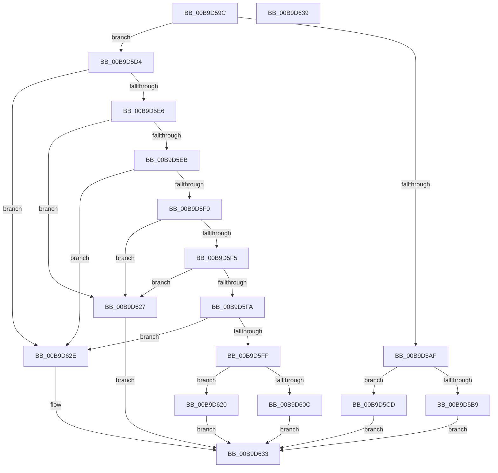

# IovpExamineDevObjForwarding

- RVA: `0x00B9D59C`–`0x00B9D63A` (길이 `158` bytes)
- VA: `0x0000000140B9D59C`
- 실행 섹션: `PAGEVRFY`
- PDB 이름 있음: `예`; PDB Function 태그: `아니요`
- unwind 정보 RVA: `0x0005CF00`
- 디코드: `49`개 명령, `158/158` bytes 표시
- 미해석 바이트: `0` (있으면 어셈블리에 `.byte`로 보존)

> 이 문서는 커널 이미지의 기계어와 PDB 기호를 분석해 생성했습니다. 4번과 5번은 함수 원형과 자료형을 바이너리 사용 방식에서 추정한 C 해석이며 원본 소스 복구 결과는 아닙니다.

## 1. Dependencies

- 직접 호출 지점: **5**; 고유 호출 대상: **3**
- 직접 호출자로 확인된 함수: **1**
- RIP 상대 이미지 참조: **0**

### Outgoing calls
- `0x00B9D5AF` → [IovUtilGetUpperDeviceObjectWithTag](../BA/IovUtilGetUpperDeviceObjectWithTag_function_00BA2AE0.md) (function, `0x00BA2AE0`)
- `0x00B9D5C1` → [ObfDereferenceObjectWithTag](../../text/2F/ObfDereferenceObjectWithTag_function_002F78E0.md) (function, `0x002F78E0`)
- `0x00B9D5D9` → [IovUtilRelateDeviceObjects](../BA/IovUtilRelateDeviceObjects_function_00BA2C98.md) (function, `0x00BA2C98`)
- `0x00B9D602` → [IovUtilGetUpperDeviceObjectWithTag](../BA/IovUtilGetUpperDeviceObjectWithTag_function_00BA2AE0.md) (function, `0x00BA2AE0`)
- `0x00B9D614` → [ObfDereferenceObjectWithTag](../../text/2F/ObfDereferenceObjectWithTag_function_002F78E0.md) (function, `0x002F78E0`)

### Direct callers
- [IovpCallDriver1](IovpCallDriver1_function_00B9CCA4.md) at `0x00B9CEC1`

### Static image references
- 디코드된 RIP-relative 메모리 참조가 없습니다.

## 2. Other-region calls and transfers

- 다른 실행 섹션으로 향하는 call: **2**
  - `0x00B9D5C1` → [ObfDereferenceObjectWithTag](../../text/2F/ObfDereferenceObjectWithTag_function_002F78E0.md) (`PAGEVRFY` → `.text`)
  - `0x00B9D614` → [ObfDereferenceObjectWithTag](../../text/2F/ObfDereferenceObjectWithTag_function_002F78E0.md) (`PAGEVRFY` → `.text`)
- 별도 외부 분기/꼬리 이동을 확인하지 못했습니다.

## 3. Assembly (complete function range)

```asm
00B9D59C  40 53                           push rbx
00B9D59E  48 83 EC 20                     sub rsp, 0x20
00B9D5A2  83 64 24 38 00                  and dword ptr [rsp + 0x38], 0
00B9D5A7  48 8B D9                        mov rbx, rcx
00B9D5AA  48 85 D2                        test rdx, rdx
00B9D5AD  75 25                           jne 0x140b9d5d4
00B9D5AF  E8 2C 55 00 00                  call 0x140ba2ae0
00B9D5B4  48 85 C0                        test rax, rax
00B9D5B7  74 14                           je 0x140b9d5cd
00B9D5B9  BA 56 72 66 49                  mov edx, 0x49667256
00B9D5BE  48 8B C8                        mov rcx, rax
00B9D5C1  E8 1A A3 75 FF                  call 0x1402f78e0
00B9D5C6  B8 04 00 00 00                  mov eax, 4
00B9D5CB  EB 66                           jmp 0x140b9d633
00B9D5CD  B8 01 00 00 00                  mov eax, 1
00B9D5D2  EB 5F                           jmp 0x140b9d633
00B9D5D4  4C 8D 44 24 38                  lea r8, [rsp + 0x38]
00B9D5D9  E8 BA 56 00 00                  call 0x140ba2c98
00B9D5DE  8B 4C 24 38                     mov ecx, dword ptr [rsp + 0x38]
00B9D5E2  85 C9                           test ecx, ecx
00B9D5E4  74 48                           je 0x140b9d62e
00B9D5E6  83 E9 01                        sub ecx, 1
00B9D5E9  74 3C                           je 0x140b9d627
00B9D5EB  83 E9 01                        sub ecx, 1
00B9D5EE  74 3E                           je 0x140b9d62e
00B9D5F0  83 E9 01                        sub ecx, 1
00B9D5F3  74 32                           je 0x140b9d627
00B9D5F5  83 E9 01                        sub ecx, 1
00B9D5F8  74 2D                           je 0x140b9d627
00B9D5FA  83 F9 01                        cmp ecx, 1
00B9D5FD  75 2F                           jne 0x140b9d62e
00B9D5FF  48 8B CB                        mov rcx, rbx
00B9D602  E8 D9 54 00 00                  call 0x140ba2ae0
00B9D607  48 85 C0                        test rax, rax
00B9D60A  74 14                           je 0x140b9d620
00B9D60C  BA 56 72 66 49                  mov edx, 0x49667256
00B9D611  48 8B C8                        mov rcx, rax
00B9D614  E8 C7 A2 75 FF                  call 0x1402f78e0
00B9D619  B8 06 00 00 00                  mov eax, 6
00B9D61E  EB 13                           jmp 0x140b9d633
00B9D620  B8 05 00 00 00                  mov eax, 5
00B9D625  EB 0C                           jmp 0x140b9d633
00B9D627  B8 03 00 00 00                  mov eax, 3
00B9D62C  EB 05                           jmp 0x140b9d633
00B9D62E  B8 02 00 00 00                  mov eax, 2
00B9D633  48 83 C4 20                     add rsp, 0x20
00B9D637  5B                              pop rbx
00B9D638  C3                              ret
00B9D639  CC                              int3
```

## 4. C-style interpretation (structured pseudocode)

```c
__int64 __fastcall IovpExamineDevObjForwarding(__int64 a1, __int64 a2)
{
    __int64 result;
    __int64 v_rsp;
    unsigned int v_stack_p10;

    v_rsp = (v_rsp) - (32);
    if (a2 != 0) goto loc_00B9D5D4;
    result = IovUtilGetUpperDeviceObjectWithTag(a1, a2, a3, a4);
    if (result == 0) goto loc_00B9D5CD;
    result = ObfDereferenceObjectWithTag(result, (unsigned int)(0x49667256ULL), a3, a4);
    goto loc_00B9D633;
loc_00B9D5CD:
    goto loc_00B9D633;
loc_00B9D5D4:
    result = IovUtilRelateDeviceObjects(result, (unsigned int)(0x49667256ULL), v_stack_p10, a4);
    if ((unsigned int)((unsigned int)(v_stack_p10)) == 0) goto loc_00B9D62E;
    a1 = (unsigned int)(((unsigned int)(v_stack_p10)) - (1));
    if (condition_is_equal) goto loc_00B9D627;
    a1 = (unsigned int)((a1) - (1));
    if (condition_is_equal) goto loc_00B9D62E;
    a1 = (unsigned int)((a1) - (1));
    if (condition_is_equal) goto loc_00B9D627;
    a1 = (unsigned int)((a1) - (1));
    if (condition_is_equal) goto loc_00B9D627;
    if (((unsigned int)(a1)) != 1) goto loc_00B9D62E;
    result = IovUtilGetUpperDeviceObjectWithTag(a1, (unsigned int)(0x49667256ULL), v_stack_p10, a4);
    if (result == 0) goto loc_00B9D620;
    result = ObfDereferenceObjectWithTag(result, (unsigned int)(0x49667256ULL), v_stack_p10, a4);
    goto loc_00B9D633;
loc_00B9D620:
    goto loc_00B9D633;
loc_00B9D627:
    goto loc_00B9D633;
loc_00B9D62E:
loc_00B9D633:
    v_rsp = (v_rsp) + (32);
    return 2;
}
```

## 5. (Beta) C Style

```c
int64_t IovpExamineDevObjForwarding(int64_t Arg1, int64_t Arg2)
{
    int64_t result;
    int64_t local_rsp;
    uint32_t v_stack_p10;

    local_rsp = (local_rsp) - (32);
    if (Arg2 != 0) goto loc_00B9D5D4;
    result = IovUtilGetUpperDeviceObjectWithTag(Arg1, Arg2, a3, a4);
    if (result == 0) goto loc_00B9D5CD;
    result = ObfDereferenceObjectWithTag(result, (uint32_t)(0x49667256ULL), a3, a4);
    goto loc_00B9D633;
loc_00B9D5CD:
    goto loc_00B9D633;
loc_00B9D5D4:
    result = IovUtilRelateDeviceObjects(result, (uint32_t)(0x49667256ULL), v_stack_p10, a4);
    if ((uint32_t)((uint32_t)(v_stack_p10)) == 0) goto loc_00B9D62E;
    Arg1 = (uint32_t)(((uint32_t)(v_stack_p10)) - (1));
    if (condition_is_equal) goto loc_00B9D627;
    Arg1 = (uint32_t)((Arg1) - (1));
    if (condition_is_equal) goto loc_00B9D62E;
    Arg1 = (uint32_t)((Arg1) - (1));
    if (condition_is_equal) goto loc_00B9D627;
    Arg1 = (uint32_t)((Arg1) - (1));
    if (condition_is_equal) goto loc_00B9D627;
    if (((uint32_t)(Arg1)) != 1) goto loc_00B9D62E;
    result = IovUtilGetUpperDeviceObjectWithTag(Arg1, (uint32_t)(0x49667256ULL), v_stack_p10, a4);
    if (result == 0) goto loc_00B9D620;
    result = ObfDereferenceObjectWithTag(result, (uint32_t)(0x49667256ULL), v_stack_p10, a4);
    goto loc_00B9D633;
loc_00B9D620:
    goto loc_00B9D633;
loc_00B9D627:
    goto loc_00B9D633;
loc_00B9D62E:
loc_00B9D633:
    local_rsp = (local_rsp) + (32);
    return 2;
}
```

## 6. Execution-region graph

[열기: 2D/3D 그래프와 함수 탐색 컨트롤 패널](../../../control-panel.html?section=pagevrfy&rva=0x00B9D59C&view=graph)

- 2D 그래프는 위에서 아래로 흐르고, 3D 그래프는 빈 공간을 드래그해 회전합니다. Shift+드래그는 이동, 휠은 확대·축소, 함수 노드 선택은 대상 보고서 이동입니다.

### Static fallback


