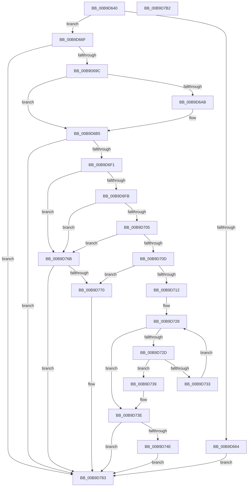

# IovpExamineIrpStackForwarding

- RVA: `0x00B9D640`–`0x00B9D7B3` (길이 `371` bytes)
- VA: `0x0000000140B9D640`
- 실행 섹션: `PAGEVRFY`
- PDB 이름 있음: `예`; PDB Function 태그: `아니요`
- unwind 정보 RVA: `0x0005FEF8`
- 디코드: `105`개 명령, `371/371` bytes 표시
- 미해석 바이트: `0` (있으면 어셈블리에 `.byte`로 보존)

> 이 문서는 커널 이미지의 기계어와 PDB 기호를 분석해 생성했습니다. 4번과 5번은 함수 원형과 자료형을 바이너리 사용 방식에서 추정한 C 해석이며 원본 소스 복구 결과는 아닙니다.

## 1. Dependencies

- 직접 호출 지점: **4**; 고유 호출 대상: **4**
- 직접 호출자로 확인된 함수: **1**
- RIP 상대 이미지 참조: **1**

### Outgoing calls
- `0x00B9D6CA` → [memcmp](../../text/6C/memcmp_function_006C6B10.md) (function, `0x006C6B10`)
- `0x00B9D71F` → [KeAcquireQueuedSpinLock](../../text/27/KeAcquireQueuedSpinLock_function_00273D80.md) (function, `0x00273D80`)
- `0x00B9D745` → [KeReleaseQueuedSpinLock](../../text/27/KeReleaseQueuedSpinLock_function_00272540.md) (function, `0x00272540`)
- `0x00B9D75B` → [ViErrorReport1](../../text/61/ViErrorReport1_function_00614584.md) (function, `0x00614584`)

### Direct callers
- [IovpCallDriver1](IovpCallDriver1_function_00B9CCA4.md) at `0x00B9CEF2`

### Static image references
- `0x00B9D770` → RVA `0x00B9D7C0` (`IovpInternalCompletionTrap`; read)

## 2. Other-region calls and transfers

- 다른 실행 섹션으로 향하는 call: **4**
  - `0x00B9D6CA` → [memcmp](../../text/6C/memcmp_function_006C6B10.md) (`PAGEVRFY` → `.text`)
  - `0x00B9D71F` → [KeAcquireQueuedSpinLock](../../text/27/KeAcquireQueuedSpinLock_function_00273D80.md) (`PAGEVRFY` → `.text`)
  - `0x00B9D745` → [KeReleaseQueuedSpinLock](../../text/27/KeReleaseQueuedSpinLock_function_00272540.md) (`PAGEVRFY` → `.text`)
  - `0x00B9D75B` → [ViErrorReport1](../../text/61/ViErrorReport1_function_00614584.md) (`PAGEVRFY` → `.text`)
- 별도 외부 분기/꼬리 이동을 확인하지 못했습니다.

## 3. Assembly (complete function range)

```asm
00B9D640  48 8B C4                        mov rax, rsp
00B9D643  48 89 58 08                     mov qword ptr [rax + 8], rbx
00B9D647  48 89 68 10                     mov qword ptr [rax + 0x10], rbp
00B9D64B  48 89 70 18                     mov qword ptr [rax + 0x18], rsi
00B9D64F  48 89 78 20                     mov qword ptr [rax + 0x20], rdi
00B9D653  41 54                           push r12
00B9D655  41 56                           push r14
00B9D657  41 57                           push r15
00B9D659  48 83 EC 20                     sub rsp, 0x20
00B9D65D  4D 8B F9                        mov r15, r9
00B9D660  85 D2                           test edx, edx
00B9D662  74 0B                           je 0x140b9d66f
00B9D664  33 FF                           xor edi, edi
00B9D666  44 8D 77 01                     lea r14d, [rdi + 1]
00B9D66A  E9 14 01 00 00                  jmp 0x140b9d783
00B9D66F  44 0F B6 B1 BA 00 00 00         movzx r14d, byte ptr [rcx + 0xba]
00B9D677  41 0F BE 41 43                  movsx eax, byte ptr [r9 + 0x43]
00B9D67C  49 8B A9 B8 00 00 00            mov rbp, qword ptr [r9 + 0xb8]
00B9D683  44 2B F0                        sub r14d, eax
00B9D686  49 63 FE                        movsxd rdi, r14d
00B9D689  48 8D 7F FF                     lea rdi, [rdi - 1]
00B9D68D  48 8D 3C FF                     lea rdi, [rdi + rdi*8]
00B9D691  48 8D 7C FD 00                  lea rdi, [rbp + rdi*8]
00B9D696  0F 84 E7 00 00 00               je 0x140b9d783
00B9D69C  48 8B 74 24 68                  mov rsi, qword ptr [rsp + 0x68]
00B9D6A1  0F B7 07                        movzx eax, word ptr [rdi]
00B9D6A4  0F B7 0E                        movzx ecx, word ptr [rsi]
00B9D6A7  2B C8                           sub ecx, eax
00B9D6A9  75 0A                           jne 0x140b9d6b5
00B9D6AB  0F B6 4E 02                     movzx ecx, byte ptr [rsi + 2]
00B9D6AF  0F B6 47 02                     movzx eax, byte ptr [rdi + 2]
00B9D6B3  2B C8                           sub ecx, eax
00B9D6B5  33 DB                           xor ebx, ebx
00B9D6B7  48 8D 57 08                     lea rdx, [rdi + 8]
00B9D6BB  85 C9                           test ecx, ecx
00B9D6BD  41 B8 20 00 00 00               mov r8d, 0x20
00B9D6C3  48 8D 4E 08                     lea rcx, [rsi + 8]
00B9D6C7  0F 94 C3                        sete bl
00B9D6CA  E8 41 94 B2 FF                  call 0x1406c6b10
00B9D6CF  48 8B 56 30                     mov rdx, qword ptr [rsi + 0x30]
00B9D6D3  45 33 C0                        xor r8d, r8d
00B9D6D6  85 C0                           test eax, eax
00B9D6D8  41 0F 94 C0                     sete r8b
00B9D6DC  33 C0                           xor eax, eax
00B9D6DE  44 23 C3                        and r8d, ebx
00B9D6E1  48 3B 57 30                     cmp rdx, qword ptr [rdi + 0x30]
00B9D6E5  41 0F 44 C0                     cmove eax, r8d
00B9D6E9  85 C0                           test eax, eax
00B9D6EB  0F 84 92 00 00 00               je 0x140b9d783
00B9D6F1  48 8B 4E 38                     mov rcx, qword ptr [rsi + 0x38]
00B9D6F5  48 3B 4F 38                     cmp rcx, qword ptr [rdi + 0x38]
00B9D6F9  75 70                           jne 0x140b9d76b
00B9D6FB  48 8B 47 40                     mov rax, qword ptr [rdi + 0x40]
00B9D6FF  48 39 46 40                     cmp qword ptr [rsi + 0x40], rax
00B9D703  75 66                           jne 0x140b9d76b
00B9D705  8A 47 03                        mov al, byte ptr [rdi + 3]
00B9D708  38 46 03                        cmp byte ptr [rsi + 3], al
00B9D70B  75 5E                           jne 0x140b9d76b
00B9D70D  48 85 C9                        test rcx, rcx
00B9D710  74 5E                           je 0x140b9d770
00B9D712  48 8B 5F 28                     mov rbx, qword ptr [rdi + 0x28]
00B9D716  33 ED                           xor ebp, ebp
00B9D718  4C 8B 63 08                     mov r12, qword ptr [rbx + 8]
00B9D71C  8D 4D 0A                        lea ecx, [rbp + 0xa]
00B9D71F  E8 5C 66 6D FF                  call 0x140273d80
00B9D724  48 8B 4B 18                     mov rcx, qword ptr [rbx + 0x18]
00B9D728  48 85 C9                        test rcx, rcx
00B9D72B  74 11                           je 0x140b9d73e
00B9D72D  4C 39 61 08                     cmp qword ptr [rcx + 8], r12
00B9D731  74 06                           je 0x140b9d739
00B9D733  48 8B 49 18                     mov rcx, qword ptr [rcx + 0x18]
00B9D737  EB EF                           jmp 0x140b9d728
00B9D739  BD 01 00 00 00                  mov ebp, 1
00B9D73E  8A D0                           mov dl, al
00B9D740  B9 0A 00 00 00                  mov ecx, 0xa
00B9D745  E8 F6 4D 6D FF                  call 0x140272540
00B9D74A  85 ED                           test ebp, ebp
00B9D74C  75 35                           jne 0x140b9d783
00B9D74E  48 8B 54 24 60                  mov rdx, qword ptr [rsp + 0x60]
00B9D753  4D 8B C7                        mov r8, r15
00B9D756  B9 07 02 00 00                  mov ecx, 0x207
00B9D75B  E8 24 6E A7 FF                  call 0x140614584
00B9D760  48 83 66 38 00                  and qword ptr [rsi + 0x38], 0
00B9D765  40 88 6E 03                     mov byte ptr [rsi + 3], bpl
00B9D769  EB 18                           jmp 0x140b9d783
00B9D76B  48 85 C9                        test rcx, rcx
00B9D76E  75 13                           jne 0x140b9d783
00B9D770  48 8D 05 49 00 00 00            lea rax, [rip + 0x49]
00B9D777  48 89 6D F8                     mov qword ptr [rbp - 8], rbp
00B9D77B  48 89 45 F0                     mov qword ptr [rbp - 0x10], rax
00B9D77F  C6 45 BB E0                     mov byte ptr [rbp - 0x45], 0xe0
00B9D783  48 8B 44 24 70                  mov rax, qword ptr [rsp + 0x70]
00B9D788  48 8B 5C 24 40                  mov rbx, qword ptr [rsp + 0x40]
00B9D78D  48 8B 6C 24 48                  mov rbp, qword ptr [rsp + 0x48]
00B9D792  48 8B 74 24 50                  mov rsi, qword ptr [rsp + 0x50]
00B9D797  48 89 38                        mov qword ptr [rax], rdi
00B9D79A  48 8B 44 24 78                  mov rax, qword ptr [rsp + 0x78]
00B9D79F  48 8B 7C 24 58                  mov rdi, qword ptr [rsp + 0x58]
00B9D7A4  44 89 30                        mov dword ptr [rax], r14d
00B9D7A7  48 83 C4 20                     add rsp, 0x20
00B9D7AB  41 5F                           pop r15
00B9D7AD  41 5E                           pop r14
00B9D7AF  41 5C                           pop r12
00B9D7B1  C3                              ret
00B9D7B2  CC                              int3
```

## 4. C-style interpretation (structured pseudocode)

```c
__int64 __fastcall IovpExamineIrpStackForwarding(__int64 a1, int a2, __int64 a3, __int64 a4, __int64 a5, __int64 a6, __int64 a7, __int64 a8)
{
    __int64 result;
    __int64 v_r14;
    __int64 v_rbp;
    __int64 v_rbx;
    __int64 v_rdi;
    __int64 v_rsp;
    unsigned __int64 v_stack_p10;
    unsigned __int64 v_stack_p18;
    unsigned __int64 v_stack_p20;
    unsigned __int64 v_stack_p8;

    *(unsigned __int64 *)(v_rsp + 8) = v_rbx;
    *(unsigned __int64 *)(v_rsp + 16) = v_rbp;
    *(unsigned __int64 *)(v_rsp + 24) = v_rsi;
    *(unsigned __int64 *)(v_rsp + 32) = v_rdi;
    v_rsp = (v_rsp) - (32);
    if (a2 == 0) goto loc_00B9D66F;
    v_rdi = 0;
    goto loc_00B9D783;
loc_00B9D66F:
    v_r14 = (unsigned int)((*(unsigned __int8 *)(a1 + 186)) - ((unsigned int)((__int8)(*(unsigned __int8 *)(a4 + 67)))));
    if (condition_is_equal) goto loc_00B9D783;
    a1 = (unsigned int)((*(unsigned __int16 *)(a6)) - ((unsigned int)(*(unsigned __int16 *)(*(unsigned __int64 *)(a4 + 184) + (int)((unsigned int)(v_r14)) - 1 + (int)((unsigned int)(v_r14)) - 1 * 8 * 8))));
    result = *(unsigned __int16 *)(*(unsigned __int64 *)(a4 + 184) + (int)((unsigned int)(v_r14)) - 1 + (int)((unsigned int)(v_r14)) - 1 * 8 * 8);
    if (!(condition_is_not_equal)) {
        a1 = *(unsigned __int8 *)(a6 + 2);
        result = *(unsigned __int8 *)(*(unsigned __int64 *)(a4 + 184) + (int)((unsigned int)(v_r14)) - 1 + (int)((unsigned int)(v_r14)) - 1 * 8 * 8 + 2);
        a1 = (unsigned int)((a1) - ((unsigned int)(result)));
    }
    v_rbx = 0;
    v_rbx = ((unsigned int)(a1) == 0) ? 1 : 0;
    result = memcmp(a6 + 8, *(unsigned __int64 *)(a4 + 184) + (int)((unsigned int)(v_r14)) - 1 + (int)((unsigned int)(v_r14)) - 1 * 8 * 8 + 8, 32, a4);
    a3 = 0;
    a3 = ((unsigned int)(result) == 0) ? 1 : 0;
    result = 0;
    a3 = (unsigned int)((a3) & ((unsigned int)(v_rbx)));
    if ((*(unsigned __int64 *)(a6 + 48)) == (*(unsigned __int64 *)(*(unsigned __int64 *)(a4 + 184) + (int)((unsigned int)(v_r14)) - 1 + (int)((unsigned int)(v_r14)) - 1 * 8 * 8 + 48))) { result = (unsigned int)(a3); }
    if ((unsigned int)(result) == 0) goto loc_00B9D783;
    if ((*(unsigned __int64 *)(a6 + 56)) != (*(unsigned __int64 *)(*(unsigned __int64 *)(a4 + 184) + (int)((unsigned int)(v_r14)) - 1 + (int)((unsigned int)(v_r14)) - 1 * 8 * 8 + 56))) goto loc_00B9D76B;
    if ((*(unsigned __int64 *)(a6 + 64)) != (*(unsigned __int64 *)(*(unsigned __int64 *)(a4 + 184) + (int)((unsigned int)(v_r14)) - 1 + (int)((unsigned int)(v_r14)) - 1 * 8 * 8 + 64))) goto loc_00B9D76B;
    if ((*(unsigned __int8 *)(a6 + 3)) != ((unsigned __int8)(*(unsigned __int8 *)(*(unsigned __int64 *)(a4 + 184) + (int)((unsigned int)(v_r14)) - 1 + (int)((unsigned int)(v_r14)) - 1 * 8 * 8 + 3)))) goto loc_00B9D76B;
    if (*(unsigned __int64 *)(a6 + 56) == 0) goto loc_00B9D770;
    v_rbp = 0;
    result = KeAcquireQueuedSpinLock(v_rbp + 10, *(unsigned __int64 *)(a6 + 48), a3, a4);
loc_00B9D728:
    if (*(unsigned __int64 *)(*(unsigned __int64 *)(*(unsigned __int64 *)(a4 + 184) + (int)((unsigned int)(v_r14)) - 1 + (int)((unsigned int)(v_r14)) - 1 * 8 * 8 + 40) + 24) == 0) goto loc_00B9D73E;
    if ((*(unsigned __int64 *)(*(unsigned __int64 *)(*(unsigned __int64 *)(*(unsigned __int64 *)(a4 + 184) + (int)((unsigned int)(v_r14)) - 1 + (int)((unsigned int)(v_r14)) - 1 * 8 * 8 + 40) + 24) + 8)) == (*(unsigned __int64 *)(*(unsigned __int64 *)(*(unsigned __int64 *)(a4 + 184) + (int)((unsigned int)(v_r14)) - 1 + (int)((unsigned int)(v_r14)) - 1 * 8 * 8 + 40) + 8))) goto loc_00B9D739;
    goto loc_00B9D728;
loc_00B9D739:
loc_00B9D73E:
    result = KeReleaseQueuedSpinLock(10, (unsigned __int8)(result), a3, a4);
    if (1 != 0) goto loc_00B9D783;
    result = ViErrorReport1(519, a5, a4, a4);
    *(unsigned __int8 *)(a6 + 3) = 1;
    goto loc_00B9D783;
loc_00B9D76B:
    if (519 == 0) {
        result = v_rip + 73;
        *(unsigned __int64 *)(1 - 8) = 1;
        *(unsigned __int64 *)(1 - 16) = result;
        *(unsigned __int8 *)(1 - 69) = 224;
    }
    *(unsigned __int64 *)(a7) = *(unsigned __int64 *)(a4 + 184) + (int)((unsigned int)(v_r14)) - 1 + (int)((unsigned int)(v_r14)) - 1 * 8 * 8;
    *(unsigned int *)(a8) = (unsigned int)(v_r14);
    v_rsp = (v_rsp) + (32);
    return a8;
}
```

## 5. (Beta) C Style

```c
void *IovpExamineIrpStackForwarding(void *Arg1, int32_t Arg2, int64_t Arg3, void *Arg4, int64_t Arg5, void *Arg6, void *Arg7, void *Arg8)
{
    uint8_t *arg1 = (uint8_t *)Arg1;
    uint8_t *arg4 = (uint8_t *)Arg4;
    uint8_t *arg6 = (uint8_t *)Arg6;
    uint8_t *arg7 = (uint8_t *)Arg7;
    uint8_t *arg8 = (uint8_t *)Arg8;

    int64_t result;
    int64_t local_r14;
    int64_t local_rbp;
    int64_t local_rbx;
    int64_t local_rdi;
    int64_t local_rsp;
    uint64_t v_stack_p10;
    uint64_t v_stack_p18;
    uint64_t v_stack_p20;
    uint64_t v_stack_p8;

    *(uint64_t *)(local_rsp + 0x8) = local_rbx;
    *(uint64_t *)(local_rsp + 0x10) = local_rbp;
    *(uint64_t *)(local_rsp + 0x18) = local_rsi;
    *(uint64_t *)(local_rsp + 0x20) = local_rdi;
    local_rsp = (local_rsp) - (32);
    if (Arg2 == 0) goto loc_00B9D66F;
    local_rdi = 0;
    goto loc_00B9D783;
loc_00B9D66F:
    local_r14 = (uint32_t)((*(uint8_t *)(arg1 + 0xBA)) - ((uint32_t)((int8_t)(*(uint8_t *)(arg4 + 0x43)))));
    if (condition_is_equal) goto loc_00B9D783;
    Arg1 = (uint32_t)((*(uint16_t *)(arg6)) - ((uint32_t)(*(uint16_t *)(*(uint64_t *)(arg4 + 0xB8) + (int32_t)((uint32_t)(local_r14)) - 0x1 + (int32_t)((uint32_t)(local_r14)) - 0x1 * 8 * 8))));
    result = *(uint16_t *)(*(uint64_t *)(arg4 + 0xB8) + (int32_t)((uint32_t)(local_r14)) - 0x1 + (int32_t)((uint32_t)(local_r14)) - 0x1 * 8 * 8);
    if (!(condition_is_not_equal)) {
        Arg1 = *(uint8_t *)(arg6 + 0x2);
        result = *(uint8_t *)(*(uint64_t *)(arg4 + 0xB8) + (int32_t)((uint32_t)(local_r14)) - 0x1 + (int32_t)((uint32_t)(local_r14)) - 0x1 * 8 * 8 + 0x2);
        Arg1 = (uint32_t)((Arg1) - ((uint32_t)(result)));
    }
    local_rbx = 0;
    local_rbx = ((uint32_t)(Arg1) == 0) ? 1 : 0;
    result = memcmp(Arg6 + 8, *(uint64_t *)(arg4 + 0xB8) + (int32_t)((uint32_t)(local_r14)) - 1 + (int32_t)((uint32_t)(local_r14)) - 1 * 8 * 8 + 8, 32, Arg4);
    Arg3 = 0;
    Arg3 = ((uint32_t)(result) == 0) ? 1 : 0;
    result = 0;
    Arg3 = (uint32_t)((Arg3) & ((uint32_t)(local_rbx)));
    if ((*(uint64_t *)(arg6 + 0x30)) == (*(uint64_t *)(*(uint64_t *)(arg4 + 0xB8) + (int32_t)((uint32_t)(local_r14)) - 0x1 + (int32_t)((uint32_t)(local_r14)) - 0x1 * 8 * 8 + 0x30))) { result = (uint32_t)(Arg3); }
    if ((uint32_t)(result) == 0) goto loc_00B9D783;
    if ((*(uint64_t *)(arg6 + 0x38)) != (*(uint64_t *)(*(uint64_t *)(arg4 + 0xB8) + (int32_t)((uint32_t)(local_r14)) - 0x1 + (int32_t)((uint32_t)(local_r14)) - 0x1 * 8 * 8 + 0x38))) goto loc_00B9D76B;
    if ((*(uint64_t *)(arg6 + 0x40)) != (*(uint64_t *)(*(uint64_t *)(arg4 + 0xB8) + (int32_t)((uint32_t)(local_r14)) - 0x1 + (int32_t)((uint32_t)(local_r14)) - 0x1 * 8 * 8 + 0x40))) goto loc_00B9D76B;
    if ((*(uint8_t *)(arg6 + 0x3)) != ((uint8_t)(*(uint8_t *)(*(uint64_t *)(arg4 + 0xB8) + (int32_t)((uint32_t)(local_r14)) - 0x1 + (int32_t)((uint32_t)(local_r14)) - 0x1 * 8 * 8 + 0x3)))) goto loc_00B9D76B;
    if (*(uint64_t *)(arg6 + 0x38) == 0) goto loc_00B9D770;
    local_rbp = 0;
    result = KeAcquireQueuedSpinLock(local_rbp + 10, *(uint64_t *)(arg6 + 0x30), Arg3, Arg4);
loc_00B9D728:
    if (*(uint64_t *)(*(uint64_t *)(*(uint64_t *)(arg4 + 0xB8) + (int32_t)((uint32_t)(local_r14)) - 0x1 + (int32_t)((uint32_t)(local_r14)) - 0x1 * 8 * 8 + 0x28) + 0x18) == 0) goto loc_00B9D73E;
    if ((*(uint64_t *)(*(uint64_t *)(*(uint64_t *)(*(uint64_t *)(arg4 + 0xB8) + (int32_t)((uint32_t)(local_r14)) - 0x1 + (int32_t)((uint32_t)(local_r14)) - 0x1 * 8 * 8 + 0x28) + 0x18) + 0x8)) == (*(uint64_t *)(*(uint64_t *)(*(uint64_t *)(arg4 + 0xB8) + (int32_t)((uint32_t)(local_r14)) - 0x1 + (int32_t)((uint32_t)(local_r14)) - 0x1 * 8 * 8 + 0x28) + 0x8))) goto loc_00B9D739;
    goto loc_00B9D728;
loc_00B9D739:
loc_00B9D73E:
    result = KeReleaseQueuedSpinLock(10, (uint8_t)(result), Arg3, Arg4);
    if (1 != 0) goto loc_00B9D783;
    result = ViErrorReport1(519, Arg5, Arg4, Arg4);
    *(uint8_t *)(arg6 + 0x3) = 1;
    goto loc_00B9D783;
loc_00B9D76B:
    if (519 == 0) {
        result = v_rip + 73;
        *(uint64_t *)(1 - 0x8) = 1;
        *(uint64_t *)(1 - 0x10) = result;
        *(uint8_t *)(1 - 0x45) = 224;
    }
    *(uint64_t *)(arg7) = *(uint64_t *)(arg4 + 0xB8) + (int32_t)((uint32_t)(local_r14)) - 1 + (int32_t)((uint32_t)(local_r14)) - 1 * 8 * 8;
    *(uint32_t *)(arg8) = (uint32_t)(local_r14);
    local_rsp = (local_rsp) + (32);
    return Arg8;
}
```

### 관측된 메모리 오프셋

구조체 형식이 확인되지 않은 접근은 인자 기준의 오프셋으로만 기록했습니다.

| 기준 인자 | 오프셋 표현 | 폭 (bit) | 접근 |
|---|---:|---:|---|
| `Arg1` | `+ 0xBA` | `8` | `R` |
| `Arg4` | `+ 0x43` | `8` | `R` |
| `Arg4` | `+ 0xB8` | `64` | `R` |
| `Arg6` | `+ 0x0` | `16` | `R` |
| `Arg6` | `+ 0x2` | `8` | `R` |
| `Arg6` | `+ 0x3` | `8` | `R` |
| `Arg6` | `+ 0x3` | `8` | `W` |
| `Arg6` | `+ 0x8` | `64` | `R` |
| `Arg6` | `+ 0x30` | `64` | `R` |
| `Arg6` | `+ 0x38` | `64` | `R` |
| `Arg6` | `+ 0x38` | `64` | `R/W` |
| `Arg6` | `+ 0x40` | `64` | `R` |
| `Arg7` | `+ 0x0` | `64` | `W` |
| `Arg8` | `+ 0x0` | `32` | `W` |

## 6. Execution-region graph

[열기: 2D/3D 그래프와 함수 탐색 컨트롤 패널](../../../control-panel.html?section=pagevrfy&rva=0x00B9D640&view=graph)

- 2D 그래프는 위에서 아래로 흐르고, 3D 그래프는 빈 공간을 드래그해 회전합니다. Shift+드래그는 이동, 휠은 확대·축소, 함수 노드 선택은 대상 보고서 이동입니다.

### Static fallback


