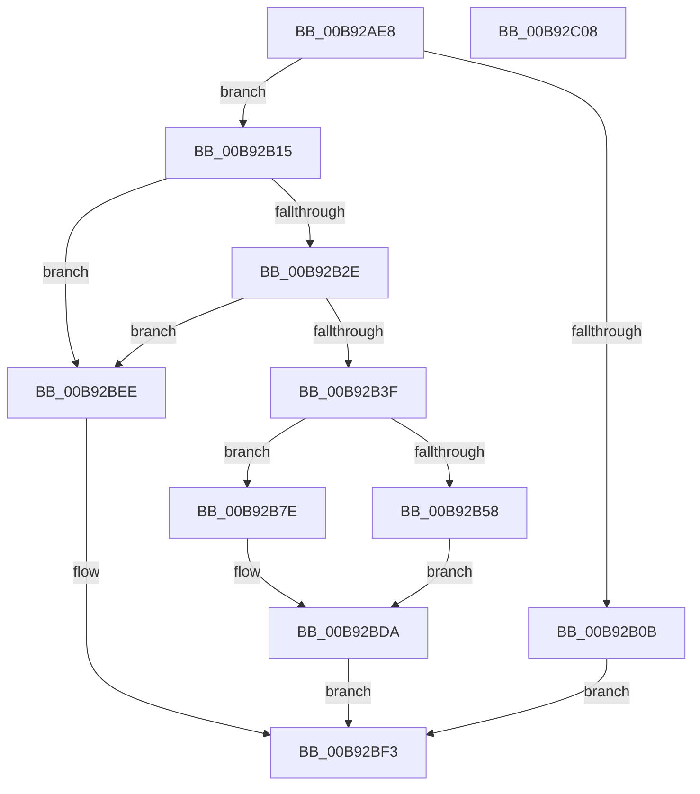

# IovpUnloadDriver

- RVA: `0x00B92AE8`–`0x00B92C09` (길이 `289` bytes)
- VA: `0x0000000140B92AE8`
- 실행 섹션: `PAGEVRFY`
- PDB 이름 있음: `예`; PDB Function 태그: `아니요`
- unwind 정보 RVA: `0x000C7E80`
- 디코드: `73`개 명령, `289/289` bytes 표시
- 미해석 바이트: `0` (있으면 어셈블리에 `.byte`로 보존)

> 이 문서는 커널 이미지의 기계어와 PDB 기호를 분석해 생성했습니다. 4번과 5번은 함수 원형과 자료형을 바이너리 사용 방식에서 추정한 C 해석이며 원본 소스 복구 결과는 아닙니다.

## 1. Dependencies

- 직접 호출 지점: **13**; 고유 호출 대상: **12**
- 직접 호출자로 확인된 함수: **1**
- RIP 상대 이미지 참조: **2**

### Outgoing calls
- `0x00B92B15` → [ObfReferenceObject](../../text/20/ObfReferenceObject_function_0020FA20.md) (function, `0x0020FA20`)
- `0x00B92B21` → [IopCheckUnloadDriver](../../text/4D/IopCheckUnloadDriver_function_004DC454.md) (function, `0x004DC454`)
- `0x00B92B31` → [ObfDereferenceObject](../../text/2F/ObfDereferenceObject_function_002F9350.md) (function, `0x002F9350`)
- `0x00B92B58` → [HalAdjustResourceList](../../text/48/HalAdjustResourceList_function_0048FDC0.md) (function, `0x0048FDC0`)
- `0x00B92B60` → [PsAttachSiloToCurrentThread](../../text/44/PsAttachSiloToCurrentThread_function_004428C0.md) (function, `0x004428C0`)
- `0x00B92B6F` → [guard_dispatch_icall](../../text/6B/guard_dispatch_icall_function_006BAAD0.md) (function, `0x006BAAD0`)
- `0x00B92B77` → [PsDetachSiloFromCurrentThread](../../text/44/PsDetachSiloFromCurrentThread_function_00449AC0.md) (function, `0x00449AC0`)
- `0x00B92B88` → [memset](../../text/6C/memset_function_006C6C40.md) (function, `0x006C6C40`)
- `0x00B92B96` → [KeInitializeEvent](../../text/40/KeInitializeEvent_function_0040DD10.md) (function, `0x0040DD10`)
- `0x00B92BBF` → [ExQueueWorkItem](../../text/2F/ExQueueWorkItem_function_002F9520.md) (function, `0x002F9520`)
- `0x00B92BD5` → [KeWaitForSingleObject](../../text/20/KeWaitForSingleObject_function_0020E6B0.md) (function, `0x0020E6B0`)
- `0x00B92BDD` → [ObMakeTemporaryObject](../../page/A7/ObMakeTemporaryObject_function_00A7F860.md) (function, `0x00A7F860`)
- `0x00B92BE5` → [ObfDereferenceObject](../../text/2F/ObfDereferenceObject_function_002F9350.md) (function, `0x002F9350`)

### Direct callers
- [IovUnloadDrivers](IovUnloadDrivers_function_00B9277C.md) at `0x00B927C6`

### Static image references
- `0x00B92B48` → RVA `0x00FC6AB0` (`ALMOSTRO`; read)
- `0x00B92B9B` → RVA `0x00996B80` (`IopLoadUnloadDriver`; read)

## 2. Other-region calls and transfers

- 다른 실행 섹션으로 향하는 call: **13**
  - `0x00B92B15` → [ObfReferenceObject](../../text/20/ObfReferenceObject_function_0020FA20.md) (`PAGEVRFY` → `.text`)
  - `0x00B92B21` → [IopCheckUnloadDriver](../../text/4D/IopCheckUnloadDriver_function_004DC454.md) (`PAGEVRFY` → `.text`)
  - `0x00B92B31` → [ObfDereferenceObject](../../text/2F/ObfDereferenceObject_function_002F9350.md) (`PAGEVRFY` → `.text`)
  - `0x00B92B58` → [HalAdjustResourceList](../../text/48/HalAdjustResourceList_function_0048FDC0.md) (`PAGEVRFY` → `.text`)
  - `0x00B92B60` → [PsAttachSiloToCurrentThread](../../text/44/PsAttachSiloToCurrentThread_function_004428C0.md) (`PAGEVRFY` → `.text`)
  - `0x00B92B6F` → [guard_dispatch_icall](../../text/6B/guard_dispatch_icall_function_006BAAD0.md) (`PAGEVRFY` → `.text`)
  - `0x00B92B77` → [PsDetachSiloFromCurrentThread](../../text/44/PsDetachSiloFromCurrentThread_function_00449AC0.md) (`PAGEVRFY` → `.text`)
  - `0x00B92B88` → [memset](../../text/6C/memset_function_006C6C40.md) (`PAGEVRFY` → `.text`)
  - `0x00B92B96` → [KeInitializeEvent](../../text/40/KeInitializeEvent_function_0040DD10.md) (`PAGEVRFY` → `.text`)
  - `0x00B92BBF` → [ExQueueWorkItem](../../text/2F/ExQueueWorkItem_function_002F9520.md) (`PAGEVRFY` → `.text`)
  - `0x00B92BD5` → [KeWaitForSingleObject](../../text/20/KeWaitForSingleObject_function_0020E6B0.md) (`PAGEVRFY` → `.text`)
  - `0x00B92BDD` → [ObMakeTemporaryObject](../../page/A7/ObMakeTemporaryObject_function_00A7F860.md) (`PAGEVRFY` → `PAGE`)
  - `0x00B92BE5` → [ObfDereferenceObject](../../text/2F/ObfDereferenceObject_function_002F9350.md) (`PAGEVRFY` → `.text`)
- 별도 외부 분기/꼬리 이동을 확인하지 못했습니다.

## 3. Assembly (complete function range)

```asm
00B92AE8  48 89 5C 24 10                  mov qword ptr [rsp + 0x10], rbx
00B92AED  48 89 7C 24 18                  mov qword ptr [rsp + 0x18], rdi
00B92AF2  55                              push rbp
00B92AF3  48 8B EC                        mov rbp, rsp
00B92AF6  48 81 EC 80 00 00 00            sub rsp, 0x80
00B92AFD  33 DB                           xor ebx, ebx
00B92AFF  48 8B F9                        mov rdi, rcx
00B92B02  88 5D 10                        mov byte ptr [rbp + 0x10], bl
00B92B05  48 39 59 68                     cmp qword ptr [rcx + 0x68], rbx
00B92B09  75 0A                           jne 0x140b92b15
00B92B0B  B8 10 00 00 C0                  mov eax, 0xc0000010
00B92B10  E9 DE 00 00 00                  jmp 0x140b92bf3
00B92B15  E8 06 CF 67 FF                  call 0x14020fa20
00B92B1A  48 8D 55 10                     lea rdx, [rbp + 0x10]
00B92B1E  48 8B CF                        mov rcx, rdi
00B92B21  E8 2E 99 94 FF                  call 0x1404dc454
00B92B26  85 C0                           test eax, eax
00B92B28  0F 89 C0 00 00 00               jns 0x140b92bee
00B92B2E  48 8B CF                        mov rcx, rdi
00B92B31  E8 1A 68 76 FF                  call 0x1402f9350
00B92B36  38 5D 10                        cmp byte ptr [rbp + 0x10], bl
00B92B39  0F 84 AF 00 00 00               je 0x140b92bee
00B92B3F  65 48 8B 0C 25 88 01 00 00      mov rcx, qword ptr gs:[0x188]
00B92B48  48 8B 05 61 3F 43 00            mov rax, qword ptr [rip + 0x433f61]
00B92B4F  48 39 81 B8 00 00 00            cmp qword ptr [rcx + 0xb8], rax
00B92B56  75 26                           jne 0x140b92b7e
00B92B58  E8 63 D2 8F FF                  call 0x14048fdc0
00B92B5D  48 8B C8                        mov rcx, rax
00B92B60  E8 5B FD 8A FF                  call 0x1404428c0
00B92B65  48 8B D8                        mov rbx, rax
00B92B68  48 8B CF                        mov rcx, rdi
00B92B6B  48 8B 47 68                     mov rax, qword ptr [rdi + 0x68]
00B92B6F  E8 5C 7F B2 FF                  call 0x1406baad0
00B92B74  48 8B CB                        mov rcx, rbx
00B92B77  E8 44 6F 8B FF                  call 0x140449ac0
00B92B7C  EB 5C                           jmp 0x140b92bda
00B92B7E  33 D2                           xor edx, edx
00B92B80  48 8D 4D B0                     lea rcx, [rbp - 0x50]
00B92B84  44 8D 42 50                     lea r8d, [rdx + 0x50]
00B92B88  E8 B3 40 B3 FF                  call 0x1406c6c40
00B92B8D  45 33 C0                        xor r8d, r8d
00B92B90  48 8D 4D D0                     lea rcx, [rbp - 0x30]
00B92B94  33 D2                           xor edx, edx
00B92B96  E8 75 B1 87 FF                  call 0x14040dd10
00B92B9B  48 8D 05 DE 3F E0 FF            lea rax, [rip - 0x1fc022]
00B92BA2  48 89 7D E8                     mov qword ptr [rbp - 0x18], rdi
00B92BA6  48 89 45 C0                     mov qword ptr [rbp - 0x40], rax
00B92BAA  48 8D 4D B0                     lea rcx, [rbp - 0x50]
00B92BAE  48 8D 45 B0                     lea rax, [rbp - 0x50]
00B92BB2  48 89 5D B0                     mov qword ptr [rbp - 0x50], rbx
00B92BB6  BA 01 00 00 00                  mov edx, 1
00B92BBB  48 89 45 C8                     mov qword ptr [rbp - 0x38], rax
00B92BBF  E8 5C 69 76 FF                  call 0x1402f9520
00B92BC4  45 33 C9                        xor r9d, r9d
00B92BC7  48 89 5C 24 20                  mov qword ptr [rsp + 0x20], rbx
00B92BCC  45 33 C0                        xor r8d, r8d
00B92BCF  48 8D 4D D0                     lea rcx, [rbp - 0x30]
00B92BD3  33 D2                           xor edx, edx
00B92BD5  E8 D6 BA 67 FF                  call 0x14020e6b0
00B92BDA  48 8B CF                        mov rcx, rdi
00B92BDD  E8 7E CC EE FF                  call 0x140a7f860
00B92BE2  48 8B CF                        mov rcx, rdi
00B92BE5  E8 66 67 76 FF                  call 0x1402f9350
00B92BEA  33 C0                           xor eax, eax
00B92BEC  EB 05                           jmp 0x140b92bf3
00B92BEE  B8 03 01 00 00                  mov eax, 0x103
00B92BF3  4C 8D 9C 24 80 00 00 00         lea r11, [rsp + 0x80]
00B92BFB  49 8B 5B 18                     mov rbx, qword ptr [r11 + 0x18]
00B92BFF  49 8B 7B 20                     mov rdi, qword ptr [r11 + 0x20]
00B92C03  49 8B E3                        mov rsp, r11
00B92C06  5D                              pop rbp
00B92C07  C3                              ret
00B92C08  CC                              int3
```

## 4. C-style interpretation (structured pseudocode)

```c
__int64 __fastcall IovpUnloadDriver(__int64 a1, __int64 a2, __int64 a3, int a4)
{
    __int64 result;
    __int64 v_rbx;
    __int64 v_rsp;
    unsigned __int64 v_stack_m20;
    unsigned __int64 v_stack_m38;
    unsigned __int64 v_stack_m40;
    unsigned __int64 v_stack_m48;
    unsigned __int64 v_stack_m58;
    unsigned __int64 v_stack_m68;
    unsigned __int64 v_stack_m8;
    unsigned __int64 v_stack_p10;
    unsigned __int64 v_stack_p18;
    unsigned __int8 v_stack_p8;

    v_stack_p10 = v_rbx;
    v_stack_p18 = v_rdi;
    v_rsp = (v_rsp) - (128);
    v_rbx = 0;
    v_stack_p8 = 0;
    if ((*(unsigned __int64 *)(a1 + 104)) != 0) goto loc_00B92B15;
    goto loc_00B92BF3;
loc_00B92B15:
    result = ObfReferenceObject(a1, a2, a3, a4);
    result = IopCheckUnloadDriver(a1, v_stack_p8, a3, a4);
    if (!sign_flag) goto loc_00B92BEE;
    result = ObfDereferenceObject(a1, v_stack_p8, a3, a4);
    if (v_stack_p8 == 0) goto loc_00B92BEE;
    if ((*(unsigned __int64 *)(*(unsigned __int64 *)(gs_base + (0 + 392)) + 184)) != (*(unsigned __int64 *)(v_rip + 4407137))) goto loc_00B92B7E;
    result = HalAdjustResourceList(*(unsigned __int64 *)(gs_base + (0 + 392)), v_stack_p8, a3, a4);
    result = PsAttachSiloToCurrentThread(result, v_stack_p8, a3, a4);
    result = guard_dispatch_icall(a1, v_stack_p8, a3, a4);
    result = PsDetachSiloFromCurrentThread(result, v_stack_p8, a3, a4);
    goto loc_00B92BDA;
loc_00B92B7E:
    a2 = 0;
    result = memset(v_stack_m58, a2, a2 + 80, a4);
    a3 = 0;
    a2 = 0;
    result = KeInitializeEvent(v_stack_m38, a2, a3, a4);
    v_stack_m20 = a1;
    v_stack_m48 = v_rip - 2080802;
    v_stack_m58 = result;
    v_stack_m40 = v_stack_m58;
    result = ExQueueWorkItem(v_stack_m58, 1, a3, a4);
    a4 = 0;
    v_stack_m68 = result;
    a3 = 0;
    a2 = 0;
    result = KeWaitForSingleObject(v_stack_m38, a2, a3, a4);
loc_00B92BDA:
    result = ObMakeTemporaryObject(a1, a2, a3, a4);
    result = ObfDereferenceObject(a1, a2, a3, a4);
    result = 0;
    goto loc_00B92BF3;
loc_00B92BEE:
loc_00B92BF3:
    return 259;
}
```

## 5. (Beta) C Style

```c
int64_t IovpUnloadDriver(void *Arg1, int64_t Arg2, int64_t Arg3, int32_t Arg4)
{
    uint8_t *arg1 = (uint8_t *)Arg1;

    int64_t result;
    int64_t local_rbx;
    int64_t local_rsp;
    uint64_t v_stack_m20;
    uint64_t v_stack_m38;
    uint64_t v_stack_m40;
    uint64_t v_stack_m48;
    uint64_t v_stack_m58;
    uint64_t v_stack_m68;
    uint64_t v_stack_m8;
    uint64_t v_stack_p10;
    uint64_t v_stack_p18;
    uint8_t v_stack_p8;

    v_stack_p10 = local_rbx;
    v_stack_p18 = local_rdi;
    local_rsp = (local_rsp) - (128);
    local_rbx = 0;
    v_stack_p8 = 0;
    if ((*(uint64_t *)(arg1 + 0x68)) != 0) goto loc_00B92B15;
    goto loc_00B92BF3;
loc_00B92B15:
    result = ObfReferenceObject(Arg1, Arg2, Arg3, Arg4);
    result = IopCheckUnloadDriver(Arg1, v_stack_p8, Arg3, Arg4);
    if (!sign_flag) goto loc_00B92BEE;
    result = ObfDereferenceObject(Arg1, v_stack_p8, Arg3, Arg4);
    if (v_stack_p8 == 0) goto loc_00B92BEE;
    if ((*(uint64_t *)(*(uint64_t *)(gs_base + (0 + 0x188)) + 0xB8)) != (*(uint64_t *)(v_rip + 0x433F61))) goto loc_00B92B7E;
    result = HalAdjustResourceList(*(uint64_t *)(gs_base + (0 + 0x188)), v_stack_p8, Arg3, Arg4);
    result = PsAttachSiloToCurrentThread(result, v_stack_p8, Arg3, Arg4);
    result = guard_dispatch_icall(Arg1, v_stack_p8, Arg3, Arg4);
    result = PsDetachSiloFromCurrentThread(result, v_stack_p8, Arg3, Arg4);
    goto loc_00B92BDA;
loc_00B92B7E:
    Arg2 = 0;
    result = memset(v_stack_m58, Arg2, Arg2 + 80, Arg4);
    Arg3 = 0;
    Arg2 = 0;
    result = KeInitializeEvent(v_stack_m38, Arg2, Arg3, Arg4);
    v_stack_m20 = Arg1;
    v_stack_m48 = v_rip - 2080802;
    v_stack_m58 = result;
    v_stack_m40 = v_stack_m58;
    result = ExQueueWorkItem(v_stack_m58, 1, Arg3, Arg4);
    Arg4 = 0;
    v_stack_m68 = result;
    Arg3 = 0;
    Arg2 = 0;
    result = KeWaitForSingleObject(v_stack_m38, Arg2, Arg3, Arg4);
loc_00B92BDA:
    result = ObMakeTemporaryObject(Arg1, Arg2, Arg3, Arg4);
    result = ObfDereferenceObject(Arg1, Arg2, Arg3, Arg4);
    result = 0;
    goto loc_00B92BF3;
loc_00B92BEE:
loc_00B92BF3:
    return 259;
}
```

### 관측된 메모리 오프셋

구조체 형식이 확인되지 않은 접근은 인자 기준의 오프셋으로만 기록했습니다.

| 기준 인자 | 오프셋 표현 | 폭 (bit) | 접근 |
|---|---:|---:|---|
| `Arg1` | `+ 0x68` | `64` | `R` |

## 6. Execution-region graph

[열기: 2D/3D 그래프와 함수 탐색 컨트롤 패널](../../../control-panel.html?section=pagevrfy&rva=0x00B92AE8&view=graph)

- 2D 그래프는 위에서 아래로 흐르고, 3D 그래프는 빈 공간을 드래그해 회전합니다. Shift+드래그는 이동, 휠은 확대·축소, 함수 노드 선택은 대상 보고서 이동입니다.

### Static fallback


