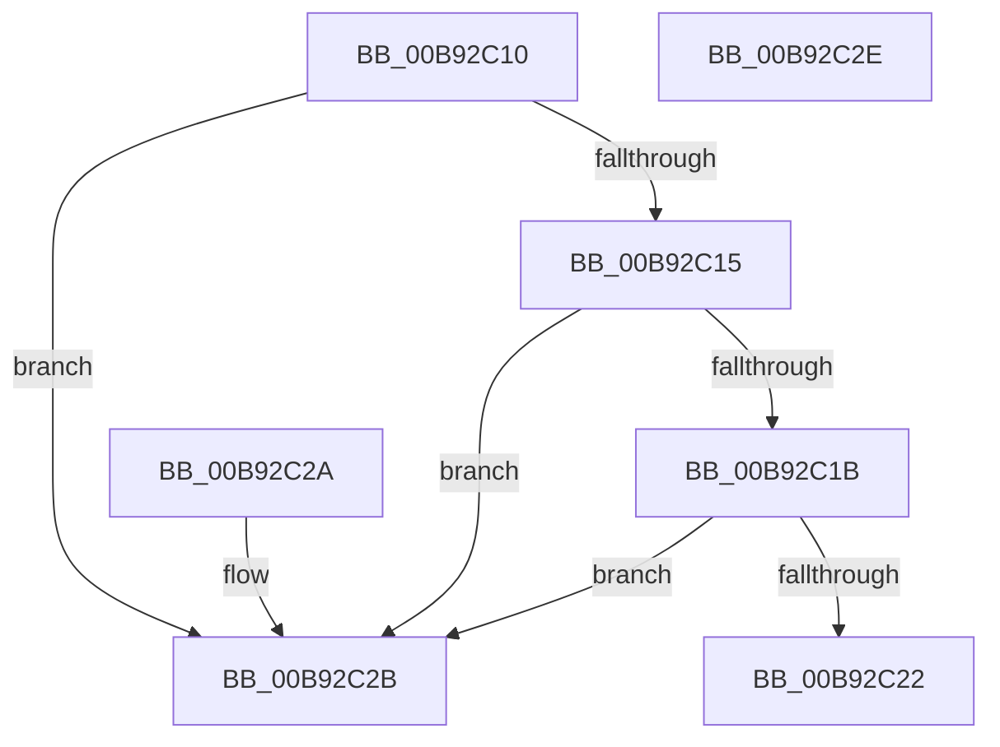

# IovpValidateDeviceObject

- RVA: `0x00B92C10`–`0x00B92C2F` (길이 `31` bytes)
- VA: `0x0000000140B92C10`
- 실행 섹션: `PAGEVRFY`
- PDB 이름 있음: `예`; PDB Function 태그: `아니요`
- unwind 정보 RVA: `0x000DB714`
- 디코드: `13`개 명령, `31/31` bytes 표시
- 미해석 바이트: `0` (있으면 어셈블리에 `.byte`로 보존)

> 이 문서는 커널 이미지의 기계어와 PDB 기호를 분석해 생성했습니다. 4번과 5번은 함수 원형과 자료형을 바이너리 사용 방식에서 추정한 C 해석이며 원본 소스 복구 결과는 아닙니다.

## 1. Dependencies

- 직접 호출 지점: **0**; 고유 호출 대상: **0**
- 직접 호출자로 확인된 함수: **2**
- RIP 상대 이미지 참조: **0**

### Outgoing calls
- 직접 디코드된 call 명령이 없습니다.

### Direct callers
- [IovpCallDriverWithStackBuffer](IovpCallDriverWithStackBuffer_function_00B92940.md) at `0x00B929BC`
- [sub_00BBC34E](../BB/Unknown_function_00BBC34E.md) at `0x00BBC3E3`

### Static image references
- 디코드된 RIP-relative 메모리 참조가 없습니다.

## 2. Other-region calls and transfers

- 다른 실행 섹션으로 향하는 call: **0**
- 별도 외부 분기/꼬리 이동을 확인하지 못했습니다.

## 3. Assembly (complete function range)

```asm
00B92C10  48 85 C9                        test rcx, rcx
00B92C13  74 16                           je 0x140b92c2b
00B92C15  66 83 39 03                     cmp word ptr [rcx], 3
00B92C19  75 10                           jne 0x140b92c2b
00B92C1B  48 83 79 08 00                  cmp qword ptr [rcx + 8], 0
00B92C20  74 09                           je 0x140b92c2b
00B92C22  83 79 04 00                     cmp dword ptr [rcx + 4], 0
00B92C26  0F 9D C0                        setge al
00B92C29  C3                              ret
00B92C2A  CC                              int3
00B92C2B  32 C0                           xor al, al
00B92C2D  C3                              ret
00B92C2E  CC                              int3
```

## 4. C-style interpretation (structured pseudocode)

```c
__int64 __fastcall IovpValidateDeviceObject(__int64 a1)
{
    __int64 result;

    if (a1 == 0) goto loc_00B92C2B;
    if ((*(unsigned __int16 *)(a1)) != 3) goto loc_00B92C2B;
    if ((*(unsigned __int64 *)(a1 + 8)) == 0) goto loc_00B92C2B;
    result = ((*(unsigned int *)(a1 + 4)) >= 0) ? 1 : 0;
    return result;
loc_00B92C2B:
    result = 0;
    return result;
}
```

## 5. (Beta) C Style

```c
int64_t IovpValidateDeviceObject(int64_t Arg1)
{
    int64_t result;

    if (Arg1 == 0) goto loc_00B92C2B;
    if ((*(uint16_t *)(Arg1)) != 3) goto loc_00B92C2B;
    if ((*(uint64_t *)(Arg1 + 0x8)) == 0) goto loc_00B92C2B;
    result = ((*(uint32_t *)(Arg1 + 0x4)) >= 0) ? 1 : 0;
    return result;
loc_00B92C2B:
    result = 0;
    return result;
}
```

## 6. Execution-region graph

[열기: 2D/3D 그래프와 함수 탐색 컨트롤 패널](../../../control-panel.html?section=pagevrfy&rva=0x00B92C10&view=graph)

- 2D 그래프는 위에서 아래로 흐르고, 3D 그래프는 빈 공간을 드래그해 회전합니다. Shift+드래그는 이동, 휠은 확대·축소, 함수 노드 선택은 대상 보고서 이동입니다.

### Static fallback


