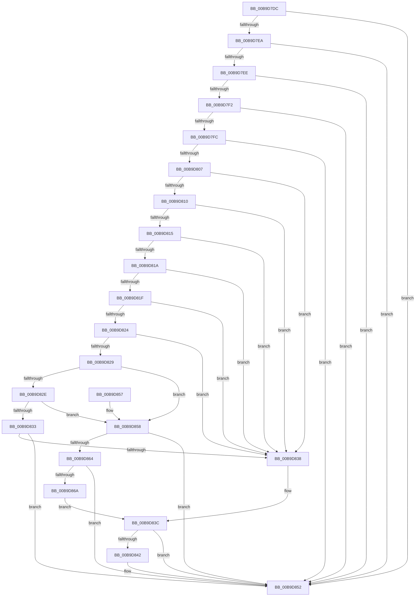

# IovpValidateStatusInformation

- RVA: `0x00B9D7DC`–`0x00B9D873` (길이 `151` bytes)
- VA: `0x0000000140B9D7DC`
- 실행 섹션: `PAGEVRFY`
- PDB 이름 있음: `예`; PDB Function 태그: `아니요`
- unwind 정보 RVA: `0x00094EEC`
- 디코드: `52`개 명령, `151/151` bytes 표시
- 미해석 바이트: `0` (있으면 어셈블리에 `.byte`로 보존)

> 이 문서는 커널 이미지의 기계어와 PDB 기호를 분석해 생성했습니다. 4번과 5번은 함수 원형과 자료형을 바이너리 사용 방식에서 추정한 C 해석이며 원본 소스 복구 결과는 아닙니다.

## 1. Dependencies

- 직접 호출 지점: **1**; 고유 호출 대상: **1**
- 직접 호출자로 확인된 함수: **1**
- RIP 상대 이미지 참조: **0**

### Outgoing calls
- `0x00B9D84D` → [ViErrorReport1](../../text/61/ViErrorReport1_function_00614584.md) (function, `0x00614584`)

### Direct callers
- [sub_00BBBE00](../BB/Unknown_function_00BBBE00.md) at `0x00BBBF44`

### Static image references
- 디코드된 RIP-relative 메모리 참조가 없습니다.

## 2. Other-region calls and transfers

- 다른 실행 섹션으로 향하는 call: **1**
  - `0x00B9D84D` → [ViErrorReport1](../../text/61/ViErrorReport1_function_00614584.md) (`PAGEVRFY` → `.text`)
- 별도 외부 분기/꼬리 이동을 확인하지 못했습니다.

## 3. Assembly (complete function range)

```asm
00B9D7DC  48 83 EC 28                     sub rsp, 0x28
00B9D7E0  8B 42 10                        mov eax, dword ptr [rdx + 0x10]
00B9D7E3  4C 8B D1                        mov r10, rcx
00B9D7E6  A8 10                           test al, 0x10
00B9D7E8  74 68                           je 0x140b9d852
00B9D7EA  A8 40                           test al, 0x40
00B9D7EC  74 64                           je 0x140b9d852
00B9D7EE  A8 20                           test al, 0x20
00B9D7F0  74 60                           je 0x140b9d852
00B9D7F2  8B 42 30                        mov eax, dword ptr [rdx + 0x30]
00B9D7F5  3D 16 00 00 80                  cmp eax, 0x80000016
00B9D7FA  74 56                           je 0x140b9d852
00B9D7FC  B9 00 00 00 C0                  mov ecx, 0xc0000000
00B9D801  23 C1                           and eax, ecx
00B9D803  3B C1                           cmp eax, ecx
00B9D805  74 4B                           je 0x140b9d852
00B9D807  41 0F B6 08                     movzx ecx, byte ptr [r8]
00B9D80B  83 E9 03                        sub ecx, 3
00B9D80E  74 28                           je 0x140b9d838
00B9D810  83 E9 02                        sub ecx, 2
00B9D813  74 23                           je 0x140b9d838
00B9D815  83 E9 02                        sub ecx, 2
00B9D818  74 1E                           je 0x140b9d838
00B9D81A  83 E9 03                        sub ecx, 3
00B9D81D  74 19                           je 0x140b9d838
00B9D81F  83 E9 02                        sub ecx, 2
00B9D822  74 14                           je 0x140b9d838
00B9D824  83 E9 01                        sub ecx, 1
00B9D827  74 0F                           je 0x140b9d838
00B9D829  83 E9 01                        sub ecx, 1
00B9D82C  74 2A                           je 0x140b9d858
00B9D82E  83 E9 01                        sub ecx, 1
00B9D831  74 25                           je 0x140b9d858
00B9D833  83 F9 0A                        cmp ecx, 0xa
00B9D836  75 1A                           jne 0x140b9d852
00B9D838  41 8B 40 08                     mov eax, dword ptr [r8 + 8]
00B9D83C  48 39 42 38                     cmp qword ptr [rdx + 0x38], rax
00B9D840  76 10                           jbe 0x140b9d852
00B9D842  4C 8B C2                        mov r8, rdx
00B9D845  B9 12 03 00 00                  mov ecx, 0x312
00B9D84A  49 8B D1                        mov rdx, r9
00B9D84D  E8 32 6D A7 FF                  call 0x140614584
00B9D852  48 83 C4 28                     add rsp, 0x28
00B9D856  C3                              ret
00B9D857  CC                              int3
00B9D858  49 8B 82 C8 00 00 00            mov rax, qword ptr [r10 + 0xc8]
00B9D85F  48 85 C0                        test rax, rax
00B9D862  74 EE                           je 0x140b9d852
00B9D864  48 3B 42 18                     cmp rax, qword ptr [rdx + 0x18]
00B9D868  75 E8                           jne 0x140b9d852
00B9D86A  41 8B 82 D0 00 00 00            mov eax, dword ptr [r10 + 0xd0]
00B9D871  EB C9                           jmp 0x140b9d83c
```

## 4. C-style interpretation (structured pseudocode)

```c
__int64 __fastcall IovpValidateStatusInformation(__int64 a1, __int64 a2, __int64 a3, __int64 a4)
{
    __int64 result;
    __int64 v_rsp;

    v_rsp = (v_rsp) - (40);
    if ((((unsigned __int8)((unsigned int)(*(unsigned int *)(a2 + 16)))) & (16)) == 0) goto loc_00B9D852;
    if ((((unsigned __int8)((unsigned int)(*(unsigned int *)(a2 + 16)))) & (64)) == 0) goto loc_00B9D852;
    if ((((unsigned __int8)((unsigned int)(*(unsigned int *)(a2 + 16)))) & (32)) == 0) goto loc_00B9D852;
    if (((unsigned int)((unsigned int)(*(unsigned int *)(a2 + 48)))) == 0x80000016ULL) goto loc_00B9D852;
    result = (unsigned int)(((unsigned int)(*(unsigned int *)(a2 + 48))) & ((unsigned int)((unsigned int)(0xC0000000ULL))));
    if (((unsigned int)(result)) == ((unsigned int)((unsigned int)(0xC0000000ULL)))) goto loc_00B9D852;
    a1 = (unsigned int)((*(unsigned __int8 *)(a3)) - (3));
    if (condition_is_equal) goto loc_00B9D838;
    a1 = (unsigned int)((a1) - (2));
    if (condition_is_equal) goto loc_00B9D838;
    a1 = (unsigned int)((a1) - (2));
    if (condition_is_equal) goto loc_00B9D838;
    a1 = (unsigned int)((a1) - (3));
    if (condition_is_equal) goto loc_00B9D838;
    a1 = (unsigned int)((a1) - (2));
    if (condition_is_equal) goto loc_00B9D838;
    a1 = (unsigned int)((a1) - (1));
    if (condition_is_equal) goto loc_00B9D838;
    a1 = (unsigned int)((a1) - (1));
    if (condition_is_equal) goto loc_00B9D858;
    a1 = (unsigned int)((a1) - (1));
    if (condition_is_equal) goto loc_00B9D858;
    if (((unsigned int)(a1)) != 10) goto loc_00B9D852;
loc_00B9D838:
loc_00B9D83C:
    result = (unsigned int)(*(unsigned int *)(a3 + 8));
    if ((*(unsigned __int64 *)(a2 + 56)) >= = ((unsigned int)(*(unsigned int *)(a3 + 8)))) {
        a3 = a2;
        a1 = 786;
        a2 = a4;
        result = ViErrorReport1(a1, a2, a3, a4);
    }
    v_rsp = (v_rsp) + (40);
    return result;
loc_00B9D858:
    if (*(unsigned __int64 *)(a1 + 200) == 0) goto loc_00B9D852;
    if ((*(unsigned __int64 *)(a1 + 200)) != (*(unsigned __int64 *)(a2 + 24))) goto loc_00B9D852;
    goto loc_00B9D83C;
}
```

## 5. (Beta) C Style

```c
int64_t IovpValidateStatusInformation(void *Arg1, void *Arg2, void *Arg3, int64_t Arg4)
{
    uint8_t *arg1 = (uint8_t *)Arg1;
    uint8_t *arg2 = (uint8_t *)Arg2;
    uint8_t *arg3 = (uint8_t *)Arg3;

    int64_t result;
    int64_t local_rsp;

    local_rsp = (local_rsp) - (40);
    if ((((uint8_t)((uint32_t)(*(uint32_t *)(arg2 + 0x10)))) & (16)) == 0) goto loc_00B9D852;
    if ((((uint8_t)((uint32_t)(*(uint32_t *)(arg2 + 0x10)))) & (64)) == 0) goto loc_00B9D852;
    if ((((uint8_t)((uint32_t)(*(uint32_t *)(arg2 + 0x10)))) & (32)) == 0) goto loc_00B9D852;
    if (((uint32_t)((uint32_t)(*(uint32_t *)(arg2 + 0x30)))) == 0x80000016ULL) goto loc_00B9D852;
    result = (uint32_t)(((uint32_t)(*(uint32_t *)(arg2 + 0x30))) & ((uint32_t)((uint32_t)(0xC0000000ULL))));
    if (((uint32_t)(result)) == ((uint32_t)((uint32_t)(0xC0000000ULL)))) goto loc_00B9D852;
    Arg1 = (uint32_t)((*(uint8_t *)(arg3)) - (3));
    if (condition_is_equal) goto loc_00B9D838;
    Arg1 = (uint32_t)((Arg1) - (2));
    if (condition_is_equal) goto loc_00B9D838;
    Arg1 = (uint32_t)((Arg1) - (2));
    if (condition_is_equal) goto loc_00B9D838;
    Arg1 = (uint32_t)((Arg1) - (3));
    if (condition_is_equal) goto loc_00B9D838;
    Arg1 = (uint32_t)((Arg1) - (2));
    if (condition_is_equal) goto loc_00B9D838;
    Arg1 = (uint32_t)((Arg1) - (1));
    if (condition_is_equal) goto loc_00B9D838;
    Arg1 = (uint32_t)((Arg1) - (1));
    if (condition_is_equal) goto loc_00B9D858;
    Arg1 = (uint32_t)((Arg1) - (1));
    if (condition_is_equal) goto loc_00B9D858;
    if (((uint32_t)(Arg1)) != 10) goto loc_00B9D852;
loc_00B9D838:
loc_00B9D83C:
    result = (uint32_t)(*(uint32_t *)(arg3 + 0x8));
    if ((*(uint64_t *)(arg2 + 0x38)) >= = ((uint32_t)(*(uint32_t *)(arg3 + 0x8)))) {
        Arg3 = Arg2;
        Arg1 = 786;
        Arg2 = Arg4;
        result = ViErrorReport1(Arg1, Arg2, Arg3, Arg4);
    }
    local_rsp = (local_rsp) + (40);
    return result;
loc_00B9D858:
    if (*(uint64_t *)(arg1 + 0xC8) == 0) goto loc_00B9D852;
    if ((*(uint64_t *)(arg1 + 0xC8)) != (*(uint64_t *)(arg2 + 0x18))) goto loc_00B9D852;
    goto loc_00B9D83C;
}
```

### 관측된 메모리 오프셋

구조체 형식이 확인되지 않은 접근은 인자 기준의 오프셋으로만 기록했습니다.

| 기준 인자 | 오프셋 표현 | 폭 (bit) | 접근 |
|---|---:|---:|---|
| `Arg1` | `+ 0xC8` | `64` | `R` |
| `Arg1` | `+ 0xD0` | `32` | `R` |
| `Arg2` | `+ 0x10` | `32` | `R` |
| `Arg2` | `+ 0x18` | `64` | `R` |
| `Arg2` | `+ 0x30` | `32` | `R` |
| `Arg2` | `+ 0x38` | `64` | `R` |
| `Arg3` | `+ 0x0` | `8` | `R` |
| `Arg3` | `+ 0x8` | `32` | `R` |

## 6. Execution-region graph

[열기: 2D/3D 그래프와 함수 탐색 컨트롤 패널](../../../control-panel.html?section=pagevrfy&rva=0x00B9D7DC&view=graph)

- 2D 그래프는 위에서 아래로 흐르고, 3D 그래프는 빈 공간을 드래그해 회전합니다. Shift+드래그는 이동, 휠은 확대·축소, 함수 노드 선택은 대상 보고서 이동입니다.

### Static fallback


