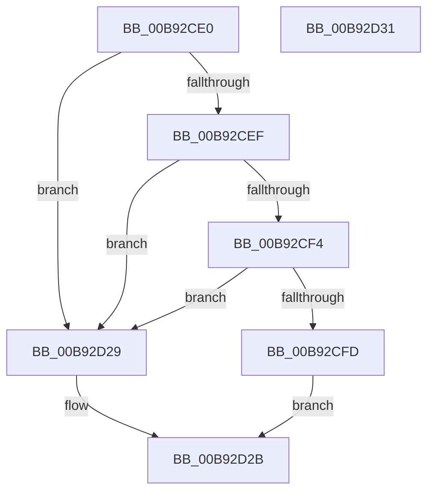

# MmIsDriverSuspectForVerifier

- RVA: `0x00B92CE0`–`0x00B92D32` (길이 `82` bytes)
- VA: `0x0000000140B92CE0`
- 실행 섹션: `PAGEVRFY`
- PDB 이름 있음: `예`; PDB Function 태그: `아니요`
- unwind 정보 RVA: `0x0005CF00`
- 디코드: `24`개 명령, `82/82` bytes 표시
- 미해석 바이트: `0` (있으면 어셈블리에 `.byte`로 보존)

> 이 문서는 커널 이미지의 기계어와 PDB 기호를 분석해 생성했습니다. 4번과 5번은 함수 원형과 자료형을 바이너리 사용 방식에서 추정한 C 해석이며 원본 소스 복구 결과는 아닙니다.

## 1. Dependencies

- 직접 호출 지점: **3**; 고유 호출 대상: **3**
- 직접 호출자로 확인된 함수: **0**
- RIP 상대 이미지 참조: **3**

### Outgoing calls
- `0x00B92CFD` → [VfDriverLock](VfDriverLock_function_00B9A4A4.md) (function, `0x00B9A4A4`)
- `0x00B92D05` → [ViIsDriverSuspectForVerifier](ViIsDriverSuspectForVerifier_function_00B9381C.md) (function, `0x00B9381C`)
- `0x00B92D20` → [KeReleaseMutex](../../text/39/KeReleaseMutex_function_00396810.md) (function, `0x00396810`)

### Direct callers
- 이 함수 시작 RVA로 연결되는 직접 call은 확인되지 않았습니다. 간접 호출은 완전히 역산할 수 없습니다.

### Static image references
- `0x00B92CE6` → RVA `0x00E681A0` (`.data`; read)
- `0x00B92D0C` → RVA `0x00F04938` (`.data`; write)
- `0x00B92D17` → RVA `0x00F04900` (`.data`; read)

## 2. Other-region calls and transfers

- 다른 실행 섹션으로 향하는 call: **1**
  - `0x00B92D20` → [KeReleaseMutex](../../text/39/KeReleaseMutex_function_00396810.md) (`PAGEVRFY` → `.text`)
- 별도 외부 분기/꼬리 이동을 확인하지 못했습니다.

## 3. Assembly (complete function range)

```asm
00B92CE0  40 53                           push rbx
00B92CE2  48 83 EC 20                     sub rsp, 0x20
00B92CE6  83 3D B3 54 2D 00 00            cmp dword ptr [rip + 0x2d54b3], 0
00B92CED  74 3A                           je 0x140b92d29
00B92CEF  48 85 C9                        test rcx, rcx
00B92CF2  74 35                           je 0x140b92d29
00B92CF4  48 8B 59 28                     mov rbx, qword ptr [rcx + 0x28]
00B92CF8  48 85 DB                        test rbx, rbx
00B92CFB  74 2C                           je 0x140b92d29
00B92CFD  E8 A2 77 00 00                  call 0x140b9a4a4
00B92D02  48 8B CB                        mov rcx, rbx
00B92D05  E8 12 0B 00 00                  call 0x140b9381c
00B92D0A  33 D2                           xor edx, edx
00B92D0C  48 C7 05 21 1C 37 00 00 00 00 00  mov qword ptr [rip + 0x371c21], 0
00B92D17  48 8D 0D E2 1B 37 00            lea rcx, [rip + 0x371be2]
00B92D1E  8B D8                           mov ebx, eax
00B92D20  E8 EB 3A 80 FF                  call 0x140396810
00B92D25  8B C3                           mov eax, ebx
00B92D27  EB 02                           jmp 0x140b92d2b
00B92D29  33 C0                           xor eax, eax
00B92D2B  48 83 C4 20                     add rsp, 0x20
00B92D2F  5B                              pop rbx
00B92D30  C3                              ret
00B92D31  CC                              int3
```

## 4. C-style interpretation (structured pseudocode)

```c
__int64 __fastcall MmIsDriverSuspectForVerifier(__int64 a1, int a2)
{
    __int64 result;
    __int64 v_rsp;

    v_rsp = (v_rsp) - (32);
    if ((*(unsigned int *)(v_rip + 2970803)) == 0) goto loc_00B92D29;
    if (a1 == 0) goto loc_00B92D29;
    if (*(unsigned __int64 *)(a1 + 40) == 0) goto loc_00B92D29;
    result = VfDriverLock(a1, a2, a3, a4);
    result = ViIsDriverSuspectForVerifier(*(unsigned __int64 *)(a1 + 40), a2, a3, a4);
    a2 = 0;
    *(unsigned __int64 *)(v_rip + 3611681) = 0;
    result = KeReleaseMutex(v_rip + 3611618, a2, a3, a4);
    goto loc_00B92D2B;
loc_00B92D29:
    result = 0;
loc_00B92D2B:
    v_rsp = (v_rsp) + (32);
    return result;
}
```

## 5. (Beta) C Style

```c
int64_t MmIsDriverSuspectForVerifier(int64_t Arg1, int32_t Arg2)
{
    int64_t result;
    int64_t local_rsp;

    local_rsp = (local_rsp) - (32);
    if ((*(uint32_t *)(v_rip + 0x2D54B3)) == 0) goto loc_00B92D29;
    if (Arg1 == 0) goto loc_00B92D29;
    if (*(uint64_t *)(Arg1 + 0x28) == 0) goto loc_00B92D29;
    result = VfDriverLock(Arg1, Arg2, a3, a4);
    result = ViIsDriverSuspectForVerifier(*(uint64_t *)(Arg1 + 0x28), Arg2, a3, a4);
    Arg2 = 0;
    *(uint64_t *)(v_rip + 0x371C21) = 0;
    result = KeReleaseMutex(v_rip + 3611618, Arg2, a3, a4);
    goto loc_00B92D2B;
loc_00B92D29:
    result = 0;
loc_00B92D2B:
    local_rsp = (local_rsp) + (32);
    return result;
}
```

## 6. Execution-region graph

[열기: 2D/3D 그래프와 함수 탐색 컨트롤 패널](../../../control-panel.html?section=pagevrfy&rva=0x00B92CE0&view=graph)

- 2D 그래프는 위에서 아래로 흐르고, 3D 그래프는 빈 공간을 드래그해 회전합니다. Shift+드래그는 이동, 휠은 확대·축소, 함수 노드 선택은 대상 보고서 이동입니다.

### Static fallback


