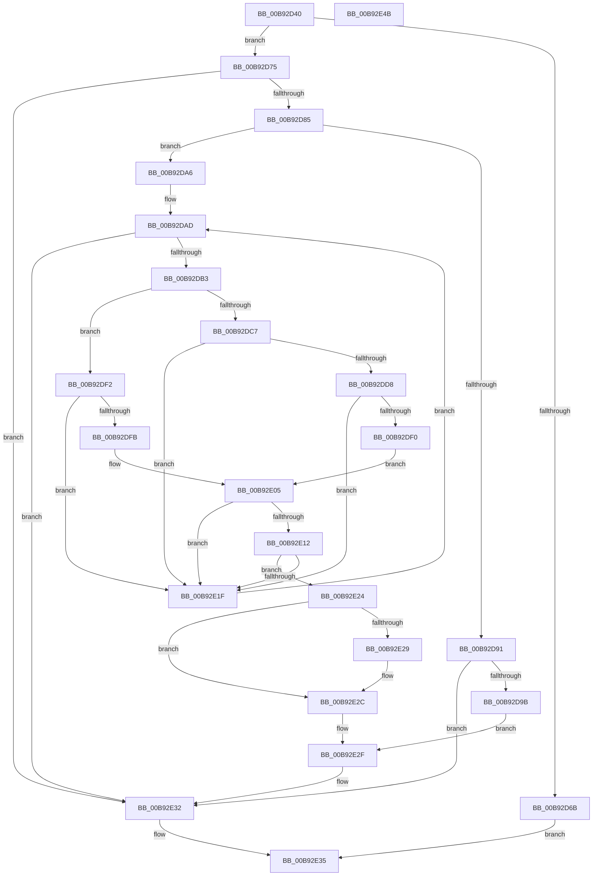

# MmIsVerifierEnabled

- RVA: `0x00B92D40`–`0x00B92E4C` (길이 `268` bytes)
- VA: `0x0000000140B92D40`
- 실행 섹션: `PAGEVRFY`
- PDB 이름 있음: `예`; PDB Function 태그: `아니요`
- unwind 정보 RVA: `0x0006F978`
- 디코드: `70`개 명령, `268/268` bytes 표시
- 미해석 바이트: `0` (있으면 어셈블리에 `.byte`로 보존)

> 이 문서는 커널 이미지의 기계어와 PDB 기호를 분석해 생성했습니다. 4번과 5번은 함수 원형과 자료형을 바이너리 사용 방식에서 추정한 C 해석이며 원본 소스 복구 결과는 아닙니다.

## 1. Dependencies

- 직접 호출 지점: **1**; 고유 호출 대상: **1**
- 직접 호출자로 확인된 함수: **0**
- RIP 상대 이미지 참조: **3**

### Outgoing calls
- `0x00B92D88` → [VfDriverIsKernelImageAddress](../BB/VfDriverIsKernelImageAddress_function_00BB7EBC.md) (function, `0x00BB7EBC`)

### Direct callers
- 이 함수 시작 RVA로 연결되는 직접 call은 확인되지 않았습니다. 간접 호출은 완전히 역산할 수 없습니다.

### Static image references
- `0x00B92D75` → RVA `0x00E681A0` (`.data`; read)
- `0x00B92DA6` → RVA `0x00000000` (`image boundary/outside`; read)
- `0x00B92DF2` → RVA `0x00E681A0` (`.data`; reference)

## 2. Other-region calls and transfers

- 다른 실행 섹션으로 향하는 call: **0**
- 별도 외부 분기/꼬리 이동을 확인하지 못했습니다.

## 3. Assembly (complete function range)

```asm
00B92D40  48 89 5C 24 08                  mov qword ptr [rsp + 8], rbx
00B92D45  48 89 74 24 10                  mov qword ptr [rsp + 0x10], rsi
00B92D4A  48 89 7C 24 18                  mov qword ptr [rsp + 0x18], rdi
00B92D4F  41 56                           push r14
00B92D51  48 83 EC 20                     sub rsp, 0x20
00B92D55  48 8B 74 24 28                  mov rsi, qword ptr [rsp + 0x28]
00B92D5A  45 33 DB                        xor r11d, r11d
00B92D5D  48 8B D9                        mov rbx, rcx
00B92D60  41 B9 BB 00 00 C0               mov r9d, 0xc00000bb
00B92D66  48 85 C9                        test rcx, rcx
00B92D69  75 0A                           jne 0x140b92d75
00B92D6B  B8 0D 00 00 C0                  mov eax, 0xc000000d
00B92D70  E9 C0 00 00 00                  jmp 0x140b92e35
00B92D75  4C 8B 05 24 54 2D 00            mov r8, qword ptr [rip + 0x2d5424]
00B92D7C  45 85 C0                        test r8d, r8d
00B92D7F  0F 84 AD 00 00 00               je 0x140b92e32
00B92D85  48 8B CE                        mov rcx, rsi
00B92D88  E8 2F 51 02 00                  call 0x140bb7ebc
00B92D8D  85 C0                           test eax, eax
00B92D8F  74 15                           je 0x140b92da6
00B92D91  41 F6 C0 02                     test r8b, 2
00B92D95  0F 84 97 00 00 00               je 0x140b92e32
00B92D9B  C7 03 02 00 00 00               mov dword ptr [rbx], 2
00B92DA1  E9 89 00 00 00                  jmp 0x140b92e2f
00B92DA6  4C 8D 35 53 D2 46 FF            lea r14, [rip - 0xb92dad]
00B92DAD  41 83 FB 08                     cmp r11d, 8
00B92DB1  73 7F                           jae 0x140b92e32
00B92DB3  45 8B D3                        mov r10d, r11d
00B92DB6  49 C1 E2 05                     shl r10, 5
00B92DBA  47 8B 84 32 18 8F E0 00         mov r8d, dword ptr [r10 + r14 + 0xe08f18]
00B92DC2  45 85 C0                        test r8d, r8d
00B92DC5  75 2B                           jne 0x140b92df2
00B92DC7  49 8D BE 1C 8F E0 00            lea rdi, [r14 + 0xe08f1c]
00B92DCE  49 03 FA                        add rdi, r10
00B92DD1  8B 07                           mov eax, dword ptr [rdi]
00B92DD3  83 F8 40                        cmp eax, 0x40
00B92DD6  73 47                           jae 0x140b92e1f
00B92DD8  8B D0                           mov edx, eax
00B92DDA  24 1F                           and al, 0x1f
00B92DDC  48 C1 EA 05                     shr rdx, 5
00B92DE0  0F B6 C8                        movzx ecx, al
00B92DE3  41 8B 84 96 A0 81 E6 00         mov eax, dword ptr [r14 + rdx*4 + 0xe681a0]
00B92DEB  0F A3 C8                        bt eax, ecx
00B92DEE  73 2F                           jae 0x140b92e1f
00B92DF0  EB 13                           jmp 0x140b92e05
00B92DF2  44 85 05 A7 53 2D 00            test dword ptr [rip + 0x2d53a7], r8d
00B92DF9  74 24                           je 0x140b92e1f
00B92DFB  49 8D BE 1C 8F E0 00            lea rdi, [r14 + 0xe08f1c]
00B92E02  49 03 FA                        add rdi, r10
00B92E05  4B 8B 8C 32 08 8F E0 00         mov rcx, qword ptr [r10 + r14 + 0xe08f08]
00B92E0D  48 3B F1                        cmp rsi, rcx
00B92E10  76 0D                           jbe 0x140b92e1f
00B92E12  4B 03 8C 32 10 8F E0 00         add rcx, qword ptr [r10 + r14 + 0xe08f10]
00B92E1A  48 3B F1                        cmp rsi, rcx
00B92E1D  72 05                           jb 0x140b92e24
00B92E1F  41 FF C3                        inc r11d
00B92E22  EB 89                           jmp 0x140b92dad
00B92E24  45 85 C0                        test r8d, r8d
00B92E27  75 03                           jne 0x140b92e2c
00B92E29  44 8B 07                        mov r8d, dword ptr [rdi]
00B92E2C  44 89 03                        mov dword ptr [rbx], r8d
00B92E2F  45 33 C9                        xor r9d, r9d
00B92E32  41 8B C1                        mov eax, r9d
00B92E35  48 8B 5C 24 30                  mov rbx, qword ptr [rsp + 0x30]
00B92E3A  48 8B 74 24 38                  mov rsi, qword ptr [rsp + 0x38]
00B92E3F  48 8B 7C 24 40                  mov rdi, qword ptr [rsp + 0x40]
00B92E44  48 83 C4 20                     add rsp, 0x20
00B92E48  41 5E                           pop r14
00B92E4A  C3                              ret
00B92E4B  CC                              int3
```

## 4. C-style interpretation (structured pseudocode)

```c
__int64 __fastcall MmIsVerifierEnabled(__int64 a1)
{
    __int64 result;
    __int64 v_r10;
    __int64 v_r11;
    __int64 v_rdi;
    __int64 v_rsp;
    unsigned __int64 v_stack_p0;
    unsigned __int64 v_stack_p10;
    unsigned __int64 v_stack_p18;
    unsigned __int64 v_stack_p8;

    v_stack_p8 = v_rbx;
    v_stack_p10 = v_rsi;
    v_stack_p18 = v_rdi;
    v_rsp = (v_rsp) - (32);
    v_r11 = 0;
    if (a1 != 0) goto loc_00B92D75;
    goto loc_00B92E35;
loc_00B92D75:
    if ((unsigned int)(*(unsigned __int64 *)(v_rip + 2970660)) == 0) goto loc_00B92E32;
    result = VfDriverIsKernelImageAddress(v_stack_p0, a2, *(unsigned __int64 *)(v_rip + 2970660), (unsigned int)(0xC00000BBULL));
    if ((unsigned int)(result) == 0) goto loc_00B92DA6;
    if ((((unsigned __int8)(*(unsigned __int64 *)(v_rip + 2970660))) & (2)) == 0) goto loc_00B92E32;
    *(unsigned int *)(a1) = 2;
    goto loc_00B92E2F;
loc_00B92DA6:
loc_00B92DAD:
    if (0 >= 8) goto loc_00B92E32;
    v_r10 = (0) << (5);
    if ((unsigned int)((unsigned int)(*(unsigned int *)(v_r10 + v_rip - 12135853 * 1 + 14716696))) != 0) goto loc_00B92DF2;
    v_rdi = (v_rip - 12135853 + 14716700) + (v_r10);
    if (((unsigned int)((unsigned int)(*(unsigned int *)(v_rdi)))) >= 64) goto loc_00B92E1F;
    result = (unsigned __int8)(((unsigned int)(*(unsigned int *)(v_rdi))) & (31));
    a2 = ((unsigned int)((unsigned int)((unsigned int)(*(unsigned int *)(v_rdi))))) >> (5);
    if (condition_is_above_or_equal) goto loc_00B92E1F;
    goto loc_00B92E05;
loc_00B92DF2:
    if (((*(unsigned int *)(v_rip + 2970535)) & ((unsigned int)((unsigned int)(*(unsigned int *)(v_r10 + v_rip - 12135853 * 1 + 14716696))))) == 0) goto loc_00B92E1F;
    v_rdi = (v_rip - 12135853 + 14716700) + (v_r10);
loc_00B92E05:
    if (v_stack_p0 <= (*(unsigned __int64 *)(v_r10 + v_rip - 12135853 * 1 + 14716680))) goto loc_00B92E1F;
    a1 = (*(unsigned __int64 *)(v_r10 + v_rip - 12135853 * 1 + 14716680)) + (*(unsigned __int64 *)(v_r10 + v_rip - 12135853 * 1 + 14716688));
    if (v_stack_p0 < a1) goto loc_00B92E24;
loc_00B92E1F:
    v_r11 = (unsigned int)((v_r11) + 1);
    goto loc_00B92DAD;
loc_00B92E24:
    if ((unsigned int)((unsigned int)(*(unsigned int *)(v_r10 + v_rip - 12135853 * 1 + 14716696))) == 0) {
        a3 = *(unsigned int *)(v_rdi);
    }
    *(unsigned int *)(a1) = (unsigned int)(a3);
loc_00B92E2F:
    a4 = 0;
loc_00B92E32:
loc_00B92E35:
    v_rsp = (v_rsp) + (32);
    return 0;
}
```

## 5. (Beta) C Style

```c
int64_t MmIsVerifierEnabled(void *Arg1)
{
    uint8_t *arg1 = (uint8_t *)Arg1;

    int64_t result;
    int64_t local_r10;
    int64_t local_r11;
    int64_t local_rdi;
    int64_t local_rsp;
    uint64_t v_stack_p0;
    uint64_t v_stack_p10;
    uint64_t v_stack_p18;
    uint64_t v_stack_p8;

    v_stack_p8 = local_rbx;
    v_stack_p10 = local_rsi;
    v_stack_p18 = local_rdi;
    local_rsp = (local_rsp) - (32);
    local_r11 = 0;
    if (Arg1 != NULL) goto loc_00B92D75;
    goto loc_00B92E35;
loc_00B92D75:
    if ((uint32_t)(*(uint64_t *)(v_rip + 0x2D5424)) == 0) goto loc_00B92E32;
    result = VfDriverIsKernelImageAddress(v_stack_p0, a2, *(uint64_t *)(v_rip + 0x2D5424), (uint32_t)(0xC00000BBULL));
    if ((uint32_t)(result) == 0) goto loc_00B92DA6;
    if ((((uint8_t)(*(uint64_t *)(v_rip + 0x2D5424))) & (2)) == 0) goto loc_00B92E32;
    *(uint32_t *)(arg1) = 2;
    goto loc_00B92E2F;
loc_00B92DA6:
loc_00B92DAD:
    if (0 >= 8) goto loc_00B92E32;
    local_r10 = (0) << (5);
    if ((uint32_t)((uint32_t)(*(uint32_t *)(local_r10 + v_rip - 0xB92DAD * 1 + 0xE08F18))) != 0) goto loc_00B92DF2;
    local_rdi = (v_rip - 12135853 + 14716700) + (local_r10);
    if (((uint32_t)((uint32_t)(*(uint32_t *)(local_rdi)))) >= 64) goto loc_00B92E1F;
    result = (uint8_t)(((uint32_t)(*(uint32_t *)(local_rdi))) & (31));
    a2 = ((uint32_t)((uint32_t)((uint32_t)(*(uint32_t *)(local_rdi))))) >> (5);
    if (condition_is_above_or_equal) goto loc_00B92E1F;
    goto loc_00B92E05;
loc_00B92DF2:
    if (((*(uint32_t *)(v_rip + 0x2D53A7)) & ((uint32_t)((uint32_t)(*(uint32_t *)(local_r10 + v_rip - 0xB92DAD * 1 + 0xE08F18))))) == 0) goto loc_00B92E1F;
    local_rdi = (v_rip - 12135853 + 14716700) + (local_r10);
loc_00B92E05:
    if (v_stack_p0 <= (*(uint64_t *)(local_r10 + v_rip - 0xB92DAD * 1 + 0xE08F08))) goto loc_00B92E1F;
    Arg1 = (*(uint64_t *)(local_r10 + v_rip - 0xB92DAD * 1 + 0xE08F08)) + (*(uint64_t *)(local_r10 + v_rip - 0xB92DAD * 1 + 0xE08F10));
    if (v_stack_p0 < Arg1) goto loc_00B92E24;
loc_00B92E1F:
    local_r11 = (uint32_t)((local_r11) + 1);
    goto loc_00B92DAD;
loc_00B92E24:
    if ((uint32_t)((uint32_t)(*(uint32_t *)(local_r10 + v_rip - 0xB92DAD * 1 + 0xE08F18))) == 0) {
        a3 = *(uint32_t *)(local_rdi);
    }
    *(uint32_t *)(arg1) = (uint32_t)(a3);
loc_00B92E2F:
    a4 = 0;
loc_00B92E32:
loc_00B92E35:
    local_rsp = (local_rsp) + (32);
    return 0;
}
```

### 관측된 메모리 오프셋

구조체 형식이 확인되지 않은 접근은 인자 기준의 오프셋으로만 기록했습니다.

| 기준 인자 | 오프셋 표현 | 폭 (bit) | 접근 |
|---|---:|---:|---|
| `Arg1` | `+ 0x0` | `32` | `W` |

## 6. Execution-region graph

[열기: 2D/3D 그래프와 함수 탐색 컨트롤 패널](../../../control-panel.html?section=pagevrfy&rva=0x00B92D40&view=graph)

- 2D 그래프는 위에서 아래로 흐르고, 3D 그래프는 빈 공간을 드래그해 회전합니다. Shift+드래그는 이동, 휠은 확대·축소, 함수 노드 선택은 대상 보고서 이동입니다.

### Static fallback


