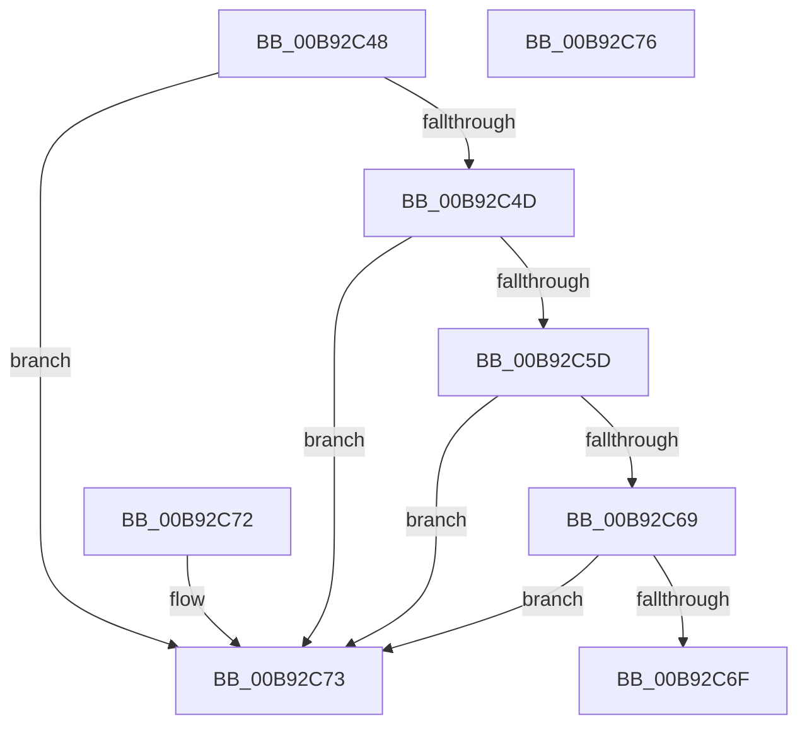

# PpvUtilIsHardwareBeingVerified

- RVA: `0x00B92C48`–`0x00B92C77` (길이 `47` bytes)
- VA: `0x0000000140B92C48`
- 실행 섹션: `PAGEVRFY`
- PDB 이름 있음: `예`; PDB Function 태그: `아니요`
- unwind 정보 RVA: `0x000DB714`
- 디코드: `17`개 명령, `47/47` bytes 표시
- 미해석 바이트: `0` (있으면 어셈블리에 `.byte`로 보존)

> 이 문서는 커널 이미지의 기계어와 PDB 기호를 분석해 생성했습니다. 4번과 5번은 함수 원형과 자료형을 바이너리 사용 방식에서 추정한 C 해석이며 원본 소스 복구 결과는 아닙니다.

## 1. Dependencies

- 직접 호출 지점: **0**; 고유 호출 대상: **0**
- 직접 호출자로 확인된 함수: **2**
- RIP 상대 이미지 참조: **0**

### Outgoing calls
- 직접 디코드된 call 명령이 없습니다.

### Direct callers
- [VfFailDeviceNode](../../text/4B/VfFailDeviceNode_function_004B4EC0.md) at `0x004B4EE0`
- [sub_006FC1AC](../../text/6F/Unknown_function_006FC1AC.md) at `0x006FC1D7`

### Static image references
- 디코드된 RIP-relative 메모리 참조가 없습니다.

## 2. Other-region calls and transfers

- 다른 실행 섹션으로 향하는 call: **0**
- 별도 외부 분기/꼬리 이동을 확인하지 못했습니다.

## 3. Assembly (complete function range)

```asm
00B92C48  48 85 C9                        test rcx, rcx
00B92C4B  74 26                           je 0x140b92c73
00B92C4D  48 8B 81 38 01 00 00            mov rax, qword ptr [rcx + 0x138]
00B92C54  48 8B 40 28                     mov rax, qword ptr [rax + 0x28]
00B92C58  48 85 C0                        test rax, rax
00B92C5B  74 16                           je 0x140b92c73
00B92C5D  8B 80 8C 01 00 00               mov eax, dword ptr [rax + 0x18c]
00B92C63  0F BA E0 11                     bt eax, 0x11
00B92C67  72 0A                           jb 0x140b92c73
00B92C69  0F BA E0 0F                     bt eax, 0xf
00B92C6D  73 04                           jae 0x140b92c73
00B92C6F  B0 01                           mov al, 1
00B92C71  C3                              ret
00B92C72  CC                              int3
00B92C73  32 C0                           xor al, al
00B92C75  C3                              ret
00B92C76  CC                              int3
```

## 4. C-style interpretation (structured pseudocode)

```c
__int64 __fastcall PpvUtilIsHardwareBeingVerified(__int64 a1)
{
    __int64 result;

    if (a1 == 0) goto loc_00B92C73;
    if (*(unsigned __int64 *)(*(unsigned __int64 *)(a1 + 312) + 40) == 0) goto loc_00B92C73;
    if (condition_is_below) goto loc_00B92C73;
    if (condition_is_above_or_equal) goto loc_00B92C73;
    return 1;
loc_00B92C73:
    result = 0;
    return result;
}
```

## 5. (Beta) C Style

```c
int64_t PpvUtilIsHardwareBeingVerified(int64_t Arg1)
{
    int64_t result;

    if (Arg1 == 0) goto loc_00B92C73;
    if (*(uint64_t *)(*(uint64_t *)(Arg1 + 0x138) + 0x28) == 0) goto loc_00B92C73;
    if (condition_is_below) goto loc_00B92C73;
    if (condition_is_above_or_equal) goto loc_00B92C73;
    return 1;
loc_00B92C73:
    result = 0;
    return result;
}
```

## 6. Execution-region graph

[열기: 2D/3D 그래프와 함수 탐색 컨트롤 패널](../../../control-panel.html?section=pagevrfy&rva=0x00B92C48&view=graph)

- 2D 그래프는 위에서 아래로 흐르고, 3D 그래프는 빈 공간을 드래그해 회전합니다. Shift+드래그는 이동, 휠은 확대·축소, 함수 노드 선택은 대상 보고서 이동입니다.

### Static fallback


