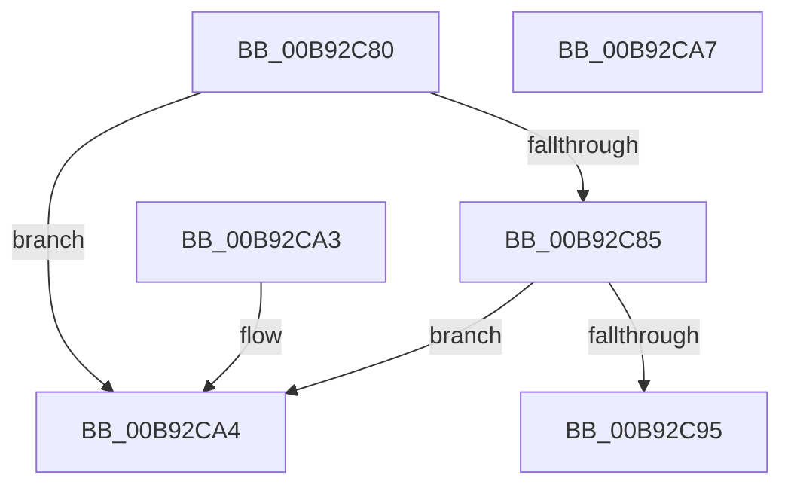

# PpvUtilIsPdo

- RVA: `0x00B92C80`–`0x00B92CA8` (길이 `40` bytes)
- VA: `0x0000000140B92C80`
- 실행 섹션: `PAGEVRFY`
- PDB 이름 있음: `예`; PDB Function 태그: `아니요`
- unwind 정보 RVA: `0x000DB714`
- 디코드: `15`개 명령, `40/40` bytes 표시
- 미해석 바이트: `0` (있으면 어셈블리에 `.byte`로 보존)

> 이 문서는 커널 이미지의 기계어와 PDB 기호를 분석해 생성했습니다. 4번과 5번은 함수 원형과 자료형을 바이너리 사용 방식에서 추정한 C 해석이며 원본 소스 복구 결과는 아닙니다.

## 1. Dependencies

- 직접 호출 지점: **0**; 고유 호출 대상: **0**
- 직접 호출자로 확인된 함수: **2**
- RIP 상대 이미지 참조: **0**

### Outgoing calls
- 직접 디코드된 call 명령이 없습니다.

### Direct callers
- [IovUtilIsWdmStack](../BA/IovUtilIsWdmStack_function_00BA2C68.md) at `0x00BA2C76`
- [VfPnpVerifyIrpStackUpward](../BB/VfPnpVerifyIrpStackUpward_function_00BB58E0.md) at `0x00BB5A68`

### Static image references
- 디코드된 RIP-relative 메모리 참조가 없습니다.

## 2. Other-region calls and transfers

- 다른 실행 섹션으로 향하는 call: **0**
- 별도 외부 분기/꼬리 이동을 확인하지 못했습니다.

## 3. Assembly (complete function range)

```asm
00B92C80  48 85 C9                        test rcx, rcx
00B92C83  74 1F                           je 0x140b92ca4
00B92C85  48 8B 81 38 01 00 00            mov rax, qword ptr [rcx + 0x138]
00B92C8C  48 8B 40 28                     mov rax, qword ptr [rax + 0x28]
00B92C90  48 85 C0                        test rax, rax
00B92C93  74 0F                           je 0x140b92ca4
00B92C95  8B 80 8C 01 00 00               mov eax, dword ptr [rax + 0x18c]
00B92C9B  C1 E8 11                        shr eax, 0x11
00B92C9E  F6 D0                           not al
00B92CA0  24 01                           and al, 1
00B92CA2  C3                              ret
00B92CA3  CC                              int3
00B92CA4  32 C0                           xor al, al
00B92CA6  C3                              ret
00B92CA7  CC                              int3
```

## 4. C-style interpretation (structured pseudocode)

```c
__int64 __fastcall PpvUtilIsPdo(__int64 a1)
{
    __int64 result;

    if (a1 == 0) goto loc_00B92CA4;
    if (*(unsigned __int64 *)(*(unsigned __int64 *)(a1 + 312) + 40) == 0) goto loc_00B92CA4;
    result = (unsigned int)(((unsigned int)(*(unsigned int *)(*(unsigned __int64 *)(*(unsigned __int64 *)(a1 + 312) + 40) + 396))) >> (17));
    result = (unsigned __int8)(~(result));
    result = (unsigned __int8)((result) & (1));
    return result;
loc_00B92CA4:
    result = 0;
    return result;
}
```

## 5. (Beta) C Style

```c
int64_t PpvUtilIsPdo(int64_t Arg1)
{
    int64_t result;

    if (Arg1 == 0) goto loc_00B92CA4;
    if (*(uint64_t *)(*(uint64_t *)(Arg1 + 0x138) + 0x28) == 0) goto loc_00B92CA4;
    result = (uint32_t)(((uint32_t)(*(uint32_t *)(*(uint64_t *)(*(uint64_t *)(Arg1 + 0x138) + 0x28) + 0x18C))) >> (17));
    result = (uint8_t)(~(result));
    result = (uint8_t)((result) & (1));
    return result;
loc_00B92CA4:
    result = 0;
    return result;
}
```

## 6. Execution-region graph

[열기: 2D/3D 그래프와 함수 탐색 컨트롤 패널](../../../control-panel.html?section=pagevrfy&rva=0x00B92C80&view=graph)

- 2D 그래프는 위에서 아래로 흐르고, 3D 그래프는 빈 공간을 드래그해 회전합니다. Shift+드래그는 이동, 휠은 확대·축소, 함수 노드 선택은 대상 보고서 이동입니다.

### Static fallback


