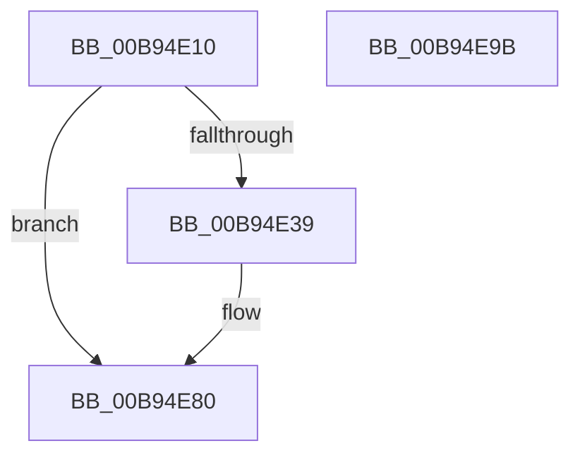

# SUBTRACT_MAP_REGISTERS

- RVA: `0x00B94E10`–`0x00B94E9C` (길이 `140` bytes)
- VA: `0x0000000140B94E10`
- 실행 섹션: `PAGEVRFY`
- PDB 이름 있음: `예`; PDB Function 태그: `아니요`
- unwind 정보 RVA: `0x00066400`
- 디코드: `38`개 명령, `140/140` bytes 표시
- 미해석 바이트: `0` (있으면 어셈블리에 `.byte`로 보존)

> 이 문서는 커널 이미지의 기계어와 PDB 기호를 분석해 생성했습니다. 4번과 5번은 함수 원형과 자료형을 바이너리 사용 방식에서 추정한 C 해석이며 원본 소스 복구 결과는 아닙니다.

## 1. Dependencies

- 직접 호출 지점: **2**; 고유 호출 대상: **2**
- 직접 호출자로 확인된 함수: **9**
- RIP 상대 이미지 참조: **2**

### Outgoing calls
- `0x00B94E5E` → [ViHalPreprocessOptions](ViHalPreprocessOptions_function_00B9920C.md) (function, `0x00B9920C`)
- `0x00B94E7B` → [VfReportIssueWithOptions](../../text/61/VfReportIssueWithOptions_function_00614444.md) (function, `0x00614444`)

### Direct callers
- [ViFlushZeroMapRegisterBaseWcbs](../../text/61/ViFlushZeroMapRegisterBaseWcbs_function_00612D2C.md) at `0x00612DA2`
- [VfAllocateAdapterChannel](VfAllocateAdapterChannel_function_00B95180.md) at `0x00B95303`
- [VfAllocateAdapterChannelEx](VfAllocateAdapterChannelEx_function_00B95360.md) at `0x00B9553F`
- [VfCancelAdapterChannel](VfCancelAdapterChannel_function_00B95FD0.md) at `0x00B9604F`
- [VfFreeAdapterChannel](VfFreeAdapterChannel_function_00B96480.md) at `0x00B964EC`
- [VfFreeAdapterObject](VfFreeAdapterObject_function_00B96530.md) at `0x00B96610`
- [VfFreeMapRegisters](VfFreeMapRegisters_function_00B967D0.md) at `0x00B96884`
- [VfPutScatterGatherList](VfPutScatterGatherList_function_00B97970.md) at `0x00B97A48`
- [ViAdapterCallback](ViAdapterCallback_function_00B97B40.md) at `0x00B97C4B`

### Static image references
- `0x00B94E42` → RVA `0x00E0E9AC` (`.data`; read)
- `0x00B94E57` → RVA `0x00BBA1D0` (` ?? ::JKADOLAD::`string'`; read)

## 2. Other-region calls and transfers

- 다른 실행 섹션으로 향하는 call: **1**
  - `0x00B94E7B` → [VfReportIssueWithOptions](../../text/61/VfReportIssueWithOptions_function_00614444.md) (`PAGEVRFY` → `.text`)
- 별도 외부 분기/꼬리 이동을 확인하지 못했습니다.

## 3. Assembly (complete function range)

```asm
00B94E10  4C 8B DC                        mov r11, rsp
00B94E13  49 89 5B 08                     mov qword ptr [r11 + 8], rbx
00B94E17  49 89 6B 10                     mov qword ptr [r11 + 0x10], rbp
00B94E1B  49 89 73 18                     mov qword ptr [r11 + 0x18], rsi
00B94E1F  57                              push rdi
00B94E20  48 83 EC 30                     sub rsp, 0x30
00B94E24  8B C2                           mov eax, edx
00B94E26  48 8B F9                        mov rdi, rcx
00B94E29  F7 D8                           neg eax
00B94E2B  F0 0F C1 81 C0 00 00 00         lock xadd dword ptr [rcx + 0xc0], eax
00B94E33  33 F6                           xor esi, esi
00B94E35  2B C2                           sub eax, edx
00B94E37  79 47                           jns 0x140b94e80
00B94E39  F7 D8                           neg eax
00B94E3B  49 89 73 F0                     mov qword ptr [r11 - 0x10], rsi
00B94E3F  48 63 D8                        movsxd rbx, eax
00B94E42  48 8D 2D 63 9B 27 00            lea rbp, [rip + 0x279b63]
00B94E49  4C 8B CB                        mov r9, rbx
00B94E4C  49 89 73 E8                     mov qword ptr [r11 - 0x18], rsi
00B94E50  44 8D 46 05                     lea r8d, [rsi + 5]
00B94E54  48 8B CD                        mov rcx, rbp
00B94E57  48 8D 15 72 53 02 00            lea rdx, [rip + 0x25372]
00B94E5E  E8 A9 43 00 00                  call 0x140b9920c
00B94E63  45 33 C9                        xor r9d, r9d
00B94E66  48 89 6C 24 28                  mov qword ptr [rsp + 0x28], rbp
00B94E6B  4C 8B C3                        mov r8, rbx
00B94E6E  48 89 74 24 20                  mov qword ptr [rsp + 0x20], rsi
00B94E73  8D 56 05                        lea edx, [rsi + 5]
00B94E76  B9 E6 00 00 00                  mov ecx, 0xe6
00B94E7B  E8 C4 F5 A7 FF                  call 0x140614444
00B94E80  87 B7 DC 00 00 00               xchg dword ptr [rdi + 0xdc], esi
00B94E86  48 8B 74 24 50                  mov rsi, qword ptr [rsp + 0x50]
00B94E8B  48 8B 5C 24 40                  mov rbx, qword ptr [rsp + 0x40]
00B94E90  48 8B 6C 24 48                  mov rbp, qword ptr [rsp + 0x48]
00B94E95  48 83 C4 30                     add rsp, 0x30
00B94E99  5F                              pop rdi
00B94E9A  C3                              ret
00B94E9B  CC                              int3
```

## 4. C-style interpretation (structured pseudocode)

```c
__int64 __fastcall SUBTRACT_MAP_REGISTERS(__int64 a1, int a2)
{
    __int64 result;
    __int64 v_rbp;
    __int64 v_rbx;
    __int64 v_rsi;
    __int64 v_rsp;
    unsigned __int64 v_stack_m10;
    unsigned __int64 v_stack_m18;
    unsigned __int64 v_stack_p10;
    unsigned __int64 v_stack_p18;
    unsigned __int64 v_stack_p8;

    *(unsigned __int64 *)(v_rsp + 8) = v_rbx;
    *(unsigned __int64 *)(v_rsp + 16) = v_rbp;
    *(unsigned __int64 *)(v_rsp + 24) = v_rsi;
    v_rsp = (v_rsp) - (48);
    result = (unsigned int)(-((unsigned int)(a2)));
    v_rsi = 0;
    result = (unsigned int)((result) - (a2));
    if (sign_flag) {
        result = (unsigned int)(-(result));
        *(unsigned __int64 *)(v_rsp - 16) = 0;
        v_rbx = (int)((unsigned int)(result));
        v_rbp = v_rip + 2595683;
        a4 = v_rbx;
        *(unsigned __int64 *)(v_rsp - 24) = 0;
        a3 = v_rsi + 5;
        a1 = v_rbp;
        a2 = v_rip + 152434;
        result = ViHalPreprocessOptions(a1, a2, a3, a4);
        a4 = 0;
        v_stack_m10 = v_rbp;
        a3 = v_rbx;
        v_stack_m18 = 0;
        a2 = v_rsi + 5;
        a1 = 230;
        result = VfReportIssueWithOptions(a1, a2, a3, a4);
    }
    v_rsp = (v_rsp) + (48);
    return result;
}
```

## 5. (Beta) C Style

```c
int64_t SUBTRACT_MAP_REGISTERS(void *Arg1, int32_t Arg2)
{
    uint8_t *arg1 = (uint8_t *)Arg1;

    int64_t result;
    int64_t local_rbp;
    int64_t local_rbx;
    int64_t local_rsi;
    int64_t local_rsp;
    uint64_t v_stack_m10;
    uint64_t v_stack_m18;
    uint64_t v_stack_p10;
    uint64_t v_stack_p18;
    uint64_t v_stack_p8;

    *(uint64_t *)(local_rsp + 0x8) = local_rbx;
    *(uint64_t *)(local_rsp + 0x10) = local_rbp;
    *(uint64_t *)(local_rsp + 0x18) = local_rsi;
    local_rsp = (local_rsp) - (48);
    result = (uint32_t)(-((uint32_t)(Arg2)));
    local_rsi = 0;
    result = (uint32_t)((result) - (Arg2));
    if (sign_flag) {
        result = (uint32_t)(-(result));
        *(uint64_t *)(local_rsp - 0x10) = 0;
        local_rbx = (int32_t)((uint32_t)(result));
        local_rbp = v_rip + 2595683;
        a4 = local_rbx;
        *(uint64_t *)(local_rsp - 0x18) = 0;
        a3 = local_rsi + 5;
        Arg1 = local_rbp;
        Arg2 = v_rip + 152434;
        result = ViHalPreprocessOptions(Arg1, Arg2, a3, a4);
        a4 = 0;
        v_stack_m10 = local_rbp;
        a3 = local_rbx;
        v_stack_m18 = 0;
        Arg2 = local_rsi + 5;
        Arg1 = 230;
        result = VfReportIssueWithOptions(Arg1, Arg2, a3, a4);
    }
    local_rsp = (local_rsp) + (48);
    return result;
}
```

### 관측된 메모리 오프셋

구조체 형식이 확인되지 않은 접근은 인자 기준의 오프셋으로만 기록했습니다.

| 기준 인자 | 오프셋 표현 | 폭 (bit) | 접근 |
|---|---:|---:|---|
| `Arg1` | `+ 0xC0` | `32` | `R/W` |
| `Arg1` | `+ 0xDC` | `32` | `R/W` |

## 6. Execution-region graph

[열기: 2D/3D 그래프와 함수 탐색 컨트롤 패널](../../../control-panel.html?section=pagevrfy&rva=0x00B94E10&view=graph)

- 2D 그래프는 위에서 아래로 흐르고, 3D 그래프는 빈 공간을 드래그해 회전합니다. Shift+드래그는 이동, 휠은 확대·축소, 함수 노드 선택은 대상 보고서 이동입니다.

### Static fallback


