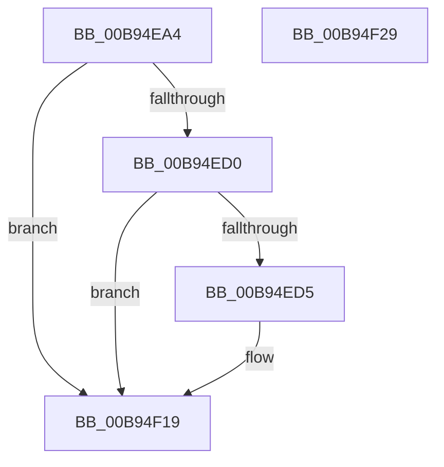

# VERIFY_BUFFER_LOCKED

- RVA: `0x00B94EA4`–`0x00B94F2A` (길이 `134` bytes)
- VA: `0x0000000140B94EA4`
- 실행 섹션: `PAGEVRFY`
- PDB 이름 있음: `예`; PDB Function 태그: `아니요`
- unwind 정보 RVA: `0x000CC43C`
- 디코드: `36`개 명령, `134/134` bytes 표시
- 미해석 바이트: `0` (있으면 어셈블리에 `.byte`로 보존)

> 이 문서는 커널 이미지의 기계어와 PDB 기호를 분석해 생성했습니다. 4번과 5번은 함수 원형과 자료형을 바이너리 사용 방식에서 추정한 C 해석이며 원본 소스 복구 결과는 아닙니다.

## 1. Dependencies

- 직접 호출 지점: **3**; 고유 호출 대상: **3**
- 직접 호출자로 확인된 함수: **6**
- RIP 상대 이미지 참조: **2**

### Outgoing calls
- `0x00B94EC5` → [MmAreMdlPagesLocked](../BB/MmAreMdlPagesLocked_function_00BB4684.md) (function, `0x00BB4684`)
- `0x00B94EF7` → [ViHalPreprocessOptions](ViHalPreprocessOptions_function_00B9920C.md) (function, `0x00B9920C`)
- `0x00B94F14` → [VfReportIssueWithOptions](../../text/61/VfReportIssueWithOptions_function_00614444.md) (function, `0x00614444`)

### Direct callers
- [VfBuildScatterGatherList](VfBuildScatterGatherList_function_00B95AA0.md) at `0x00B95B24`
- [VfBuildScatterGatherListEx](VfBuildScatterGatherListEx_function_00B95DA0.md) at `0x00B95E1F`
- [VfGetScatterGatherList](VfGetScatterGatherList_function_00B96BD0.md) at `0x00B96C51`
- [VfGetScatterGatherListEx](VfGetScatterGatherListEx_function_00B96F20.md) at `0x00B96F87`
- [VfMapTransfer](VfMapTransfer_function_00B97300.md) at `0x00B97364`
- [VfMapTransferEx](VfMapTransferEx_function_00B974B0.md) at `0x00B97502`

### Static image references
- `0x00B94ED5` → RVA `0x00E0E9B0` (`.data`; read)
- `0x00B94EF0` → RVA `0x00BBA460` (` ?? ::JKADOLAD::`string'`; read)

## 2. Other-region calls and transfers

- 다른 실행 섹션으로 향하는 call: **1**
  - `0x00B94F14` → [VfReportIssueWithOptions](../../text/61/VfReportIssueWithOptions_function_00614444.md) (`PAGEVRFY` → `.text`)
- 별도 외부 분기/꼬리 이동을 확인하지 못했습니다.

## 3. Assembly (complete function range)

```asm
00B94EA4  48 89 5C 24 08                  mov qword ptr [rsp + 8], rbx
00B94EA9  48 89 6C 24 10                  mov qword ptr [rsp + 0x10], rbp
00B94EAE  57                              push rdi
00B94EAF  48 83 EC 30                     sub rsp, 0x30
00B94EB3  0F B7 79 0A                     movzx edi, word ptr [rcx + 0xa]
00B94EB7  48 8B D9                        mov rbx, rcx
00B94EBA  B9 04 08 00 00                  mov ecx, 0x804
00B94EBF  66 23 F9                        and di, cx
00B94EC2  48 8B CB                        mov rcx, rbx
00B94EC5  E8 BA F7 01 00                  call 0x140bb4684
00B94ECA  33 ED                           xor ebp, ebp
00B94ECC  85 C0                           test eax, eax
00B94ECE  75 49                           jne 0x140b94f19
00B94ED0  66 85 FF                        test di, di
00B94ED3  75 44                           jne 0x140b94f19
00B94ED5  48 8D 3D D4 9A 27 00            lea rdi, [rip + 0x279ad4]
00B94EDC  48 89 6C 24 28                  mov qword ptr [rsp + 0x28], rbp
00B94EE1  48 8B CF                        mov rcx, rdi
00B94EE4  48 89 6C 24 20                  mov qword ptr [rsp + 0x20], rbp
00B94EE9  4C 8B CB                        mov r9, rbx
00B94EEC  44 8D 45 0E                     lea r8d, [rbp + 0xe]
00B94EF0  48 8D 15 69 55 02 00            lea rdx, [rip + 0x25569]
00B94EF7  E8 10 43 00 00                  call 0x140b9920c
00B94EFC  45 33 C9                        xor r9d, r9d
00B94EFF  48 89 7C 24 28                  mov qword ptr [rsp + 0x28], rdi
00B94F04  4C 8B C3                        mov r8, rbx
00B94F07  48 89 6C 24 20                  mov qword ptr [rsp + 0x20], rbp
00B94F0C  8D 55 0E                        lea edx, [rbp + 0xe]
00B94F0F  B9 E6 00 00 00                  mov ecx, 0xe6
00B94F14  E8 2B F5 A7 FF                  call 0x140614444
00B94F19  48 8B 5C 24 40                  mov rbx, qword ptr [rsp + 0x40]
00B94F1E  48 8B 6C 24 48                  mov rbp, qword ptr [rsp + 0x48]
00B94F23  48 83 C4 30                     add rsp, 0x30
00B94F27  5F                              pop rdi
00B94F28  C3                              ret
00B94F29  CC                              int3
```

## 4. C-style interpretation (structured pseudocode)

```c
__int64 __fastcall VERIFY_BUFFER_LOCKED(__int64 a1)
{
    __int64 result;
    __int64 v_rbp;
    __int64 v_rdi;
    __int64 v_rsp;
    unsigned __int64 v_stack_m10;
    unsigned __int64 v_stack_m18;
    unsigned __int64 v_stack_p10;
    unsigned __int64 v_stack_p8;

    v_stack_p8 = v_rbx;
    v_stack_p10 = v_rbp;
    v_rsp = (v_rsp) - (48);
    v_rdi = (unsigned __int16)((*(unsigned __int16 *)(a1 + 10)) & ((unsigned __int16)((unsigned int)(0x804ULL))));
    result = MmAreMdlPagesLocked(a1, a2, a3, a4);
    v_rbp = 0;
    if ((unsigned int)(result) != 0) goto loc_00B94F19;
    if ((unsigned __int16)(v_rdi) == 0) {
        v_rdi = v_rip + 2595540;
        v_stack_m10 = 0;
        a1 = v_rdi;
        v_stack_m18 = 0;
        a4 = a1;
        a3 = v_rbp + 14;
        a2 = v_rip + 152937;
        result = ViHalPreprocessOptions(a1, a2, a3, a4);
        a4 = 0;
        v_stack_m10 = v_rdi;
        a3 = a1;
        v_stack_m18 = 0;
        a2 = v_rbp + 14;
        a1 = 230;
        result = VfReportIssueWithOptions(a1, a2, a3, a4);
    }
    v_rsp = (v_rsp) + (48);
    return result;
}
```

## 5. (Beta) C Style

```c
int64_t VERIFY_BUFFER_LOCKED(void *Arg1)
{
    uint8_t *arg1 = (uint8_t *)Arg1;

    int64_t result;
    int64_t local_rbp;
    int64_t local_rdi;
    int64_t local_rsp;
    uint64_t v_stack_m10;
    uint64_t v_stack_m18;
    uint64_t v_stack_p10;
    uint64_t v_stack_p8;

    v_stack_p8 = local_rbx;
    v_stack_p10 = local_rbp;
    local_rsp = (local_rsp) - (48);
    local_rdi = (uint16_t)((*(uint16_t *)(arg1 + 0xA)) & ((uint16_t)((uint32_t)(0x804ULL))));
    result = MmAreMdlPagesLocked(Arg1, a2, a3, a4);
    local_rbp = 0;
    if ((uint32_t)(result) != 0) goto loc_00B94F19;
    if ((uint16_t)(local_rdi) == 0) {
        local_rdi = v_rip + 2595540;
        v_stack_m10 = 0;
        Arg1 = local_rdi;
        v_stack_m18 = 0;
        a4 = Arg1;
        a3 = local_rbp + 14;
        a2 = v_rip + 152937;
        result = ViHalPreprocessOptions(Arg1, a2, a3, a4);
        a4 = 0;
        v_stack_m10 = local_rdi;
        a3 = Arg1;
        v_stack_m18 = 0;
        a2 = local_rbp + 14;
        Arg1 = 230;
        result = VfReportIssueWithOptions(Arg1, a2, a3, a4);
    }
    local_rsp = (local_rsp) + (48);
    return result;
}
```

### 관측된 메모리 오프셋

구조체 형식이 확인되지 않은 접근은 인자 기준의 오프셋으로만 기록했습니다.

| 기준 인자 | 오프셋 표현 | 폭 (bit) | 접근 |
|---|---:|---:|---|
| `Arg1` | `+ 0xA` | `16` | `R` |

## 6. Execution-region graph

[열기: 2D/3D 그래프와 함수 탐색 컨트롤 패널](../../../control-panel.html?section=pagevrfy&rva=0x00B94EA4&view=graph)

- 2D 그래프는 위에서 아래로 흐르고, 3D 그래프는 빈 공간을 드래그해 회전합니다. Shift+드래그는 이동, 휠은 확대·축소, 함수 노드 선택은 대상 보고서 이동입니다.

### Static fallback


