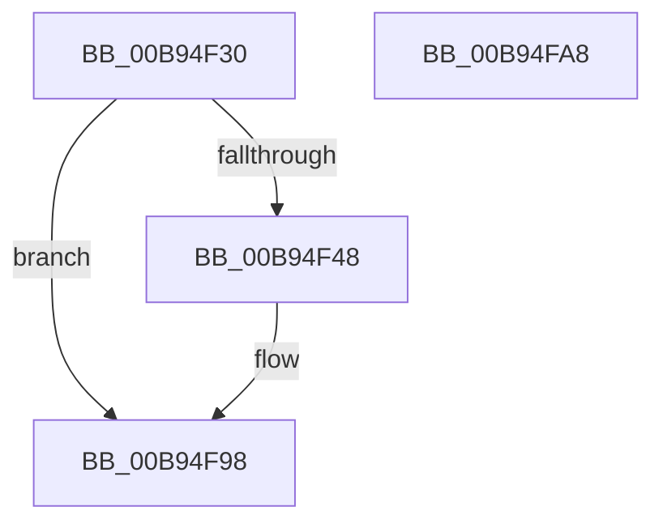

# VF_ASSERT_IRQL

- RVA: `0x00B94F30`–`0x00B94FA9` (길이 `121` bytes)
- VA: `0x0000000140B94F30`
- 실행 섹션: `PAGEVRFY`
- PDB 이름 있음: `예`; PDB Function 태그: `아니요`
- unwind 정보 RVA: `0x000733E4`
- 디코드: `31`개 명령, `121/121` bytes 표시
- 미해석 바이트: `0` (있으면 어셈블리에 `.byte`로 보존)

> 이 문서는 커널 이미지의 기계어와 PDB 기호를 분석해 생성했습니다. 4번과 5번은 함수 원형과 자료형을 바이너리 사용 방식에서 추정한 C 해석이며 원본 소스 복구 결과는 아닙니다.

## 1. Dependencies

- 직접 호출 지점: **2**; 고유 호출 대상: **2**
- 직접 호출자로 확인된 함수: **12**
- RIP 상대 이미지 참조: **2**

### Outgoing calls
- `0x00B94F73` → [ViHalPreprocessOptions](ViHalPreprocessOptions_function_00B9920C.md) (function, `0x00B9920C`)
- `0x00B94F93` → [VfReportIssueWithOptions](../../text/61/VfReportIssueWithOptions_function_00614444.md) (function, `0x00614444`)

### Direct callers
- [VfAllocateAdapterChannel](VfAllocateAdapterChannel_function_00B95180.md) at `0x00B951C1`
- [VfAllocateAdapterChannelEx](VfAllocateAdapterChannelEx_function_00B95360.md) at `0x00B953BB`
- [VfAllocateCommonBuffer](VfAllocateCommonBuffer_function_00B95570.md) at `0x00B955B0`
- [VfAllocateCrashDumpRegisters](VfAllocateCrashDumpRegisters_function_00B95860.md) at `0x00B958B0`
- [VfBuildScatterGatherList](VfBuildScatterGatherList_function_00B95AA0.md) at `0x00B95AF8`
- [VfBuildScatterGatherListEx](VfBuildScatterGatherListEx_function_00B95DA0.md) at `0x00B95DFA`
- [VfFreeAdapterChannel](VfFreeAdapterChannel_function_00B96480.md) at `0x00B9648F`
- [VfFreeMapRegisters](VfFreeMapRegisters_function_00B967D0.md) at `0x00B9681E`
- [VfGetDmaAdapter](VfGetDmaAdapter_function_00B96930.md) at `0x00B9698A`
- [VfGetDmaAlignment](VfGetDmaAlignment_function_00B96B10.md) at `0x00B96B27`
- [VfGetScatterGatherList](VfGetScatterGatherList_function_00B96BD0.md) at `0x00B96C28`
- [VfPutScatterGatherList](VfPutScatterGatherList_function_00B97970.md) at `0x00B979B6`

### Static image references
- `0x00B94F4B` → RVA `0x00E0E988` (`.data`; read)
- `0x00B94F55` → RVA `0x00BBA290` (` ?? ::JKADOLAD::`string'`; read)

## 2. Other-region calls and transfers

- 다른 실행 섹션으로 향하는 call: **1**
  - `0x00B94F93` → [VfReportIssueWithOptions](../../text/61/VfReportIssueWithOptions_function_00614444.md) (`PAGEVRFY` → `.text`)
- 별도 외부 분기/꼬리 이동을 확인하지 못했습니다.

## 3. Assembly (complete function range)

```asm
00B94F30  4C 8B DC                        mov r11, rsp
00B94F33  49 89 5B 08                     mov qword ptr [r11 + 8], rbx
00B94F37  49 89 73 10                     mov qword ptr [r11 + 0x10], rsi
00B94F3B  57                              push rdi
00B94F3C  48 83 EC 30                     sub rsp, 0x30
00B94F40  44 0F 20 C0                     mov rax, cr8
00B94F44  3A C1                           cmp al, cl
00B94F46  74 50                           je 0x140b94f98
00B94F48  0F B6 F9                        movzx edi, cl
00B94F4B  48 8D 35 36 9A 27 00            lea rsi, [rip + 0x279a36]
00B94F52  0F B6 D8                        movzx ebx, al
00B94F55  48 8D 15 34 53 02 00            lea rdx, [rip + 0x25334]
00B94F5C  49 89 5B F0                     mov qword ptr [r11 - 0x10], rbx
00B94F60  48 8B CE                        mov rcx, rsi
00B94F63  41 B9 01 00 00 00               mov r9d, 1
00B94F69  49 89 7B E8                     mov qword ptr [r11 - 0x18], rdi
00B94F6D  41 B8 13 00 00 10               mov r8d, 0x10000013
00B94F73  E8 94 42 00 00                  call 0x140b9920c
00B94F78  BA 13 00 00 00                  mov edx, 0x13
00B94F7D  48 89 74 24 28                  mov qword ptr [rsp + 0x28], rsi
00B94F82  44 8B CF                        mov r9d, edi
00B94F85  48 89 5C 24 20                  mov qword ptr [rsp + 0x20], rbx
00B94F8A  B9 E6 00 00 00                  mov ecx, 0xe6
00B94F8F  44 8D 42 EE                     lea r8d, [rdx - 0x12]
00B94F93  E8 AC F4 A7 FF                  call 0x140614444
00B94F98  48 8B 5C 24 40                  mov rbx, qword ptr [rsp + 0x40]
00B94F9D  48 8B 74 24 48                  mov rsi, qword ptr [rsp + 0x48]
00B94FA2  48 83 C4 30                     add rsp, 0x30
00B94FA6  5F                              pop rdi
00B94FA7  C3                              ret
00B94FA8  CC                              int3
```

## 4. C-style interpretation (structured pseudocode)

```c
__int64 __fastcall VF_ASSERT_IRQL(unsigned __int8 a1)
{
    __int64 result;
    __int64 v_rbx;
    __int64 v_rdi;
    __int64 v_rsi;
    __int64 v_rsp;
    unsigned __int64 v_stack_m10;
    unsigned __int64 v_stack_m18;
    unsigned __int64 v_stack_p10;
    unsigned __int64 v_stack_p8;

    *(unsigned __int64 *)(v_rsp + 8) = v_rbx;
    *(unsigned __int64 *)(v_rsp + 16) = v_rsi;
    v_rsp = (v_rsp) - (48);
    result = v_cr8;
    if (((unsigned __int8)(v_cr8)) != a1) {
        v_rdi = a1;
        v_rsi = v_rip + 2595382;
        v_rbx = (unsigned __int8)(v_cr8);
        a2 = v_rip + 152372;
        *(unsigned __int64 *)(v_rsp - 16) = v_rbx;
        a1 = v_rsi;
        a4 = 1;
        *(unsigned __int64 *)(v_rsp - 24) = v_rdi;
        a3 = 0x10000013ULL;
        result = ViHalPreprocessOptions(a1, a2, a3, a4);
        a2 = 19;
        v_stack_m10 = v_rsi;
        a4 = (unsigned int)(v_rdi);
        v_stack_m18 = v_rbx;
        a1 = 230;
        a3 = a2 - 18;
        result = VfReportIssueWithOptions(a1, a2, a3, a4);
    }
    v_rsp = (v_rsp) + (48);
    return result;
}
```

## 5. (Beta) C Style

```c
int64_t VF_ASSERT_IRQL(uint8_t Arg1)
{
    int64_t result;
    int64_t local_rbx;
    int64_t local_rdi;
    int64_t local_rsi;
    int64_t local_rsp;
    uint64_t v_stack_m10;
    uint64_t v_stack_m18;
    uint64_t v_stack_p10;
    uint64_t v_stack_p8;

    *(uint64_t *)(local_rsp + 0x8) = local_rbx;
    *(uint64_t *)(local_rsp + 0x10) = local_rsi;
    local_rsp = (local_rsp) - (48);
    result = v_cr8;
    if (((uint8_t)(v_cr8)) != Arg1) {
        local_rdi = Arg1;
        local_rsi = v_rip + 2595382;
        local_rbx = (uint8_t)(v_cr8);
        a2 = v_rip + 152372;
        *(uint64_t *)(local_rsp - 0x10) = local_rbx;
        Arg1 = local_rsi;
        a4 = 1;
        *(uint64_t *)(local_rsp - 0x18) = local_rdi;
        a3 = 0x10000013ULL;
        result = ViHalPreprocessOptions(Arg1, a2, a3, a4);
        a2 = 19;
        v_stack_m10 = local_rsi;
        a4 = (uint32_t)(local_rdi);
        v_stack_m18 = local_rbx;
        Arg1 = 230;
        a3 = a2 - 18;
        result = VfReportIssueWithOptions(Arg1, a2, a3, a4);
    }
    local_rsp = (local_rsp) + (48);
    return result;
}
```

## 6. Execution-region graph

[열기: 2D/3D 그래프와 함수 탐색 컨트롤 패널](../../../control-panel.html?section=pagevrfy&rva=0x00B94F30&view=graph)

- 2D 그래프는 위에서 아래로 흐르고, 3D 그래프는 빈 공간을 드래그해 회전합니다. Shift+드래그는 이동, 휠은 확대·축소, 함수 노드 선택은 대상 보고서 이동입니다.

### Static fallback


