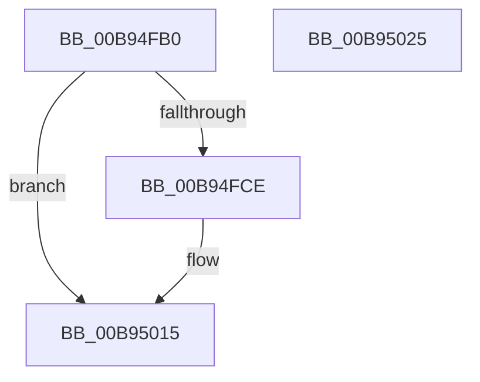

# VF_ASSERT_MAX_IRQL

- RVA: `0x00B94FB0`–`0x00B95026` (길이 `118` bytes)
- VA: `0x0000000140B94FB0`
- 실행 섹션: `PAGEVRFY`
- PDB 이름 있음: `예`; PDB Function 태그: `아니요`
- unwind 정보 RVA: `0x000733E4`
- 디코드: `31`개 명령, `118/118` bytes 표시
- 미해석 바이트: `0` (있으면 어셈블리에 `.byte`로 보존)

> 이 문서는 커널 이미지의 기계어와 PDB 기호를 분석해 생성했습니다. 4번과 5번은 함수 원형과 자료형을 바이너리 사용 방식에서 추정한 C 해석이며 원본 소스 복구 결과는 아닙니다.

## 1. Dependencies

- 직접 호출 지점: **2**; 고유 호출 대상: **2**
- 직접 호출자로 확인된 함수: **9**
- RIP 상대 이미지 참조: **2**

### Outgoing calls
- `0x00B94FF3` → [ViHalPreprocessOptions](ViHalPreprocessOptions_function_00B9920C.md) (function, `0x00B9920C`)
- `0x00B95010` → [VfReportIssueWithOptions](../../text/61/VfReportIssueWithOptions_function_00614444.md) (function, `0x00614444`)

### Direct callers
- [VfFlushAdapterBuffers](VfFlushAdapterBuffers_function_00B96220.md) at `0x00B96264`
- [VfFlushAdapterBuffersEx](VfFlushAdapterBuffersEx_function_00B963D0.md) at `0x00B96410`
- [VfFreeCommonBuffer](VfFreeCommonBuffer_function_00B96650.md) at `0x00B9669C`
- [VfGetScatterGatherListEx](VfGetScatterGatherListEx_function_00B96F20.md) at `0x00B96F71`
- [VfMapTransfer](VfMapTransfer_function_00B97300.md) at `0x00B9735C`
- [VfMapTransferEx](VfMapTransferEx_function_00B974B0.md) at `0x00B974FA`
- [VfPutDmaAdapter](VfPutDmaAdapter_function_00B97680.md) at `0x00B9769B`
- [VfReadDmaCounter](VfReadDmaCounter_function_00B97AF0.md) at `0x00B97B05`
- [ViGetAdapterInformationInternal](ViGetAdapterInformationInternal_function_00B98E88.md) at `0x00B98ECB`

### Static image references
- `0x00B94FD1` → RVA `0x00E0E990` (`.data`; read)
- `0x00B94FDC` → RVA `0x00BBA260` (` ?? ::JKADOLAD::`string'`; read)

## 2. Other-region calls and transfers

- 다른 실행 섹션으로 향하는 call: **1**
  - `0x00B95010` → [VfReportIssueWithOptions](../../text/61/VfReportIssueWithOptions_function_00614444.md) (`PAGEVRFY` → `.text`)
- 별도 외부 분기/꼬리 이동을 확인하지 못했습니다.

## 3. Assembly (complete function range)

```asm
00B94FB0  4C 8B DC                        mov r11, rsp
00B94FB3  49 89 5B 08                     mov qword ptr [r11 + 8], rbx
00B94FB7  49 89 73 10                     mov qword ptr [r11 + 0x10], rsi
00B94FBB  57                              push rdi
00B94FBC  48 83 EC 30                     sub rsp, 0x30
00B94FC0  44 0F 20 C0                     mov rax, cr8
00B94FC4  BE 02 00 00 00                  mov esi, 2
00B94FC9  40 3A C6                        cmp al, sil
00B94FCC  76 47                           jbe 0x140b95015
00B94FCE  0F B6 D8                        movzx ebx, al
00B94FD1  48 8D 3D B8 99 27 00            lea rdi, [rip + 0x2799b8]
00B94FD8  49 89 5B F0                     mov qword ptr [r11 - 0x10], rbx
00B94FDC  48 8D 15 7D 52 02 00            lea rdx, [rip + 0x2527d]
00B94FE3  48 8B CF                        mov rcx, rdi
00B94FE6  49 89 73 E8                     mov qword ptr [r11 - 0x18], rsi
00B94FEA  44 8B CE                        mov r9d, esi
00B94FED  41 B8 13 00 00 10               mov r8d, 0x10000013
00B94FF3  E8 14 42 00 00                  call 0x140b9920c
00B94FF8  44 8B CE                        mov r9d, esi
00B94FFB  48 89 7C 24 28                  mov qword ptr [rsp + 0x28], rdi
00B95000  44 8B C6                        mov r8d, esi
00B95003  48 89 5C 24 20                  mov qword ptr [rsp + 0x20], rbx
00B95008  8D 56 11                        lea edx, [rsi + 0x11]
00B9500B  B9 E6 00 00 00                  mov ecx, 0xe6
00B95010  E8 2F F4 A7 FF                  call 0x140614444
00B95015  48 8B 5C 24 40                  mov rbx, qword ptr [rsp + 0x40]
00B9501A  48 8B 74 24 48                  mov rsi, qword ptr [rsp + 0x48]
00B9501F  48 83 C4 30                     add rsp, 0x30
00B95023  5F                              pop rdi
00B95024  C3                              ret
00B95025  CC                              int3
```

## 4. C-style interpretation (structured pseudocode)

```c
__int64 __fastcall VF_ASSERT_MAX_IRQL(void)
{
    __int64 result;
    __int64 v_rbx;
    __int64 v_rdi;
    __int64 v_rsp;
    unsigned __int64 v_stack_m10;
    unsigned __int64 v_stack_m18;
    unsigned __int64 v_stack_p10;
    unsigned __int64 v_stack_p8;

    *(unsigned __int64 *)(v_rsp + 8) = v_rbx;
    *(unsigned __int64 *)(v_rsp + 16) = v_rsi;
    v_rsp = (v_rsp) - (48);
    result = v_cr8;
    if (((unsigned __int8)(v_cr8)) >= = 2) {
        v_rbx = (unsigned __int8)(v_cr8);
        v_rdi = v_rip + 2595256;
        *(unsigned __int64 *)(v_rsp - 16) = v_rbx;
        a2 = v_rip + 152189;
        a1 = v_rdi;
        *(unsigned __int64 *)(v_rsp - 24) = 2;
        a4 = 2;
        a3 = 0x10000013ULL;
        result = ViHalPreprocessOptions(a1, a2, a3, a4);
        a4 = 2;
        v_stack_m10 = v_rdi;
        a3 = 2;
        v_stack_m18 = v_rbx;
        a2 = 2 + 17;
        a1 = 230;
        result = VfReportIssueWithOptions(a1, a2, a3, a4);
    }
    v_rsp = (v_rsp) + (48);
    return result;
}
```

## 5. (Beta) C Style

```c
void VF_ASSERT_MAX_IRQL(void)
{
    int64_t result;
    int64_t local_rbx;
    int64_t local_rdi;
    int64_t local_rsp;
    uint64_t v_stack_m10;
    uint64_t v_stack_m18;
    uint64_t v_stack_p10;
    uint64_t v_stack_p8;

    *(uint64_t *)(local_rsp + 0x8) = local_rbx;
    *(uint64_t *)(local_rsp + 0x10) = local_rsi;
    local_rsp = (local_rsp) - (48);
    result = v_cr8;
    if (((uint8_t)(v_cr8)) >= = 2) {
        local_rbx = (uint8_t)(v_cr8);
        local_rdi = v_rip + 2595256;
        *(uint64_t *)(local_rsp - 0x10) = local_rbx;
        a2 = v_rip + 152189;
        a1 = local_rdi;
        *(uint64_t *)(local_rsp - 0x18) = 2;
        a4 = 2;
        a3 = 0x10000013ULL;
        result = ViHalPreprocessOptions(a1, a2, a3, a4);
        a4 = 2;
        v_stack_m10 = local_rdi;
        a3 = 2;
        v_stack_m18 = local_rbx;
        a2 = 2 + 17;
        a1 = 230;
        result = VfReportIssueWithOptions(a1, a2, a3, a4);
    }
    local_rsp = (local_rsp) + (48);
    return result;
}
```

## 6. Execution-region graph

[열기: 2D/3D 그래프와 함수 탐색 컨트롤 패널](../../../control-panel.html?section=pagevrfy&rva=0x00B94FB0&view=graph)

- 2D 그래프는 위에서 아래로 흐르고, 3D 그래프는 빈 공간을 드래그해 회전합니다. Shift+드래그는 이동, 휠은 확대·축소, 함수 노드 선택은 대상 보고서 이동입니다.

### Static fallback


