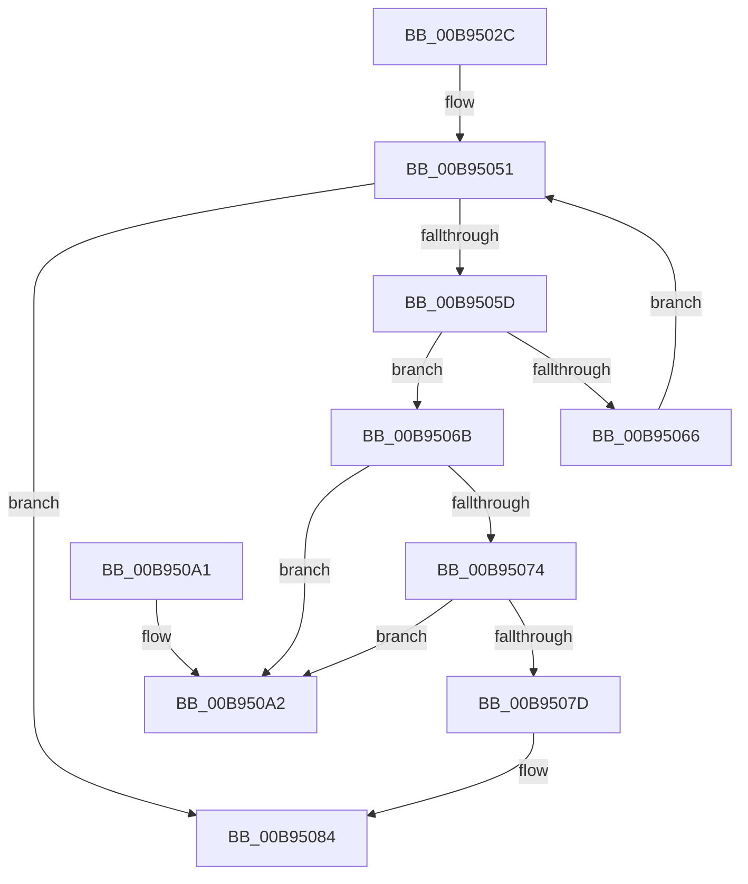

# VF_FIND_DEVICE_INFORMATION_AND_REMOVE

- RVA: `0x00B9502C`–`0x00B950A9` (길이 `125` bytes)
- VA: `0x0000000140B9502C`
- 실행 섹션: `PAGEVRFY`
- PDB 이름 있음: `예`; PDB Function 태그: `아니요`
- unwind 정보 RVA: `0x0006CF28`
- 디코드: `36`개 명령, `125/125` bytes 표시
- 미해석 바이트: `0` (있으면 어셈블리에 `.byte`로 보존)

> 이 문서는 커널 이미지의 기계어와 PDB 기호를 분석해 생성했습니다. 4번과 5번은 함수 원형과 자료형을 바이너리 사용 방식에서 추정한 C 해석이며 원본 소스 복구 결과는 아닙니다.

## 1. Dependencies

- 직접 호출 지점: **2**; 고유 호출 대상: **2**
- 직접 호출자로 확인된 함수: **1**
- RIP 상대 이미지 참조: **2**

### Outgoing calls
- `0x00B95042` → [KeAcquireSpinLockRaiseToDpc](../../text/20/KeAcquireSpinLockRaiseToDpc_function_00208470.md) (function, `0x00208470`)
- `0x00B9508E` → [KeReleaseSpinLock](../../text/39/KeReleaseSpinLock_function_00392BA0.md) (function, `0x00392BA0`)

### Direct callers
- [VfHalDeleteDevice](VfHalDeleteDevice_function_00B97190.md) at `0x00B9721B`

### Static image references
- `0x00B9503B` → RVA `0x00F03FD0` (`.data`; read)
- `0x00B9504A` → RVA `0x00F03FC0` (`.data`; read)

## 2. Other-region calls and transfers

- 다른 실행 섹션으로 향하는 call: **2**
  - `0x00B95042` → [KeAcquireSpinLockRaiseToDpc](../../text/20/KeAcquireSpinLockRaiseToDpc_function_00208470.md) (`PAGEVRFY` → `.text`)
  - `0x00B9508E` → [KeReleaseSpinLock](../../text/39/KeReleaseSpinLock_function_00392BA0.md) (`PAGEVRFY` → `.text`)
- 별도 외부 분기/꼬리 이동을 확인하지 못했습니다.

## 3. Assembly (complete function range)

```asm
00B9502C  48 89 5C 24 08                  mov qword ptr [rsp + 8], rbx
00B95031  57                              push rdi
00B95032  48 83 EC 20                     sub rsp, 0x20
00B95036  48 8B F9                        mov rdi, rcx
00B95039  33 DB                           xor ebx, ebx
00B9503B  48 8D 0D 8E EF 36 00            lea rcx, [rip + 0x36ef8e]
00B95042  E8 29 34 67 FF                  call 0x140208470
00B95047  44 8A C0                        mov r8b, al
00B9504A  48 8B 05 6F EF 36 00            mov rax, qword ptr [rip + 0x36ef6f]
00B95051  48 8D 0D 68 EF 36 00            lea rcx, [rip + 0x36ef68]
00B95058  48 3B C8                        cmp rcx, rax
00B9505B  74 27                           je 0x140b95084
00B9505D  48 8B 08                        mov rcx, qword ptr [rax]
00B95060  48 39 78 40                     cmp qword ptr [rax + 0x40], rdi
00B95064  74 05                           je 0x140b9506b
00B95066  48 8B C1                        mov rax, rcx
00B95069  EB E6                           jmp 0x140b95051
00B9506B  48 8B D8                        mov rbx, rax
00B9506E  48 39 41 08                     cmp qword ptr [rcx + 8], rax
00B95072  75 2E                           jne 0x140b950a2
00B95074  48 8B 50 08                     mov rdx, qword ptr [rax + 8]
00B95078  48 39 02                        cmp qword ptr [rdx], rax
00B9507B  75 25                           jne 0x140b950a2
00B9507D  48 89 0A                        mov qword ptr [rdx], rcx
00B95080  48 89 51 08                     mov qword ptr [rcx + 8], rdx
00B95084  41 8A D0                        mov dl, r8b
00B95087  48 8D 0D 42 EF 36 00            lea rcx, [rip + 0x36ef42]
00B9508E  E8 0D DB 7F FF                  call 0x140392ba0
00B95093  48 8B C3                        mov rax, rbx
00B95096  48 8B 5C 24 30                  mov rbx, qword ptr [rsp + 0x30]
00B9509B  48 83 C4 20                     add rsp, 0x20
00B9509F  5F                              pop rdi
00B950A0  C3                              ret
00B950A1  CC                              int3
00B950A2  B9 03 00 00 00                  mov ecx, 3
00B950A7  CD 29                           int 0x29
```

## 4. C-style interpretation (structured pseudocode)

```c
__int64 __fastcall VF_FIND_DEVICE_INFORMATION_AND_REMOVE(__int64 a1)
{
    __int64 result;
    __int64 v_rbx;
    __int64 v_rsp;
    unsigned __int64 v_stack_p8;

    v_stack_p8 = v_rbx;
    v_rsp = (v_rsp) - (32);
    v_rbx = 0;
    result = KeAcquireSpinLockRaiseToDpc(v_rip + 3600270, a2, a3, a4);
loc_00B95051:
    if ((v_rip + 3600232) == (*(unsigned __int64 *)(v_rip + 3600239))) goto loc_00B95084;
    if ((*(unsigned __int64 *)(*(unsigned __int64 *)(v_rip + 3600239) + 64)) == a1) goto loc_00B9506B;
    goto loc_00B95051;
loc_00B9506B:
    if ((*(unsigned __int64 *)(*(unsigned __int64 *)(*(unsigned __int64 *)(v_rip + 3600239)) + 8)) != (*(unsigned __int64 *)(*(unsigned __int64 *)(v_rip + 3600239)))) goto loc_00B950A2;
    if ((*(unsigned __int64 *)(*(unsigned __int64 *)(*(unsigned __int64 *)(*(unsigned __int64 *)(v_rip + 3600239)) + 8))) != (*(unsigned __int64 *)(*(unsigned __int64 *)(v_rip + 3600239)))) goto loc_00B950A2;
    *(unsigned __int64 *)(*(unsigned __int64 *)(*(unsigned __int64 *)(*(unsigned __int64 *)(v_rip + 3600239)) + 8)) = *(unsigned __int64 *)(*(unsigned __int64 *)(v_rip + 3600239));
    *(unsigned __int64 *)(*(unsigned __int64 *)(*(unsigned __int64 *)(v_rip + 3600239)) + 8) = *(unsigned __int64 *)(*(unsigned __int64 *)(*(unsigned __int64 *)(v_rip + 3600239)) + 8);
loc_00B95084:
    result = KeReleaseSpinLock(v_rip + 3600194, (unsigned __int8)((unsigned __int8)(result)), (unsigned __int8)(result), a4);
    v_rsp = (v_rsp) + (32);
    return *(unsigned __int64 *)(*(unsigned __int64 *)(v_rip + 3600239));
loc_00B950A2:
    return *(unsigned __int64 *)(*(unsigned __int64 *)(v_rip + 3600239));
}
```

## 5. (Beta) C Style

```c
int64_t VF_FIND_DEVICE_INFORMATION_AND_REMOVE(int64_t Arg1)
{
    int64_t result;
    int64_t local_rbx;
    int64_t local_rsp;
    uint64_t v_stack_p8;

    v_stack_p8 = local_rbx;
    local_rsp = (local_rsp) - (32);
    local_rbx = 0;
    result = KeAcquireSpinLockRaiseToDpc(v_rip + 3600270, a2, a3, a4);
loc_00B95051:
    if ((v_rip + 3600232) == (*(uint64_t *)(v_rip + 0x36EF6F))) goto loc_00B95084;
    if ((*(uint64_t *)(*(uint64_t *)(v_rip + 0x36EF6F) + 0x40)) == Arg1) goto loc_00B9506B;
    goto loc_00B95051;
loc_00B9506B:
    if ((*(uint64_t *)(*(uint64_t *)(*(uint64_t *)(v_rip + 0x36EF6F)) + 0x8)) != (*(uint64_t *)(*(uint64_t *)(v_rip + 0x36EF6F)))) goto loc_00B950A2;
    if ((*(uint64_t *)(*(uint64_t *)(*(uint64_t *)(*(uint64_t *)(v_rip + 0x36EF6F)) + 0x8))) != (*(uint64_t *)(*(uint64_t *)(v_rip + 0x36EF6F)))) goto loc_00B950A2;
    *(uint64_t *)(*(uint64_t *)(*(uint64_t *)(*(uint64_t *)(v_rip + 0x36EF6F)) + 0x8)) = *(uint64_t *)(*(uint64_t *)(v_rip + 0x36EF6F));
    *(uint64_t *)(*(uint64_t *)(*(uint64_t *)(v_rip + 0x36EF6F)) + 0x8) = *(uint64_t *)(*(uint64_t *)(*(uint64_t *)(v_rip + 0x36EF6F)) + 0x8);
loc_00B95084:
    result = KeReleaseSpinLock(v_rip + 3600194, (uint8_t)((uint8_t)(result)), (uint8_t)(result), a4);
    local_rsp = (local_rsp) + (32);
    return *(uint64_t *)(*(uint64_t *)(v_rip + 0x36EF6F));
loc_00B950A2:
    return *(uint64_t *)(*(uint64_t *)(v_rip + 0x36EF6F));
}
```

## 6. Execution-region graph

[열기: 2D/3D 그래프와 함수 탐색 컨트롤 패널](../../../control-panel.html?section=pagevrfy&rva=0x00B9502C&view=graph)

- 2D 그래프는 위에서 아래로 흐르고, 3D 그래프는 빈 공간을 드래그해 회전합니다. Shift+드래그는 이동, 휠은 확대·축소, 함수 노드 선택은 대상 보고서 이동입니다.

### Static fallback


